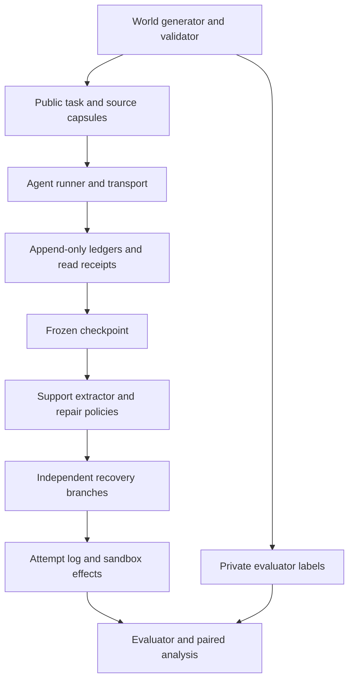
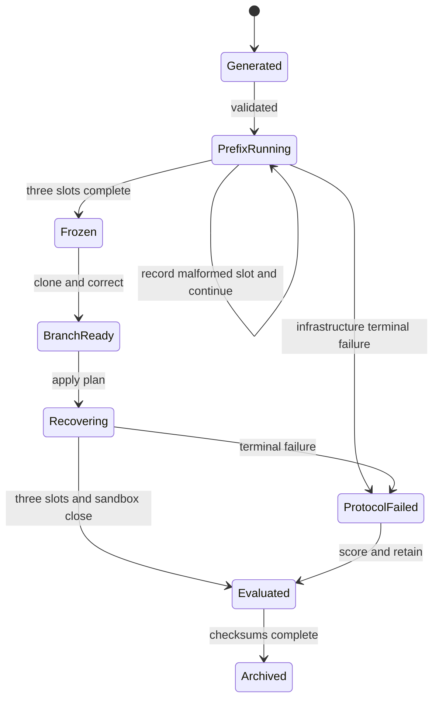

# Architecture and framework decision

## Decision

Build a **SILO-derived recovery extension with a new event-sourced runner**. Reuse and modify the public task generators and preserve native-task calibration. Do not retrofit the entire original execution engine, and do not call the resulting scores native SILO scores. Use a small MasDrift-derived workflow transfer. Use MemTX's public interfaces as a conformance reference, not an unexamined dependency.

The substantive new experimental machinery is necessary: SILO has distributed tasks and programmatic answers, but does not natively provide versioned correction events, claim/action support semantics, or paired recovery branches.

## Audited foundation

| Foundation | Verified files / behavior | Decision |
|---|---|---|
| [SILO-Bench](https://github.com/jwyjohn/acl26-silo-bench/tree/e74127782ed1c42fff474249961f022c063d76f2) | `benchmark_generator/paradigm_i.py`, generator README, `src/models.py`, `src/engine.py`, `src/utils/llm.py`, metrics, pyproject and LICENSE. Generators include Any Match and Global Max. The runner keeps round directories and per-agent context; submitted agents stop participating. Scoring compares submitted values. | Reuse task generation and distributed-shard conventions; replace lifecycle, inference adapter, grader and persistence. |
| [MemTX code](https://github.com/lxy1134/MEMTX_/tree/4e1124ccd5fd384857463020e3497aa73ec93be6) | Public schemas, typed states, descendant traversal and downstream retraction case inspected. Native benchmarks exercise commit/retraction and include oracle-like declared case labels. | Useful regression/conformance reference. Does not remove the need for the proposed support/binding generator. No top-level license file was visible in the inspected tree: do not vendor its source without resolving reuse terms. |
| [MasDrift](https://github.com/ZhuoningXu/MasDrift/tree/7119c09c0266162f89db29d3faa32d496837b5c3) | CapEx environment has budgets, approval thresholds, incomplete cases, draft and execution tools. | Reuse the environment's task structure and attributed tool vocabulary for a controlled transfer; construct an exact grader for the adapted subset. |
| MemoRepair / dependency-guided rollback / REVISE | Useful protocols; an official runnable artifact was not verified for these papers during this audit. | They are prior methods, not guaranteed available benchmark dependencies. |

Pinned SILO **commit**: `e74127782ed1c42fff474249961f022c063d76f2`; tree: `e67cba64b3cccc39116563376d194101178cd65f`. The upstream pyproject asks for Python≥ 3.13 and labels the license MIT; the inspected LICENSE contains the Unlicense text. Preserve the actual license file and record this metadata inconsistency. The adapter does not install the full package, so the research runtime can use Python 3.11 after generator compatibility tests. The original global `random.seed(42)` must be replaced in the vendored adapter with an explicit local RNG argument.

## Precise SILO changes

1. Copy the two generator functions and supporting case constructor into an attributed `adapters/silo/` module, retaining the original file/checksum in `third_party_manifest.json`. Keep a separate unmodified source snapshot for comparison.
2. Add `rng: random.Random` and an explicit `items_per_shard` parameter. Replace module-global random calls. Native calibration sets 15 items for I-04 and 20 for I-01 at a matched RNG state; recovery worlds set 4. Keep the unmodified native generator for comparison rather than silently changing its defaults.
3. Make Any Match's positive witness placement and Global Max's threshold-crossing witness placement explicit generator parameters. Preserve the original substring and maximum computations.
4. Add version IDs and ownership to shards. Add a public permit atom, a second witness, online predicates for the threshold family, and a separate control job.
5. Add a controlled correction of X's shard, preserving its identity but changing its version. Pair Y's eligibility across unique/alternative variants. Do not tell agents the factor labels.
6. Replace submit-and-stop with three prefix decisions, a pending-action cut, correction, and three recovery decisions.
7. Replace flat result scoring with exact claim, support and action grading. Keep a native-score adapter only for calibration; never mix its denominator with the new outcomes.
8. Replace the upstream open-ended retry behavior and unbounded generation with fixed call/token caps and explicit failure events. Open-weight inference is local.

These changes substantially alter the scientific object from one-shot distributed aggregation to recovery of stateful distributed decisions. That is deliberate and must be stated in the thesis.

## Runtime components and trust boundary



Only diagnostic oracle policies receive a separate mask from the evaluator. Feasible policy objects cannot receive `OracleWorld`, formula labels, expected outputs, or post-correction gold action arguments.

| Component | Inputs | Outputs | Responsibility |
|---|---|---|---|
| `WorldFactory` | generator config, base seed | PublicWorld, OracleWorld, correction | Matched structural worlds and private gold. |
| `EvidenceStore` | evidence/correction events | current version map, source capsules | Version integrity and source ownership. |
| `EventStore` | validated atomic event batch | append-only JSONL, materialized state | Atomic reducer and audit trail. |
| `Transport` | messages and automatic capsules | delivered inbox, read receipts | Reliable deterministic handoff, no invented evidence. |
| `PromptBuilder` | AgentView, public rules, phase | exact text, visible IDs, hash | Stable ordering, bounds, no label leakage. |
| `InferenceBackend` | InferenceRequest | raw result, tokens, timing | Model execution only; no domain semantics. |
| `AgentController` | raw result, view, ownership | typed deltas or failure event | Parse/validate/apply allowed writes. |
| `SupportExtractor` | frozen prefix public projection | estimated DNF and errors | Predict sufficient evidence sets before correction. |
| `PolicyPlanner` | checkpoint view, correction, support view | RepairPlan | Select withdrawals/notices/resets; never regenerate answers. |
| `RecoveryExecutor` | branch, plan, three slots | updated ledgers, proposed execution | Apply dispositions and call agents. |
| `Sandbox` | execution request | attempt, block or effect | Ownership/state/idempotency; no secret answer gate. |
| `ExactEvaluator` | private world, branch events | labels and metrics | Pure offline grading, never feeds feasible policy. |
| `ExperimentRunner` | registered manifest | complete blocks, cost ledger | Scheduling, budgets, recovery from process failures. |
| `AnalysisPipeline` | frozen outcome tables | contrasts, CIs, figures | Predeclared paired statistical analysis. |

## Agents and authority

**A:** owns X's evidence stream and local eligibility claim. May publish one local claim and send its report to B. Cannot modify B's conclusions or C's actions.

**B:** owns Y/control evidence, reads A's handoff, publishes Y eligibility, global feasibility, and the control-job conclusion. It cannot execute. C applies the public witness priority to choose its own action arguments.

**C:** reads B's handoff with the complete source capsules, owns two pending actions, and is the only executor. It may retain, cancel, or replace each action and publish its current feasibility assessment.

Roles are fixed across arms and the three agents share a model checkpoint. Different ownership and persistent decisions, rather than different persona adjectives, create the dependency. A naming seed permutes resource display names while logical X/Y identities and A/B/C ownership remain fixed. Store the display-name map with the public task; retain the logical correction target in the private manifest.

The model has no persistent hidden session. Its effective state is the rendered agent view. No vector database or embedding retrieval is necessary: the entire bounded active state fits in context. Audit transcripts are stored but never automatically replayed into the prompt.

## Ledger semantics

Claims are immutable records. A `DispositionEvent` makes a record active, withdrawn, or superseded in the current projection. Historical validity is preserved separately. A support assessment is another versioned record; an estimated assessment never overwrites the evaluator label.

Actions: `PROPOSED → READY → EXECUTED`; policy may move pending actions to `SUSPENDED`; C can `CANCEL` or replace them with a new proposed version. `SUSPENDED → READY` requires an explicit C revalidation event, not mere passage of time. The runtime checks references and epoch acknowledgment but does not check semantic truth. A revalidated wrong action can therefore still fail. Replacement automatically cancels the previous pending version atomically. One applied action per job/idempotency key.

At the prefix cut, actions are PROPOSED, not applied. At recovery close, explicit C execution requests are processed. `wait` is a recorded completed decision, not the absence of output. Missing output is failure, not safe abstention.

## State machines



A malformed prefix call does not cancel capsule delivery or erase the world. Continue the remaining scheduled slots with an explicit failure marker, then freeze what exists. Empty ledgers are valid failed-prefix checkpoints. Infrastructure failures may retry only under the narrow rules in 10.

## Package layout

```text
recovery_study/
  contracts.py             # strict Pydantic wire and persisted schemas
  config.py                # validation, locks, factor/matrix expansion
  adapters/silo.py         # attributed generator transformation
  adapters/masdrift.py     # attributed workflow transfer compiler
  worlds/{generate,dsl,validate}.py
  oracle/{truth,support,grade}.py
  runtime/{events,reducer,evidence,claims,actions,transport}.py
  agents/{views,prompts,controller}.py
  provenance/{read_graph,declared,extractor,score}.py
  policies/{notify,read_closure,estimated,diagnostics}.py
  inference/{base,transformers_worker,cache,meter}.py
  experiments/{manifest,prefix,branch,scheduler,resume}.py
  analysis/{tables,contrasts,bootstrap,plots}.py
  cli.py
tests/{symbolic,protocol,isolation,integration}/
configs/ prompts/ schemas/ third_party_manifest.json
```

`reference/` in this delivered package is a validation seed for the formal core and schemas. The full module tree above is the implementation target, not a claim that every module has already been built.
