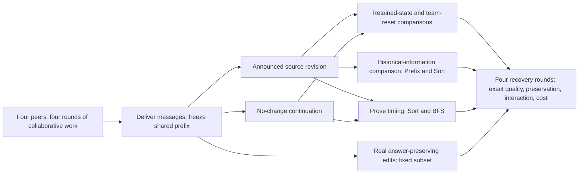

# Recovering Distributed LLM Teams After Information Changes

**State reuse, historical evidence, and communication effects**

Final authoritative specification · 5 October 2026

This document governs implementation, execution, evaluation, and reporting. It supersedes conflicting instructions in [FINAL_PROJECT_SPECIFICATION_PLAN.md](research/06_final_design/FINAL_PROJECT_SPECIFICATION_PLAN.md), the numbered blueprint, research/addition directories, old configurations, and dependency lists. Those artifacts preserve the design history and supporting evidence; they are not additional requirements.

**Status:** M1–M2 are implemented and verified on CPU: exact worlds/schedules,
permitted views, scripted state/retention/delivery/replay, attainability and native
token capacity. Durable runner integration, the hardware/capability pilot, main
inference and empirical results remain unexecuted. Scripted/reference outcomes
are protocol evidence, not model-capability or experimental recovery results.

## 1. Research purpose and design

> A distributed team of LLM agents has already performed substantial collaborative work. Previously valid information then changes. How should the team recover while preserving useful previous work without allowing obsolete work to harm the revised result?

Study recovery as a joint decision about **retained evidence, retained computation, and subsequent interaction**. A team may benefit from old calculations, need historical input values to update them, or need alternatives that its previous answer discarded. Resetting one peer can also change what its collaborators receive. The study must explain these tradeoffs, rather than only rank policies by final accuracy.

Use four identical peers with private inputs, one natural four-round collaborative prefix per generated world, one announced source revision, and matched four-round continuations. Target **60 worlds, 12 per task family**; the resource fallback is **40 worlds, eight per family**. All worlds receive the main retention, delivery, restart, and complementary half-team-reset comparisons. Focused historical-information and communication interventions share these prefixes and controls.

| Scientific question | Identifying comparison | Evidential role |
|---|---|---|
| Does clearing derived history help specifically after facts change? | Broadcast retain/reset under revision and sham | Primary θ |
| Does resetting teammates affect a peer whose own initial state is retained? | Complementary reset groups versus all-retain after revision | Primary φ; sham assesses correction specificity secondarily |
| Can a compact old result preserve useful work, and what historical information makes it reusable? | Evidence only, own last candidate, full history; crossed with before-value disclosure on Prefix Sum/Sort | Prespecified secondary estimates |
| When does immediate derived communication help or hinder recovery? | Delay first-round received prose while preserving source delivery, under retain/reset and revision/sham | Prespecified secondary estimates |
| What was repaired, preserved, lost, or propagated, and at what cost? | Exact trajectories, information inventories, synchronization, deterministic references, and repeated continuations | Descriptive explanation and practical guidance |

The two primary estimands answer different questions. θ is deliberately correction-specific. φ is the **direct effect on retained collaborators in the revised world**: subtracting an equally large sham effect would conceal operationally important team interference. Report that subtraction separately. Neither primary result must be positive for the study to be informative.

All interventions are sibling continuations of the original prefix. They are not applied sequentially or crossed into one large factorial. One additional continuation replicate on ten predetermined prefixes checks the stability of the main account.

## 2. Worlds, task structure, and events

### 2.1 Task definitions

Let numeric shard size `m=8`, total length `n=4m=32`, and peer IDs be 0–3. Indices and ranks are zero-based except difference coordinates, explicitly indexed below. Every peer initially sees only its own raw records and public task metadata.

| SILO-derived family | Inputs and required candidate | Answer-changing edit | Scientific purpose |
|---|---|---|---|
| **Top-K, I-09** | Independent uniform integers 0–99; random equal ownership partitions. Every peer returns the descending top ten, including duplicates. | Lower a uniquely occurring value strictly above the old tenth-value cutoff to below that cutoff. | Partial result reuse; a newly needed reserve may be absent from the old list. |
| **Prefix Sum, II-11** | Independent uniform integers 1–9; contiguous shards. Peer i returns global cumulative sums at positions `im … (i+1)m−1`. | Replace one entry with a different in-range value. | A suffix changes; a retained segment can be updated from a historical operand, but peers have different local views. |
| **Difference Array, II-17** | Independent uniform integers 0–30; contiguous shards. Every peer returns the full ordered vector `d_j=x_j−x_(j−1)`, `j=1…n−1`. | Replace one entry with a different in-range value. | At most two coordinates change, yet every peer has a full-output responsibility. |
| **Distributed Sort, III-21** | Independent uniform integers 0–99; random equal ownership partitions. Peer i returns ascending global ranks `im … (i+1)m−1`. | Replace one entry with a different in-range value. | Output ownership differs from source ownership; updated segments can require remote boundary values. |
| **BFS Distance, III-24** | Public nodes 0–11, source 0, 16 unique undirected edges, four per peer. Every peer returns all node distances; unreachable = −1. | Delete an edge that changes at least one distance. | Nonlinear effects and alternatives omitted from old distance labels. |

For BFS, sample a uniform labeled Prüfer tree, add five uniformly sampled nonedges without replacement, then randomly partition edges equally. The initial graph is connected; the edit may disconnect it. This is a declared modified distribution, not the native SILO graph distribution.

The five families supply complementary information and output-placement problems. Global Max remains a CPU illustration of discarded alternatives; Top-K covers that phenomenon more richly in the live study. SILO level is a descriptive label, not a randomized complexity variable. Results are **SILO-derived revision-task results**, not native benchmark scores or coverage of all algorithmic tasks.

### 2.2 Sampling and reproducibility

Generate the complete world/seed manifest before main inference, with disjoint development seeds. Use separate saved random streams for world generation, edit selection, partition assignment, prefix generation, and continuation sampling. Save actual inputs and chosen edits, not only seeds.

Within each family, randomize edited-owner order in blocks of four containing each peer once. Twelve worlds therefore give three edits per owner; the first eight give two each and define the nested fallback. Numeric source ownership and global positions are recorded separately. For each fixed owner:

- Prefix, Difference, and Sort: sample a position uniformly among that owner's records, then a different replacement uniformly in the stated range.
- Top-K: condition generation on at least one eligible record belonging to the owner; choose uniformly among eligible records, then uniformly among legal lower values.
- BFS: choose uniformly among the owner's answer-changing edges; regenerate if none exists.

All Top-K/BFS worlds must also support an answer-preserving edit. Select that edit uniformly over legal record/replacement pairs or removable edges, without constraining its owner to match the main edit. Conditioning on these eligibility rules is part of the study population. Permit at most 1,000 generation attempts per world; record rejection counts and fail explicitly afterward. Reject only violations of these mathematical constraints, never model outcomes.

Run all four prefix rounds regardless of early correctness. The edited v1 record must have appeared in its owner's rendered prefix input. Include every valid generated world, including unsuccessful prefixes. Exposure is not proof of internal use; do not require a citation, successful prefix, or demonstrated model dependence to retain a world.

### 2.3 Events and populations

| Event/comparison | Target / fallback worlds | Selection and interpretation |
|---|---:|---|
| Answer-changing revision and sham; main policies and complementary reset groups | 60 / 40 | All worlds, equally allocated over five families |
| Historical receipt crossing | 24 / 16 | All Prefix Sum and Sort worlds |
| Prose-delay crossing | 24 / 16 | All Sort and BFS worlds |
| Answer-preserving revision | 16 / 16 | First eight Top-K and first eight BFS worlds |
| Extra continuation replicate | 10 / 10 | First two worlds per family |

**Revision:** one record becomes v2, replacing its value or tombstoning its edge. **Sham:** no source changes; all peers receive the same neutral notice to continue solving and submit current candidates. **Answer-preserving revision:** a below-cutoff Top-K value changes without entering the top ten, or a distance-redundant BFS edge is deleted; the exact target remains unchanged. Run B/C/K on this subset. Its empty changed-coordinate set tests avoiding damage after a real update, not repair of a changed answer.

All events start from the original prefix. No live episode contains a second revision. No preserving single-entry edits are fabricated for Prefix Sum, Difference, or Sort. Subsets and partitions are fixed before model output; their overlap is intentional and does not increase independent sample size.

## 3. Common peer protocol

### 3.1 State and visibility

Each peer has separate state containing a current source table, derived history, latest candidate, and validation feedback. Source records have stable ID, owner, version, and raw value or deletion payload. The host owns the full world for delivery and offline evaluation; model calls receive only their permitted views.

Render current sources once per call, outside history, in a fixed order. Initially supply only private records. Peers forward evidence by naming a currently held record/version; the host copies its exact payload to the named recipient. It reveals no unseen record on request and computes no aggregate. Source references and delivery metadata are distinct from free-text messages. Prose, candidates, and proposed aggregates remain untrusted derived work.

History contains prior own replies, received prose, and schema-error feedback capped at 32 tokenizer tokens per slot, with phase/round labels. Feedback describes only the public contract violation and never echoes hidden source values or evaluates answer correctness. Do not append historical raw source tables or resolved source payloads to history. Old raw values can nevertheless remain in model-generated text or candidates; that is part of the retention treatment. Keep the complete raw audit archive offline.

All peers know the source-ID/owner manifest, their output assignments, task definitions, and public array positions or node set. IDs must not encode hidden values or private edge endpoints. At a revision, a persistent public notice names the changed ID, owner, and new version, and invalidates v1 everywhere. Nonrecipients retain only an update-pending marker, not a usable old source. Replacement content is rendered only after its delivery. The notice and any assigned historical receipt remain outside clearable history for the entire continuation.

For BFS, the delivered v2 tombstone identifies the deleted endpoints and deletion status; it does not restore an active edge. The public notice alone does not reveal those endpoints to an unexposed peer. A tombstone counts as a known current record for coverage; an unknown replacement does not.

Hide condition names, branch IDs, subset membership, future edits, gold answers, affected-output masks, and anticipated effects from prompts. Use one generic instruction about current-source authority and historical work. Supply the same short algorithm hint and communication permissions within each task. Hints do not enforce routes or a leader; peers may centralize information. There is no supervisor, external solver tool, semantic dependency extractor, or correctness feedback.

### 3.2 Synchronous rounds and replies

Each round gives every peer one scheduled call on an immutable start-of-round view. Validate all replies, then commit deliveries together for the next round. Invocation order cannot expose another peer's current-round output. After prefix round four, deliver its messages and freeze an immutable snapshot with no pending prefix deliveries. Apply the event and state intervention once, then execute four recovery rounds. All peers remain active throughout; provisional candidates never terminate an agent.

Each reply is one complete JSON object with `candidate` and `send`. Messages contain `to`, optional `source_refs` with record ID/version, and optional `text`. Retain these limits:

| Resource | Limit |
|---|---|
| Total context, including reserved output | 262,144 tokenizer tokens |
| Generated output | 384 tokens per scheduled call |
| Recipients | At most one message per other peer; three total |
| Source references | At most eight distinct references per recipient |
| Prose | At most 128 tokenizer tokens summed over message texts in the reply |

Numeric candidates are JSON integer lists of the task's required length. BFS candidates are JSON objects with exactly the canonical decimal-string node keys and integer distances; key order is irrelevant. Reject fields outside the declared reply/message/reference schemas. The full-information controls use the same outer reply schema with an empty send list and the complete-world candidate length.

Parse strict JSON, permitting whitespace but not code fences, extra prose, duplicate object keys, nonfinite numbers, or truncated fragments. Enforce candidate integer types, lengths, and coordinate keys; reject booleans as integers. Enforce recipient/reference permissions and payload caps. Numeric answer errors are scored, not repaired. A protocol-invalid reply produces no messages and no valid candidate, even if a candidate field looks plausible. Supply only schema/permission feedback at the next scheduled call, without an extra opportunity. A complete valid reply that finishes exactly at the generation cap is accepted; record its termination reason separately from actual truncation.

Message text must contain Unicode scalar values after JSON decoding. Valid escaped surrogate pairs are accepted; unpaired surrogates make the entire reply schema-invalid before native prose counting or effects. Preserve the exact raw reply and generated IDs, use bounded message-schema feedback, and never replace, normalize or repair the sender's text. This pre-main clarification resolves the tokenizer incompatibility documented in M2-T06; it was authorized with the selected capacity remedy on 5 October 2026.

An invalid or failed slot never inherits the previous candidate as a new answer. No separate chain-of-thought or support proof is requested. Short peer explanations are allowed inside the prose budget.

The simultaneous maximum prose/reference payload need not fit within 384 tokens. Before GPU use, verify that every candidate shape, useful legal messages, and worst permitted retained contexts fit the declared caps. Do not silently truncate history. The only predefined input-size fallback is in Section 8; further cap changes require a documented pre-main protocol revision and renewed checks for all conditions.

**Authorized pre-main capacity revision, 5 October 2026:** M2-T06 disproved the
original 8,192-token input budget. The selected remedy preserves every retained
own reply and received text in labeled literal blocks, with structural metadata
and delivery/history column tables in one user message. A fixed footer prevents
the native template from stripping final archived whitespace. The uniform limit
is now 262,144 including the unchanged 384 output reserve, within both pinned
checkpoints' native windows; no positional extension is used. The
[complete CPU proof](docs/implementation-research/m2-t06-capacity-proof.md)
bounds the full retained horizon, including invalid outputs and Unicode.
Exact rendered text remains archived separately from native token IDs: the
checkpoint's existing NFC normalizer operates during tokenization, with no host
normalization or answer repair. This changes the input-budget and representation
regime uniformly; populations, interventions and output/prose limits remain fixed.
M5 must establish memory, headroom, capability and timing for this limit before
accepting a configuration. CPU admission does not establish GPU feasibility.

## 4. Recovery interventions and their controls

### 4.1 What each peer retains

For a revised broadcast branch, let E be that peer's acquired source table after invalidating v1 and delivering v2; for sham, E is the unchanged acquired table. B, C, K, and the mixed-team conditions have identical initial E for each peer within an event.

| Policy | Replacement delivery | Initial evidence | Initial derived state |
|---|---|---|---|
| **L: local delivery** | Content only to edited owner; public notice to all | Acquired current records; replacement absent until received | Retain history |
| **B: broadcast retain** | Content to all | E | Retain history |
| **C: evidence-only reset** | Same as B | E | Clear history, candidates, and validation feedback |
| **K: compact result** | Same as B | E | Retain only own prefix-round-four candidate from a protocol-valid reply, explicitly historical |
| **F: fresh corrected restart** | Same broadcast record as B | Corrected private shard plus revision; discard other acquired remote records | Empty history/candidates |
| **P_G: reset group G** | Same as B | E | C for G; B for H |
| **P_H: reset group H** | Same as B | E | B for G; C for H |

K keeps the actual candidate even when wrong. A protocol-invalid round-four reply yields an absence marker. Never select an earlier/better candidate, repair it, summarize it, or expose another peer's private candidate. After the boundary, every policy accumulates ordinary new history. K is a compact initial state, not continuous compression.

Run **L/B/C/K/F/P_G/P_H under answer-changing revision** and **B/C/K/P_G/P_H under sham** on every world. Use unmodified acquired evidence for shams and the same retention rules. B/C/K after answer-preserving edits are separate siblings.

B−L estimates guaranteed replacement-content delivery after an announced change. C−F estimates acquired-current-evidence retention with derived state cleared. K−C estimates keeping the last output; B−K estimates keeping the additional conversation/intermediate work. C−B is the total effect of clearing derived state with current evidence fixed. These package effects include context length, representation, useful historical information, and earlier evidence-selection decisions; they do not isolate hidden anchoring or semantic erasure. All policies receive equal round/output budgets and the same generic instructions.

### 4.2 Complementary groups: recovery is a team intervention

For each world, independently sample one of the three unordered two-pair partitions uniformly, using a saved pre-outcome seed. Name the pair containing peer 0 G and its complement H. This fixes labels without selecting on correctness, exposure, or the edited owner. Use both complementary masks and the same partition under every event and continuation replicate. Each peer, including the owner, is reset in one mixed branch and retained in the other.

The four cells are `00=B`, `10=P_G`, `01=P_H`, and `11=C`, where each bit denotes clearing its group. They identify effects of other peers' reset while holding the focal peers' initial local state fixed. All main worlds receive these cells; no separate smaller primary population is needed. The experiment does not enumerate all masks or learn which peers to reset.

Hide other peers' reset status. In recovery round one, a retained peer's request must exactly equal its B request and a cleared peer's request its C request. **Replay those exact saved first-round replies**, including invalid replies, into the mixed branch. Assemble the mixed outgoing set before delivery and apply its recipient effects independently. Never initialize a mixed branch from B/C's post-delivery recipient tables. Only rounds 2–4 require new generations.

This sharing is required experimental semantics, not an optional speed assumption. Identical prompts/seeds alone do not guarantee identical stochastic outputs. Verify request, settings, seed, and permitted-state equality before replay; a mismatch is a protocol defect. With replay, first-round equality is a construction check, not empirical evidence that interference is absent. Subsequent differences can arise through source forwarding, prose, routing, and feedback.

### 4.3 Historical information × retained representation

On every Prefix Sum and Sort world, add BΔ/CΔ/KΔ after the main revision. They share the exact current sources and respective retention rules of B/C/K. The six cells cross **full history / own last output / evidence only** with **after-only / before-and-after information**.

The host supplies the genuine archived v1 raw value as a historical field, associated with the changed ID, owner, versions, and already-public position. The current v2 payload is supplied identically in both receipt modes. The ordinary historical field says “not included in this receipt”; it does not claim that history lacks or cannot reconstruct the value. Keep the historical value outside current-source lookup/forwarding.

Use one notice layout and generic instruction. Supply no computed delta, update formula, relevant-output indices, gold, corrected candidate, or additional unchanged source. Record token cost; do not add padding/wording arms. This identifies the historical-receipt interface package, not a pure information or attention mechanism. Some peers may receive a historical value they never previously held; that is the intended information intervention.

KΔ is needed to determine whether a compact actual result plus transition information captures useful work. CΔ controls benefits that also occur without a retained result; BΔ tests whether richer history adds value. Prefix updating can be locally sufficient with the old operand; Sort can still require remote rank-boundary values. Do not select worlds with favorable old summaries or apparent information gaps. No receipt-sham or receipt-preserving factorial is run or claimed.

### 4.4 Early prose availability, with current sources fixed

On every Sort and BFS world, add Q_B and Q_C under both revision and sham. Each inherits B or C, with this sole delivery change:

1. Replay the exact corresponding first-round B/C replies from their pre-delivery barrier.
2. Deliver validated source references and their current records normally before round two.
3. Hold only received round-one free-text prose until before round three. Senders retain their own replies normally.
4. Release held prose before round-two prose, ordered by generation round and sender ID, with stable IDs and generation labels. Continue ordinary delivery thereafter.

Append delayed entries at their actual release boundary; do not reorder the history already seen by a peer.

Do not delay the host revision, drop text permanently, add a fifth round, or announce the queue policy in prompts. Do not expose held text through summaries, validation errors, candidate sharing, or delivery metadata. For messages with sources, render the same source-delivery metadata in both siblings. For text-only messages, introduce no placeholder revealing held content or extra advice.

Before round two, each Q/B or Q/C pair has identical current source tables and own first-round reply. Incoming prose differs. Exact first-round replay is required for that control; independently regenerating round one would not preserve realized source deliveries. After round two, acquisition may diverge as a treatment consequence, so later contrasts are total scheduling effects.

C's comparison distinguishes a general prose effect from dependence on retained old history; shams distinguish ordinary scheduling behavior from behavior after revision. Prose can contain useful facts and summaries. A benefit of delay does not prove that a particular sentence was stale. Report how often text was actually held, including inactive treatments with no prose. Do not condition inclusion on talkativeness or cross these variants with receipt/mask variants.

## 5. Outcomes and prespecified estimands

### 5.1 Exact outcomes

Use independent task-specific gold solvers before/after each event. Preserve order and multiplicity for lists and compare BFS dictionaries on the complete node set. The native generic partial scorer is unsuitable. Gold and scoring stay outside all model-visible execution and stopping decisions.

For world w, policy p, event z, peer i, and recovery round r, let `c[w,p,z,i,r]` be 1 exactly when that scheduled reply is protocol-valid and its entire assigned candidate equals gold; otherwise a recorded failed slot scores 0. An unexecuted slot is unknown, handled in Section 6.

`a[w,p,z,r] = (1/4) Σ_i c[w,p,z,i,r]`

`A[w,p,z] = (1/4) Σ_(r=1…4) a[w,p,z,r]`

A is normalized exact-peer recovery AUC in [0,1]. It rewards earlier correctness over 16 peer-round opportunities without treating them as independent samples. Do not count the reset boundary as an incorrect round. Report final joint completion, defined as all four final candidates correct, alongside A. Agreement on a wrong answer is failure.

Define task balancing as `⟨d⟩=(1/5)Σ_f mean_(w in f)d_w`; use an analogous equal two-family mean for focal comparisons. Main estimates use continuation replicate zero.

### 5.2 Primary 1: correction-specific reset value

`θ = ⟨(A[C,revision]−A[B,revision]) − (A[C,sham]−A[B,sham])⟩`.

Report both component contrasts. Positive θ means resetting becomes relatively more favorable after revision; it does not by itself mean reset improves revised-world performance. A practical reset benefit also requires the direct corrected C−B contrast and its preservation/cost consequences.

### 5.3 Primary 2: effects on retained collaborators

For each event, let `M_G^ab` be mean exact-candidate correctness over peers in G and recovery rounds **2–4** in mask ab; define `M_H^ab` analogously. Define:

`E_keep(z) = ½[(M_G^01(z)−M_G^00(z)) + (M_H^10(z)−M_H^00(z))]`

`φ = ⟨E_keep(revision)⟩`.

Each term compares the same retained peers when their other group is reset versus retained. φ in [−1,1] estimates a benefit or harm to those collaborators after factual revision. Round one is excluded because their requests/replies are identical by construction. It remains visible as the zero-effect reference in trajectory plots.

Prespecified secondary companions are `⟨E_keep(sham)⟩` and the correction-specific interaction `φ_corr=⟨E_keep(revision)−E_keep(sham)⟩`. A shared effect across events is still an operational team effect. Also report effects on already-reset peers:

`E_clear(z) = ½[(M_G^11(z)−M_G^10(z)) + (M_H^11(z)−M_H^01(z))]`.

Show all four mask trajectories, complementary own-group reset contrasts, and average P_G/P_H policy performance. A zero φ cannot rule out effects confined to cleared peers or cancellation among cases. Interpret effects as consequences of teammates' reset through subsequent interaction, not causal attribution to a specific message. Nonadditivity of all-correct team completion alone is not evidence of psychological synergy; that endpoint is nonlinear.

### 5.4 Secondary estimates

| Comparison | Endpoint and purpose |
|---|---|
| C−B, K−C, K−B, B−L, C−F after revision | AUC plus final joint completion: practical state, delivery, and evidence-retention effects |
| K−C and K−B under sham and their revision-minus-sham contrasts | Distinguish compact-state recovery effects from generic context effects |
| `η=⟨(a[KΔ,1]−a[CΔ,1])−(a[K,1]−a[C,1])⟩_Prefix,Sort` | First response: does the receipt increase the relative value of the retained result? |
| Q_B−B and Q_C−C, separately under revision/sham | Round-two accuracy: early received-prose effect with current-source delivery fixed |
| B/C/K under answer-preserving revision | AUC, joint completion, and preservation without any changed target coordinate |

For receipts, show all six first-round cell means, the three direct receipt effects, B-versus-C and B-versus-K comparisons under each format, and four-round AUC/final/preservation companions. Positive η can result from harm to CΔ; a zero interaction can hide equal large benefits. The first-response endpoint matches the pre-new-message information boundary, not a guaranteed power gain. For Q, show subsequent trajectories/AUC and preservation as well as the immediate effect. Early gains need not persist.

These are prespecified estimates with uncertainty, not separate confirmatory tests for every cell, round, or task. The study may support useful mechanisms or simple-policy conclusions without a universal winner.

## 6. Statistical analysis, repetition, and missingness

The independent cluster is the generated world **with its one realized prefix**. Keep all events, policies, peers, rounds, groups, controls, and repeats together. θ and φ both target the equal-weight five-family mixture on all 60 or 40 worlds. The two focal crossings target only their named families. Family-specific estimates are descriptive; these five families are not a random sample of all tasks.

Use 10,000 paired world-bootstrap resamples, drawing worlds with replacement within each family at its observed sample size, with a saved resampling seed. Carry complete sibling records together; analyze each fixed subset within its own eligible population. Preserve common world identities when jointly displaying overlapping subsets. Report **97.5% two-sided percentile intervals for each of the two primary estimands** (1.25th and 98.75th percentiles), giving Bonferroni multiplicity protection to the extent the approximate bootstrap coverage holds. Use descriptive 95% percentile intervals for secondary estimates. Do not claim exact small-sample coverage or add a catalogue of p-values. Show raw world contrasts and family means beside pooled intervals.

When within-family contrasts are constant and bootstrap uncertainty degenerates, additionally report a conservative bounded-mean interval. For independent world contrasts bounded by [L,U], let F be the number of eligible families, use normalized weights `b_w=1/(F n_f)`, and error level α (0.025 for a primary interval). The weighted Hoeffding half-width is:

`h=(U−L) sqrt[½ log(2/α) Σ_w b_w²]`.

Report `[estimate−h, estimate+h]` intersected with [L,U].

Use θ range [−2,2], φ and direct accuracy-difference range [−1,1], and the correct range for each secondary interaction. This bound describes the fixed design under independent world generation; it does not account for unknown systematic implementation errors. Report all-success/all-failure completion counts with appropriate binomial bounds within eligible family populations. Zero observed variation is not population certainty.

Use 0.10 in AUC or mean peer correctness as a practical reporting reference, not a promised detection limit or an automatically valid equivalence margin. With two primary contrasts, a rough normal-approximation 80% power reference is `3.08 × SD(world contrast)/sqrt(N)`: for SD 0.35/0.60 this is 0.139/0.239 at N=60 and 0.170/0.292 at N=40. Focal n=24/16 yields unadjusted references about 0.200/0.245 at SD 0.35 and 0.343/0.420 at SD 0.60. These are sensitivity calculations, not measured power; endpoint variances differ. The fallback increases main standard errors about 22.5% at equal variance. Wide intervals cannot establish equivalence or irrelevance.

**Repeatability.** On the ten fixed worlds, keep the prefix and partition and execute one additional independently seeded continuation replicate of B/C/K/P_G/P_H under both revision and sham, with the same replay rules within that replicate. Replicate zero remains the main analysis; do not replace it or count repeats as new worlds. Display per-world θ/φ/compact-state contrasts across replicates, separating ties from sign reversals, and changes in trajectory categories. Two samples per prefix assess conditional stability, not reliable per-world variance, new-prefix variability, or receipt/Q repeatability.

**Failure and missingness.** Malformed outputs, cap-truncated JSON, recorded timeouts, and exhausted scheduled attempts are zero-credit outcomes. Unexecuted slots are unknown, not demonstrated model errors. Publish scheduled/executed counts and paired coverage. If missing slots cannot be completed, bound their outcomes between 0 and 1 through the estimand and show best/worst sensitivity; preserve shared-response identities when bounding repeated logical uses. Do not present complete-case results as the intended population.

Exclude or regenerate only for an independently verified generator, protocol, leakage, or evaluator defect. Fix it, rerun all affected matched branches, charge the cost, and disclose the deviation. Incorrect prefixes, silent peers, redundant receipts, and harmful policies remain included. Correct-prefix and correct-old-candidate strata are offline, prespecified descriptions with denominators, never runtime admission rules. No outcome-adaptive sample growth, favorable-family replacement, learned threshold search, or endpoint switching is permitted.

## 7. Explaining recovery and deriving practical conclusions

### 7.1 Repair, preservation, and synchronized completion

Map each output to unique task coordinates: ranked positions for Top-K/Sort, global indices for Prefix/Difference, and nodes for BFS. Define evaluator-only `D={j:gold_old[j]≠gold_new[j]}` and unchanged set U. Replicated peer copies are separate responses, not independent coordinates/worlds.

For each round measure new correctness on D; explicit old-gold values on D; and preservation of U coordinates that the same peer correctly answered in its protocol-valid prefix-round-four candidate. Count a newly wrong eligible U coordinate as collateral damage. Changed candidate values on U can instead repair old errors; separate these from harmful changes. Invalid candidates are incorrect for accuracy/preservation but occupy a distinct missing/malformed category for old-value persistence. Empty denominators are not applicable, with counts reported.

Average coordinate rates within eligible peers, then worlds, then equally over eligible families. Publish unique-coordinate and peer-copy counts. A world absent from a diagnostic denominator remains in the main outcomes.

Show peer and team trajectories; first joint correctness; first correctness maintained through round four; and any subsequent regression. “Stable” means stable within the observed horizon. Never average only successful recovery times or assign a failed branch an invented fifth-round time. Classify complete branches as: continuously correct; correct at the end after delay/regression; temporarily correct but incorrect at the end; or never jointly correct. Keep incomplete branches separate.

A **fragmented** trajectory has every peer correct at least once but never all four correct together. Do not combine its best answers from different rounds into an oracle-selected team result. Report valid identical-but-wrong full answers only for replicated-output tasks; differently assigned Prefix/Sort segments do not require identical answers.

Use six nonexclusive observable annotations: protocol/inference failure; v2 not yet available; incorrect after v2 receipt; explicit old-value persistence; collateral error; and regression. Prefix correctness is context. Overlapping labels need counts/intersections, not percentages presented as a partition or speculative psychological causes.

### 7.2 What information and work survived

Show old-gold prefix correctness, acquired remote-record coverage, history tokens, and communication over all four prefix rounds. This operationalizes prior collaborative work without claiming recovery after hours of real tool use or a causal effect of correction timing.

For L/B, align first **usable call-boundary** v2 receipt with subsequent accuracy. Distinguish host injection from generated forwarding, and count no receipt, receipt without subsequent success, same-call success, later success, and correctness before authoritative receipt. Prose or deduction may explain the last category. Do not average successful receipt-to-correctness lags while dropping censored peers.

For C/F, count boundary-held remote current records excluding the host-injected changed record, unique newly acquired record/version pairs, and all delivery attempts. Tombstones count as known records. Raw-source completeness is sufficient for exact fresh recomputation, not necessary; summaries can supply information absent from the raw table. Post-intervention acquisition is an outcome, not a covariate to control away from the policy effect.

For the receipt comparison, annotate explicit source-bound old-value visibility, reconstructibility under a stated correct-candidate assumption, sufficient current raw evidence, and unresolved cases. Numeric-token occurrence alone is not a source association; unresolved does not mean absent. Keep gold-correctness strata offline. Recorded source/message paths can illustrate timing, but do not construct a general exposure-cone analysis or treat delivered paths as complete semantic provenance: absence, routing, and source-selection decisions can also carry influence.

Use the following information atlas to interpret these observations:

| Retained representation | Useful information and limits |
|---|---|
| Maximum, CPU illustration only | Winning value can omit the runner-up needed after demotion. |
| Top-K | Preserves selected values, but may omit the reserve and record-to-value association. |
| Local prefix segment | A correct segment plus old/new edited value determines its update; an after-only notice may leave the historical operand unidentified. |
| Complete differences plus unchanged raw anchor | Correct differences determine the old array up to an additive constant; the anchor fixes it. Before-values need not be missing information. |
| Local sorted segment | A complete correct multiset plus old/new values can be updated, but one peer's segment can lack remote boundary values. |
| BFS distances | Old labels do not determine alternative path topology after deletion. |

The existing CPU witnesses establish update sufficiency or ambiguity for **specified views**, not natural LLM failure frequency or impossibility after further communication. Correct-summary arguments never certify an actual model candidate.

For Prefix/Difference, apply the exact update offline to each actual protocol-valid old candidate, even if wrong. With δ equal to the true input change, add δ to prefix coordinates at/after edited position k; add δ to difference d_k when k≥1 and subtract it from d_(k+1) when k≤n−2. No earlier-candidate backfill is allowed. The residual identity `(candidate+update)−(gold_old+update)=candidate−gold_old` shows how correct updating can preserve earlier errors. Missing/invalid old candidates make this reference unavailable, not grounds to exclude a world. This sometimes privileged CPU reference is never supplied to the model.

Record edit position/direction/magnitude, number of affected output owners, sort segment crossings, and BFS disconnection. Use task-level tables and a few prespecified plots, not a high-dimensional moderator model or a claim that footprint/level causes difficulty.

### 7.3 Quality, retained work, and cost

Keep retained evidence inventory, preserved correct output, and measured computation separate. Unchanged output can be recomputed; retained records can be unused. Report tokens, validated source/text deliveries, call/attempt durations, peak memory, and aggregate allocated GPU-seconds, including failures and assigned idle overhead.

The physical ledger counts a shared prefix or generation once. A hypothetical deployed policy includes its prefix plus **all 16 logical continuation calls**, assigning replayed replies their measured original generation cost. F includes its abandoned prefix. Otherwise replay would make mixed/Q policies falsely appear cheaper. Completing early does not save calls under the fixed schedule; cost to oracle-recognized stable correctness is only retrospective.

Plot paired quality/preservation against policy-accounted cost, with uncertainty. Do not combine them into an arbitrary utility or accuracy-per-message score. Similar point estimates do not establish equivalent quality, and longer prompts do not directly establish a GPU-time penalty without measurement.

Evaluate one frozen descriptive boundary rule from complete recorded branches: **choose C if every peer already holds the complete current record manifest; otherwise choose K**. It uses runtime source/version coverage, including tombstones, not gold or candidate correctness. Select the whole branch and its policy-accounted cost; compare with always B/C/K. Report selection frequencies, and one sentence if the rule is constant. Do not tune it, splice states from different trajectories, or advertise hindsight best-of-policy performance as achievable.

### 7.4 Results narrative and cases

The report should progress through: prior work and task information; recovery-policy effects; repair versus collateral damage; representation × historical information; effects on collaborators; prose timing and synchronization; and practical quality/cost with repeatability and limitations. Combine related panels into roughly seven or eight main exhibits rather than one subsection per candidate addition. Publish family/world tables and detailed traces as supporting artifacts.

Choose at most six matched case cards by a frozen rule: for corrected C−B AUC, E_keep(revision), and KΔ−K first-round accuracy, select the median strictly positive and median strictly negative complete world when each sign exists. Order by effect then immutable ID and take the lower observed median. Merge duplicate selected worlds; report empty sign categories. When all contrasts are zero, use the smallest-ID regression world, or the smallest complete world if no regression exists. Show edits, trajectories, availability, preservation, and necessary unaltered excerpts linked to call/message IDs. Cases illustrate behavior; the full annotation table establishes prevalence.

Interpretation must survive unfavorable outcomes. Equal revision/sham reset effects indicate generic cleanup. A receipt can help both representations equally despite zero interaction. Mixed resets can help one subgroup and harm another. Prose delay can discard useful coordination time. Ceiling performance can still differ in cost or temporary damage; common failure with poor full-information controls is capability-limited. Broad intervals or unstable repeats require an inconclusive conclusion, not a universal policy recommendation.

## 8. Inference configuration and feasible allocation

### 8.1 Model and capability controls

Start with [Qwen3.5-9B](https://huggingface.co/Qwen/Qwen3.5-9B), with [Qwen3.5-4B](https://huggingface.co/Qwen/Qwen3.5-4B) as the hardware/runtime fallback. Run text-only, local inference without training. Use Transformers, bitsandbytes NF4 with double quantization, ordinary FP16 computation, and implementation-required FP32 sensitive calculations. Validate the maintained text-only loading path and actual language weights; do not assume multimodal checkpoint loading or optional kernels work on T4.

Freeze `enable_thinking=False`, temperature 0.7, top_p 0.8, top_k 20, min_p 0, repetition penalty 1.0, and no presence penalty. These use the model's documented non-thinking general-task sampling settings with the deliberate omission of presence penalty because repeated schema keys/IDs are legitimate. The study's short output/context caps are its own bounded-computation regime, not the model card's unrestricted reasoning benchmark configuration. [Official guidance](https://huggingface.co/Qwen/Qwen3.5-9B#best-practices)

Use batch size one, one full replica and serial inference worker per T4, with independent episodes across workers. Four logical peers share weights but have fresh KV/recurrent state per call. Two 16-GB devices are not a unified memory pool. Require finite outputs, no unexplained missing/newly initialized language weights, no CPU offload or cross-device model splitting, and at least 1.5 GiB free headroom at the accepted worst prompt. Expected unused vision weights are distinct from missing language weights. Supported PyTorch attention/recurrent fallbacks are acceptable; no custom kernels or presumed FlashAttention/BF16 support. Record actual device maps, driver, memory, and kernel paths.

Use compatible maintained package versions and pin the complete passing environment, model/tokenizer revision, and templates before main execution. Do not inherit the old proposed version list as a tested lock. Alternative serving stacks and quantizers are outside this execution plan; a required change must be made before freezing and must repeat affected isolation, capability, and timing checks.

For every main world, run two separate one-call full-information controls, before and after its main edit, with all raw sources and the complete mathematical output contract. Use the same model, decoding, output cap, and task hint, with no communication. Prefix/Sort controls return the entire n-coordinate answer. These are capability diagnostics, not budget-matched team competitors or treatment selectors.

### 8.2 CPU checks and bounded development pilot

Before GPU use, implement a **protocol attainability witness**: each scripted peer sends its own current shard to a different peer in each of the first three rounds and computes its answer only after required sources are locally available. Use the existing exact task solvers locally, legal placeholders earlier, and no oracle information unavailable to the scripted peer. Check actual serialized/tokenized payloads for all five tasks, local/broadcast delivery, resets, and prose delay. This proves the horizon/channel permits a correct strategy, not that an LLM can execute it.

Use five disjoint development worlds, one per family. Begin with a load/smoke screen of at most 24 calls and 0.5 aggregate GPU-hour, whichever comes first, including long prompts, output types, forwarding, and a corrected continuation. For a candidate passing it, run:

| Pilot component | Distinct generation slots |
|---|---:|
| Five prefixes; revised L/B/C/K/F; sham B/C/K; before/after full-information controls | 730 |
| Complementary masks under revision/sham on Prefix and BFS | 96 |
| BΔ/CΔ/KΔ on Prefix and Sort | 96 |
| Q_B/Q_C under revision/sham on Sort and BFS | 96 |
| Preserving B/C/K on Top-K and BFS | 96 |
| **Full pilot / including separate smoke maximum** | **1,114 / 1,138** |

Execute the 90 prefix/full-information slots first and check their capability thresholds before spending on recovery branches. The full pilot exercises each transformation; it need not run every main combination. All reused replies are charged once physically. Failed configurations, attempts, and justified reruns consume the same development allocation.

Admission requires: no unresolved leakage/isolation/queue defect; at least 98% protocol-valid distinct scheduled pilot generation slots for the accepted configuration; at least 9/10 correct full-information controls and at least one correct control in each family; at least three of five jointly correct final prefixes and 14/20 correct final prefix-peer candidates; worst-context memory/capacity checks; and a conservative forecast for a complete schedule. Inspect family/condition failures rather than relying only on the pooled validity rate. These small operational screens do not estimate treatment effects or general competence.

If arithmetic/context capability requires it, permit one uniform size reduction to **m=6 numeric records per peer and BFS with eight nodes/twelve edges**. Keep top-ten output, four peers, phase lengths, value ranges, and five extra graph edges. Update every coordinate contract, generator, oracle, witness, and prompt consistently and repeat affected checks. Do not drop a family to manufacture recovery success or select model/phrasing by a favorable effect. If no accepted configuration passes within development resources, stop before main inference and report feasibility limitations.

### 8.3 Exact main schedule

A full continuation has 16 logical calls. Mixed and Q continuations have four replayed first-round calls and **12 new generations**. Prefixes and full-information controls are physical calls. Let `N=60 or 40` and `q=2N/5`, the number of worlds in either two-family focal set.

| Component | Formula for new generations | Target | Fallback |
|---|---|---:|---:|
| Shared prefixes | 16N | 960 | 640 |
| Revised L/B/C/K/F | 80N | 4,800 | 3,200 |
| Sham B/C/K | 48N | 2,880 | 1,920 |
| Complementary masks, both events, all worlds | 48N | 2,880 | 1,920 |
| Full-information controls | 2N | 120 | 80 |
| Preserving B/C/K, 16 worlds | 16×3×16 | 768 | 768 |
| BΔ/CΔ/KΔ, Prefix/Sort | 48q | 1,152 | 768 |
| Q_B/Q_C, both events, Sort/BFS | 48q | 1,152 | 768 |
| Extra B/C/K/mask replicate, both events, ten worlds | 10×(6×16+4×12) | 1,440 | 1,440 |
| **Distinct main generation slots** | Sum | **16,152** | **11,504** |
| **Logical call slots, counting shared uses** | Main generations +16N+16q+160 | **17,656** | **12,560** |

The logical total counts each scheduled prefix once and every continuation's first round separately; per-policy end-to-end cost additionally attributes that shared prefix to each hypothetical workflow. It is not an alternative independently regenerated design. Retries increase actual physical attempts beyond generation-slot counts. No saving assumes early stopping, fortunate output lengths, or extra-prefix selection.

### 8.4 Resource gate and freeze

Use **100 aggregate allocated GPU-hours as the initial total planning ceiling**. Reserve up to eight for development inference, two for loading/setup, and two for necessary interruptions/reruns. These allocations all count toward the ceiling. The complete 1,138-slot pilot/smoke allowance would take 6.32 hours at illustrative 20 seconds/call; actual speed, overhead, and failed configurations may still prevent completion within development resources.

Forecast main cost using measured phase/condition times and prompt lengths, the slower device, allocated idle time, and a 25% margin. Allocate device overhead without double counting it as both per-call cost and setup. A simple illustration is `12 + 1.25×main_calls×g/3600`, where g is allocated seconds per new main generation:

| Assumed g | Target total | Fallback total |
|---|---:|---:|
| 10 seconds | 68.08 GPU-hours | 51.94 GPU-hours |
| 15 seconds | 96.13 GPU-hours | 71.92 GPU-hours |
| 20 seconds | 124.17 GPU-hours | 91.89 GPU-hours |

These are arithmetic sensitivities, not measured feasibility. Use the full reserve in the pre-main conservative forecast; smaller actual spending remains visible in the ledger. Two busy GPUs can shorten elapsed time but do not halve aggregate device-hours. Record provider billing rules separately from physical allocation.

Select the complete 60-world design if the accepted model and forecast fit, otherwise the complete 40-world design. Prefer capable 9B/40 over changing models solely to obtain more worlds. If 9B cannot satisfy hardware/runtime gates, test 4B within the same development limit; never mix models across conditions. If neither full schedule fits, revise scope/resources explicitly before main execution rather than removing shams, incomplete pairs, or unfavorable families. The 100-hour figure is a resource decision point, not evidence of sufficiency.

Freeze the accepted model/environment, size, templates, source/event schemas, limits, timeout, all worlds/edits/partitions/seeds, schedule, estimands, and forecast before inspecting main outcomes. Execute balanced task/world blocks; rotate eligible sibling order/device assignment subject to replay dependencies. Monitor remaining allocated time and stop before exceeding the frozen ceiling. Unexpected incompletion is reported with coverage and bounds, not converted into exclusions or a new sample-size target.

## 9. Implementation and consistency requirements

Use a small Python package with task generators/oracles, protocol/state transformations, inference, evaluation, and analysis. Python 3.11, Pydantic 2, PyTorch/Transformers/Accelerate/bitsandbytes, NumPy/SciPy/pandas, and Matplotlib are sufficient components, subject to the passing environment lock.

Use **LangGraph with local SQLite checkpoints**, tested for this protocol, or a small Python loop if the integration cannot preserve its semantics. Checkpointing supplies persistence, not scientific isolation or semantic repair. Each branch starts in a new thread from a deep-deserialized snapshot; explicit replacement must remove cleared state without append reducers restoring it. Maintain independent delivery cursors and message effects. One SQLite file per worker is sufficient. [LangGraph persistence](https://docs.langchain.com/oss/python/langgraph/persistence)

The round procedure is: freeze views → render requests → obtain or replay replies → validate → stage outgoing records/text → apply this branch's delivery rule → checkpoint → advance. Store both pre-delivery and committed states where replay/queue interventions require them. B/C first-round replies are dependency parents of mixed/Q first rounds, but never their post-delivery recipient state.

Persist a raw reply before applying effects. Resume completed call IDs from that exact reply, including invalid ones; stable message IDs make delivery idempotent. Permit at most one identical-request retry for an infrastructure interruption with no durable response, charging every attempt. No retry for wrong answers, formatting, truncation, or a completed timeout. Begin development with a 120-second attempt timeout; verify adequacy before freezing it. Record failed slots and possible unobserved completed inference around a crash rather than claiming exactly-once generation.

Assign saved per-world/phase/replicate/round/peer seed streams, matched across sibling policies and events; retain independent peer streams. Matched seeds couple randomness but do not make different prompts equivalent. The required first-round replay uses exact equality, not this approximation. New continuation replicates must have new physical generation identities and seeds. No backend conversation handle, KV cache, or recurrent state persists between calls; only explicit branch-owned records are re-rendered.

| Record | Minimum required contents |
|---|---|
| World/event | Task/size, seed, raw ownership/positions, chosen edits, partition, subset membership; gold/footprints stored evaluator-side |
| Peer/checkpoint | Exact permitted source table, history/candidate/feedback, queue and delivery cursors, prefix parent and phase/round |
| Call/attempt | Logical call ID, physical generation/replay parent ID, exact rendered request, settings/seed, raw reply, validity/termination, timing/tokens/device |
| Delivery | Sender/recipient, source ID/version or prose, generation round, first usable round, host/agent origin, queue/release status |
| Outcome/cost | Correctness, coordinate denominators, trajectory/annotation fields, grouping keys, actual allocation and logical policy-cost attribution |

Essential checks before inference and before release:

1. **Task truth:** independent oracles agree on selected native cases and adversarial duplicates, array endpoints/shard boundaries, rank crossings, alternative paths/disconnection, and empty/nonempty D. Updating a source never rewrites a candidate.
2. **Visibility:** no gold, future edit, hidden shard, or condition label enters prompts; source references reveal only held current versions. Receipts contain real historical raw values, not host-computed repair advice.
3. **State interventions:** initial B/C/K/mask source tables match; C/F differ only in acquired remote evidence; K retains exactly the accepted round-four candidate or absence. Reset does not restore old truth. CPU v1→v2→v3 checks validate version handling without claiming live repeated recovery.
4. **Synchrony and replay:** no within-round access; first-round mixed/Q request equality; mixed messages combined before branch-local delivery; Q's round-two sources/own reply equal its parent; no held text leakage, premature release, duplicate delivery, or sibling mutation.
5. **Failure/restart:** invalid replies, interruptions, timeouts, overflows, and resumes preserve slot/attempt accounting; completed invalid replies cannot be resampled. No silent context truncation or permanent peer deactivation.
6. **Analysis:** θ=0 when reset has the same effect across events; φ=0 without cross-group influence; positive/negative teammate effects have correct signs; φ_corr distinguishes shared from revision-specific effects. Check fragmentation, preservation denominators, missingness bounds, paired resampling, and physical versus logical cost with synthetic fixtures.
7. **Accounting and capacity:** enumerate the full branch manifest and reconcile both schedule totals, repeat IDs, and pilot calls; tokenize the attainability witness and worst permitted contexts; verify memory and measured timing gates.

Use ordinary unit/property checks and a tiny end-to-end scripted run. A general orchestration framework, formal verifier, graph database, or coverage campaign is unnecessary. Publish the accepted configuration/environment lock, inputs/seeds, immutable prefixes/branches, raw calls/deliveries, tidy outcome/cost tables, analysis code, figures, and pilot/coverage report. Every empirical statement must be traceable to executed artifacts.

## 10. Foundations, limits, and contribution

The scientific foundation is established work, accurately attributed:

- [SILO-BENCH](https://aclanthology.org/2026.acl-long.1354/) provides private-shard coordination tasks. This study changes sizes, provisional-answer lifecycle, communication rendering, and source dynamics.
- [CIR](https://arxiv.org/html/2610.00372v1) motivates matched recovery interventions and distinguishing rescue from harm. Paired recovery evaluation is not claimed as new.
- [ICR](https://arxiv.org/html/2610.01042v1) studies answer-only/full-text communication and correction/preservation with frozen independent solutions and single-hop revision. Here the target changes after actual private-information collaboration, followed by further team feedback.
- [StateAuditor](https://arxiv.org/html/2608.01619v1) uses previous/current transitions in agent repair; [DBSP](https://arxiv.org/abs/2203.16684) supplies an incremental-computation foundation. Historical receipts and correct-summary updating are established ideas, not proposed inventions.
- [REVISE](https://arxiv.org/html/2609.00643v1) and related recovery work address structured dependencies and conservative invalidation. This study does not assume a correct semantic dependency graph for peer prose or claim to outperform those systems under their own interfaces.

The [SILO audit](research/07_repository_audit/SILO_REPOSITORY_AUDIT.md) documents native runner/evaluator limitations: submitted peers stop, historical delivery state can mutate, retries are unbounded, and generic partial scoring mishandles some nested/duplicate outputs. Reuse mathematical task definitions and attribution, not those execution semantics. These checkout findings do not establish errors in published SILO results. The [v2 protocol audit](research/04_design_extensions/evidence/PROTOCOL_AUDIT.md) supplies checked identities and constructed local-information counterexamples; its scripts are not a production recovery implementation. The [literature landscape](research/04_design_extensions/UPDATED_RESEARCH_LANDSCAPE.md) preserves wider predecessors, version notes, and unresolved access caveats. Verify precise source/version claims before publication; no exhaustive novelty claim is required.

Keep the project within one announced edit, reliable synchronous communication, four peers, one accepted quantized model, bounded non-thinking generation, and five selected task families. The study does not test unannounced-change detection, adversarial peers, asynchronous races, irreversible actions, repeated revisions, larger teams, or frontier-model generality. Small tasks and exact source forwarding simplify factual integrity; public hints and permitted centralization limit claims about autonomous algorithm discovery or distributed lower bounds.

Do not add live delayed resets, revision-time/direction sweeps, completion-reopening obligations, semantic/exposure-based deletion, verifier-assisted answer repair, learned routing, prefix-prevention training, or additional models to this schedule. Their distinct interfaces and controls would dilute the questions identified here. Prefix-progress/direction descriptors, version tests, and deterministic information examples preserve their useful lessons without another live matrix.

The intended contribution is a **controlled account of when previously acquired evidence, retained outputs, historical change information, and peer interaction help or hinder recovery**. Useful findings include a compact practical policy, limits of correction broadcasting, harmful or beneficial effects on collaborators, costly loss of correct work, or well-bounded evidence that simpler recovery suffices. Inconclusive intervals and capability failures must remain visible. A completed, reproducible negative result is preferable to a stronger claim unsupported by the available observations.

## 11. Adopted ABS/IIS course regime

### 11.1 Scope and precedence

This scoped amendment adopts the four-round course regime on 9 October 2026.
The explicit adoption record is in [course/M1-T01 evidence](docs/validation/course-m1-contract-and-reuse.md#amendment-and-authorization).
Sections 1-10 retain the full thesis contract and defaults; only the named course
parameters, populations and resource choice below override them for a separate
course bundle. All other scientific requirements, comparisons, exclusions,
execution gates and attribution apply. Course acceptance does not close thesis
todos or admit the original thesis configuration. This amendment is a design and
resource decision, not an accepted model/environment freeze or permission for
GPU allocation, pilot/main execution or external delivery.

| Parameter | Course regime |
|---|---|
| Model | For the final-online-4 repair: Qwen3.5-9B revision `c202236235762e1c871ad0ccb60c8ee5ba337b9a` first; Qwen3.5-4B revision `851bf6e806efd8d0a36b00ddf55e13ccb7b8cd0a` as the sole declared fallback, under ?11.3. Earlier source-bound packages retain 4B. Direct text-only NF4/double quantization, FP16 and necessary FP32 calculations as in Section 8.1 |
| Mathematical size | Numeric m=6, n=24; BFS eight nodes/twelve unique edges, uniform labelled Pruefer tree plus five uniformly sampled nonedges and equal random ownership |
| Main/development population | 20 main worlds, four per family; five separate development worlds, one per family |
| Peers/horizon | Four peers; four synchronous prefix and four synchronous recovery rounds |
| Reply/prose limits | 256 generated tokens per scheduled call; at most 64 tokenizer tokens summed over outgoing message texts |
| Other protocol limits | 262,144 total context including the full 256 output reserve; three recipients, eight distinct current references per recipient, 32 feedback tokens per slot |
| Focused populations | All eight Prefix/Sort worlds for receipts; all eight Sort/BFS worlds for Q; all four Top-K and four BFS worlds for preserving edits |
| Additional continuation replicate | First one main world per family, five total, fixed before outcomes; B/C/K/P_G/P_H under revision and sham only |

Retain the value ranges, ownership/output-coordinate distinctions, Top-K's ten
values including multiplicity, six assigned Prefix/Sort coordinates per peer,
23 ordered Difference coordinates and complete canonical eight-node BFS keys.
Full-information Prefix/Sort controls return all 24 coordinates and `send=[]`.
The 256/64 limits are uniform acceptance candidates: all shapes, controls, useful
forwarding and the complete permitted history must pass before GPU use. A failed
cap/capacity gate requires an explicit pre-main amendment and renewed affected
checks, never reply repair, silent truncation or a per-condition exception.
The three-recovery-round proposal is outside this adopted regime.

Use one balanced edited-owner block per family, each owner exactly once. Preserve
mathematical eligibility, uniform legal edit sampling, the 1,000-attempt rejection
limit and all unfavorable/incorrect prefixes. Independently sample the unordered
two-pair partition; G contains peer zero and the same partition is used across
siblings/events/repeats. Use new saved course master-seed streams verified
disjoint from actual thesis and course-development/main assignments. Save actual
inputs, edits, ownership, partitions, rejection counts and seeds before main
inference. Existing IDs/records are reused within separate course and thesis
bundles; neither equal-looking IDs nor equal seeds allow cross-bundle replay.

### 11.2 Schedule and scientific invariants

| Main component | New generations | Logical opportunities |
|---|---:|---:|
| Shared prefixes | 320 | 320 |
| Revised L/B/C/K/F | 1,600 | 1,600 |
| Sham B/C/K | 960 | 960 |
| Complementary masks under both events | 960 | 1,280 |
| Before/after full-information controls | 40 | 40 |
| Preserving B/C/K | 384 | 384 |
| Historical receipts, revision only | 384 | 384 |
| Q_B/Q_C under both events | 384 | 512 |
| Additional B/C/K/mask replicate under both events | 720 | 800 |
| **Complete main** | **5,752** | **6,280** |

Development retains Section 8.2's exact five-world matrix: 730+96+96+96+96=1,114
new generations, 1,178 logical opportunities, beginning with 80 prefix and ten
control slots. The separate smoke maximum remains 24 calls and 0.5 aggregate
GPU-hour, whichever comes first; attempts/retries and setup/assigned idle time
remain accounted within the applicable envelope. Main plus accepted development
plus the smoke maximum is 6,890 planned new slots, before failed configurations,
infrastructure retries or justified reruns. These counts grant no spending.

All interventions remain original-prefix siblings. Retain literal L/B/C/K/F,
complementary masks, genuine before-value receipts and Q's prose-only delay and
release before round three; no additional crossings are introduced. Required
mixed/Q first-round replay includes exact persisted invalid/failed outcomes,
request/native tokens/settings/seed/permitted-view equality and branch-local
effects. Persist raw outcomes before effects; use fresh call-owned KV/recurrent
state, bounded infrastructure retries and synchronous checkpoint/delivery.
Gold, hidden sources, future edits and condition labels remain outside peer views.

Sections 5-7 apply unchanged: theta and phi target the equal five-family mixture
of 20 independent world/prefix clusters; collaborator means use rounds 2-4,
AUC uses all sixteen peer-round opportunities, final/stable completion ends at
round four, receipts target round one and immediate Q effects round two.
Focal contrasts use their fixed eight-world populations. Replicate zero is
primary; the five additional continuations share their original prefixes and
partitions and add no independent worlds. Preserve 10,000 paired within-family
bootstrap draws, primary 97.5%/secondary 95% intervals, bounded companions,
fixed case/C-or-K rules, and every diagnostic/cost denominator. Recorded invalid
or failed slots score zero; unexecuted slots remain unknown with intended-population
coverage and shared-response sensitivity. Policy cost includes sixteen prefix
plus all sixteen logical continuation calls, original replay cost and F's prefix.

### 11.3 Cumulative resources and admission

**Final-online-4 repair adoption, 13 October 2026.** Following the complete
[diagnosis and concrete proposal](docs/validation/course-kaggle-final-online-4-proposal.md),
the user requested "Fully repair it". For its new online Run All package,
adopt the proposed Qwen3.5-9B-first qualification order, reviewed revision
`c202236235762e1c871ad0ccb60c8ee5ba337b9a`, with the pinned 4B above as the only
predeclared fallback. Both use the same uniform compact-output clarification
`course_compact_v1`, with unchanged permitted information, NF4/double FP16,
sampling, populations, schedules, 256/64 limits, replay and scoring. Original
rendering and source-bound older packages remain supported separately; changed
candidate bundles cannot reuse their model replies.

Renew the complete permitted-input bound using the identical pinned native
tokenizer/template and the added instruction's conservative ASCII-byte bound.
Each candidate must pass its fresh fixed 24-attempt hardware matrix before its
existing first-90/full-pilot gates. Only the two forced-output hardware envelope
probes have a 600-second diagnostic deadline; ordinary research calls retain
120 seconds and unchanged cleanup bounds. A longer diagnostic success does not
establish the original 120-second hardware result or ordinary-call adequacy.

Retain all 23 historical preparation attempts (22 final-online-4 worker attempts
plus the earlier loader failure). Allow at most 24 new hardware attempts for
each of the two fixed candidates, at most 71 cumulatively including history.
Hardware infrastructure retries consume that candidate's 24; they do not expand
the matrix allowance. Qualify 4B only after a terminal hardware or complete
capability/protocol failure before freeze; incomplete sessions, an independent
raw/effect audit defect, and frozen/main failures never select another model.
Development allows the unchanged 1,114 distinct scheduled generations per
candidate, with at most one identical infrastructure retry per call lacking a
durable outcome. Invalid replies, wrong answers, truncation and known timeouts
never receive retries. Failed candidate evidence and all actual/unknown time
remain preserved. No GPU-hour budget forms or historical hour ceilings return.

This authorizes implementing the scoped repair and its upload artifacts, not
GPU allocation here. Operator Run All on T4x2 authorizes these fixed conditional
stages; every original hardware/capability/pilot/freeze gate still applies. If
neither candidate passes, export a limited result with unknown main outcomes.
Further candidates, changed frozen settings or publication need separate approval.

**Course execution amendment, 12 October 2026.** The user authorized removing
manual budget forms and budget-based execution stops, and explicitly requested
automatic acceptance without a manually justified model-memory bound. For the
automatic course notebook, the 30/100-hour ceilings, 8/2/2 reservations and
0.5-hour smoke envelope below are historical planning references and retrospective
reporting quantities, not admission gates. The thesis regime is unchanged.
Record actual attempts, provider-process timestamps, observed GPU intervals,
setup logs and progression. Observation start/end never implies actual provider
assignment/deallocation; unobserved earlier/later time remains unknown, not zero.
Logical progress alone is not a measure of allocated GPU-hours. Keep bounded
per-call execution, bounded cleanup, a configurable controller session deadline,
quiescent backups and the fixed matrix; do not stop/select branches by outcomes.

Hardware acceptance for this automatic workflow uses two distinct actual T4
replicas, original loading/state/finite-output checks, the complete permitted-input
bound, and both full-envelope probes with forced 256-token output, fresh state,
finite outputs and at least 1.5 GiB observed free headroom. This is measured stress
acceptance; it is not a formal complete allocator/workspace memory proof. Keep
the 24 recorded smoke-attempt maximum, first-90 capability thresholds and the
complete-pilot 98% validity/raw-effect audit. Review family/condition failures
and timeout evidence automatically and retain every recorded failure/uncertainty.
The observed forecast is reported rather than used as a budget stop. Run All on
the pinned GPU configuration records operator authorization for the fixed stages
and a conditional unchanged freeze before main; changing frozen scientific
settings or publishing still requires separate authorization. Preserve every
population, comparison, seed, protocol limit, replay and missingness rule.

The following paragraphs describe the original resource-gated course policy,
which remains available to earlier source-bound packages; the amendment above
governs the simplified automatic notebook.

**One-time repair amendment, 13 October 2026.** The user explicitly authorized
one additional cumulative smoke attempt for the diagnosed `final-online-2`
pre-generation loader failure. For this incident and its corrected package,
retain the failed attempt as prior preparation evidence and permit at most
25 cumulative recorded smoke attempts: that one failure plus the unchanged
24-diagnostic hardware matrix. The original failure is not an infrastructure
retry, never overwritten or reset. This grants no further retry allowance,
changes no model/protocol/population/capability/headroom acceptance criterion,
and does not change the original 24 maximum for unrelated execution packages.
The same cumulative evidence and ceiling persist across sessions and rebuilds.

Adopt a **30 aggregate allocated GPU-hour course subceiling**, within the unchanged
**100-hour overall planning ceiling**. Count shared prior preparation once in the
overall scientific total and include it in the course subceiling when reused.
Keep cumulative allowances of eight hours for development, two for loading/setup
and two for interruptions/reruns, including prior failed configurations and all
assigned devices/idle time. A new account, candidate or course label does not
reset prior spending, these allowances or the applicable smoke envelope.

Recover prior allocation intervals from evidence or use defensible documented
upper bounds; retain an unreconstructable interval as unknown. Unknown duration
is not zero and cannot establish available hours or a remaining smoke allowance.
With unresolved bounds, resource admission is withheld; safe CPU preparation
may continue. Provider quota, session terms, billing, durable export and release
must be verified at their later gate, not inferred from this ceiling.

Let P be cumulative charged course/shared-preparation allocation, D/S/I its
nonoverlapping development/setup/interruption portions, and M the measured
complete-main allocation forecast including assigned idle time. Remaining
allowances are R_D=max(0,8-D), R_S=max(0,2-S), R_I=max(0,2-I), in GPU-hours.
Before main admission require the shared allowances to remain satisfied and
`P + R_D + R_S + R_I + 1.25*M <= 30`, as well as the cumulative overall 100-hour
constraint. This retains the full twelve-hour preparation reservation: spent
portions plus their unspent remainder, with other prior costs included in P.
Do not add already charged preparation a second time on top of twelve hours,
refund spent reserves or double-count setup in M. Show spending, unused reserves,
uncertainty and provider billing separately. Unknown intervals must be recovered
or bounded sufficiently to check each applicable limit before admission.
Two assigned T4s for fifteen minutes cost 0.5 aggregate hour; two devices do not
halve aggregate scientific cost or combine their replica memory.

Course M1-M4 acceptance and a concrete course-source runtime packet precede GPU
use. Keep Section 8's actual-host loading/state/finite-output checks, complete
course-envelope memory proof with at least 1.5 GiB free headroom, smoke, first-90
capability screen (9/10 controls including one per family; 3/5 jointly correct
final prefixes and 14/20 correct final prefix-peer candidates), complete-pilot
98% protocol-valid screen and conservative measured forecast. Freeze the single
accepted configuration, inputs and analysis before main outcomes with explicit
freeze authorization; main execution requires separate authorization. Stop for
an explicit scope/resource decision if the complete adopted matrix fails a gate.

### 11.4 Deliverable and claims

The initial deliverable is a locally reproducible course report and canonical
artifact bundle, or an explicitly limited feasibility/incompletion report if an
execution gate fails. External course submission/publication requires separate
explicit authorization. ABS/IIS rubric, deadline, required format and rules for
shared submissions remain unspecified and are not invented implementation blockers.
Describe results as an exploratory 20-world, four-per-family SILO-derived course
regime with fixed two-family/eight-world scopes and conditional continuation
repeatability. Keep uncertainty, inactive treatments, failures and unfavorable
results visible. Do not pool course/development/thesis outcomes, claim a universal
best policy or replace outstanding thesis admission and execution obligations.

## 12. Adopted I-01 course regime

Adopted 14 October 2026 by the user's explicit approval of the reviewed
[I-01 WBS](docs/plans/i01-course-implementation-wbs.md). This is a separately
identified controlled recovery extension of native SILO-BENCH I-01. Sections
1–11 and their historical artifacts retain their own meaning; their schedules,
Run All policy, fallback models, gates and hour ceilings do not govern I-01.
Implementation approval authorizes no inference, qualification, pilot or main run.

Amended 15 October 2026 by the user's instruction to fully repair the reviewed
[course-3 solution](docs/proposals/i01-course-3-direct-mode-solution.md): use
direct-only protocol-first admission, consistent pilot accuracy treatment and
reconciled campaign spending as specified below. This is data-informed after
two 10/12 direct screens and five thinking attempts, before every pilot/main
outcome. Preserve the original 11/12 failures and the incomplete thinking screen;
new eligibility is not a rewritten historical pass. No further execution is
authorized by this software-repair instruction.

The question is the practical effect of retaining versus clearing a short
distributed conversation after withdrawing its previously winning value. Use
two agents with twenty independent uniform integers each in −1000…1000. An
eligible world has a unique global maximum at record r and remaining maximum
M2 > −1000. Replace r uniformly in [−1000, M2−1]. Reject mathematical
ineligibility only, at most 1,000 proposals per saved world. Save actual inputs,
edit, rejection count, independent seeds, orders and placement before inference.
Six qualification, three pilot and twenty main worlds are disjoint. Never
select or replace a world using model outcomes. Each main world has one realized
prefix, retain and clear siblings, and one revised full-information control.
Each pilot also has original and revised controls. Qualification evaluates both
inputs of each of six worlds. Controls use one scalar action with no messaging.

Current private shards are authoritative. Retain keeps each agent's own
previously visible messages and explicit submissions literally; clear erases
those. No private reasoning is retained. Both agents receive the changed
owner/record identity; only the owner sees its new value/current shard. Before
values, truth, partner private shards/submissions, future edits, treatment labels
and eligibility rules stay outside prompts. Messages are ordinary bounded text,
with no host certification. Submission values are private unless messaged.

An action is one JSON object with exactly `message` (string or null), `submit`
(strict integer or null), and `wait` (boolean). Waiting excludes other actions;
an empty non-wait action is invalid. Submission is final within a phase.
Send-and-submit delivers the explicit message then finishes the sender. Later
messages remain archived without invalidation. The revision alone reopens both
agents. At most three invocations per agent/six per phase, with no transferred
turns. Waiting wakes on a delivered message. Stop on both submissions, exhausted
opportunities or inability of unfinished agents to progress, irrespective of
correctness. Invalid/truncated replies deliver nothing and consume their turn;
at most 32 native tokens of nonsemantic feedback may appear on a later legal
turn. Known terminal timeouts consume attempt and turn and never inherit an
answer. Unresolved calls stop admission until reconciled.

Five main worlds occupy each changed-owner/recovery-first-speaker combination.
Prefix first speaker equals recovery first speaker. Match sibling per-agent
invocation seeds and recovery order; balance physical treatment order and keep
sibling episodes on one logical GPU slot. Share only the prefix; never replay
continuation answers across treatments. Exact resume reuses recorded raw output.

Use pinned Qwen3.5-9B revision c202236235762e1c871ad0ccb60c8ee5ba337b9a,
text-only NF4 double quantization, FP16 and the reviewed T4 attention runtime.
The primary condition is direct/nonthinking: temperature 0.7/top-p 0.8/top-k 20,
repetition penalty 1, presence penalty 0, maximum 512 output tokens and 8,192
input tokens (resident bound 8,704). Under the original 14 October rule, thinking
was conditionally available at 1.0/0.95/20, maximum 4,096 total output tokens and
512 visible final tokens (resident bound 12,288). Preserve the observed partial
thinking qualification, raw tokens and latency as diagnostic history; do not
complete it, use it as an automatic fallback, or select it for this primary
study. Never carry private thinking forward.
Use fresh call-owned KV/recurrent state and finite-score checks. Provisional
load/direct/thinking deadlines are 600/180/900 seconds with bounded cleanup;
freeze observed adequate selected bounds before main. No extra model candidate.

Hard admission is 500 new physical attempts: at most 380 main, 60 pilot,
24 qualification, eight hardware/state and 28 contingency. Direct-only planned
first attempts are 460, conditional-thinking maximum 472. Unused capacity adds
no worlds. Keep the prior 45 attempts separate. All warmups/diagnostics, failures
and retries count; loads/downloads do not. One identical infrastructure retry is
permitted only without a durable outcome and with confirmed prior termination.
Wrong/malformed/truncated answers and recorded timeouts never retry. Persist
admission before dispatch, raw outcome before effects, and atomically checkpoint
effects. A single controller admits across two explicitly named WAL/FULL worker
databases. No unbounded lost-session spending is assumed zero.

The 500 limit covers the I-01 campaign, not each newly named directory. Preserve
known prior-study spending as explicit checkpoint-linked charges in the same
admission owner. For the supplied course-3 continuation, its 23 physical attempts
and course-2's 18 separate repeated preparation attempts total 41. This amendment
charges those earlier 18 to the existing 28-attempt reserve as known repeated
preparation, leaving ten reserve attempts; their original stage rows are not
rewritten or described as retries, lost calls or the historical 45. The five
thinking attempts remain spent and seven thinking controls remain unexecuted.
At most 442 further ordinary envelope/pilot/main attempts would bring this known
campaign to 483, before any additional exposure/reload/retry. Unused seven
thinking slots do not expand the ten remaining reserve or add worlds. Restores
must preserve prior-study charges and all earlier lost-spending uncertainty.

Fresh-rerun amendment (15 October 2026, subsequent user instruction): the user
explicitly requests a new run from the beginning, with no previous checkpoint
or result reuse, using Run All to check the repaired workflow. This independently
identified study starts at zero with its own 500-attempt ceiling and unchanged
stage/reserve limits. The prior 41 I-01 executions remain separate historical
preparation evidence, as do the earlier 45; they are not deleted, imported,
pooled as new outcomes or presented as unspent calls within their old campaign.
Only explicit independent initialization grants this scope. Renaming, reopening
or restoring an existing study never resets its attempts, charges or unknown
exposure. This exception supersedes the shared-campaign requirement above only
for the newly authorized independent rerun.

Run All is supported for this new study's bounded preparation: setup, source/
native checks, model loading, six readiness calls, twelve direct controls, two
full-envelope calls, reporting and verified checkpoint export. It makes at most
20 first attempts plus eligible charged infrastructure retries. Current provider
facts are observed before preparation; setup/download time consumes the same
fixed session window. Thinking inference is not selected. A failed protocol,
isolation, resource or evidence prerequisite blocks further inference; no automatic
waiver is permitted. Pilot reviews, explicit freeze and bounded main execution
remain individually operated in the complete research workflow. All model,
runtime, task, population, scoring and uncertainty settings remain unchanged.

Recorded-outcome amendment (15 October 2026, course-6 follow-up): the user
approved full implementation of the course-6 proposal's recommended policy and
explicitly selected another fresh complete Run All. New independent studies
precommit `i01-recorded-outcomes-run-all-2026-10-15` before any model call. This
supersedes the pilot prefix/completion/control admission requirements below only
for that new policy. Preserve historical stricter plans and failed decisions.
The fresh study starts empty with its own unchanged 500-attempt hard allocation,
28-attempt contingency ceiling and fixed three-pilot/twenty-main-world schedule;
no earlier outcomes or checkpoint spending are imported or erased.

The fixed twelve direct qualification controls must still be legal and committed;
mathematical accuracy remains diagnostic. After qualification, all ordinary
sampled pilot behavior is measured: original-prefix, retain/clear and later
pilot-control wrong/invalid/malformed/truncated/framing replies and terminal
noncompletion do not veto admission. Original submissions, protocol compliance
and communication remain diagnostics. Every scheduled phase/control must still
have terminal durable evidence with committed raw outcomes/effects. Unknown or
unexecuted evidence is never converted into a recorded failure. Confirmed
timeouts may be failed outcomes, but current-load health and confirmed termination
are required before further dispatch. Genuine provider/cache/numerical defects,
source/privacy/storage faults, unresolved spending/death, inadequate headroom or
measured resources still stop. Pilot checks and main admission use the same rule.

Strict action validation, turn consumption, delivery, source views, prompts and
feedback, model/runtime, decoding, inputs, seeds, limits, scoring and uncertainty
remain unchanged. Invalid messages are never delivered or repaired. Prompt/
feedback clarification and new models/action spaces remain deferred. Keep all
twenty intended main worlds and correct-prefix descriptive analysis; disclose
floor effects, ordinary failures and retrospective human review. Preserve the
existing clock, checkpoints, replay, restore and truthful failure cleanup.
Implementation authorizes no new GPU inference or actual research execution here.

Recovery-admission amendment (15 October 2026, course-5 follow-up): the user
approved implementation of the course-5 repair proposal and explicitly chose
a fresh beginning with complete Run All. New independent studies precommit
`i01-recovery-admission-run-all-2026-10-15` before any model call. This supersedes
only the all-phase pilot protocol requirement below for that policy; historical
plans and failed gates keep their original meaning. No course-5 continuation or
result import is selected. The existing independent 500-attempt allocation and
fixed three-pilot/twenty-world schedule apply without expansion.

Qualification still requires twelve legal, committed direct controls. Each
pilot requires legal original-prefix actions, both original-team submissions,
legal original/revised controls, terminal states and committed raw/effects for
every phase, reconciled spending, current hardware/isolation evidence and an
adequate measured resource forecast. Accuracy remains diagnostic. Ordinary
post-revision retain/clear invalid, malformed, truncated, framing, wrong and
noncompletion outcomes are measured failures and do not veto admission. A
recorded recovery timeout is eligible only with confirmed process termination.
Unresolved termination/spending, genuine provider/cache/numerical faults,
source/storage/headroom and resource failures still block. Use the same rule at
pilot checks and main admission. Strict action validation, turn consumption,
delivery, views, prompts, seeds, inference settings and scoring are unchanged;
never repair a model reply. Prompt/protocol/model redesign remains deferred.

On unattended failure, stop admission, preserve a settled partial export before
bounded worker cleanup, and record actual closure acknowledgements or failure;
never claim provider release. Keep the last valid archive if export fails.
Derive persistent blocked status from saved gate/stage receipts. Preserve the
original session observation timestamp, duration and estimate/observed basis
through initialization; repeated cells never extend its deadline. Diagnostics
distinguish syntax, schema and illegal action, phase and admission consequence.
Human communication/mechanism review remains retrospective and pending.

Whole-experiment Run All amendment (15 October 2026): the user explicitly
approved replacing the blocking pilot-review procedure with predefined objective
checks and retrospective human review, then requested the complete end-to-end
notebook. This supersedes the preparation-only Run All boundary and manual
pilot/freeze/batch acknowledgements for the new independent study. It changes
the admission procedure, not the model, task, conditions, scoring or population.
No new inference is authorized during implementation; the operator's later
Run All explicitly requests the fixed qualification, three pilots and all
twenty main worlds through these gates.

Before the first model call, bind a Run All execution plan to the existing
immutable input/configuration/source manifest, direct decoding/settings, prompt
implementation, limits, evaluation and rubric. Do not choose settings using
pilot answers. All three pilots run in order. Automatic pilot admission requires
terminal prefix/retain/clear episodes and both controls, both original-team
submissions (irrespective of correctness), legal protocol for every attempted
pilot action/control, committed durable effects, reconciled attempts, valid
current-load qualification/headroom, and an inspectable checkpoint. All three
must pass before main admission. A wrong scalar, wrong team answer, recovery
failure, effect direction or message-quality judgment never selects admission.
Message counts and full conversations are diagnostic. Useful task-relevant
communication, usability and mechanisms remain unreviewed until genuine later
human inspection; never synthesize human approval or an LLM judge.

After the pilots, automatically record main admission only when the unchanged
plan matches the active settings and the measured attempt/time/deadline forecast
is adequate. This admission record does not refreeze or tune the precommitted
configuration. Execute all ten fixed two-world batches in order without operator
acknowledgements. Each batch must have complete durable terminal evidence before
advancing; invalid/wrong recorded main outcomes remain measured failures and do
not select worlds or stop the main run. Real provider/cache/numerical, protocol
qualification/pilot, unresolved spending, source, storage and resource failures
still stop dispatch and retain a truthful partial report/checkpoint. No automatic
fallback, resampling of recorded outcomes, replacement world or sample expansion.

Keep ordinary independently executable stage cells, progress and complete trace
inspection. A rerun of a numbered completed pilot/batch never advances another
scope or spends again. Export after each pilot, each main batch and settled
error; final reports/figures and verified portable export conclude the run.
Existing resident replicas stay loaded between stages; close them after final
export. Automatic local checkpoints remain enabled even when restore controls
are not used. Do not promise survival of a provider hard shutdown or external
download verification. Retrospective review remains visibly pending in exports.

The user reports an approximately twelve-hour Kaggle session maximum. A fresh
session may use a clearly labelled conservative 700-minute planning window,
leaving twenty minutes against that approximate maximum, starting before setup.
This is an operator-reported estimate, not verified provider allowance/assignment
evidence. Reduce it to actual remaining time if already elapsed, and check the
account's GPU allowance. Never extend the fixed deadline on cell rerun. Provider
shutdown can occur earlier; existing call/termination/export margins and durable
accounting remain mandatory. No completion-time guarantee is licensed.

Actual-host prerequisites are source/dependency/restore/self-check acceptance,
two distinct T4s, six short state checks, twelve completed direct full-information
controls with zero malformed/truncated/illegal final actions, and two direct full
envelopes with ≥1.5 GiB measured free headroom on each device. Force output
reserve only in envelope diagnostics. Mathematical qualification accuracy is
reported completely as a diagnostic, with no accuracy admission threshold.
Three separately executed pilots require complete original teams and six
complete controls, useful task-relevant original communication,
valid protocol, inspectable exports and an adequate measured attempt/time
forecast. Mathematical errors in any phase/control and effect direction alone
do not fail a gate. Ordinary malformed/truncated model replies remain recorded
invalid actions, not global backend defects; runtime/cache/numerical faults
continue to block dispatch. Pilot protocol checks remain strict.
Freeze configuration, inputs, schedule, prompts, runtime, bounds, endpoints and
rubric explicitly before main. Main scopes are fixed one/two-world actions;
success never automatically authorizes a next stage. Preserve session deadline
margin for calls, termination and export; actual Kaggle allowance is operator
evidence, not an invented quota. Reports and inspection keep resident weights.

Team success means both exact revised submissions within bounds. Recorded
terminal failures score zero; unexecuted/unresolved episodes are unknown.
Include all twenty intended worlds and a separate correct-prefix descriptive
stratum. Show paired counts and clear-minus-retain contrast, unknown bounds and
10,000 seeded 95% exploratory world-bootstrap draws within the four fixed
schedule strata, preserving siblings; qualify degeneracy and small sample.
Principal effort is post-revision ready-model inference seconds. Report calls,
tokens/messages and accuracy jointly, loading/setup/observed allocation/unknown
costs separately. Charge the prefix once physically and to both hypothetical
end-to-end policies logically. Freeze the trace rubric listed in
`configs/i01-course.json`; human annotations need trace references and ambiguous
mechanisms stay ambiguous. No LLM judge or arbitrary accuracy/cost score.

Deliver full prompt/output/token/conversation evidence, tables, SVG/PNG figures,
partial/final reports, exact source/runtime/input identities and portable
quiescent SQLite backups with safe ZIP/extracted-directory restoration. Missing
bytes or unbounded lost spending block continuation, not read-only reporting.
Final executed notebook and off-session downloads are operator responsibilities.
No native-benchmark score, correction-specific, pure-anchoring, broad
generalization or multi-agent-superiority claim is licensed. Publication remains
separately authorized.

### 12.1 Assisted I-01 course regime (16 October 2026)

The user explicitly approves implementation of the
[final experimental design](docs/plans/i01-course-final-experimental-design.md)
and its [exact protocol/acceptance annex](docs/plans/i01-course-final-design-protocol-and-acceptance.md).
This prospective amendment adopts `i01-course-assisted-v2`, execution policy
`i01-assisted-feasibility-2026-10-16`. It applies only to new studies explicitly
initialized with `configs/i01-course-assisted.json`. All earlier §12 regimes,
Course-7 records and §§1–11 retain their own semantics. Implementation and CPU
verification are authorized; GPU inference and experimental execution are not.

The selected question is the total practical retain/clear contrast after the
specified winning-record withdrawal under one fixed assisted environment. The
annex §§1–3 are incorporated as the exact common system/control instructions,
renderer, literal phase-history boundary and public-rule rejection feedback.
Both agents receive the same assistance from the initial phase onward, including
a short coordination strategy and the public sole-record-change rule. Hidden
winning-record/replacement eligibility remains outside peer views. Strict
actions, turn consumption, private finality, source privacy, literal history
transformations, isolated siblings, fresh hidden state and exact scoring remain.
No host computation/certification/repair, forced exchange, extra turns or decoder
constraint is introduced. Unsuccessful natural main prefixes remain included.

Save four qualification, four pilot and twenty main worlds before inference,
with master seed 2026101601 and the annex §4 world/assignment/invocation-seed
algorithms. Uniform proposals are conditioned on mathematical eligibility and
the scheduled original-winner owner, with separate rejection counters and the
unchanged 1,000-proposal cap. Check actual input disjointness from exposed
historical/development data before release. Preserve the four balanced main
owner/first-speaker strata, five worlds each. Decouple device and physical sibling
order as specified, keep siblings on one device, interleave strata and serialize
same-device worlds within the ten fixed two-world batches.

Pin the same Qwen3.5-9B revision, NF4/FP16 T4 runtime and direct decoding/settings
as §12. Use 8,192 input/512 output tokens, load/direct deadlines 600/180 seconds,
five-second termination, 300-second checkpoints, 120-second export reserve and
at least 1.5 GiB measured free headroom. No model/thinking/backend fallback or
within-campaign candidate search is selected. Lock source/runtime, presentation,
inputs, schedule, scoring, limits and gates before the first call.

Ordinary first-attempt stage ceilings are hardware/state 8, direct scalar
qualification 8, diagnostics 4, pilots 80 and main 380: total 480. Contingency is
20 and the whole independent-campaign hard ceiling is 500. Unused stage capacity
adds no scope. Retain the single admission owner, two canonical stores,
persist-before-effects, exact resume and unknown-spending block. One identical
infrastructure retry requires no durable outcome and confirmed termination;
recorded wrong/invalid/truncated/timeout outcomes never retry. Each new load of
the unchanged frozen runtime requires six state checks and two envelopes charged
to contingency; accepted scalar/diagnostic/pilot outcomes do not regenerate.
An independent campaign needs explicit execution authorization; restores and
renaming never reset its spending. Prior campaigns remain separately preserved.

After source/native checks and six state checks, all eight qualification scalar
controls must be legal and durably committed; accuracy is diagnostic. Require
two current-load full envelopes, then exactly the four annex §5 single-call
diagnostics with settled durable evidence and a verified preparation checkpoint.
Diagnostic nonpasses have no extra numerical admission threshold. Run all four
complete natural pilots once despite ordinary mistakes unless a genuine health,
integrity, unresolved-spending or resource fault stops admission.

Main eligibility requires exactly: complete terminal/committed evidence for all
four pilots and their controls, reconciled spending/exports; at least 3/4 correct
original teams; at least 7/8 correct pilot scalar controls; valid current health
and measured resources sufficient for the remaining fixed scope. These are
course-usefulness choices, not reliability certification. No recovery-success,
effect-direction, all-actions-legal or qualitative-message veto applies. On
failure, preserve a full feasibility report and leave main unexecuted/unknown;
do not tune, resample, relax thresholds or substitute worlds. On passing and
separate execution authorization, complete all twenty intended main worlds;
ordinary main failures never select subsequent worlds. Use annex §4.3's exact
conservative forecast and the existing per-dispatch deadline/export safeguards.
Keep finite idempotent stage cells, resident workers, quiescent checkpoints,
settled-error export and bounded cleanup. Run All is supported only for its
separately authorized fixed stages; eligibility is not execution authorization.

The primary endpoint is mean clear-minus-retain exact both-agent revised success
over all twenty intended worlds, with four paired categories and unknown
coverage/completion bounds. Principal secondary effort is paired post-revision
ready-model seconds including all attempts and failures. Unknown effort never
becomes zero. The cohort point/interval requires all intended pairs; observed
coverage summaries remain separately labelled. Use annex §6's exact ordering,
10,000-draw stratified paired bootstrap with seed 2026101602 and sorted zero-based
indices 250/9750. Disclose constant/degenerate empirical variation; no equivalence,
power or repeated-seed reliability claim is licensed. Correct-prefix recovery
has descriptive counts only. Preserve historical intervals unchanged. Report
syntax/schema/action legality separately, completion/wrong agreement, locally
refutable and obsolete submissions, effort coverage and the fixed six-category
trace casebook. No LLM judge, causal failure-percentage decomposition, pure-memory,
anchoring, revision-specific or cross-campaign prompt-efficacy claim is selected.

The annex §7 acceptance requirements govern implementation verification. Actual
T4/model/latency/headroom gates remain unrun until separately authorized. Reuse
the existing implementation and durable evidence infrastructure; introduce no
new outcome store, runtime framework or scientific registry.
