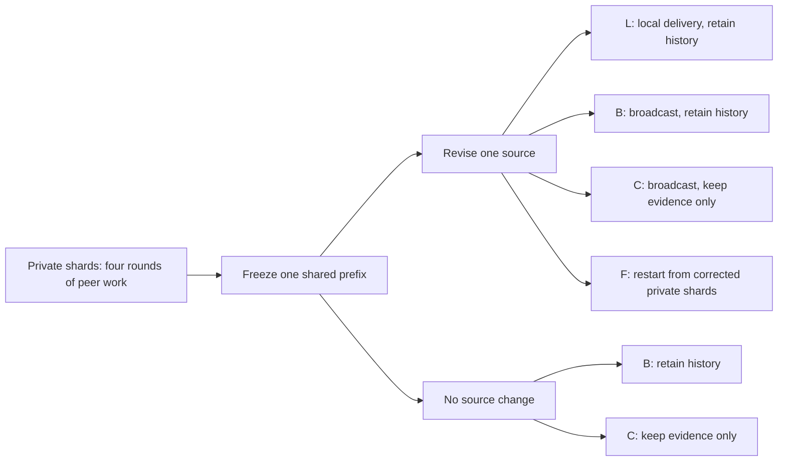

# When should a team keep its work after the facts change?

**Correction propagation and recovery in distributed LLM reasoning**  
Authoritative project specification · 24 September 2026

This document governs implementation, experiments, analysis, and research writing. It replaces the previous support/action-binding specification and conflicting recommendations in the numbered blueprint, `codex_context`, configuration files, and dependency lists. The supplied `acl26-silo-bench` is the task foundation, not an already implemented correction benchmark. This specifies future experiments; no model performance, GPU timing, or recovery advantage is claimed.

## 1. Research decision

> After a fact changes during distributed problem solving, how much does recovery depend on disseminating the correction, retaining previously gathered evidence, and revising the team's prior reasoning state?

The main comparison asks whether **clearing derived reasoning while preserving acquired source evidence helps specifically after a correction**, beyond any benefit it also provides when nothing changes. This is a controlled empirical study of state reuse, with correction delivery and evidence reuse as explanatory comparisons. It does not propose a new memory-consistency algorithm.

Use four identical peer agents, six small algorithmic task families adapted from all three SILO levels, one correction after a shared four-round prefix, and four-round matched continuations. Compare local correction delivery, guaranteed delivery, evidence-preserving reset, and fresh restart. Add matched no-change controls and a small set of real corrections that leave the answer unchanged. Evaluate exact answers, recovery trajectories, propagation, and preservation of still-correct output components.

Target **48 independent worlds, eight per task**. Use 36 worlds, six per task, only if the measured compute forecast requires it. Start with **Qwen3.5-9B in NF4 4-bit quantization**; fall back to Qwen3.5-4B after a bounded hardware/capability pilot. The ceiling is **30 aggregate allocated GPU-hours on two T4s**. Neither a larger sample nor a second model is assumed to fit.

### Why replace the previous design?

The earlier three-role pipeline and alternative-support/action-binding factorial were defensible but narrow. The full repository makes a stronger generalization study possible: peers possess private information, communicate over several rounds, and produce replicated or distributed outputs whose response to an edit can be calculated exactly. An edit can affect a local boundary, an entire suffix, a rank allocation, or graph reachability.

Preserve correction of previously consumed information as the intervention. Replace the support extractor, Boolean support algebra, action gate, fixed planner/executor roles, and eight-policy diagnostic matrix with a smaller set of interventions answering an operational question: **what should a collaborating team retain when it resumes after a correction?** Novelty is secondary to identifying that tradeoff reliably.

The framework choice is separate from the scientific change. LangGraph supplies checkpoints and execution boundaries; it must not determine answers, select relevant evidence, or prescribe peer reasoning and communication routes.

### Current status

- **Available:** SILO generators, 180 stored cases, prompts, communication tools, runner, and metrics; the earlier project's support algebra, contracts, examples, and reference tests.
- **Verified during this revision:** source inspection across all 30 tasks and all three communication backends; 180 exact-evaluator self-checks; independent oracle recomputation for 36 stored instances of the six selected families. The independent answers matched. Native partial scoring has failures described below.
- **Not implemented or measured:** the new generators, revision protocol, recovery conditions, independent dynamic evaluator, LangGraph runner, Qwen/T4 pilot, main runs, or statistical results. Existing support-algebra tests do not validate this experiment.

Retain old material as background, without porting its requirements by default. No support estimator, file hashing, formal change-control system, cloud service, vector database, or elaborate documentation hierarchy is required. Assume Linux GPU execution, local inference, and CPU access for generation and analysis. Check the actual provider's session limits during setup.

## 2. What prior research already establishes

Sources were inspected as of 24 September 2026. Their findings have not been reproduced here. Recent arXiv works are preprints. The comparison concerns inspected methods and experiments, not proof that related work exists nowhere else.

| Closest work | Established evidence and boundary | Relationship to this study |
|---|---|---|
| **SILO-BENCH**, ACL 2026, task design and experiments. [Paper](https://aclanthology.org/2026.acl-long.1354.pdf), [repository](https://github.com/jwyjohn/acl26-silo-bench) | Static algorithmic problems with private shards, peer communication, exact answers, and multiple scales/protocols. It reports a gap between communication activity and successful computation. Activity alone does not establish that required information reached a particular agent. | Extend selected tasks with revisions and matched continuations. Intervene on delivery and retained state instead of inferring their effects from communication volume. This is not native SILO reproduction. |
| **Fresh Memory, Stale Plans / PlanFence**, September 2026, §§3–5 and Appendices A.2–A.6. [Paper](https://arxiv.org/html/2609.03340v1) | Already studies fresh facts with obsolete plans in a five-agent Qwen3.5 system. Wrappers supply action dependencies; lineage validation can trigger an isolated replan. Its matched live study has 30 workflows per method; cost evidence also uses controlled replay. | Freshness alone failing is already known. Test the state-retention tradeoff in peer algorithmic coordination without exact semantic dependencies or a gate enforcing valid answers. A no-change reset control distinguishes correction-specific effects from generic context effects. |
| **From Faulty Memories to Corrected Actions**, August 2026, §§3.2–3.6, evaluation and appendices. [Paper](https://arxiv.org/html/2608.10502v1) | Joint state/answer repair, runtime provenance, independent-support preservation, and selective replay are explicit contributions. Dependencies come from emitted provenance; recovering missing edges from unrestricted language is outside scope. | Do not claim the first selective recovery or preservation study. Measure the value and harm of peer state using exact task outcomes, without assuming a correct semantic dependency graph. The reset is not a reproduction of this repair algorithm. |
| **REVISE**, September 2026, §§3–4 and Appendix A. [Paper](https://arxiv.org/html/2609.00643v1) | Versioned artifacts and read selectors support selective recomputation and revalidation. Live LangGraph/LLMCompiler evaluations compare restart with finer recovery; incomplete provenance expands recovery conservatively. Adapters extract declared program dependencies. | Workflow recovery is established. Here the issue is retained peer-generated reasoning, distributed evidence acquisition, and correction scope across exact algorithms, rather than serving efficiency over instrumented workflow dependencies. |
| **AgentRewind**, August 2026, method and evaluation. [Paper](https://arxiv.org/html/2608.14380v1) | Restores aligned context and controlled environment state for long-horizon recovery while preserving selected experience from failed attempts. | Reset/rollback benefits are not new. Here the corrected world remains authoritative; resetting a team must never restore the old fact. Source evidence and derived conversation are separately controlled. |

Adjacent work reinforces the importance of revision. **STALE** evaluates recognizing and applying memory updates; **Belief-R** studies reasoning under revised premises; **TRACK** studies propagation of conflicting updated knowledge through multi-step reasoning. Their tasks differ from this distributed, checkpoint-matched intervention. **MemTX** already addresses transactional belief admission and cascading repair. Cite these as foundations, not methods this study defeats. [STALE](https://arxiv.org/html/2605.06527v1), [Belief-R, EMNLP 2024](https://aclanthology.org/2024.emnlp-main.586/), [TRACK, EACL 2026](https://aclanthology.org/2026.eacl-long.273/), [MemTX](https://arxiv.org/html/2607.23929v2)

One close title in the supplied materials, *Repair Sets Before Repair Choices: Identifiable Rollback Families for Self-Evolving Agent Memory*, remains unverified: the [OpenReview route](https://openreview.net/forum?id=IJoWb6T3RJ) did not yield accessible full text through the checked routes. Do not inherit detailed claims about it from earlier notes. Recheck before submission. If it answers the same question, frame this study as replication or generalization; do not weaken the question to preserve novelty.

**What this study could establish:** within the specified model/task regime, the effect of guaranteed correction delivery; the correction-specific effect of retaining versus clearing reasoning given the same authenticated evidence; and the value of retaining evidence gathered before the change. It can relate failures to the affected output region and distinguish stale answers from damage to unaffected answers.

It cannot establish that all teams need resetting, that higher SILO levels cause worse recovery, that a particular hidden reasoning process is responsible, or that these interventions outperform the cited systems under their own assumptions. A future paper should lead with the measured tradeoff and its boundaries, including a rigorous null result, rather than first-ever recovery.

## 3. What the actual SILO repository supports

The generators organize tasks into aggregation, local/sequential dependency, and global redistribution/graph motifs. Preserve those labels for coverage, but **do not treat Level I < II < III as a controlled numerical complexity variable**.

The implementation shows why: I-08 and III-26 both compute distinct-element count; III-25's one K-means step can aggregate local sums/counts; III-30 gives each agent all of B and one row of A. II-17 requires every agent to return the whole answer despite a local difference operation. Message-count claims depend on payload size, output placement, and routing restrictions; unrestricted centralization changes them. These are direct observations from the [Level I](acl26-silo-bench/benchmark_generator/paradigm_i.py), [Level II](acl26-silo-bench/benchmark_generator/paradigm_ii.py), and [Level III](acl26-silo-bench/benchmark_generator/paradigm_iii.py) source.

The [native runner](acl26-silo-bench/src/engine.py) needs scientific changes: submitted agents stop permanently, received tool results affect the next generation, and the [point-to-point receiver](acl26-silo-bench/src/msg/tools.py) mutates read flags in prior-round files. Branching by reusing those directories is unsafe. The [inference adapter](acl26-silo-bench/src/utils/llm.py) retries indefinitely and lacks the required generation budget.

The inspected [partial-credit evaluator](acl26-silo-bench/src/utils/metrics.py) raised errors on perfect nested-list answers for 18 cases and undercredited perfect duplicate-containing sort answers in five cases. Independent recomputation matched all 36 stored instances for the six selected families. Reuse mathematical definitions, not generic partial scoring. These checkout findings do not establish errors in the published results or their precise experimental version.

Use selected task definitions and attributed prompt guidance; write small independent generators and evaluators. Reuse source where useful without adopting the entire runner. The [supporting audit](SILO_REPOSITORY_AUDIT.md) records all-task inspection details; no final requirement depends on reading it.

## 4. Tasks, worlds, and interventions

### Six complementary task families

Use **four peers, IDs 0–3**, throughout. Every peer has the same model and tool permissions, but its own shard and output assignment. There is no appointed planner/executor. Four peers permit several communication hops while keeping inference affordable. This is a fixed-size study, not a scaling study.

| SILO family | Generated instance and required answer | Main correction | Scientific use |
|---|---|---|---|
| **I-01 Global Max** | Eight integers per peer, 32 total, values 0–99. Every peer returns the maximum. | Lower a unique global maximum below the second-largest value. | A small global answer must change everywhere; other evidence becomes decisive. |
| **I-09 Top-K** | Eight integers per peer, values 0–99; retain K=10. Every peer returns the descending top-ten list, including duplicates. | Lower a uniquely occurring value strictly above the old cutoff to below it, changing the list. | Partial reuse of a ranked answer; stale membership and ordering. |
| **II-11 Prefix Sum** | Eight integers per peer, values 1–9, concatenated in peer order. Each returns its eight cumulative sums in global coordinates. | Replace one entry with another value in 1–9. | An exact suffix changes; preceding coordinates remain valid. |
| **II-17 Difference Array** | Eight integers per peer, values 0–30. Every peer returns all 31 values `x[i]-x[i-1]`, i=1…31. | Replace one entry with a different value in 0–30. | At most two output coordinates change, including shard-boundary cases. |
| **III-21 Distributed Sort** | Eight integers per peer, values 0–99, duplicates allowed. Sort all 32 ascending; peer a returns ranks 8a…8a+7. | Replace one value with another in 0–99, changing the sorted result. | Output responsibility crosses original data ownership; rank intervals shift. |
| **III-24 BFS Distance** | Twelve public nodes 0–11; 16 unique undirected edges, four per peer. Every peer returns all distances from 0; unreachable is -1. | Delete an edge whose removal changes at least one distance. | Nonlinear propagation and alternative paths; exact affected-node labels. |

For BFS, sample a labeled tree using a uniform Prüfer sequence, add five uniformly sampled nonedges, randomly permute non-source labels, and randomly partition edges into four shards. Initial graphs are connected; deletion may disconnect nodes. This deliberately modified distribution supports indispensable and redundant paths and is not SILO's native random-edge distribution.

For arrays, draw initial values independently and uniformly from the stated integer range, and record global positions separately from ownership. Prefix/difference shards are contiguous; maximum/top-K/sort use random record partitions. Cycle edited owners across peers as evenly as the per-family sample permits, randomizing cycle order. For prefix/difference/sort, sample uniformly among legal positions of that owner and legal replacement values. For max/top-K, condition generation on an eligible value belonging to that owner, then choose uniformly among eligible records and legal replacement values. For BFS, select uniformly among answer-changing edges of that owner, regenerating if none exists. On the answer-preserving subset, choose uniformly among legal record/replacement pairs (or legal removable edges), without requiring the main edit's owner.

Use a private random generator per world and explicit seeds, not import-time global seeding. Choose edits using the mathematical oracle **before any LLM run**. Reject only violations of the stated data/edit constraints, with at most 1,000 generation attempts per world and an explicit failure afterward. Save rejection counts and final inputs. Never reject based on model answers, recovery effects, or whether a preferred condition wins.

This selection studies consequential corrections, not their natural frequency. Input sizes, N values, interface, and stopping rules differ from native SILO; label results **SILO-derived revision tasks**, never native benchmark scores.

### Three event classes

1. **Answer-changing revision:** one record gets version 2, replacing a value or tombstoning an edge. Every main world receives this event in all four conditions.
2. **No-change continuation:** no source changes. The same prefix receives a neutral continuation notice under retain-history and evidence-preserving-reset conditions. This is the primary counterfactual control.
3. **Answer-preserving revision:** a source changes but the gold answer does not. Use 12 predetermined main prefixes: four each from maximum, top-K, and BFS. Change a nonmaximum value without reaching the maximum, a below-cutoff value without entering the top ten, or delete an edge without changing distances. Run retain-history and evidence-preserving reset only. These worlds must support both edit types at generation; record subset membership before inference.

Do not invent an answer-preserving single-entry edit for prefix sums or sorted multisets where it is impossible. The selected difference-array intervention always changes an output. The preserving subset is diagnostic, not an equally powered second experiment. Every event starts from the original prefix; events are never chained in one run.

### Previously used information

The edited version-1 record must have appeared in its owner's source view during the completed prefix. Thus revision follows model exposure and distributed work, rather than preceding a fresh task. Record forwarding and prefix accuracy. Exposure is not proof of internal causal use; a citation or prompt occurrence is not a complete semantic dependency.

Run all four prefix rounds regardless of early correctness. Keep every generated world in the main analysis, including unsuccessful prefixes. Correct-prefix analyses are secondary and use only pre-intervention outcomes. Never rerun prefixes until they succeed or select edits after inspecting answers.

## 5. Interaction and recovery conditions

### One communication protocol

Use synchronous point-to-point messages over fully connected peers. Each logical round gives every peer one call on an immutable start-of-round view. Commit outgoing messages together; recipients see them before their next calls. Invocation order must not expose earlier peers' current-round outputs. Models choose recipients, message text, evidence forwarding, and candidate answers.

Prompts supply the mathematical definition, ownership/output contract, JSON schema, and a short SILO-inspired algorithm hint. Suggested chains, aggregation, and graph propagation are **hints, not enforced network constraints**. Peers may centralize information. This keeps network permissions constant across families, but prevents claims about communication lower bounds or exclusively decentralized computation.

Each reply contains a provisional typed `candidate` and a `send` list. Allow one message per other peer, at most three total. Messages have `to`, optional `source_refs`, and optional text. Allow at most eight source references per recipient and **128 tokenizer tokens of free message text across the reply**, inside a **384-token generation cap**. Request no separate chain-of-thought, support proof, or reviewer. Peer explanations are allowed and become derived state.

Candidates must have the scalar/list/dictionary types and lengths in the task table. Reject booleans as integers, missing/extra coordinates, duplicate recipients, invalid references, and excess payload. Parse complete JSON; tolerate whitespace, not truncated fragments or extra prose. A schema-invalid reply produces no messages and no valid candidate for that round. Supply the error at the next scheduled call, without an extra retry. A well-formed wrong candidate is a normal task failure and may be revised next round.

### Source evidence versus derived state

Maintain a small **source table**: record ID, owner, version, and raw value or deletion marker. Initially an agent sees only its own records. To forward evidence, it names a record/version it currently holds; the host copies the exact source to the recipient. This prevents transcription mistakes from becoming authoritative facts and makes delivery auditable. Forwarding reveals no unseen shard and computes no summary.

Prose, proposed aggregates, and candidates remain untrusted derived state. The host does not infer dependencies, correct reasoning, or block wrong answers. Facts in prose are not automatically promoted into source records. Clearing prose may discard useful summaries as well as errors: this tradeoff is intentional.

Render the current source table once per call, outside history. Retain prior own replies, received peer prose, and validation errors as history; do not duplicate past raw tables inside it. A revision notice marks the old version obsolete and removes it from the usable table, while preserving it offline for audit. A peer without the new value sees that an update is needed. Derived text mentioning old values remains in retain-history conditions.

This is provenance of **raw records delivered**, not a semantic dependency graph or a claim about hidden memory. It gives the reset and retain conditions identical current source evidence.

### Shared prefix and four conditions

Execute four prefix rounds. Deliver round-four messages into recipient state, then freeze an immutable snapshot. No pre-correction deliveries remain pending. Fork independent continuations, apply revision and retention rules, then execute four recovery rounds. Candidates never permanently deactivate peers.

Every continuation has four rounds. The primary comparison is the C−B difference after revision minus the C−B difference without revision. The answer-preserving diagnostic adds separate B/C siblings on the predetermined subset.

All answer-changing branches receive the same public notice naming the changed record, owner, and new version. Revision is therefore **announced and diagnosed**; detecting an unnoticed change is outside scope. Conditions differ in replacement-content delivery and retained work:

| Condition | Replacement at recovery start | Retained source evidence | Prior derived history/candidates | Comparison |
|---|---|---|---|---|
| **L — Local delivery** | New value/tombstone only at its owner; peers communicate it. | Previously delivered records except the obsolete version. | Retained. | B−L: guaranteed content delivery after an announced change. |
| **B — Broadcast, retain history** | Host gives the revised record to every peer. | Previously delivered records plus the update. | Retained. | Reference after guaranteed delivery. |
| **C — Clear reasoning, retain evidence** | Exactly as B. | Exactly B's current per-peer source tables. | Discard own replies, derived peer prose, validation history, and candidates. | C−B: clearing reasoning/history with source evidence fixed. |
| **F — Fresh team restart** | Exactly as B. | Corrected private shards and the broadcast revision only; discard previously acquired remote records. | None. | C−F: value of previously gathered evidence. |

Task instructions, round budgets, output caps, correction wording, model configuration, and tools are identical. C/F have empty working histories, without stronger recovery instructions. Hide condition names and evaluator labels from model-visible IDs/prompts. Broadcasting one changed record is an intentional intervention, not access to the whole world.

For no-change B/C, retain unmodified source tables and give both the same neutral phase-boundary notice to continue solving and submit current candidates. B keeps history; C clears it. Reset may help even without correction; the primary analysis accounts for that.

For answer-preserving edits, B/C receive the changed source normally. A correct answer may remain unchanged. Do not require gratuitous answer edits or assume an unchanged answer proves every old justification valid.

F receives the same four recovery rounds. Charge its abandoned prefix in end-to-end cost. A separate one-call **full-information single-agent control**, before and after the main edit for every world, checks capability when all sources are supplied. It returns all segments where necessary. It is a diagnostic, not a fair multi-agent policy competitor.

### Hypotheses and boundaries

- Guaranteed delivery may improve recovery over owner-only delivery. A small B−L can mean peers already disseminate revisions efficiently; it does not make communication irrelevant.
- Prior reasoning may help through reusable computation or hurt through stale conclusions. The primary hypothesis is two-sided: correction changes the relative value of clearing that state.
- Retaining gathered evidence may improve early recovery compared with restarting from private shards. No advantage would narrow the case for maintaining it in these tasks.
- Effects may vary with the affected output region. Treat this as descriptive within families, not a causal effect of SILO level or footprint size.

B−L is an intervention effect, not mediation inferred from observed message receipt. C−B changes content and context length together; it does not isolate psychological anchoring. C−F tests authenticated evidence reuse, not all useful information in prose. No condition uses oracle deletion of only wrong derived statements.

## 6. Evaluation and statistical analysis

### Exact success and recovery trajectory

For each world, compute independent gold answers before and after each event. Map them to each peer's required output. Preserve order and multiplicity for lists; compare BFS dictionaries by the complete public node set, with integer distances. Do not use an LLM judge, SILO's generic partial score, string similarity, or a gold-answer repair tool.

Let `a[w,p,z,r]` be the fraction of the four peers whose **entire candidate** is correct in recovery round r. Here p is the condition and z is the event (`change` or `sham`). Define:

`A[w,p,z] = (a[w,p,z,1] + a[w,p,z,2] + a[w,p,z,3] + a[w,p,z,4]) / 4`.

This normalized area under the exact-agent-accuracy curve ranges from 0 to 1. It rewards correct recovery earlier in an equal four-round allowance, while remaining interpretable when not all peers finish together. It contains 16 agent-round indicators per branch, but those are **not 16 independent observations**. Do not include the reset boundary itself as an incorrect round.

The **single primary estimand** is the task-balanced mean of the within-world interaction:

`theta = mean_w[(A[C,change] - A[B,change]) - (A[C,sham] - A[B,sham])]`.

This measures how the effect of clearing history changes when information is revised. Report both component contrasts beside theta. A positive theta does **not** by itself show that reset helps after correction: reset could simply be less harmful then. Claim a practical recovery benefit only when the observed corrected-world C−B contrast supports it as well.

Prespecified secondary policy contrasts on answer-changing events are **C−B**, **B−L**, and **C−F**, using A and reporting final-round exact team completion alongside it. B−F is a descriptive overall reuse-versus-restart comparison. Define final team completion as all four final candidates being valid and exactly correct. Agreement on a wrong answer is failure.

Report round-by-round curves, first all-correct round, and first all-correct round after which no later regression occurs. Runs never stably correct are right-censored at the four-round allowance; do not average only successful runs or convert failure into an invented recovery time. The fixed schedule does not actually stop at correctness, so “cost to first stable correct round” is an offline diagnostic, not demonstrated deployable stopping behavior.

### What remains valid and what changes

For each problem coordinate j, define the exact semantic footprint:

`D = {j : gold_before[j] != gold_after[j]}`; `U = remaining coordinates`.

This is an output-value comparison, not a model provenance graph. For scalar maximum there is one problem coordinate; for sorted outputs it is the global rank; for BFS it is the node. Replicated answers create several peer copies of a coordinate, not several independent problems.

Measure at each recovery round:

- **Repair of changed coordinates:** correct-new-value rate on D and retention of the old gold value on D. The latter diagnoses a stale answer even if a peer never explicitly cited the old source.
- **Preservation:** among U coordinates that the peer had correctly answered at the prefix boundary, the fraction still correct. Count a new error there as collateral damage. An edit to a previously wrong coordinate is not collateral damage merely because it changed the candidate.
- **Unnecessary edits:** changed candidate values on U, reported separately from harmful edits. Correcting an old error is beneficial.
- **Communication:** model-call boundary at first authoritative v2 receipt per peer, first subsequent correct candidate, message deliveries, source records delivered, and payload tokens/bytes. Distinguish model-generated communication from the host's injected correction. Count fan-out per recipient.
- **Protocol reliability and cost:** schema errors, invalid references, truncations, context overflows, infrastructure failures, prompt/generated tokens, per-call elapsed time, peak device memory, and allocated GPU-hours.

For malformed candidates, score exact correctness zero and required coordinates as incorrect. Do not carry a previously correct candidate forward as if it were a new valid reply. Stale-value frequency has a separate missing/malformed category; absence of a parseable value is not successful revision. If a preservation denominator is empty, report not applicable and its count, not zero or one.

Aggregate coordinate diagnostics within peers, then worlds, then weight eligible families equally. A peer/world/family with no eligible coordinates is absent only from that diagnostic's denominator; report those counts explicitly. For example, maximum has no unchanged coordinate in an answer-changing run. Primary A always includes all six families equally. Also show raw denominators and both the fraction of unique problem coordinates in D and the number of peer copies affected. This avoids letting replicated BFS/difference outputs dominate segmented prefix/sort outputs.

On the answer-preserving subset, D is empty; evaluate preservation, exact recovery curves, and unnecessary changes. Report this subset separately. It tests avoiding damage after a real revision, not recovering a changed answer.

### Sample size, uncertainty, and exclusions

The independent unit is a generated **base world plus its shared prefix**. All conditions, event variants, peers, rounds, and single-agent diagnostics remain in that cluster. Use 48 worlds, or the pre-main budget fallback of 36. One sampled prefix/continuation per condition is the initial design; variation over independent worlds and generation seeds is included, but repeated-seed reliability for each identical instance is not estimated.

Use a stratified cluster bootstrap with 10,000 resamples, resampling worlds within each of the six fixed task families and carrying all paired records together. Report the task-balanced mean, a 95% interval, per-family effects, and raw paired observations. These intervals describe the **specified six-task mixture**, not a population of all algorithm families. With only six/eight worlds per family, family-specific intervals are descriptive and uncertain.

The primary analysis is two-sided. For the three prespecified secondary contrasts, show ordinary 95% paired bootstrap intervals and use **98.33% intervals** for multiplicity-aware claims (Bonferroni across three contrasts, based on the same stratified resamples). These are approximate bootstrap intervals, not exact small-sample guarantees. Endpoint completion and other diagnostics receive descriptive paired intervals, without additional significance claims. Effect sizes and uncertainty take precedence over a binary significance threshold; no large collection of p-values is needed.

Choose **0.10 in A** as a practical effect reference, approximately 1.6 additional correct agent-rounds out of 16. This is a reporting threshold, not an assumed achievable effect or a promised detection limit. Under a normal approximation, 80% power at two-sided 5% roughly requires an effect of `2.8 * SD(paired contrast) / sqrt(n)`. If the world-level primary contrast SD were 0.35, this is about 0.14 at n=48 and 0.16 at n=36; at SD=0.60 it is about 0.24 and 0.28. These are sensitivity calculations, not measured power. The interaction may be noisier than a simple pairwise difference.

If observed paired differences are all equal, a zero-width bootstrap interval must not imply population certainty. Accompany it with a bounded-mean interval using the known range (primary interaction -2…2; simple contrast -1…1), and exact binomial bounds for all-success/all-failure rates where applicable. Do not claim equivalence unless an appropriate interval excludes effects beyond the practical threshold; lack of significance alone is inconclusive.

Include all valid generated worlds. Model timeouts, malformed outputs, and truncations are outcomes. A missing call cannot silently remove a difficult branch. Exclude a world only for an independently established generator/runner/evaluator defect; correct the defect and rerun **all matched branches affected by it**, charging the budget and disclosing the change. If missing infrastructure runs cannot be completed, show paired coverage and best/worst bounded sensitivity instead of reporting complete-case results as the intended study.

### Interpreting negative and mixed results

| Observation | Defensible interpretation |
|---|---|
| B improves over L | Guaranteed content delivery helps in announced revisions; the difference includes subsequent interactions, not only network latency. |
| C improves over B after change, with positive theta | Evidence that clearing retained history has a correction-specific benefit in these tasks. Context length/content remain joint explanations. |
| C improves equally with and without change | A generic reset/context effect; insufficient evidence of a correction-specific mechanism. |
| B outperforms C | Prior derived work is useful enough to outweigh stale-state harm under this protocol. |
| C outperforms F | Gathered raw evidence has reusable value; its collection need not be repeated after every edit. |
| All conditions recover | Compare speed/temporary damage; if curves also coincide, report a bounded ceiling result. |
| All conditions fail, including full-information controls | The setting is capability-limited; do not attribute failure to correction propagation. |
| Prefix is poor but fresh corrected solving works | Recovery is entangled with initial team failure; report all-world results plus the predeclared correct-prefix subset. |
| Effects vary by family | Report the task-specific boundary. Arithmetic, output form, footprint, and communication demands are not independently randomized. |

## 7. Practical implementation

### Framework and dependencies

**Select LangGraph with local SQLite checkpoints.** Its explicit state transitions and persistence fit a controlled prefix/fork/continuation experiment. Its maintained documentation and actual use in REVISE support suitability, but it supplies no semantic repair guarantee. [Overview](https://docs.langchain.com/oss/python/langgraph/overview), [persistence](https://docs.langchain.com/oss/python/langgraph/persistence)

| Alternative | Assessment |
|---|---|
| Extend the supplied SILO runner directly | Reuses task loading and tools, but needs provisional submissions, immutable branches, a bounded inference adapter, automatic round-boundary delivery, and explicit source/history separation. Reusing task definitions is more valuable than preserving this runner's semantics. |
| A small Python loop | Entirely viable for four peers and fixed rounds. It is the fallback if a short LangGraph integration spike reveals a blocking problem. Preserve the identical protocol and records; do not build a general custom orchestration framework. |
| Microsoft Agent Framework | Maintained checkpointed workflows are capable of this task, but add no concrete advantage for the selected local Python experiment. [Checkpoint documentation](https://learn.microsoft.com/en-us/agent-framework/workflows/checkpoints) |

Use one graph: prepare round → invoke each peer against the frozen view → validate replies → commit deliveries/candidates → checkpoint → advance or finish. Peer invocations may be serial inside a worker; logical synchrony is what matters. Policy application happens once at the continuation boundary. Evaluation runs outside the model-visible graph. No supervisor LLM, planner node, LangChain agent wrapper, Deep Agents layer, or hosted tracing service is necessary.

Persist each continuation under a new `thread_id` initialized from a deep-deserialized prefix. `update_state` on an existing thread is not a branch clone. Replace owned state explicitly; append reducers must not resurrect cleared history. Replaying a checkpoint can rerun downstream nodes, so completed call IDs must retrieve their saved responses rather than resample. One SQLite file per GPU worker is sufficient. [Time-travel semantics](https://docs.langchain.com/oss/python/langgraph/use-time-travel)

Use Python 3.11, Pydantic 2, LangGraph/SQLite checkpointer, PyTorch, Transformers, Accelerate, bitsandbytes, NumPy/SciPy, pandas, and Matplotlib. The supplied SILO package declares Python 3.13; adapt the needed task semantics into this small package rather than assuming its whole environment installs unchanged. JSONL, JSON, CSV, and ordinary figure files are sufficient.

### Essential records and custom logic

| Record | Required contents |
|---|---|
| World and event | Task, seed, raw records/ownership/positions, chosen revisions, before/after gold, affected-coordinate labels; gold stays evaluator-only. |
| Source record | Stable ID, owner, version, raw value/tombstone. |
| Peer state | Delivered source table, derived history, latest candidate, current inbox, validation feedback. |
| Episode | World/prefix/condition/event IDs, round, peer states, immutable messages and delivery times, parent prefix ID. |
| Call | Stable ID, exact input messages, model/settings/seed, raw response, parse status, timing, token counts, device, termination reason. |
| Outcome | Exact peer/team correctness, coordinate diagnostics, delivery indicators, errors, costs, and grouping keys. |

Custom code is limited to generators/oracles, source forwarding, synchronous delivery, boundary retention rules, prompt rendering/validation, the inference adapter, and analysis. Suggested modules are `tasks`, `protocol`, `workflow`, `inference`, `evaluate`, and `analyze`; these are convenient boundaries, not mandatory scaffolding. Do not retain the old support/DNF machinery merely because it exists.

Hide gold answers, D/U labels, future edits, condition names, and other branches from the agent schema. Construct each call from its allowed visible state with fresh KV and recurrent state. Shared model weights are fine; cross-call conversation/cache handles are not. Prefix and branch state must be independent objects and independent persistent records, including message delivery cursors.

Save a response before applying its messages. Resuming a completed call reuses the exact saved response, including an invalid one. Permit at most one identical-request retry for an infrastructure interruption with no durable response; charge every attempt. Use a 120-second inference timeout per attempt, confirmed adequate for accepted pilot prompts. If exceeded, terminate/reset the worker, record a failed slot, and do not retry merely because generation was slow. Do not retry semantic failures or give hidden formatting repair calls. Stable message IDs make delivery idempotent. Record the possibility of an unobserved completed generation before a crash rather than claiming exactly-once inference.

Use matched per-world/phase/round/peer generation seeds across sibling conditions and rotate execution order across worlds/workers. Different prompts can consume randomness differently; matching seeds does not make outcomes identical or remove the need for clustered uncertainty. Freeze model, quantization, prompts, parsing, and task rules before main outcomes are inspected.

## 8. Compute and feasibility

### Initial model configuration

Use the official Apache-2.0 checkpoints [Qwen3.5-9B](https://huggingface.co/Qwen/Qwen3.5-9B) and, if necessary, [Qwen3.5-4B](https://huggingface.co/Qwen/Qwen3.5-4B). These are initial candidates, not validated hardware configurations.

| Setting | Decision |
|---|---|
| Inference | Transformers native `Qwen3_5ForCausalLM`, text only; no vision inputs or training. Check checkpoint-to-text-model loading carefully. |
| Quantization | bitsandbytes NF4, double quantization, 4-bit linear weights. |
| Computation | FP16 ordinary computation/weights where applicable; retain implementation-required FP32 recurrent/numerically sensitive calculations. Override BF16 defaults. |
| Context | **8,192 total tokens including output**, with at most 384 generated tokens per call, including full-information controls. |
| Decoding | Explicit chat-template `enable_thinking=False`; temperature 0.7, top_p 0.8, top_k 20, min_p 0, repetition penalty 1.0, no presence penalty. |
| Scheduling | Batch size one; one full quantized replica and serial inference worker per T4. Run independent episodes across workers. Four logical peers share weights, not conversation state. |
| Attention/cache | Supported SDPA/math or eager attention and maintained PyTorch fallback paths; fresh generation state for each call. No assumed FlashAttention-2 or cross-run cache reuse. |

The model card supports the non-thinking template and sampling settings. Omit its suggested presence penalty because repeated JSON keys/source IDs are legitimate, and a custom logits processor adds little here. The short generation cap is deliberate; results concern bounded non-thinking inference, not unrestricted Qwen reasoning. [Official inference guidance](https://huggingface.co/Qwen/Qwen3.5-9B#instruct-or-non-thinking-mode)

Initial package candidates checked in this research pass are Transformers 5.17.0, bitsandbytes 0.50.2, Accelerate 1.15.0, LangGraph 1.2.12, and `langgraph-checkpoint-sqlite` 3.1.1. Begin with an official PyTorch CUDA 12.6 wheel compatible with the actual driver, such as the checked 2.14.0 wheel line. These are **not a tested compatibility lock**. Pin the complete passing environment after the pilot; do not upgrade during the main study. [Transformers](https://pypi.org/project/transformers/5.17.0/), [bitsandbytes](https://pypi.org/project/bitsandbytes/0.50.2/), [Accelerate](https://pypi.org/project/accelerate/1.15.0/), [LangGraph](https://pypi.org/project/langgraph/1.2.12/), [SQLite checkpointer](https://pypi.org/project/langgraph-checkpoint-sqlite/3.1.1/), [PyTorch packaging notice](https://dev-discuss.pytorch.org/t/notice-cuda-12-6-wheels-will-no-longer-be-published-from-pytorch-2-15-drops-maxwell-pascal-volta/3432)

### What is and is not established about T4 compatibility

A T4 has 16 GB device memory and compute capability 7.5; two devices are not a unified 32 GB pool. bitsandbytes documents NF4 support for Pascal and newer GPUs, including Turing. This establishes a plausible quantizer path, **not that the complete Qwen3.5 hybrid model runs correctly or quickly on this hardware**. [NVIDIA specifications](https://www.nvidia.com/en-us/data-center/tesla-t4/), [CUDA capabilities](https://developer.nvidia.com/cuda/gpus), [bitsandbytes support](https://huggingface.co/docs/transformers/en/quantization/bitsandbytes)

The 9B configuration has 24 linear-attention and eight full-attention layers. The inspected Transformers implementation includes ordinary PyTorch gated-delta-rule paths as well as the text-only class. Use those supported fallbacks if optional kernels are unsuitable; do not write a custom kernel. BF16, FlashAttention-2, or a newer GPU's benchmark must not be assumed applicable to T4. [Model configuration](https://huggingface.co/Qwen/Qwen3.5-9B/raw/main/config.json), [versioned implementation](https://github.com/huggingface/transformers/blob/v5.17.0/src/transformers/models/qwen3_5/modeling_qwen3_5.py)

Packing all 9B parameters at four bits gives an ideal lower bound near 4.5 GB, not a VRAM forecast. The 248,320-token vocabulary and 4,096 hidden dimension imply about 1.017 billion entries per embedding/output matrix. If both untied matrices remain FP16, together they occupy about 4.07 GB; their unquantized cost replaces their assumed packed cost, rather than being wholly additional parameters. Add quantization metadata, cache/recurrent state, activations, workspaces, and allocator overhead. Inspect actual quantized modules and peak memory at the longest permitted prompt. The 4B model's ideal packed bound is about 2 GB, with similar categories of overhead.

Require finite outputs, no missing/newly initialized language weights, no CPU offload, and at least **1.5 GiB free device-memory headroom at the tested worst prompt**. Expected unused vision/MTP checkpoint weights are different from missing language weights. Bind each process to one device and inspect its device map. Do not silently use tensor parallelism or split 9B across both T4s; that would invalidate the two-worker forecast. Check host RAM, disk, available VRAM, driver, and both devices independently.

Context length is larger than in the previous specification because this study contains actual peer histories. Validate the worst permitted transcript on CPU before GPU use. Do not truncate history in B/L, because that changes the treatment. A production context overflow is an explicit failed slot, reported by condition; if common, the experiment is not interpretable and the protocol needs development revision before main runs.

Transformers/bitsandbytes remains the default. If it passes correctness/memory but narrowly misses runtime, allow one bounded **vLLM** comparison on at most 12 matched development prompts, preferably with the same quantization. Current GPU and quantization documentation includes Turing support, but gives no validated throughput for this exact setup. Adopt it only if isolation tests pass and projected total time, including setup, improves by at least 20%. A quantization change requires renewed capability checks. Do not turn this project into backend development. [vLLM GPU support](https://docs.vllm.ai/en/stable/getting_started/installation/gpu/), [quantization support](https://docs.vllm.ai/en/stable/features/quantization/), [Qwen3.5 recipe](https://docs.vllm.ai/projects/recipes/en/latest/Qwen/Qwen3.5.html)

### Small pilot and acceptance decisions

Perform CPU implementation and mock-model checks before allocating GPUs. Reserve up to **three aggregate GPU-hours for development inference**, **one for loading/setup**, and **two for interruptions and reruns**; provisionally leave 24 for the main schedule. All allocations count toward 30. Unused reserve is not permission to change the sample after inspecting main effects.

Begin 9B with a fail-fast load/smoke test, capped at 24 representative calls and 0.5 allocated GPU-hour, whichever comes first. Include a near-limit prompt, each output type, source forwarding, and a corrected continuation. If memory/kernels fail, switch to 4B before spending the full pilot. Charge failed configurations and alternative-backend probes to the same reserve.

For the candidate that passes the smoke test, use **six development worlds, one per family**, with seeds excluded from main data:

| Pilot component | Calls |
|---|---:|
| Six four-round, four-peer prefixes | 96 |
| Four changed-event continuations per prefix | 384 |
| No-change B/C on three predetermined worlds, one per level | 96 |
| Full-information single-agent before/after controls | 12 |
| **Pilot total for one complete candidate configuration** | **588** |

This is a capability and operational screen, not a reliable effect-size estimate. Inspect all replies, delivery traces, outputs, and evaluator disagreements. Before acceptance require:

- At least 98% of scheduled model replies valid under the frozen JSON/message contract; no silent truncation, source leakage, sibling contamination, nonfinite output, or unexplained missing language weights.
- Correct full-information answers on at least 10/12 controls, with at least one correct control in every family. This is a modest feasibility gate, not evidence of near-perfect underlying capability.
- At least three of six prefixes jointly correct by round four and at least 16 of the 24 final prefix peer answers correct. Poorer initial competence makes this small recovery study difficult to interpret.
- Passing worst-context memory checks and a conservative time forecast within the selected schedule. Neither a reset advantage nor a particular sign of theta is an acceptance criterion.

Permitted development adjustments are clearer schemas/hints, fixing defects, and one uniform size reduction to **six numeric records per peer and BFS with eight nodes/twelve edges** if arithmetic/context capability is the obstacle. Keep K=10, the same task functions/output placement, four peers, and four rounds per phase. For smaller BFS use a seven-edge random tree plus five nonedges, three records per peer. Update sizes, coordinates, tests, and final configuration consistently, then repeat the relevant pilot checks within the same development budget. Do not drop the hardest family solely to manufacture a positive result.

If 9B passes capability and fits the 36-world schedule but not 48, prefer the complete **9B/36-world** study to switching models just for twelve more worlds. If 9B cannot fit either schedule, test 4B and choose 48 or 36 using the same criteria. If development budget or either model's capability is inadequate, deliver a feasibility finding and revise the study before main execution. Do not silently lower validity gates, mix models across conditions, remove the sham control, or spend beyond 30 GPU-hours.

### Main call budget

Each prefix/continuation uses `4 peers × 4 rounds = 16` calls. Prefix calls are executed once and reused across all sibling branches. All six task families remain equally represented.

| Component | 48-world target | 36-world budget fallback |
|---|---:|---:|
| Shared prefixes | 768 | 576 |
| Answer-changing L/B/C/F continuations | 3,072 | 2,304 |
| No-change B/C continuations for every world | 1,536 | 1,152 |
| Answer-preserving B/C on 12 predetermined prefixes | 384 | 384 |
| Full-information before/after controls | 96 | 72 |
| **Main total** | **5,856** | **4,488** |

Let `g_call` denote aggregate allocated GPU-seconds per completed scheduled call, including worker idle time apportioned over calls. Use measured totals by phase/condition and actual prompt/output lengths, not a single cherry-picked decode-rate number. Forecast `hours = setup_and_pilot + sum(projected allocated GPU-seconds)/3600 + reserve`. Weight the main matrix by pilot call types; guard against the small pilot's noise using the slower device and a 25% margin on its phase-specific mean times. Include capped failures, pauses with allocated devices, and startup. Use the matched changed B/C timings conservatively for the small answer-preserving subset. Re-evaluate remaining cost as runs complete, without adapting the sample to observed effects. Stop before allocating work that would exceed the hard ceiling; report an incomplete schedule explicitly if an unforeseen slowdown prevents completion.

With 24 hours reserved for main execution, allowable average allocated seconds per call are **14.75** for 48 worlds and **19.25** for 36, before additional main overhead. These are break-even thresholds, not predicted speeds. For illustration only:

| Allocated seconds/call | 48-world total, including six reserved hours | 36-world total, including six reserved hours |
|---|---:|---:|
| 10 | 22.27 h | 18.47 h |
| 15 | 30.40 h | 24.70 h |
| 20 | 38.53 h | 30.93 h |
| 30 | 54.80 h | 43.40 h |

Two busy T4s may approximately halve elapsed time, but do not halve aggregate GPU-hours. If both are allocated while only one is used, both count under this conservative budget. A provider may meter sessions differently; record its actual rules and both physical device-hours and billed quota. No previous model's timing estimate is valid evidence for these Qwen3.5 runs.

The initial experiment contains one accepted model/configuration, no fine-tuning, no topology sweep, no extra reviewer/extractor, and no multi-seed replication of every branch. Scaling, a second independently evaluated model, and a faithful comparison with an existing repair system are future-paper extensions only if the initial results warrant them and new resources become available.

## 9. Implementation sequence and essential checks

1. **Build six small task generators and independent oracles.** Match the supplied stored answers for the selected families before adapting sizes. Generate development/main seeds, valid edits, and output footprints; reserve main worlds without running models. Save original task attribution and actual configuration.
2. **Implement the peer protocol with a deterministic mock model.** Source forwarding, provisional candidates, synchronous barriers, per-peer views, and four-round phases must work before adding real inference.
3. **Add LangGraph checkpoints and boundary interventions.** Fork B/C/L/F and event variants from immutable prefix state. Confirm B/C have identical current source tables and that C/F differ only in previously acquired remote evidence at initialization.
4. **Implement evaluation and analysis before the GPU pilot.** Produce synthetic records covering success, stale answers, collateral damage, and missing calls. Check that the primary interaction is zero when reset has an identical effect under change and sham. Audit aggregation by world and task.
5. **Run the bounded hardware/capability pilot.** Record actual memory, kernel paths, generation settings, raw outputs, timing, and the weighted forecast. Select the passing model, input size, and 48/36-world schedule without looking at main outcomes.
6. **Freeze and execute the main schedule.** Save the accepted configuration and seed list in ordinary files/version control. Rotate condition order, checkpoint between calls, monitor remaining allocated hours, and finish matched blocks. Do not tune prompts, edit selection, or success criteria mid-study.
7. **Analyze all scheduled outcomes and write from artifacts.** Recompute metrics from raw responses, inspect disagreements, publish the exact number of complete/missing world pairs, and distinguish planned from executed coverage. Report uncertainty and negative findings before extending the study.

Essential tests protect the scientific comparison:

- Independent oracle checks, duplicate top-K/sort values, source at array endpoints/shard boundaries, BFS alternative shortest paths/disconnection, and edits with empty/nonempty D.
- At least one constructed no-change and one real answer-preserving case. Updating a source must not automatically rewrite candidate answers.
- No within-round visibility; source references reveal only held records; identical messages are delivered once; one branch cannot change another's history, delivery cursor, or model cache.
- Submitted/correct peers remain active after correction. F cannot restore old truth. C retains all and only the intended source table while removing derived state.
- No labels, condition identifiers, future edits, other shards, or evaluator functions in prompts. Shape-valid but wrong answers must reach the evaluator unchanged.
- Schema errors, truncated outputs, context overflows, interrupted calls, and resume behavior are counted consistently, with no hidden extra model opportunity.
- Exact task-balanced primary calculation, unchanged-coordinate denominators, world-level resampling, and complete call/budget accounting against the table above.

Use ordinary unit/property tests and a tiny end-to-end mock run; coverage machinery and formal verification are unnecessary. The independent oracle tests, isolation checks, and metric checks are essential because an error there could create a false research finding.

Expected outputs are a runnable small Python package and CLI, one accepted configuration/environment lock, generated worlds and seeds, immutable prefix/branch records, raw call JSONL, a tidy outcome CSV, analysis code, and a concise pilot/run report. Save a single package environment and ordinary version-control revision; no file-hashing manifest or document bureaucracy is required.

The research report should contain: a matched-intervention diagram; the six-task definition table; recovery curves and the primary/secondary paired effects; changed-coordinate repair and unaffected-coordinate preservation; delivery/cost diagnostics; actual sample coverage; and limitations. Trace examples illustrate mechanisms but do not replace aggregate evidence. Do not publish an apparent success rate without its denominator, model configuration, data distribution, and budget.

## 10. Remaining uncertainties and claim boundaries

The consequential unresolved questions are concrete: can Qwen3.5-9B or 4B run the necessary hybrid kernels within T4 memory and time; can it solve these reduced tasks reliably enough; how much peer evidence will actually be forwarded; will reset help beyond its generic context effect; and are 36–48 world clusters precise enough for the observed variation? Only implementation and a bounded pilot can resolve feasibility; only the main experiment can answer the research questions.

Source-table forwarding and announced revisions deliberately simplify factual integrity and detection. Fixed-round, reliable communication excludes packet loss, asynchronous races, repeated updates, adversarial peers, irreversible external actions, and open-world truth assessment. Four peers and one quantized small model cannot establish frontier-model or large-team behavior. Public algorithm hints and small inputs limit claims about autonomous algorithm discovery; free centralization limits claims about distributed lower bounds. Semantic output preservation is measurable, but correctness of every free-text justification is not.

The strongest justified contribution is therefore a **controlled generalization and boundary-condition study of recovery after distributed work**: establish when correction delivery is sufficient, when previously gathered evidence is worth keeping, and when retained reasoning helps or impedes adaptation. If existing work already resolves a subquestion, say so and use the new evidence as replication or a boundary test. If intervals remain wide, report the uncertainty and the resources needed for a stronger follow-up rather than manufacturing a new claim.
