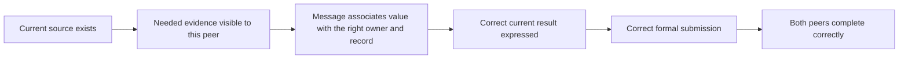

# Coordination, information exchange and final commitments

The course failures make a distinction essential: a team may possess the right
evidence, utter a correct result, agree about it, and still fail to complete the
required actions. The first task is to measure these transitions clearly.

## 1. Distributed information creates a different problem from debate

**C01 — HiddenBench / distributed-information reasoning.** Li, Naito and
Shirado's [v4](https://arxiv.org/html/2505.11556v4) reports a large gap between
full-profile and distributed-profile decisions. Structured exchange and a
host-enforced first-round disclosure intervention improve outcomes; merely
asking for more discussion does not reliably do so. The benchmark selects many
tasks using GPT-4.1 full/hidden performance, and interventions change information
access or the procedure. Its results therefore support distinguishing evidence
surfacing from decision use, not a pure causal estimate of coordination ability.
Appendix prompts and intervention construction are important: mechanically
revealing everyone's facts is stronger than prompting agents to share them.

Our private-shard setting has a related information structure but an easier
exact objective, only two agents, private final actions and a much shorter
horizon. A fixed exchange scaffold may help, but its success would measure
competence with that supplied strategy. The controlled full-report packets
already disclose most of the historical information. They primarily stress
updating, forwarding the new result and completing both submissions.

**C10 — Human hidden profiles.** Stasser and Titus's
[1985 full paper](https://www.uni-muenster.de/imperia/md/content/psyifp/aeechterhoff/vorlesungkommunikation/stasser_titus_unsharedinfogroupdisc_jpsp1985.pdf)
distributes candidate profiles across 228 students in four-person groups.
Discussion often strengthens initial preferences rather than pooling the
unshared evidence. These are judgmental political-choice tasks with pre-rated
attributes, not exact numerical problems. The paper itself distinguishes such
settings from tasks with accepted demonstrable logic. It motivates examining
what information gets introduced and repeated; it does not establish a shared
human/LLM cognitive cause.

**Design lesson:** do not count repeated agreement as independent evidence.
Record whether the necessary current fact was introduced and available to the
recipient. A broadcast supplied by the host and a voluntary peer message are
different treatments, even if they contain identical numbers.

## 2. Why the debate literature appears to disagree

**C07 — Positive debate results.** Du et al.'s
[arXiv v1](https://arxiv.org/html/2305.14325v1), later published at
[ICML 2024](https://proceedings.mlr.press/v235/du24e.html), finds improvements over
single answers, reflection and initial majority voting on arithmetic, GSM8K and
other tasks. The main setup uses three agents and two debate rounds; discussion
adds computation beyond initial voting. Longer, more stubborn exchanges can
help in those settings. This establishes useful positive cases, not a
budget-independent benefit from interaction.

**C03 — Voting accounts for much of the gain.** Choi, Zhu and Li's
[v2](https://arxiv.org/html/2508.17536v2) compares five-agent voting with multiple
debate topologies, models and round counts. Voting often matches or beats debate
at lower communication cost. Its martingale model assumes particular
Dirichlet/count-based updates and neighbor-belief conditions; it is not a theorem
that arbitrary LLM conversations cannot improve reasoning. Agents initially
answer the same question, unlike private-shard teams that need new evidence.

**C04 — Sensitivity and transfer.** Smit et al.'s
[v3](https://arxiv.org/html/2311.17371v3) compares debate with cheaper prompting
and ensembling across medical and reasoning tasks. Performance depends on
hyperparameters and the agreement prompt; a configuration tuned for one model
does not transfer uniformly to another. Best configurations and cross-dataset
selection answer different questions. Its best-result comparisons should not
be interpreted as a frozen, universally superior protocol.

**C02 — Decision rules and unequal discussion.** Kaesberg et al.'s
[ACL Findings paper](https://aclanthology.org/2025.findings-acl.606/) finds different
task preferences for voting and consensus with Llama 3. Voting generally waits
for three discussion rounds, while consensus may stop earlier; reported compute
also differs. Approval voting often ties because agents approve everything.
The rendered results table and methods were checked. This is evidence about
the evaluated decision procedures, not an isolated advantage of an abstract
voting rule at equal opportunity.

The conflict is conditional rather than mysterious. Different studies use
different models, tasks, initial answer quality, budgets, prompts and stopping
rules. “Single agent” can mean one answer, a long reflection, or many independent
samples. A statistically strong comparison inside one setup does not erase
those differences.

For our task, majority voting is especially unattractive. Two agents can tie;
more seriously, their local answers need not be justified global answers. Voting
cannot replace communicating a hidden new value. A host vote would also replace
the adopted requirement that both agents privately commit the correct result.
An independent full-information solver remains a useful diagnostic comparator,
with its distinct access and cost stated explicitly.

## 3. Scaling studies support restraint, not universal thresholds

**C05 — Agent-system scaling.** Kim et al.'s
[v3 preprint](https://arxiv.org/html/2512.08296v3) compares five architectures
across six benchmarks and several model families. Benefits differ strongly by
task. Its regression uses trace-derived coordination quantities, and its domain
complexity score partly incorporates observed degradation. These are not
independent pre-execution causal variables. Dataset clustering weakens several
coefficient claims. The roughly 45% single-agent threshold should not become our
qualification rule. The publisher's final full text was inaccessible here;
preprint and final claims are not treated as identical.

The authors' [v2.2.x correction notice](https://github.com/ybkim95/agent-scaling/blob/v2.2.3/CHANGELOG.md)
also documents an analysis-set correction from 270 to the article's 260 rows.
Their [selection evaluation](https://github.com/ybkim95/agent-scaling/blob/v2.2.3/scripts/architecture_selection_eval.py)
explicitly describes a conditional protocol retaining trace-derived architecture
summaries. These files were inspected, not executed. They reinforce the need to
check source versions and distinguish descriptive prediction from a prospective
architecture-selection guarantee.

**Our inference:** keep two agents and a short fixed horizon for the first main
study. Increasing agents, supervisor roles or rounds adds scientific conditions,
output dependence and qualification cost. Reconsider the original four-peer
teammate-reset question as a later study if two-agent capability and recovery
effects warrant it; do not import a published scaling threshold as a law.

## 4. Grounding theory clarifies the action requirement

**C08 — Grounding in Communication.** Clark and Brennan's
[1991 chapter](https://web.stanford.edu/~clark/1990s/Clark%2C%20H.H.%20_%20Brennan%2C%20S.E.%20_Grounding%20in%20communication_%201991.pdf) separates
presenting information from establishing sufficient acceptance for the current
purpose. Communication media change the costs of acknowledgment, repair and
coordination. This is a conceptual account grounded in conversation examples,
not an LLM intervention trial. The transferable point is purpose-specific
completion, not a demand for explicit acknowledgments in every exchange.

**C09 — Knowledge and common knowledge.** Halpern and Moses's
[JACM paper](https://groups.csail.mit.edu/tds/papers/Halpern/JACM90.pdf) formally
distinguishes distributed, individual and common knowledge. Impossibility
results depend on communication and timing assumptions, including unreliable
delivery and simultaneous coordinated actions. Our central runner has declared
delivery rules and requires two correct submissions, not simultaneous attack.
The theory does not justify an infinite acknowledgment chain or explain our
finite failures as an impossibility result.

**C06 — Coordination games.** Agashe et al.'s
[v3](https://arxiv.org/html/2310.03903v3) separates environment comprehension,
theory-of-mind reasoning and joint planning. Verification and explicit partner
reasoning help some games, with additional calls and task-dependent benefits.
Cross-play and game conventions differ from our exact source-revision task.
These findings motivate component diagnostics; they do not justify adding a
general ToM agent or a multi-call verifier.

Our action contract is already precise: private submission finishes that agent;
message-plus-submit delivers before finishing; waiting wakes only on a message;
calls are limited. A useful common instruction can explain these consequences.
The host should neither submit a value found in prose nor keep a finished agent
alive. Either change would remove the observed commitment problem rather than
measure a policy's ability to handle it.

## 5. Communication can rescue and corrupt

**R02 — ICR communication audit, revisited.** Li et al.'s
[v1](https://arxiv.org/html/2610.01042v1) freezes initial answers, compares message
conditions against a no-message revision opportunity, and separates correction
from corruption. Question-level bootstrap keeps associated directions together.
A sender's correct answer does not certify every statement in its message, and
the intervals omit unobserved initial-generation seeds. Its receiver-revision
setup is not our evolving two-way conversation, but its gain/loss decomposition
is directly useful for interpreting paired policy outcomes.

Report four paired world outcomes for HS versus HSC after revision: both
succeed, only HS succeeds, only HSC succeeds, neither succeeds. Equal aggregate
success can conceal different worlds helped and harmed. The no-change outcomes
show preservation and unnecessary damage. Do not equate no submission with an
incorrect numerical belief; it is a failure on the joint action endpoint.

## 6. A small, observable diagnostic scheme

This is an audit aid, not a proven causal chain. An agent may skip an explicit
intermediate utterance and still solve correctly. Visibility is a property of a
saved request; “understanding” is not directly observed.

| Observation | Evidence required | Interpretation limit |
|---|---|---|
| New private value available | Exact permitted request or delivered message | Availability alone says nothing about use |
| Owner/record association error | Unambiguous statement compared with visible records | Preserve ambiguous wording; do not infer hidden intent |
| Correct result uttered without submission | Text plus actual action fields | Utterance is not an executed commitment |
| Premature unsupported finality | Submission before necessary evidence is available | Could be a lucky guess; exact success scoring still applies |
| Repeated reporting or waiting termination | State transitions and remaining opportunities | Distinguish ordinary repetition, waiting deadlock and exhausted calls |
| Obsolete answer submitted | Submitted old M1 differs from revised truth | Shows stale output, not the mechanism producing it |

Use automatic checks only for exact protocol, delivery and numerical fields.
For semantic associations, a manageable prospective qualitative panel is eight
worlds, one per edit-type × owner × first-speaker stratum, both models and all
four main cells: 64 episodes, at most 384 calls. Select it before outcomes,
independently code the same episodes twice where feasible, adjudicate
disagreements, and retain uncertainty. It illustrates mechanisms; it cannot
estimate their population prevalence accurately or establish counterfactual
causes. This is more defensible than automatically labeling every sentence with
an LLM judge.

## 7. Intervention priorities

Preserve the current legal action interface and common strategy assistance as
the starting point. Test source/notice clarity on development data before
considering more coordination machinery. If a strategy change is necessary,
compare one concrete alternative with the current prompt under the same call
budget and inputs; label the entire prompt package as the intervention.

Compulsory exchange, a secretary, dissenting personas, a supervisor, multiple
verification calls and public shared submissions are plausible different
experiments. Their evidence does not make them repairs to this one. None belongs
in the recommended main factorial without a new question and sufficient budget.
