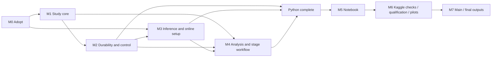

# I-01 course experiment: implementation plan and WBS

**DESIGN ADOPTED — IMPLEMENTATION IN PROGRESS; KAGGLE EXECUTION NOT AUTHORIZED HERE**

Prepared 14 October 2026 against repository `0b0a44a3cf3a0306559a716e5df45b3dbe074ed0`, branch `feat/smaller-natural-experiment`.

This is the implementation reference for the I-01 course study explicitly adopted by the user on 14 October 2026. [Specification §12](../../PROJECT_SPECIFICATION.md#12-adopted-i-01-course-regime) is authoritative. Approval covers implementation and focused lightweight checks only; actual Kaggle readiness, qualification, pilots, freeze and main remain operator stages. The existing roadmap points here instead of duplicating the task list.

The delivery order is **complete Python research scripts → interactive Kaggle notebook → in-notebook validation, qualification, pilots, main execution, and final outputs**. There is **no separate CPU verification phase**. Lightweight mathematical, protocol, persistence, and packaging checks are implemented with the scripts and executed inside the Kaggle workflow before expensive calls. Ordinary code review and syntax checking during development are not a separate research acceptance campaign.

## 1. Delivery objective and scope

Deliver a private, ready-to-upload notebook for online Kaggle T4×2 operation, backed by complete importable Python components. The operator must be able to load models once, execute one meaningful stage, inspect every agent interaction, download a complete checkpoint, and decide when to continue.

Success means a completed, auditable **20-world paired retain/clear study** on authentic SILO-BENCH I-01 mathematics, subject to actual qualification. It does not mean that retention wins. A qualification failure must instead produce a complete, truthful feasibility report and resumable evidence; it must not be presented as completed main research.

Included: native-size worlds and revisions; two-agent communication; phase-final submission; isolated continuations; direct and conditionally available thinking inference; durable attempts and checkpoints; hard attempt admission; staged controls; exact scoring; paired uncertainty and costs; full conversations; figures; portable exports; documented interruption recovery.

Excluded: additional tasks/models, sham arms, mixed retention masks, receipt interventions, message-delay experiments, semantic source certification, a supervisor LLM, LLM judging, general orchestration frameworks, remote experiment services, offline model bundles, and automatic qualification-to-main progression. Preserve existing thesis/course artifacts for future work without adapting their old schedules to this study.

## 2. Evidence and architectural diagnosis

The review covered both [I-01 proposal](../proposals/silo-bench-course-redesign.md) and [pre-implementation review](../proposals/silo-bench-course-redesign-review.md), the governing documents, the study/runtime modules, notebook builders, bootstrap/workflow scripts, and saved Kaggle evidence. Findings are source inspection or previously recorded evidence, not newly executed validation.

| Verified starting point | Planning consequence |
|---|---|
| `recovery/tasks.py` fixes four peers and five other task families | I-01 and two-peer lifecycle need an explicit new regime; no dummy peers or fabricated four-peer barriers |
| `state.py`, `rounds.py`, `runner.py`, and request registration in `storage.py` encode fixed rounds | Reuse durable-call mechanisms, not the old round contract |
| `ProcessProvider` owns a resident child and binds it to one worker store; old workflow uses separate stage databases and closes its scheduler after execution | Keep two canonical worker stores across the new study and a session controller alive across notebook stages |
| Existing provider startup/readiness records are anchored to the first attempt | Support explicit session-level loading/process evidence without inventing an LLM attempt for a load-only operation |
| `inference.py` checks exact old rendering/settings and hardcodes non-thinking; its timeout path includes loading | Adapt the I-01 request boundary, separate load readiness from inference timing, and support the two declared modes explicitly |
| WAL/FULL SQLite, exclusive writer ownership, persist-before-effects, exact saved inputs, bounded subprocess cleanup, and backup support already exist | Preserve these mechanisms and their evidence; no second database technology or event bus |
| The old notebook has nine cells, five code cells, and a Run All workflow that automatically qualifies/freezes/executes | Replace orchestration and user experience; wrapping `run_all` in more cells is insufficient |
| Latest 9B run loaded on two T4s but failed the 110,416-token envelope's headroom gate; 11/21 ordinary replies were valid and three full-information controls were wrong | Short-envelope hardware and actual I-01 competence remain mandatory; notebook completion is not scientific acceptance |
| Latest 4B fallback hit file-byte accounting; backups inflated 45 historical attempts to a derived 67 | Use exact native file inventory and explicit canonical DB paths; do not import the old fallback or broad worker globs |
| Existing acceptance candidate uses an isolated Linux Python 3.13 environment | Reuse that candidate where compatible; inspect the actual Kaggle interpreter/image before installation, not the Windows development environment |

Evidence anchors: [GPU diagnosis](../validation/course-kaggle-final-online-6-analysis.md), [diagnostic receipt](../../notebooks/validation/course-kaggle/final-online-6-analysis.json), [repair proposal](../validation/course-kaggle-final-online-6-proposal.md), [durability validation](../validation/course-m3-durable-workers-and-failures.md), [CPU/report evidence](../validation/course-m4-report-and-cpu-gate.md), and [technical synthesis](../implementation-research/SYNTHESIS.md). The previous 6,280 main logical outcomes remain unknown. None is an I-01 result.

## 3. Scientific decisions to adopt before implementation

M0 should adopt one short I-01-specific specification section. This plan recommends the reviewed design below; it does not treat every earlier proposal choice as already accepted.

| Topic | Recommended adoption |
|---|---|
| Question | Practical effect of retaining versus clearing prior communication after withdrawing a previously winning value; no correction-specific or pure-anchoring claim |
| Native task | Two agents, 20 integers each, original uniform integer range −1000…1000; both submit the global maximum |
| Main population | 20 independently sampled eligible worlds, one realized prefix each; never select by model success |
| Edit | Unique global maximum at record `r`; remaining maximum `M2 > −1000`; replace `r` uniformly in `[-1000, M2−1]`; revised truth is `M2`; record mathematical rejections, with at most 1,000 proposals per world |
| Views | Current private shard is authoritative. Retain keeps only the agent's own previously visible messages/submissions; clear removes those. No hidden shard, global transcript, evaluator truth, policy label, or eligibility rule enters prompts |
| Notice | Both agents learn the owner/record changed; owner receives its new value/current shard. No before-value in either agent-facing receipt. Old/new truth remains in the audit archive |
| Communication | One possible recipient; ordinary text, optional integer submission, or waiting; message-only turns do not require candidates. No source attachments or host verification of message claims |
| Finality | Submission is final within a phase. Send-and-submit delivers the explicit message then finishes the sender. Later messages are archived and do not invalidate that answer. Only the factual revision reopens both agents |
| Visibility | Submission values are evaluator-private unless explicitly messaged. Status may indicate an agent has finished, never whether it is correct. No mandatory acknowledgement or correctness feedback |
| Limits | At most three invocations per agent per phase, six total; no transfer of unused turns; early procedural completion and waiting are permitted |
| Invalid calls | A malformed/truncated reply delivers no action, consumes its turn, and remains in the audit. Bounded nonsemantic feedback may be shown on a later permitted turn. That later turn is not a retry of the failed call |
| Termination | Both submitted; exhausted legal opportunities; or no unsubmitted agent can progress. Disagreement and wrong answers can complete. Stop resource/provider defects separately from ordinary mathematical failure |
| Controls/development | Six qualification worlds; three separate complete pilot worlds with original/revised full-information controls; one revised full-information control per main world |
| Order/seeds | Five main worlds per changed-owner/recovery-first-speaker combination. Save prefix order explicitly, preferably the same first speaker for simplicity. Match recovery order and per-agent invocation seeds within sibling pairs; balance retain-first/clear-first execution order |
| Mode | Direct 9B first; thinking only after a justified direct competence failure, never an automatic remedy for protocol defects |
| Outcomes | All-world paired team success; correct-prefix descriptive stratum; principal practical effort is post-revision ready-model inference time. Report calls/tokens/messages and failures jointly |
| Allocation | 380 main + 60 pilot + 24 possible qualification + 8 hardware/state + 28 contingency = 500 new physical attempts |

The task distribution, mathematical answer, and native two-agent size come from [official I-01](https://github.com/jwyjohn/acl26-silo-bench/blob/e74127782ed1c42fff474249961f022c063d76f2/benchmark_generator/paradigm_i.py#L53). Revisions, conditioning, retention, bounded sequential turns, and reopening between phases are experimental adaptations. Label outputs accordingly.

Additional adoption details must be explicit, not improvised in notebook cells:

- A control uses the same scalar submission/action validation, complete inputs, and no peer communication. Qualification original/revised pairs share six worlds; they are not twelve independent worlds.
- A known terminal timeout consumes its attempt and turn; it never inherits a previous answer. Confirm process termination. An unresolved attempt blocks further work until reconciled. Hardware/nonfinite/cache defects stop dispatch immediately.
- Do not replay continuation responses across treatments. Share the prefix once; exact resume reuses durably recorded outputs without inference.
- Freeze a short transcript-review rubric, feedback bound, seeded bootstrap procedure, and selected runtime/settings before main. Propose 95% exploratory world-bootstrap intervals, preserving sibling pairs and the four five-world schedule strata; show raw paired outcomes and degeneracy caveats.
- Use a provisional 600-second load deadline, 180-second direct-call deadline, and 900-second thinking-call deadline for initial qualification, with bounded termination and separate download timeouts. Freeze adequate selected-mode bounds from the observed evidence before main; changing them later is not an invisible operational tweak.
- Approval of this plan's preparation is not execution authorization. Later operator actions authorize only the displayed bounded stage; a passed gate never triggers the next one automatically.

## 4. Target architecture and reuse boundaries

### 4.1 Small, explicit Python components

Prefer an isolated `recovery/i01/` package for study-specific mathematics, views/protocol, lifecycle, study scheduling, and analysis/reporting. Keep reusable physical inference, persistence, and process utilities in the existing package. Exact file splits can follow implementation needs; do not build factories or registries for hypothetical tasks.

Proposed delivery surfaces:

- `recovery/i01/`: the complete study library, importable without loading a model.
- `scripts/i01_course.py`: finite stage commands and a session command loop using that library; also supports read-only status, analysis, and export without CUDA.
- `scripts/build_i01_course_notebook.py`: reproducible thin notebook construction using the same interfaces.
- `configs/i01-course.json` and an I-01 runtime lock: adopted study choices and actual dependency/model pins, separate from old course defaults.
- `notebooks/i01_course_kaggle.ipynb`: operator-facing notebook, generated with no executed research output or credentials.
- A small source wheel/archive and integrity manifest: sufficient for a private Kaggle input attachment; dependencies and weights are retrieved online. A pinned accessible Git commit is an optional source transport, not a requirement to publish the repository.

Update the explicit package list in [pyproject.toml](../../pyproject.toml) if adding a subpackage. Do not accidentally ship a notebook that imports code absent from the built wheel.

### 4.2 Responsibilities and disposition

| Existing asset | Treatment for I-01 |
|---|---|
| [tasks](../../recovery/tasks.py), [edits](../../recovery/edits.py), [truth](../../recovery/truth.py) | Reuse mathematical conventions and attribution; implement a small I-01 binding/oracle without modifying existing families |
| [state](../../recovery/state.py), [prompts](../../recovery/prompts.py), [protocol](../../recovery/protocol.py), [rounds](../../recovery/rounds.py), [events](../../recovery/events.py) | New I-01 views, optional scalar actions, phase-final lifecycle, and exact transcript transformation; reuse validation/tokenization primitives only where semantics match |
| [storage](../../recovery/storage.py), [runner](../../recovery/runner.py) | Preserve raw-attempt transactions and durable identity; separate single-turn registration/checkpoints from four-peer barrier registration. Do not encode I-01 as synthetic old rounds |
| [attempts](../../recovery/attempts.py), [workers](../../recovery/workers.py) | Reuse spawn, one writer, bounded termination, and fresh model ownership. Replace old schedule dispatch with a small stage/world controller |
| [inference](../../recovery/inference.py), [T4 attention](../../recovery/t4_attention.py) | Reuse demonstrated text-only NF4 loading and numerical/cache checks; adapt exact request framing, mode, limits, eager loading, and measurements |
| [accounting](../../recovery/accounting.py), [costs](../../recovery/costs.py) | Reuse distinction between physical attempts, logical attribution, observed GPU time, and unknown costs. Replace old schedule/population assumptions and automatic stage admission |
| [analysis](../../recovery/analysis.py), [uncertainty](../../recovery/uncertainty.py), [report](../../recovery/report.py), [figures](../../recovery/figures.py) | Reuse read-only access, literal trace rendering, and export utilities; new compact episode-level tables/plots instead of fixed-round AUC and five-family reports |
| [online assets](../../scripts/m5_course_smoke_assets.py), [bootstrap](../../scripts/course_kaggle_bootstrap.py), [workflow](../../scripts/course_kaggle_workflow.py), [builder](../../scripts/build_course_kaggle.py) | Reuse reviewed download/integrity/snapshot primitives selectively. Replace Run All, automatic fallback/freeze, large old fixtures, and stage teardown behavior |

A bounded separation of the existing attempt ledger from old round registration is justified by actual coupling in `WorkerStore`; a general persistence rewrite is not. Historical databases remain read-only and unmigrated. Use new study databases with explicit schema identity; keep one canonical representation of each record.

### 4.3 Session and model ownership

Use one notebook-owned local session controller and two serial GPU workers, one replica per T4. Keep each worker and its canonical SQLite store for the entire study, with stage-tagged calls. Models can remain resident while workers are idle between notebook stages. Never share KV/recurrent state across agent calls.

The existing isolated environment is useful: a small notebook client can maintain a pipe to a controller launched with the pinned environment's Python. The controller owns the existing spawned worker/provider pattern. This avoids replacing the notebook kernel's Torch stack or reloading weights for every shell command. The command loop is local, finite, and study-specific: no HTTP server, port management, remote service, or general job queue.

Notebook variables are convenience handles, not durable truth. On kernel loss, owned pipes/process monitoring must stop descendants; on restart, reconstruct the session from saved inputs and DBs. A model-loading cell should load/verify without a hidden generation. Every warm-up or functional probe counts in its declared attempt allocation.

Keep loading identity separate from per-call direct/thinking settings. Mode changes are permitted only for the predeclared qualification candidates; record exact settings on every call and never reinterpret old replies. If switching safely requires reload, reuse cached weights, record startup cost, and qualify the selected mode's envelope afterward.

Store load/process lifecycle evidence in the canonical run records at session scope. The old process table's first-attempt linkage must not force a fake generation row or uncounted warm-up. Bind placement to two logical worker slots; record actual GPU UUIDs on each session. Resume may use different physical T4s with the accepted hardware class/runtime and new envelope evidence. It must not require an impossible identical-device UUID across Kaggle sessions.

### 4.4 Storage and state transitions

Authoritative records are the adopted input/configuration manifest and **two explicitly enumerated canonical worker DBs**. Episode checkpoints, raw outcomes, and effects have one owner. Progress JSON, HTML, CSV, and ZIPs are derived exports. Small gate/freeze/action records must live in the existing run metadata, not a new parallel status database.

For each actual call: bind exact permitted view/request/settings/seed → durably admit attempt → generate → persist raw outcome/failure → validate → atomically commit action effects and episode checkpoint. A crash after raw persistence resumes validation/effects; it does not call the model again. Transactions never remain open during inference.

The run sequence is:

```text
adopted inputs -> loaded environment -> readiness checks -> direct screen
             -> optional thinking screen -> selected-mode envelope
             -> pilot 1 -> inspect/export -> pilot 2 -> inspect/export
             -> pilot 3 -> inspect/export -> explicit freeze
             -> explicit main batch -> inspect/export -> next explicit batch
             -> final read-only analysis -> portable final export
```

Every arrow denotes a separately requested stage after prerequisites pass. No arrow is automatic authorization.

## 5. Resource accounting and admission

| Scope | First-attempt ceiling |
|---|---:|
| Main prefixes: 20 × 6 | 120 |
| Main retain/clear: 20 × 2 × 6 | 240 |
| Revised main controls: 20 × 1 | 20 |
| Three complete pilots: 3 × (6 + 12 + 2) | 60 |
| Direct screen: 6 × 2 | 12 |
| Conditional thinking screen: 6 × 2 | 12 |
| Six short state checks + two selected-mode envelope checks | 8 |
| **Maximum planned first attempts** | **472** |
| Additional diagnostics, justified requalification, and eligible interruption attempts | **28** |
| **Hard whole-study maximum** | **500** |

Direct-only planned first attempts are 460 and its ceiling including contingency is 488. Unused thinking or early-completion capacity does not automatically add worlds. There are 29 worlds: six qualification, three pilot, twenty main. Main has 20 prefix episodes, 40 recovery episodes, and 20 single-call controls. Its maximum physical first attempts are 380; attributing the shared prefix to both end-to-end policies yields 500 logical main uses. That last number is not the whole-study physical-attempt count.

The controller must serialize admission across both workers. Reserve capacity for in-flight work and durably register an admitted attempt before dispatch; workers cannot independently spend the last available attempt or retry without admission. Count every admitted generation invocation, including failures before a response. Load-only and download operations make zero LLM attempts but consume measured setup time. Keep the previous 45 historical attempts separate.

At most one identical infrastructure retry is allowed when no durable outcome exists and prior termination is established. Malformed outputs, wrong answers, truncation, and recorded terminal timeouts are not retryable. Extra model diagnostics and reload checks consume the same contingency; network/download retries are separately bounded setup operations, never model-attempt forgiveness.

Suggested main batches contain **two predetermined worlds**, at most 38 first attempts, one world per GPU. A one-world batch costs at most 19 and is available near a deadline or when reducing recovery exposure is more important than utilization. Do not dynamically select worlds based on results. A batch can pause partway and resume its same IDs.

Protect enough time for the next bounded call, process termination, and export before dispatch. Use the actual remaining session allowance and measured costs; do not inherit old 30/100-hour or 71-attempt rules. The notebook must show:

- Actual attempt count, in-flight reservations, contingency spent, and hard remaining allowance.
- Known/unknown episode coverage and the worst-case remaining scheduled attempts.
- Ready-model inference seconds, load/setup seconds, and observed allocated-device time separately.
- A measured completion forecast with uncertainty, session deadline, and export reserve.

The prior illustrative 500-attempt estimates—7.20 aggregate compute-hours at 250 output tokens/7 tokens per second, 18.36 at 700/7, and 35.72 at 1,200/6—are sensitivities, not admission evidence. Two allocated T4s continue consuming resources during manual inspection and while one worker is idle. Actual Kaggle quota units and session limits must be read from the active account/UI; no availability promise belongs in the notebook.

## 6. Milestones, dependencies, and effort

Effort is focused engineering/operator time for one engineer assisted by Codex, excluding model/download waiting and external approval delays. Ranges reflect reuse, not a greenfield platform. All tasks below are **planned**. Risk IDs refer to Section 11.

| Milestone | Outcome | Effort |
|---|---|---:|
| M0 | Adopted contract and one execution baseline | 3–5 h |
| M1 | Complete I-01 mathematics, protocol, and schedules | 12–20 h |
| M2 | Durable bounded execution and portable recovery | 17–27 h |
| M3 | Resident inference, online environment, embedded checks | 16–26 h |
| M4 | Complete Python stage workflow, analysis, and reports | 14–21 h |
| M5 | Polished thin Kaggle notebook | 11–18 h |
| M6 | Actual Kaggle readiness, qualification, individual pilots, freeze | 7–12 h plus compute |
| M7 | Main batches, final audit, outputs, and handoff | 7–12 h plus compute |
| **Total** | | **87–141 h; approximately 11–18 focused working days** |

Critical path: **M0 → M1 → M2 → M3/M4 integration → Python-complete handoff → M5 → M6 → M7**. Environment preparation and report development can proceed alongside core work once their contracts are fixed, but notebook construction starts only after the Python interfaces and all required capabilities are complete. Target acceptance occurs on Kaggle in M6, not in an intermediate local CPU milestone.



### M0 — Formal adoption and boundaries

#### M0-T01 — Adopt the reviewed course contract

- **Objective/change:** document Section 3's final scientific choices as a separately identified I-01 regime, preserving old thesis/course semantics and artifacts.
- **Existing anchors:** `PROJECT_SPECIFICATION.md`, both I-01 proposal/review files, `docs/IMPLEMENTATION_PLAN.md`.
- **Dependencies:** explicit later authorization to adopt the scientific changes.
- **Deliverable/acceptance:** adopted I-01 specification covering population, views, finality, outcomes, qualification, and 500-attempt allocation; no unresolved difference between proposal and review enters implementation implicitly.
- **Risks:** R01. **Effort:** 2–3 h.

#### M0-T02 — Bind the implementation scope and session handoff

- **Objective/change:** set the new regime/configuration identity, planned input groups, finite stage list, artifact ownership, and WBS statuses; point the old living handoff to this plan.
- **Existing anchors:** manifests/configuration conventions, source manifests, existing plan and repository contract.
- **Dependencies:** M0-T01.
- **Deliverable/acceptance:** one traceable implementation baseline and status table; each later session knows the active task and permitted files; no duplicate todo tree or competing progress authority.
- **Risks:** R01, R14. **Effort:** 1–2 h.

### M1 — I-01 study core

#### M1-T01 — Native worlds, eligibility, edits, and exact truth

- **Objective/change:** implement original two-shard generation with local RNG streams, unique-winner eligibility, uniform legal replacement, bounded mathematical rejection, saved actual inputs, and an independent maximum oracle. Use vendored cases as references, not a runtime import that resets global RNG state.
- **Existing anchors:** `tasks.py`, `edits.py`, `truth.py`, native generator and `I-01_n2.json`; new I-01 mathematics component.
- **Dependencies:** M0.
- **Deliverable/acceptance:** disjoint six/three/twenty world groups; saved edit/ownership data; native fixture gives 827 and the documented `827→100` revision gives 780; duplicate/negative/boundary cases included in the embedded checks. No model outcome affects sampling.
- **Risks:** R02, R03. **Effort:** 3–5 h.

#### M1-T02 — Permitted views and small action protocol

- **Objective/change:** render current private inputs, literal visible history, and new-value-only notices; validate message/wait/optional integer submission without old routing/reference/vector requirements.
- **Existing anchors:** `state.py`, `prompts.py`, `protocol.py`; native tokenizer/framing conventions.
- **Dependencies:** M0-T01, M1-T01.
- **Deliverable/acceptance:** a defined action schema and bounded nonsemantic error notice; strict integers exclude booleans/coerced prose; hidden truth, partner private arrays, private submissions, and before-values do not leak. Raw invalid outputs remain available offline.
- **Risks:** R02, R04, R05. **Effort:** 3–5 h.

#### M1-T03 — Natural bounded lifecycle and sibling boundary

- **Objective/change:** implement eligible turn-taking, phase-final submissions, wait wake-up for unfinished peers, cap/deadlock termination, drained prefix snapshots, and one literal retain/clear fork.
- **Existing anchors:** `rounds.py`, `events.py`, `runner.py`; new I-01 lifecycle.
- **Dependencies:** M1-T02.
- **Deliverable/acceptance:** normal three-call collaboration is representable; confirmations never retract a final answer; premature finishing remains observable; both agents reopen only at the event; no gold-dependent stop or extra turn. Capped/failed prefixes remain valid inputs to the specified continuations.
- **Risks:** R04, R06. **Effort:** 4–6 h.

#### M1-T04 — Stable schedules, seeds, and scope accounting

- **Objective/change:** prepare all world/order/seed identities and finite call opportunities for qualification, pilots, controls, and main; eliminate mixed-mask/Q replay dependencies.
- **Existing anchors:** `schedule.py`, `manifests.py`, `populations.py`, identity-based random streams.
- **Dependencies:** M1-T01, M1-T03.
- **Deliverable/acceptance:** owner/first-speaker balance; fixed device/batch placement and treatment order; matched per-agent invocation seeds across siblings; 472 maximum planned first attempts; early completion marks unused opportunities explicitly rather than missing.
- **Risks:** R03, R07. **Effort:** 2–4 h.

### M2 — Durable bounded execution

#### M2-T01 — Adapt request registration and episode checkpoints

- **Objective/change:** separate old four-peer registration from reusable attempt storage; persist one I-01 request and episode checkpoint without fake rounds or peers.
- **Existing anchors:** `storage.py`, `runner.py`, existing SQLite transaction and checkpoint machinery.
- **Dependencies:** M1-T02–T04.
- **Deliverable/acceptance:** new-regime databases have exact requests, settings, seeds, raw replies/failures, committed delivery/submission state, and explicit schema identity; old databases are untouched. One checkpoint representation owns effects; do not persist a competing mutable episode state elsewhere.
- **Risks:** R06, R14. **Effort:** 6–10 h.

#### M2-T02 — Exact resume, interruption, and idempotent effects

- **Objective/change:** reconcile admitted/running/completed/interrupted calls; apply durable outcomes once; distinguish failed slots from unknown work and enforce identical bounded retry semantics.
- **Existing anchors:** `storage.py`, `attempts.py`, existing real-kill and durable-worker evidence.
- **Dependencies:** M2-T01.
- **Deliverable/acceptance:** interruption before output, after output, and after effect commit has a defined recovery path; completed responses never regenerate; repeated cell/stage requests do not duplicate messages; unconfirmed worker termination blocks replacement.
- **Risks:** R06, R08. **Effort:** 3–5 h.

#### M2-T03 — Global budget admission and finite batch control

- **Objective/change:** coordinate two workers with one serialized admission owner; retain per-worker evidence while counting reservations, actual attempts, retries, and stage ceilings globally.
- **Existing anchors:** `workers.py`, `accounting.py`, `attempts.py`, `costs.py`.
- **Dependencies:** M1-T04, M2-T01–T02.
- **Deliverable/acceptance:** concurrent dispatch cannot exceed 500; backup copies never add attempts; 499 spent permits only one further admission; explicit pause stops dispatch and drains bounded in-flight calls. Status is derived from canonical paths, not filenames or notebook counters.
- **Risks:** R07, R08. **Effort:** 4–6 h.

#### M2-T04 — Consistent snapshots, portable archives, and restore

- **Objective/change:** adapt backup/export to paused workers with models still resident; package exact source/configuration, all canonical DB snapshots, reports, and environment evidence without weights/venvs.
- **Existing anchors:** `WorkerStore.backup`, `backup_bundle`, safe extraction and existing source manifests.
- **Dependencies:** M2-T01–T03.
- **Deliverable/acceptance:** all writers acknowledge the same quiescent boundary; SQLite backups pass integrity checks; ZIP CRC and reopened counts agree; failed export leaves the last good archive intact. Restore accepts one selected ZIP or Kaggle-expanded directory with the same verified contents, and rejects conflicts, unsafe members, and incompatible configuration before any model call.
- **Risks:** R06, R08, R09. **Effort:** 4–6 h.

### M3 — Inference, environment, and embedded checks

#### M3-T01 — I-01 inference adapter and truthful measurement

- **Objective/change:** retain pinned 9B NF4/T4 loading; support I-01 exact request validation, direct/thinking framing, output caps, fresh state, finite scores, ready-model timing, and raw token retention.
- **Existing anchors:** `inference.py`, `t4_attention.py`, `m5_model_feasibility.py`, accepted loading inspection.
- **Dependencies:** M1-T02, M2-T01; can start after view contract is fixed.
- **Deliverable/acceptance:** 8,192 **input** limit; 512 direct output or 4,096 total thinking output with 512 visible final cap. Resident bounds are 8,704/12,288, not an accidental 8,192 total. All decoding tokens/time count; hidden thinking never enters subsequent agent history. Loading time is not reported as ready-model inference.
- **Risks:** R05, R10, R11. **Effort:** 5–8 h.

#### M3-T02 — Persistent, notebook-owned local session

- **Objective/change:** provide explicit load, stage, inspect, pause, snapshot, and close commands through one retained controller; keep both model processes resident across qualification/pilot/main boundaries.
- **Existing anchors:** `ProcessProvider`, `LocalScheduler`, owner-sentinel/pipe cleanup; proposed `scripts/i01_course.py`.
- **Dependencies:** M2-T03, M3-T01.
- **Deliverable/acceptance:** one active controller per study; workers use the intended isolated interpreter and GPU mapping; no closure merely because a cell returns. Controller/kernel loss cannot leave uncontrolled generators. Session-level loading/process evidence requires neither a fake attempt nor a hidden warm-up. Repeated load/status requests do not create duplicate replicas.
- **Risks:** R08, R10, R12. **Effort:** 5–8 h.

#### M3-T03 — Online installation and model retrieval

- **Objective/change:** create a small verified source delivery and online pinned dependency/model installation; validate current host compatibility before large downloads.
- **Existing anchors:** `pyproject.toml`, bootstrap/assets helpers, reviewed Python 3.13 candidate lock and model inspection metadata.
- **Dependencies:** M0-T02, M3-T01's supported configuration.
- **Deliverable/acceptance:** explicit interpreter/package/CUDA inventory; correct native file sizes/hashes rather than tensor-payload totals; partial-download reuse; measured scratch/output capacity; bounded transport retries. No 4B staging, multi-gigabyte upload bundle, unpinned upgrade, or mid-session environment replacement.
- **Risks:** R09–R11, R14. **Effort:** 3–5 h.

#### M3-T04 — Lightweight Kaggle self-check package

- **Objective/change:** package targeted mathematical, view, lifecycle, budget, persistence, restore, and tokenizer checks for execution in notebook cells; reuse unchanged historical evidence.
- **Existing anchors:** existing reference fixtures and focused checks, `tests/` durability patterns, M1/M2 components.
- **Dependencies:** M1, M2, M3-T01.
- **Deliverable/acceptance:** a bounded check command with a compact receipt and zero model attempts. Includes confirmation loop counterexample, waiting/finality, literal retention, unknown-versus-failure, 499-attempt admission, backup duplication, and before/after-persistence interruption using scripted responses in temporary test DBs. It does not run a separate full legacy CPU campaign.
- **Risks:** R02, R06, R07. **Effort:** 3–5 h.

### M4 — Complete Python workflow and research outputs

#### M4-T01 — Stages, gates, and operator actions

- **Objective/change:** complete explicit commands for initialization/restore, readiness, each qualification mode, each pilot, freeze, a chosen main batch, status, analysis, export, and shutdown.
- **Existing anchors:** finite workflow patterns from `course_kaggle_workflow.py`; M1 schedule and M2/M3 controller.
- **Dependencies:** M1–M3 interfaces complete.
- **Deliverable/acceptance:** every stage checks durable prerequisites; successful execution never invokes the next expensive stage; requests bind an explicit scope and repeat safely. Scientific failures return inspectable evidence; only the operator selects the conditional next action.
- **Risks:** R01, R07, R12. **Effort:** 3–5 h.

#### M4-T02 — Exact evaluation, paired uncertainty, and cost accounting

- **Objective/change:** implement episode/team success, original-prefix strata, revised controls, paired counts/contrasts, unknown bounds, and accuracy-cost summaries.
- **Existing anchors:** `evaluate.py`, `analysis.py`, `uncertainty.py`, `costs.py`.
- **Dependencies:** M1 truth/schedule, M2 evidence schema, M3 measurements.
- **Deliverable/acceptance:** 20-world intended denominators survive missingness; unused turns are not unknown outcomes; bootstrap keeps siblings together; a zero-width interval is qualified; no success-only efficiency claim or arbitrary combined score. Shared prefix charged once physically and to each hypothetical policy logically.
- **Risks:** R03, R07, R13. **Effort:** 4–6 h.

#### M4-T03 — Full trace reports, figures, and archive contents

- **Objective/change:** create readable episode timelines and concise research figures/tables from canonical records; expose all outcomes, not selected anecdotes.
- **Existing anchors:** `report.py`, `figures.py`, literal HTML/CSV/JSON export helpers.
- **Dependencies:** M4-T02, M2-T04.
- **Deliverable/acceptance:** outputs in Section 10; exact visible conversations and downloadable raw tokens/thinking; malformed text safely escaped; per-pilot and per-batch reports include failures, spending, and unknowns. Reporting never imports a generation path or repairs answers.
- **Risks:** R02, R09, R13. **Effort:** 4–6 h.

#### M4-T04 — Python-complete integration handoff

- **Objective/change:** finish package installation, finite command/API surfaces, release manifest, usage documentation, and status/error conventions before notebook construction.
- **Existing anchors:** `pyproject.toml`, command entry points, source/archive builders, this WBS.
- **Dependencies:** M1–M4-T03.
- **Deliverable/acceptance:** no research logic remains to be implemented in a notebook cell; setup/load, qualification, each pilot, main scope, inspection, export, and restore all have implemented script paths. Embedded checks are packaged and pending target execution. Mark “implemented; Kaggle validation pending,” not “verified.”
- **Risks:** R12, R14. **Effort:** 3–4 h.

### M5 — Polished Kaggle notebook, after Python completion

#### M5-T01 — Build the stage-organized notebook

- **Objective/change:** implement Section 7's cell design with clear prerequisites, stage costs, current status, and concise operator instructions.
- **Existing anchors:** old notebook builder and small source packaging; new script interfaces from M4-T04.
- **Dependencies:** M4-T04.
- **Deliverable/acceptance:** ready-to-upload `.ipynb`, internet/T4×2 instructions, small source attachment or pinned source retrieval, and no hidden “run all research” call. Every cell can be rerun and reports missing prerequisites without executing them.
- **Risks:** R10, R12. **Effort:** 3–5 h.

#### M5-T02 — Explicit controls and live progress

- **Objective/change:** provide stage-specific buttons/panels, one active action, progress output, and pause/close controls using the existing session, not new scientific logic.
- **Existing anchors:** M3-T02 controller, M4-T01 actions, notebook display facilities.
- **Dependencies:** M5-T01.
- **Deliverable/acceptance:** rendering cells or Run All does not start inference; a deliberate stage-button action has one bounded scope. Double-click/rerender cannot duplicate work. A finite background dispatch loop keeps the notebook responsive and supports pause; all durable state stays in workers, not widgets.
- **Risks:** R07, R08, R12. **Effort:** 4–6 h.

#### M5-T03 — Per-pilot and incremental inspection/download experience

- **Objective/change:** add world/agent transcript selection, outcomes, diagnostics, cost counters, and direct archive/report links after every pilot and main batch.
- **Existing anchors:** M4-T03, M2-T04, notebook HTML/table display.
- **Dependencies:** M5-T01–T02.
- **Deliverable/acceptance:** operator can inspect and download a pilot's complete output without launching another stage; failure paths expose the same controls; all rows remain available beyond display truncation. Next-stage controls require previous report/export readiness, not a claimed successful browser download.
- **Risks:** R09, R12, R13. **Effort:** 2–4 h.

#### M5-T04 — Notebook integration and delivery review

- **Objective/change:** inspect cell ordering, repeatability, fresh/restore modes, source inclusion, credentials, empty outputs, and stage boundaries before upload.
- **Existing anchors:** notebook JSON checks and source-manifest patterns; M4 release.
- **Dependencies:** M5-T01–T03.
- **Deliverable/acceptance:** one consistent script/notebook release; code cells contain orchestration/display only; no model weights or secrets in delivery. The checklist explicitly labels widget rendering, process persistence, and Kaggle download behavior as requiring M6 target verification.
- **Risks:** R12, R14. **Effort:** 2–3 h.

### M6 — Validate directly inside Kaggle and qualify

#### M6-T01 — Actual host, installation, self-check, and restore acceptance

- **Objective/change:** run the first notebook stages on actual online T4×2; execute packaged lightweight checks, including snapshot reopen, before model inference.
- **Existing anchors:** delivered notebook, M3-T03–T04, M2-T04.
- **Dependencies:** M5 complete and later bounded validation authorization.
- **Deliverable/acceptance:** actual host/dependency/source receipts, two distinct T4s, writable/capacious paths, passing lightweight checks, functional controls/download links, and restored scripted state with zero model attempts. Refuse incompatible environments before loading weights.
- **Risks:** R06, R09–R12. **Effort:** 1–2 h active, plus installation/download time.

#### M6-T02 — Resident GPU checks and selected-mode qualification

- **Objective/change:** load models, run six short A/B/A checks across the two GPUs, run the 12 direct controls, optionally run 12 thinking controls, then two selected-mode envelope generations.
- **Existing anchors:** M3 inference/controller, M4 gates, saved development inputs.
- **Dependencies:** M6-T01.
- **Deliverable/acceptance:** finite output, correct loading/device placement, fresh state instrumentation, ≥11/12 exact controls and no malformed/truncated final action for the selected mode, and ≥1.5 GiB observed free headroom on each selected envelope. Force the full output reserve only in the labeled envelope diagnostics; never force scientific answers. A/B/A equality is supporting evidence, not a substitute for cache checks or a promise of universal determinism. Every attempt is counted; report failure rather than auto-switching stages.
- **Risks:** R05, R10, R11. **Effort:** 2–3 h active plus measured inference time.

#### M6-T03 — Three individually controlled pilots and inspection handoffs

- **Objective/change:** execute pilot 1, stop/export/inspect; then separately pilot 2 and pilot 3. Preselect structural coverage rather than favorable outcomes.
- **Existing anchors:** M4 stage/report paths, M5 pilot cells, M6-T02 selected mode.
- **Dependencies:** M6-T02; each later pilot requires the preceding inspection/export checkpoint.
- **Deliverable/acceptance:** three downloadable complete pilot checkpoints; all three original teams and six full-information controls correct; genuine original collaboration; zero malformed/truncated actions or unresolved implementation/resource defects. Recovery mathematics may fail without disqualifying the model solely for an unfavorable effect; investigate deadlock/cap/protocol-dominated failures before proceeding.
- **Risks:** R04, R05, R09, R13. **Effort:** 3–5 h active plus at most 60 first-attempt calls.

#### M6-T04 — Explicit freeze and main admission

- **Objective/change:** review all pilots, freeze one mode/runtime/prompt/interface/input/schedule/rubric, and accept a measured full-study resource forecast.
- **Existing anchors:** M0 contract, M4 gates, all M6 evidence.
- **Dependencies:** M6-T03 and later freeze/main authorization.
- **Deliverable/acceptance:** portable pre-main archive and immutable freeze record; no automatic main execution. If a change is needed, consume declared development contingency for justified requalification or stop; never silently promote an altered configuration.
- **Risks:** R01, R05, R07, R13. **Effort:** 1–2 h.

### M7 — Main execution and completed research outputs

#### M7-T01 — Execute manageable main batches

- **Objective/change:** run the fixed twenty worlds in explicit one/two-world scopes; inspect/export after each scope; resume incomplete IDs exactly.
- **Existing anchors:** frozen study, M5 batch panels, canonical DBs and archive mechanism.
- **Dependencies:** M6-T04.
- **Deliverable/acceptance:** all intended prefix, retain/clear, and revised-control outcomes recorded or honestly unresolved; no effect-dependent stopping, replacements, extra seeds, or main model changes. Every batch ends with visible remaining budget and a verified archive.
- **Risks:** R07–R09, R13. **Effort:** 2–4 h active plus model runtime and chosen inspection time.

#### M7-T02 — Final read-only evaluation and trace audit

- **Objective/change:** reconstruct tables/figures from canonical snapshots, review all traces using the frozen rubric, and explain accuracy/effort jointly.
- **Existing anchors:** M4 analysis/reporting and all recorded main evidence.
- **Dependencies:** M7-T01 completion or an explicitly reported terminal feasibility/resource stop.
- **Deliverable/acceptance:** intended coverage, paired results, correct-prefix denominator, uncertainty/missingness bounds, failure categories, resource totals, and limitations agree across outputs. No reporting path can create a worker or generate missing evidence.
- **Risks:** R02, R07, R13. **Effort:** 3–5 h.

#### M7-T03 — Reproducibility export and course handoff

- **Objective/change:** produce the final archive, concise research write-up, and fresh-directory read-only reconstruction; close model processes and document session shutdown.
- **Existing anchors:** M2 export/restore, M4 reports, final notebook.
- **Dependencies:** M7-T02.
- **Deliverable/acceptance:** archive integrity and reconstructed outcomes/costs match; complete source/config/runtime/evidence included; external download is operator-confirmed; executed notebook retained; final claim distinguishes complete study from terminal partial result. No publication or repository upload occurs automatically.
- **Risks:** R08, R09, R14. **Effort:** 2–3 h.

## 7. Proposed notebook cell-by-cell design

Each row denotes one code cell with a short adjacent Markdown explanation where useful. Scientific work stays in Python modules. Cells render the current durable state rather than relying on prior execution order or stale globals. “Independent” means rerunnable with explicit prerequisite checks, not that a pilot can run without qualified models.

Expensive cells initially **render controls only**. Use explicit button actions, not persistent `RUN_ALL=True` flags or source cells that automatically set their own execution authorization. A single active action is allowed; duplicate requests bind the same scope and return status/results. If the Kaggle widget frontend cannot support the chosen controls reliably, stop notebook acceptance and deliver a tested finite-action UI fallback before research calls—do not silently enable automatic progression.

The notebook bootstrap may perform the small source/UI initialization needed to render controls, without importing the model stack or generating tokens. Large dependency/weight operations still require their displayed setup action. The table's inference counts are **first-attempt ceilings**: stage previews must separately show the additional eligible-retry allowance and its effect on the shared 28-attempt contingency. No retry is hidden inside a claimed 20-call pilot maximum.

| Cell | Stage and operator experience | Prerequisites / call ceiling |
|---|---|---|
| N00 | Study scope, adaptation label, phase diagram, caution that results depend on qualification | Markdown; 0 |
| N01 | Workspace/source selection; new versus restore; actual Python/GPU/disk/internet inventory; observed session start/deadline fields | Read-only inventory; 0 |
| N02 | Online setup control: verify small source artifact, install pinned environment, fetch metadata/tokenizer, show logs and provenance | N01; setup only, 0 |
| N03 | Initialize fixed manifests **or** restore one selected archive into a writable run directory; show run identity and recorded usage | N02; 0; never overwrite an existing conflicting run |
| N04 | Run lightweight in-notebook mathematics/protocol/persistence/accounting/token-bound checks; display concise receipt | N03; scripted checks only, 0 |
| N05 | Download/reuse pinned model files online, verify native inventory and actual space; display cache location and progress | N04; 0 |
| N06 | Load/attach two model workers; show each T4 identity, load report, process state, memory, and load time | N05; no hidden generation, 0 |
| N07 | Run the fixed six short fresh-state checks; raw outputs and instrumented evidence available immediately | N06; ≤6 first attempts |
| N08 | Run direct competence screen; show twelve original/revised control results and protocol status | N07; ≤12 |
| N09 | Qualification inspection/export: view every request/reply, costs, pass/fail and recommended next action | Read-only; 0; no automatic fallback |
| N10 | Conditional thinking screen panel, disabled unless direct failure is a justified competence limitation | Explicit request; ≤12; skipped if direct passes |
| N11 | Confirm selected mode, run two selected-mode envelope probes, inspect/export readiness evidence | Passing screen; ≤2; no next-stage auto-run |
| N12 | Run **pilot 1 only**, showing per-turn progress and completion reason | Qualified selected mode; ≤20 |
| N13 | Inspect pilot 1: complete conversation, answers/truth, controls, tokens, seconds, failures, cumulative checkpoint/download links | 0; checkpoint required before later pilot |
| N14 | Run **pilot 2 only** | Pilot 1 review/export checkpoint; ≤20 |
| N15 | Inspect/download pilot 2, including cumulative resumable state | 0 |
| N16 | Run **pilot 3 only** | Pilot 2 review/export checkpoint; ≤20 |
| N17 | Inspect/download pilot 3; compare pilot usability and costs, not treatment significance | 0 |
| N18 | Pilot gate report and explicit freeze control; show exact frozen choices and forecast; export pre-main checkpoint | All gates satisfied; 0 |
| N19 | Prepare a main batch: show fixed IDs, incomplete work, chosen one/two-world scope, allowance, and deadline margin | Frozen study; 0 |
| N20 | Execute **that prepared batch once**; live progress and pause request; return when its scope finishes/pauses | ≤19 or ≤38 first attempts, plus separately admitted eligible retries |
| N21 | Inspect/download batch: full world traces and cumulative paired tables; all displayed denominators explicit | 0; repeat N19–N21 only by operator choice |
| N22 | Session controls: status, graceful pause, checkpoint/export, close models; exact resume of the selected pending scope | 0 for management; any reload validation calls explicitly charged to contingency |
| N23 | Read-only final/partial analysis, figures, failure rubric annotations, uncertainty and coverage | Canonical snapshot; 0; usable without GPUs |
| N24 | Final archive creation, integrity/reopen demonstration, individual file links, executed-notebook/save instructions, shutdown checklist | 0; never “Save & Run All” as a research trigger |

The notebook must not claim a browser download succeeded merely because it created a link. Show archive path, bytes, creation boundary, integrity status, and contents. Ask the operator to download the latest checkpoint before ending the session. Buttons may record that an inspection step was acknowledged, but cannot verify human understanding or off-host file durability.

The per-pilot report/export step is mandatory even after a failed pilot. A failure must not bypass downloads by raising an exception before producing its evidence panel.

## 8. Execution, checkpoint, and recovery workflow

### 8.1 Paths and online operation

Use `/kaggle/working` for canonical run evidence and downloadable artifacts. Treat attached inputs under `/kaggle/input` as read-only; restore into a fresh writable directory. Use a measured writable scratch/cache location for the isolated environment and weights, following existing `/kaggle/temp` lessons; verify the actual mounts and capacity rather than assuming quotas or persistence.

Kaggle may expose an uploaded archive as expanded input files. Recognize a verified extracted bundle as well as a ZIP; missing a `.zip` filename must never silently initialize a new study. If multiple candidate restores exist, require selection of one exact bundle rather than guessing by timestamp.

Use the original pinned 9B revision `c202236235762e1c871ad0ccb60c8ee5ba337b9a`. Online retrieval must specify that revision, not `main`; Hugging Face supports revision-pinned cached downloads. [Official download guidance](https://huggingface.co/docs/huggingface_hub/guides/download)

Start from the demonstrated Python/package candidate, but record what Kaggle actually provides. An incompatible Python/CUDA/package combination stops before model inference. Correct the deployment lock deliberately and requalify if needed; never install “latest” silently. Kaggle maintains its own changing notebook images, so a prior host receipt is not proof of the current environment. [Kaggle image source](https://github.com/Kaggle/docker-python)

### 8.2 Pausing and snapshotting without unloading weights

Pause means stop new admissions, let admitted calls finish within their bounds, commit outcomes/effects, and obtain a quiescent acknowledgement from both writers. No new calls start while snapshotting. Weights may stay loaded in idle model children.

Create SQLite backup copies through the backup API, not by zipping live main/WAL/SHM files. Since two databases must represent one study boundary, quiesce both before copying either. Validate backup integrity, package to a temporary archive, verify it, then expose the completed archive atomically. Preserve the last valid archive if the new export fails. [Python SQLite backup API](https://docs.python.org/3.13/library/sqlite3.html#sqlite3.Connection.backup)

Save canonical raw outcomes/checkpoints after every call. Create an on-disk portable checkpoint after each completed world and at every stage/pilot/batch boundary. During a long action, also pause at the next safe call boundary for periodic checkpoint refresh; propose a five-minute interval, independent of results. Display a fresh downloadable checkpoint after every requested action.

A checkpoint archive contains cumulative run state and complete results up to its stated boundary, including any explicitly unresolved attempt; it does not need model weights, wheel caches, a copied venv, or mutable progress files as additional authorities.

### 8.3 Recovery cases

| Incident | Required behavior |
|---|---|
| Cell rerun or double-click | Same action/scope returns recorded results or attaches to the active request; no second run |
| Operator requests pause | Stop new dispatch, settle bounded in-flight work, snapshot, return controls; preserve resident models |
| Notebook interrupt | Catch interruption where possible, stop dispatch, confirm worker status, and expose snapshot/export. If termination is uncertain, refuse new calls |
| Kernel restart with files intact | Reinstall/reattach the identical code as needed, reopen canonical DBs, confirm old process exit, reconstruct state, reuse completed outcomes |
| Raw response persisted but effects absent | Reapply validation/effects from that raw response exactly once; zero new generation |
| Admitted call interrupted without durable outcome | Retain its spent attempt; only a confirmed identical-request infrastructure retry may be admitted, once |
| New Kaggle session with latest complete archive | Verify/extract canonical snapshots and exact source/config, restore budget, reload pinned weights, perform explicitly budgeted host revalidation, resume pending scope |
| Archive lacks work performed after its snapshot | Do not call this exact recovery. Preserve an evidence gap, reconcile lost/uncertain physical spending, and stop affected automatic execution until it is bounded |
| Source/settings/input/schema mismatch | Read-only inspection remains available; continuation refuses. Do not migrate historical evidence silently |

For a new session with identical scientific configuration, plan two selected-mode envelope/reload validation calls, one per GPU, charged to the 28-attempt contingency. Do not repeat the entire competence screen automatically. Different material runtime/settings require explicit requalification and may make completion within 500 impossible.

**Important limit:** local SQLite cannot recover bytes lost when an entire ephemeral session disappears. A downloadable file is not an external backup until saved outside that session. An older archive also cannot reveal how many later calls occurred. The system must not invent zero spending or regenerate an unknown completed prefix silently. Use the latest archive and operator/session evidence to bound the gap; if it cannot be bounded, generation admission stops and reporting remains partial. No remote synchronization service is added to disguise this limitation.

A two-world batch exposes at most 38 planned first attempts within that one action before its post-batch download, plus admitted retries; this can exceed the contingency. One-world actions and frequent downloads reduce exposure. Arbitrarily many actions after the last saved archive have no such single-batch bound. Prefer shorter scopes when interruptions are likely; reliable completion cannot be guaranteed after unrecorded total data loss.

### 8.4 Residency and shutdown

Inspection and reports do not unload models by default. A long human pause can use the close-models control to release VRAM; it does not prove Kaggle has deallocated its GPUs. Show observed idle allocation time. End-of-session instructions are: pause → complete checkpoint/export → download → close model/controller processes → stop the Kaggle session through its UI. Record process quiescence separately from provider-release evidence.

## 9. Gates and stop rules inside Kaggle

| Gate | Required evidence | Stop condition |
|---|---|---|
| G0 adopted contract | Approved I-01 section, fixed scope and budget | Scientific ambiguity or unapproved configuration |
| G1 host/self-check | Actual image/source/dependency checks; lightweight mathematical/protocol/persistence checks; safe restore/export | Incompatible host, leaked data, failed durability/accounting, insufficient storage |
| G2 model readiness | Correct pinned loading, two T4 identities, fresh state, finite outputs; six counted short checks | Wrong placement/weights, hidden cache carryover, nonfinite generation, uncontrolled child |
| G3 competence | Direct ≥11/12 correct and zero malformed/truncated final actions; conditional thinking only if justified | Neither declared candidate qualifies; unresolved protocol defects |
| G4 selected envelope | Actual 8,192-input bound plus selected output reserve on each device, ≥1.5 GiB observed free headroom | OOM, insufficient transient headroom, cap/framing defect |
| G5 three pilots | All original teams and six controls correct; useful original communication; valid protocol; complete trace/export review | Premature-finalization/deadlock/horizon pattern undermines usability; unresolved artifacts or unaffordable forecast |
| G6 freeze/main admission | Exact selected config, inputs, schedule, endpoints/rubric; sufficient conservative attempt/time allowance | Settings drift or resource forecast cannot support intended execution |
| G7 completion | Full intended coverage, reconciled evidence/costs, validated final archive/reconstruction | Unknowns remain: report partial status, not “complete” |

Wrong recovery answers or no treatment difference do not alone fail G5. Do not select a configuration for a preferred effect sign. Main execution does not stop for promising, null, or unfavorable results; only operational/resource integrity gates can pause it. Ordinary unsuccessful episodes remain in the denominator.

## 10. Required research outputs

Every pilot/batch checkpoint includes the relevant readable outputs plus cumulative resumable evidence. Final output is the same format over the full intended population.

| Output | Required content |
|---|---|
| Overview HTML/Markdown | Scope/adaptation, selected mode, gate status, completed/intended worlds, attempt allowance, major limitations, exact source/runtime identity |
| World/episode table | Prefix, retain, clear, and revised control outcomes; old/new truth; terminal reason; original-prefix correctness; unknown status |
| Paired-results table | Both/retain-only/clear-only/neither; mean clear-minus-retain contrast; correct-prefix denominator; approximate intervals and missingness bounds |
| Conversation browser and JSONL/text export | Every prompt/view, visible message/action, private submission, delivery order, invalid response, and phase boundary; evaluator annotations visually separated |
| Attempt table | Call identity, attempt number, stage/world/agent/invocation, settings/seed, status, generated tokens, timing, device/process and termination evidence |
| Cost table | Post-event ready-model seconds and token/call/message counts by pair; physical versus attributed costs; load/setup/observed allocation/unknown costs separately |
| Failure analysis | Frozen rubric labels with supporting trace locations; ambiguous explanations remain ambiguous; no LLM judge |
| Figures | Paired outcomes; per-world paired recovery time with success labels; calls/token costs; failure/coverage summary. Export SVG/PNG and the plotting data |
| Reproducibility bundle | Exact worlds/edits/seeds, adopted/frozen config, prompts, source wheel/archive, dependency/model/tokenizer identities, canonical SQLite snapshots, raw outputs/token IDs, receipts, reports, restore instructions |
| Executed notebook and final course write-up | Actual interaction record and concise interpretation; no native-benchmark-score, pure-anchoring, broad-generalization, or multi-agent-superiority claim |

Escape model-generated text in HTML and never execute it. Private model reasoning, if generated, is available as clearly separated audit material and counted in cost, not relabeled as a faithful explanation or inserted into future prompts. Exclude credentials, access tokens, package caches, and weight files from archives.

## 11. Risk register

| ID | Risk / consequence | Mitigation and decision |
|---|---|---|
| R01 | Proposal/review/specification disagree | M0 adopts one explicit regime; no old Run All/fallback/gate inheritance |
| R02 | Hidden facts or old winner leak into peer views | Permit-view checks; new-value-only owner notice; private submissions; no evaluator in renderer |
| R03 | Small sample, seed/order confounding, or selected prefixes | Fixed independent worlds/orders/seeds; include failures; pair by world; narrow claims |
| R04 | Premature finalization strands a peer or cap dominates | Phase-final instructions and legal scripted traces; pilot both relative orders; stop to revise if pervasive, not extra unrecorded turns |
| R05 | 9B cannot solve/format I-01 reliably | Direct competence screen and complete pilots; conditional thinking only for justified capability failure; no model sweep |
| R06 | Old four-peer persistence assumptions corrupt single-turn resume | Bounded registration/checkpoint adaptation; atomic effects; interruption checks inside Kaggle |
| R07 | Two workers, retries, or backup globbing overspend/count twice | Single admission owner, durable in-flight accounting, explicit DB inventory, 500 hard stop |
| R08 | Orphan processes, stale ownership, or lost session tail | Parent/pipe cleanup and termination confirmation; frequent snapshots/downloads; evidence-gap refusal rather than silent regeneration |
| R09 | Scratch/output exhaustion, broken download, or incomplete ZIP | Actual capacity checks; native file hashes; preserve last valid snapshot; no weight/venv exports; inspect/download at each stage |
| R10 | Kernel/venv ABI, GPU mapping, or mode/framing mismatch | One pinned child environment, importable spawn factories, actual T4 inventory, selected-mode envelope checks |
| R11 | Thinking tokens or human idle time exceed resources | Direct first; measured forecasts; time-bounded calls; visible idle allocation; smaller batches/close models when appropriate |
| R12 | Notebook frontend or repeated-cell behavior defeats control | Thin finite-action panels; one active action; no Run All execution; actual Kaggle UI/residency verification before research |
| R13 | Reporting turns missingness into failure or cheap errors into “efficiency” | Read-only reconstruction, intended denominators, joint accuracy/cost categories, explicit partial status |
| R14 | Source packaging, environment drift, or cross-session handoff mismatch | Exact release/source lock; packaged submodules; per-session task notes; reject incompatible restore; no automatic publication |

The highest integration risks are M2's old round-coupled storage, M3's persistent controller across an isolated interpreter, and M5's actual Kaggle UI behavior. Resolve these before any main attempt. They justify targeted adaptation, not a general infrastructure rebuild.

## 12. Cross-session handoffs and definition of done

At each meaningful task checkpoint, record in this plan's later living status section: task ID/status, commit, changed files, implemented behavior, checks actually executed and where, unresolved risks, budget impact, and next dependency-ready task. Keep source changes in scoped commits. Preserve unrelated work; do not mark a target-host check passed because code exists or an old fixture passed.

Suggested session boundaries: M0 adoption; M1 study core; M2 ledger/resume; M3 inference/environment; M4 Python completion; M5 notebook delivery; M6 readiness; each individual pilot; freeze; main batch groups; final reconstruction. Do not split a raw-persistence/effect change from the associated resume reasoning across an undocumented handoff.

### Python-complete handoff

- Every scientific, inference, lifecycle, persistence, accounting, stage, analysis, and export responsibility has an implemented script path.
- The notebook will not contain a second task generator, scorer, budget counter, or inference implementation.
- Lightweight checks and all release assets are packaged; target-host results are explicitly pending.

### Notebook-ready handoff

- All cells in Section 7 exist with prerequisites and one bounded purpose.
- Each pilot has its own execution and inspection/download step; main uses explicit bounded scopes.
- Models can remain resident across stages; status/analysis/export do not call them.
- Repeated cells, failed stages, pause, and restore have explicit behavior; Run All cannot initiate research.

### Completed research definition

- Selected mode passes the actual-host gates; all three pilots are recorded and inspectable; freeze predates main.
- All twenty intended main prefixes, forty continuations, and twenty revised controls have terminal recorded outcomes, including legitimate failures; no unresolved outcome is disguised as zero or silently regenerated.
- The complete attempt ledger reconciles to no more than 500 new attempts, with development/retries/diagnostics included and historical spending separated.
- Exact scoring, paired uncertainty, costs, and full traces reconstruct from the exported canonical evidence without model access.
- Final tables, figures, failure analysis, limitations, executed notebook, and complete portable archive are delivered and externally saved by the operator.
- Model processes are quiescent and shutdown instructions are completed; unknown provider-release facts are not invented.

If qualification, resources, or unrecoverable evidence loss prevent that outcome, deliver a terminal feasibility/partial report with the same evidence quality. That is a valid documented project outcome, but the full empirical study remains incomplete.

## 13. Critical review of this plan

The design intentionally keeps the reviewed two-arm comparison and six-turn ceilings. It adds no scientific condition. The third pilot trades twenty redundant original main controls for more actual interaction coverage while retaining the 500-attempt limit.

Dependencies that must not be skipped are: exact study adoption before behavioral implementation; episode-aware persistence before stage orchestration; resident interpreter ownership before notebook controls; report/export completion before pilots; actual UI/restore acceptance before research calls; and measured qualification before freeze/main. Source packaging must include the new subpackage, and resume must include the code that produced the stored evidence.

The only new operational machinery is a small retained local command loop and notebook controls, justified by the user's explicit requirements for resident models and independent cells. A remote dashboard, service layer, custom lineage system, generalized agent framework, or second progress database would add risk without helping this study.

The plan does not promise recovery from missing bytes, current Kaggle quota, small-model competence, or a nonzero effect. It does promise explicit gates, bounded spending, inspectable intermediate results, and a truthful final status. That is the appropriate reliability standard for this course experiment.

### External implementation references

- [Kaggle notebooks guide](https://www.kaggle.com/docs/notebooks) and [maintained Kaggle image source](https://github.com/Kaggle/docker-python): verify actual UI/runtime behavior on the target session; the guide's content was not text-extractable during this review.
- [Python 3.13 multiprocessing](https://docs.python.org/3.13/library/multiprocessing.html#contexts-and-start-methods): importable spawned workers and explicit process ownership; validate actual cleanup behavior on Kaggle.
- [Python 3.13 SQLite](https://docs.python.org/3.13/library/sqlite3.html#sqlite3.Connection.backup): backup and transaction primitives; quiescent cross-worker consistency is this application's responsibility.
- [Official Qwen3.5-9B guidance](https://huggingface.co/Qwen/Qwen3.5-9B#best-practices): supported mode/settings and history conventions; advertised benchmarks do not qualify this bounded quantized setup.

## 14. Living implementation handoff

14 October 2026: explicit user approval adopts Section 3's reviewed I-01 design,
including phase-final submissions, new-value-only notices and three pilots.
Existing thesis and earlier course artifacts remain protected. No GPU/model,
qualification, pilot, freeze or main execution occurs during implementation.

| Tasks | Status | Evidence / next dependency |
|---|---|---|
| M0-T01–T02 | Adopted | Specification §12; configs/i01-course.json; this handoff |
| M1-T01–T04 | Implemented; native checks passed | recovery/i01/core.py; validation/i01-implementation.md; native tokenizer pending |
| M2-T01–T04 | Implemented; focused scripted checks passed | WAL/FULL episode stores, serialized 500/28 admission, idempotent raw/effects, backup/ZIP/expanded restore; target-host pending |
| M3-T01–T04 | Implemented; target-host pending | Reviewed loader/cache engine, direct/thinking adapter, resident children/client, pinned online setup, packaged checks |
| M4-T01–T04 | Python complete; focused integration passed | Finite gates/stages; exact scoring/uncertainty/costs; full traces, figures, export and command/UI surfaces; docs/I01_KAGGLE.md |
| M5-T01–T04 | Implemented; delivery checks passed | notebooks/i01_course_kaggle.ipynb, source ZIP/wheel, 24 staged code cells/35 controls, explicit fallback, inspection/download/restore paths |
| M6-T01–T04 | All execution paths implemented; operator validation pending | Actual host/UI/native checks, residency/readiness, competence/envelope, three pilots and explicit freeze have not run |
| M7-T01–T03 | All execution/report/export paths implemented; operator execution pending | Fixed bounded batches, complete/partial reconstruction, figures, trace rubric, final archive and shutdown; outcomes unknown |

Baseline: branch `feat/smaller-natural-experiment`, HEAD `0b0a44a`;
only the user-provided WBS was untracked. Canonical I-01 evidence will use
`worker-0.sqlite` and `worker-1.sqlite`, with stage/gate metadata owned by slot 0.
No new progress store, cross-treatment replay or legacy-database migration.

### Delivery checkpoint

Milestone commits: `6875aae` adoption; `914036c` native study core;
`05cc8d6` ledger/archive; `3bb8ccd` inference/runtime; `237c4ac` Python completion;
`e71f99e` integration/recovery accounting. The notebook/release checkpoint follows
these Python interfaces and uses the same library, rather than notebook science.

Delivered paths: `recovery/i01/`, `scripts/i01_course.py`,
`scripts/build_i01_course_notebook.py`, `scripts/build_i01_course_release.py`,
`scripts/verify_i01_course_release.py`, `configs/i01-course.json`,
`configs/i01-runtime.lock`, `notebooks/i01_course_kaggle.ipynb`, and generated
`dist/i01-course/{i01-source.zip,i01_course_kaggle.ipynb,START_HERE.md}`.
The ZIP is about 0.52 MiB and contains exact source/configuration and the complete
wheel, with no weights/environment/cache. Regeneration uses the committed builder.

Focused checks: packaged scripted self-check (including the concurrent last
admission), six scripted integration tests, compile/schema/order/empty-output
review, 23 rendering-only cells/35 controls with zero actions, small-wheel
installation outside the checkout with byte-equal modules and read-only CLI
population reconstruction, ZIP/native source inventory checks, report-figure
visual inspection and local links/diff checks. Receipts are under
`notebooks/validation/i01-development/`; detailed limits are in
[implementation evidence](../validation/i01-implementation.md).

No GPU inference, actual qualification, pilot, main, freeze or publication ran.
The [runbook](../I01_KAGGLE.md) gives the first online T4×2 execution, all stage
commands, exact/partial restoration, evidence-gap/termination reconciliation,
read-only final reconstruction and shutdown. Actual frontend download/residency,
native capacity/framing, short-envelope headroom and real model conversations
remain Kaggle-only acceptance. M0–M5 implementation is complete; M6–M7 empirical
completion is deliberately not claimed.
