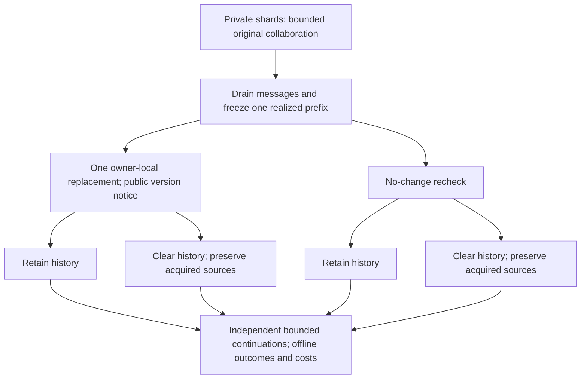

# Recovering distributed work on authentic SILO-BENCH tasks

**PROPOSED — NOT APPROVED OR IMPLEMENTED**

Prepared: 14 October 2026. Repository reviewed: `e41363f9eb81c5d2070db11ce57396815c8c6424`.

This document proposes a new study. It changes no scientific contract, executable behavior, model configuration, existing test, or experiment artifact. It grants no inference, freeze, main-execution, or publication authorization. The existing [scientific specification](../../PROJECT_SPECIFICATION.md) remains authoritative for existing regimes. Approval and a separately documented adoption would be required before implementing this proposal.

## 1. Decision and scope

**Prefer a controlled recovery study of SILO-BENCH I-08, Set Union Size, using its original two-agent mathematical task and native shard size.** Each agent holds 30 integers; both must submit the cardinality of the union of the two private shards. Introduce one announced, locally delivered record replacement after an actual collaborative prefix. Compare retaining versus clearing explicit working history, while preserving each agent's acquired authoritative source records. Run the same comparison after a no-change recheck.

The recommended bounded design is:

| Decision | Proposal |
|---|---|
| Task | Authentic I-08 Set Union Size; no custom decision task |
| Mathematical size | Two agents, 30 integers each, values in `0..29`, as in the released two-agent generator |
| Main population | 12 independently generated worlds; one realized prefix per world |
| Revision diversity | Six union-expanding and six union-contracting replacements; source owner balanced |
| Recovery conditions | Retain/reset crossed with revision/no change; four sibling continuations |
| Interaction | Alternating, message-driven turns; at most three model turns per agent per phase, six in total |
| Completion | All agents submit and no messages remain awaiting review; correctness is evaluated offline |
| Model | One qualified Qwen3.5-9B configuration; compare thinking and non-thinking only during bounded qualification |
| Main generation ceiling | 384 first attempts, including 24 full-information controls |
| Whole new-study ceiling | **500 physical attempts**, including diagnostics, pilot, and 20 interruption attempts |
| Claim level | Small exploratory causal comparison of an explicit retained-work policy, plus cost and failure evidence |

This is the strongest balance I find under the requested ceiling. It is not automatically publication-ready and is conditional on real qualification. The principal uncertainty is whether 9B can reliably construct and update the distributed set summaries at the native size, within the short interaction horizon, without either a capability floor or a scientifically empty ceiling.

If the required claim is a reliable small-effect estimate, broad task generalization, or a standalone substantial empirical paper, **do not force that claim into 500 attempts**. A 24-world version of this same design costs 884 new attempts before changing qualification requirements. Even that is not a power guarantee.

## 2. Evidence base and limits of this reassessment

### 2.1 What was inspected

The review covered the repository contract, current specification and living handoff, the preceding conversational redesign, all three official SILO task-generator modules, representative released task JSON, native execution/communication/scoring code, and the implemented recovery system's task, view, intervention, schedule, inference, checkpoint, attempt, analysis, uncertainty, and reporting boundaries. Relevant evidence includes:

- [Repository operating contract](../../AGENTS.md), [current specification](../../PROJECT_SPECIFICATION.md), and [implementation plan](../IMPLEMENTATION_PLAN.md).
- [Implementation-research synthesis](../implementation-research/SYNTHESIS.md) and [state/persistence investigation](../implementation-research/state-and-replay.md).
- [Course CPU/report gate](../validation/course-m4-report-and-cpu-gate.md), [durable-worker validation](../validation/course-m3-durable-workers-and-failures.md), and their saved receipts.
- [Earlier 4B diagnosis](../validation/course-kaggle-final-online-4-proposal.md), [latest 9B analysis](../validation/course-kaggle-final-online-6-analysis.md), [machine-readable diagnostic receipt](../../notebooks/validation/course-kaggle/final-online-6-analysis.json), and [remaining repair proposal](../validation/course-kaggle-final-online-6-proposal.md).
- Original [SILO-BENCH paper](https://aclanthology.org/2026.acl-long.1354.pdf), including protocol, execution, task and results appendices; relevant pages were also rendered and visually inspected.
- [Official released repository](https://github.com/jwyjohn/acl26-silo-bench), independently of this project's descriptions.

The previous lean proposal exists in the preceding conversation; no saved redesign Markdown file was found in this checkout. Its principal choices were a custom four-option additive-cost/availability task, two agents, 16 worlds, four conditions, four calls per phase, and 452 new attempts. Section 4 assesses that proposal directly.

### 2.2 Verified source identity and read-only checks

The official repository's `master` head on inspection was `e74127782ed1c42fff474249961f022c063d76f2`, with upstream commit timestamp 12 April 2026. The vendored copies of all three task generators, `src/engine.py`, `src/msg/tools.py`, `src/utils/metrics.py`, and `src/utils/llm.py` matched those upstream files after CRLF/LF normalization. This establishes correspondence for those seven files, not an invented Git identity for the entire vendored directory.

Read-only checks during this reassessment also:

1. Recomputed I-08 union cardinalities for all six released agent scales and matched their saved answers.
2. Verified the walkthrough and information-insufficiency counterexample in Section 8 using the released two-agent instance.
3. Rechecked the ten latest submission files against their saved SHA-256 values and checked the resume archive CRC.
4. Reopened both canonical latest hardware databases in memory, obtaining `integrity_check=ok` and 20 plus two attempts. Only the in-memory SQLite journal-mode header was adapted for deserialization; archived bytes were untouched.
5. Independently checked the proposed call-count and runtime arithmetic.

These are document-supporting CPU calculations and artifact reads, not a new implementation, a rerun of the complete validation suite, or model evidence. Existing CPU pass counts below refer to their saved executed receipts.

### 2.3 What is known about the model attempts

| Observation | Defensible conclusion | Conclusion not justified |
|---|---|---|
| Earlier 4B: 2/21 valid ordinary diagnostic replies; both valid answers wrong | The earlier interface/configuration did not qualify | That 4B cannot solve any SILO task under any interface |
| Latest 9B: 11/21 valid; eight malformed length-ended replies and two prose-cap violations | The 256/64 protocol is an observed reliability problem | That every failure is only formatting |
| Latest three full-information controls all wrong | There is a capability/task-interpretation warning independent of missing private evidence | A reliable estimate of general model accuracy from three cases |
| Latest 9B loaded and generated on both T4s | The tested quantized loading path has actual-host evidence | Full model or experiment acceptance |
| 110,416-token input probe completed in 394.043 seconds, but free memory fell to 16.813 MiB | The tested full-envelope configuration failed its 1.5 GiB headroom rule | That short-context 9B is infeasible |
| Subsequent 4B fallback refused checkpoint metadata | A file-byte versus tensor-payload accounting bug blocked that fallback | A new 4B GPU-fit result |
| Backups were counted as new attempts | The derived 67 was wrong; canonical documented preparation history is 45 attempts | That historical spending can be erased |
| No development/frozen/main records in the latest run | All 6,280 scheduled main logical uses remain unknown | Negative treatment effects or a completed feasibility pilot |

Many ordinary diagnostics intentionally lack complete information. Consequently, their aggregate 0/21 exact-answer count must not be used as a capability estimate. The original 4B replies were reused across subsequent repair submissions; those files are not independent experiments.

## 3. Diagnosis of the existing design

### 3.1 Scientific scope, not just implementation, is the main cost driver

The original study combines state retention, evidence retention, partial-team resets, historical receipts, correction delivery, prose timing, answer-preserving edits, and continuation repetitions. Its primary estimands concern both correction-specific reset value and effects on retained collaborators. Those are different research projects sharing infrastructure.

The course amendment reduces worlds and instance sizes but retains most of this matrix: 5,752 distinct main slots and 1,114 development slots. A smaller sample under the same matrix would weaken evidence without removing the principal source of cost. The right reduction is in scientific questions and conditions.

### 3.2 The protocol makes competence harder to establish

Mandatory candidates on every turn encourage premature answers. Fixed post-completion activity creates avoidable opportunities for regression. Complex JSON, reference routing, full candidate vectors and communication compete for a 256-token generation allowance. Whole-reply rejection can suppress all communication because of a small formatting error. The large literal-history envelope addresses a real implementation obligation, but that obligation is disproportionate to the mathematical inputs.

These are design risks supported by observed failures, not individually identified causal explanations. The current evidence cannot tell us how much failure comes from arithmetic, prompt interpretation, quantization, formatting, or the turn protocol.

The remedy is not to replace strict auditability with permissive semantic repair. It is to make the permitted action smaller, omit an answer when no answer is being submitted, and separate the audit archive from bounded working context.

### 3.3 Valuable work should survive

The project already has unusually valuable boundaries: evaluator truth stays outside agent views; current source authority differs from derived claims; siblings begin from the same persisted prefix; replies precede effects; resumes preserve completed outcomes; failures differ from missing work; costs and analysis derive from original records. CPU evidence includes real interruption/restart checks, not only mocks. These assets should support the smaller experiment.

Their validation does not certify a redesigned lifecycle. The existing schedules, state contracts and analysis assume four peers and four rounds, and the inference/template path fixes non-thinking behavior. A new study requires substantive adaptation, not a few parameter edits.

## 4. Critique of the preceding lean redesign

| Previous choice | Improvement | Remaining weakness and v2 decision |
|---|---|---|
| Two agents | Removes unnecessary scaling and routing burden | Retain; two is also a released SILO scale |
| Four retain/reset × revision/no-change cells | Makes a central causal comparison legible | Retain, because generic clearing costs must remain visible |
| Early completion | Stops unnecessary model work | Retain, but distinguish procedural completion from correct completion |
| Custom four-option cost task | Short answers and easy exact grading | Reject: not an authentic SILO task, and old work is only a few additions |
| Broadcasting the changed value to both | Removes a delivery confound | Replace with a fixed local correction interface shared by both treatments; do not compare delivery policies |
| Four total calls per phase | Attractive budget | Too little tolerance for source exchange, overlap checks and repair; allow six |
| Mandatory bilateral confirmation | Reduces unilateral finalization | Can impose artificial consensus and hide disagreement; preserve individual SILO-style submissions instead |
| 16 worlds under 452 new attempts | Clear accounting | A larger number of trivial worlds is not automatically more informative than 12 substantive worlds |
| Retain acquired sources during reset | Prevents a restart from also deleting canonical facts | Preserve, while admitting that derived summaries themselves encode information |
| Thinking-mode qualification | Sensible uncertainty reduction | Keep bounded; thinking is neither assumed necessary nor treated as a cure |

The earlier proposal was right to narrow the study and wrong to make task simplicity the dominant criterion. It also left too little opportunity for historical intermediate work to matter. The present proposal spends more calls per world to preserve a genuine distributed computation.

The current request concerns **500 new attempts**. Historical attempts are reported separately; there is no reason to reduce the new-study allowance by the previously documented 45.

## 5. What SILO-BENCH actually provides

### 5.1 Paper evidence and its limits

The paper evaluates 30 tasks, three communication protocols and agent counts 2, 5, 10, 20, 50 and 100 using DeepSeek-V3.1, GPT-OSS-120B and Qwen3-Next-80B-A3B. It does not qualify Qwen3.5-9B. Appendix C allows 100 rounds and reports one execution per configuration. Table 10 reports DeepSeek task averages of 93.3% for Global Max, 47.5% for Set Union Size, 41.2% for Top-K, 35.6% for Trapping Rain and 31.3% for Graph Components; these aggregate across scales/protocols and are not small-model, two-agent estimates. Table 12 reports 17.2% for Qwen3-Next at two agents across tasks/protocols. These results motivate caution rather than establish attainable tasks for this project. [Paper, Appendices C and G](https://aclanthology.org/2026.acl-long.1354.pdf)

### 5.2 Released execution semantics

Direct source inspection establishes the following:

- Agents initially receive private shards and public task instructions. Some tasks have segmented outputs; others require every agent to submit the same global answer.
- The engine obtains one model response per active agent per round. A response may contain multiple XML-described operations, but tool results are appended for a later model activation. A `receive` followed by a `send` in the same generated response cannot reason over the just-returned messages.
- In P2P, receiving reads earlier rounds, not the current one. Automatic inbox delivery would therefore be a protocol adaptation, not an unchanged native behavior.
- `wait` ends the current round's tool sequence. `submit_result` sets an agent's submitted flag; subsequent rounds copy its state without further model calls. Submission is not checked for correctness before deactivation.
- The P2P implementation stores JSON message files and mutates their read flags when receiving. The inspected code does not instantiate the paper's described SQLite mailbox. This difference matters for reusable immutable prefixes, but does not by itself invalidate published results.
- The API adapter retries indefinitely. Its execution policy is incompatible with a fixed physical-attempt ceiling.
- Native metrics use general normalization and category-based partial scoring. Exact task-specific scoring is safer for this study.

Sources: [native engine](../../acl26-silo-bench/src/engine.py), [P2P tools](../../acl26-silo-bench/src/msg/tools.py), [prompts](../../acl26-silo-bench/src/utils/prompts.py), [API wrapper](../../acl26-silo-bench/src/utils/llm.py), [metrics](../../acl26-silo-bench/src/utils/metrics.py).

### 5.3 Full task assessment

This table is based on the released generators and output contracts, not the task names alone. “Risk” is a reasoned screening judgment, not measured 9B performance. Native sizes below refer to two agents where a size is given.

| ID / authentic task | Verified computation or important detail | Recovery suitability / main objection |
|---|---|---|
| I-01 Global Max | 20 integers per shard, range −1000..1000; scalar maximum | Very attainable candidate; lowering the winner requires a reserve. Strong low-risk alternative, but little reusable computation |
| I-02 Word Frequency | Count `apple`, not a full histogram; 30 words per shard, with forced target occurrences | Useful local counts; one replacement has an elementary ±1/0 update, with high ceiling risk |
| I-03 Distributed Vote | Four candidates; every second vote is assigned to a chosen winner | Native generator deliberately creates a large margin; single-edit winner changes are rare or impossible for many worlds |
| I-04 Any Match | Zero or one inserted `ERROR` witness | Scalar and easy, but retraction is nearly revealed by generator knowledge; adding multiple witnesses would alter its distribution |
| I-05 Range Count | Count integers in inclusive `[100,500]`; 30 per shard | Sensible cheap aggregation control; additive membership updates make memory effects mostly generic caching |
| I-06 XOR Checksum | XOR of 20 bytes per shard | Clean incremental identity, but unaided bitwise arithmetic is an avoidable competence risk |
| I-07 Average Value | Floating-point mean, rounded to two decimals | Updateable summaries, but floating precision adds noise without helping the question |
| **I-08 Set Union Size** | **30 integers per shard; duplicate-rich finite domain; scalar union cardinality** | **Best balance: short answer, overlap reasoning, reusable sets, and nontrivial loss of support after replacement** |
| I-09 Top-K Select | Fixed top ten, sorted descending with multiplicity; 30 values per shard | Strong reserve-loss mechanism; longer lists, duplicates and selection increase qualification risk. Serious runner-up |
| I-10 Standard Deviation | Population standard deviation with a two-phase suggested algorithm | Useful intermediate work, but many floating operations and larger interaction requirements |
| II-11 Prefix Sum | 15 values per shard; each agent returns its own global-prefix segment | Strong update structure, but cumulative arithmetic and long segmented outputs; first shard needs no remote offset |
| II-12 Moving Average | Centered width three; endpoints omitted; every agent returns the full array | Output/rounding burden despite local-looking description |
| II-13 Longest Palindrome | Random characters with `racecar` inserted; output longest length | Known planted structure risks a shortcut; meaningful retraction can require a less natural generator regime |
| II-14 1D Life Game | Five steps of the “exactly one of left/self/right” rule; segmented output | Meaningful dependency propagation but excessive unaided simulation risk |
| II-15 Pattern Search | Greedy non-overlapping `ABC` subsequence matches, not all combinatorial subsequences | Compact state and interesting boundary changes; ambiguous name and sequential state tracking increase protocol/competence risks |
| II-16 Trapping Rain | 10 heights per shard; total water from global left/right maxima; valleys planted | Excellent reusable intermediate state and nonlocal revision effects; risky arithmetic/integration floor. Best ambitious alternative |
| II-17 Difference Array | Every agent returns all adjacent differences; 29 coordinates | Sparse mathematical repair but long output and evidence dissemination costs |
| II-18 List Ranking | 16 nodes with shuffled ownership; full head-distance dictionary | Meaningful distributed traversal; maintaining one legal list after revision often needs several pointer edits. High floor risk |
| II-19 Merge Neighbors | Deduplicate a globally sorted sequence; 15 entries per shard; full output | Easier than arbitrary union, but preserving sortedness constrains edits and useful interaction is concentrated at boundaries |
| II-20 Pipeline Hash | ASCII sum XOR previous value, modulo 10,000; fixed named blocks | Sequential dependency is real; not a cryptographic hash and not a good unaided arithmetic choice |
| III-21 Distributed Sort | 20 values per shard; return assigned global rank segment | Rich reorganization but current model evidence warns about order, multiplicity and output-width failures |
| III-22 Median | Upper median for even lengths; 25 values per shard | Scalar answer conceals substantial ordering work; a single change often leaves it unchanged |
| III-23 Graph Components | 20 public vertices; edge draws may duplicate; count includes isolated vertices | Strong deletion/alternative-path question, small answer. Native graph size and reconstructing connectivity are substantial risks |
| III-24 BFS Distance | 16 nodes at two agents; undirected graph; full distance map | Rich but larger output, topology and distance reasoning; prior reduced-task control already failed |
| III-25 K-Means Iteration | One assignment/update step, three public centroids | Can aggregate cluster sums/counts; not inherently an all-to-all shuffle. Floating distance arithmetic dominates |
| III-26 Global Distinct | Same union-cardinality function and domain construction as I-08, with a shuffle | Not an independent mathematical task family; do not count it as task diversity |
| III-27 Collaborative Filtering | Five-dimensional dot products and top-three user/item pairs | Floating arithmetic and nested outputs; too expensive for the present objective |
| III-28 PageRank Step | One directed update, without dangling-mass redistribution | Exact native semantics differ from some textbook implementations; unsuitable arithmetic burden |
| III-29 Load Balance | Deterministic LPT; output load statistics, not the allocation itself | Rich recomputation but substantial sorting/arithmetic and weaker direct interpretation of the submitted answer |
| III-30 Matrix Multiply | Each agent gets an A row and all of B; returns full product | At two agents mostly independent tiny row computation plus sharing; weak recovery-collaboration test |

Primary sources: [Level I generator](../../acl26-silo-bench/benchmark_generator/paradigm_i.py), [Level II generator](../../acl26-silo-bench/benchmark_generator/paradigm_ii.py), [Level III generator](../../acl26-silo-bench/benchmark_generator/paradigm_iii.py). The [historical source audit](../../research/07_repository_audit/SILO_REPOSITORY_AUDIT.md) provides supporting earlier checks; the definitions above were inspected anew.

The benchmark's complexity levels are not a small-model difficulty ordering. In particular, I-08 and III-26 compute the same quantity. Neither the level label nor a short final answer guarantees low reasoning cost.

## 6. Alternatives considered before selection

### 6.1 Serious experimental candidates

These budgets assume the stated horizons, two full-information controls per main/pilot world, two full pilot worlds, 24 mode-qualification calls, eight hardware calls and 20 interruption attempts. They are schedules, not claims that those tasks qualify.

| Candidate | Scientific attraction and natural work | Independent main worlds / ceiling | Strongest reason against it | Engineering and compute risk |
|---|---|---:|---|---|
| I-01 Global Max; four calls/phase; four cells | Retain local maxima versus reacquire/recompute after lowering the old winner | 18 / 492 | Most work is a scan and a comparison; likely tells a narrower caching story | Lowest output and inference risk; new scalar task but simple oracle |
| **I-08; six calls/phase; four cells** | **Overlap summaries can save work, but retraction requires evidence of remaining occurrences** | **12 / 500** | **Native duplicate counting may still be unreliable; small N** | Moderate protocol redesign; short final output; preferred |
| I-09 Top-K; six calls/phase; four cells | Invalidating an old top-ten member can require a discarded reserve | 12 / 500 | Lists and multiplicity raise floor risk; native top ten may need more than six calls | Existing mathematical assets help, but native sizes differ |
| III-23 Components; eight calls/phase; four cells | Retained connectivity summaries can fail after edge deletion | 8 / 472 | Eight worlds and uncertain competence at 20 native nodes; shrinking graphs adds a size adaptation | New graph oracle/eligibility; relatively long reasoning |
| II-16 Trapping Rain; eight calls/phase; four cells | Revised barriers invalidate nonlocal water contributions while leaving other work reusable | 8 / 472 | Strong mechanism but arithmetic floor and limited N likely dominate | New task; larger token/time risk; reserve for an ambitious later study |
| I-08 revision-only retain/reset; six calls/phase | Direct operational recovery comparison with more worlds | 20 / 492 | Cannot distinguish revision-specific costs from ordinary history-clearing costs | Simpler schedule; defensible only for a deliberately narrower operational claim |
| I-08 retain/reset/last-answer, both events; six calls/phase | Separates old scalar result from richer history | 8 / 492 | The scalar is mathematically insufficient for some updates; spending a third arm leaves too few worlds | Small extra intervention, large statistical opportunity cost |
| Two-family I-08/I-01, common six-call cap | Checks whether findings extend beyond deduplication | 10, five per family / 460 | Thin family evidence and only one complete pilot world per family; more qualification calls needed for confidence | More task binding and reporting; unused ceiling does not fix weak per-family samples |

For the two-family row, qualification is doubled to 48 calls. Cost comparisons across tasks also depend on output lengths: equal call ceilings do not imply equal GPU time.

### 6.2 Why prefer I-08

I-08 retains the smallest useful mathematical tension: an old global cardinality is not enough to retract an occurrence; even an old global set may be insufficient without multiplicity or source-specific membership. Yet the task has one integer answer and no floating-point, sorting-output, graph-serialization, or long-vector contract.

Its useful historical work is a local deduplicated set, an overlap calculation, a union, or a source-specific membership claim actually produced during collaboration. The host must not manufacture these summaries. A model may retain an incorrect summary, omit the evidence needed for an update, or spend more tokens reading history than recomputation would cost. All are relevant outcomes.

Native two-agent I-08 is not established as easy. The recommendation is to qualify this task, not to declare it solved. If it fails, Global Max is the most practical separately scoped fallback; Trapping Rain is the more scientifically ambitious alternative if more competent inference and more attempts become available. Do not silently cycle tasks until an attractive retention effect appears.

## 7. Focused research question and causal interpretation

### 7.1 Question

> After an announced local replacement in a distributed distinct-count task, does keeping the team's actual previous working history improve correct completion or reduce recovery effort, compared with clearing that history while preserving acquired authoritative sources?

The no-change recheck estimates the ordinary benefit/cost of retaining old work. The revision-minus-recheck comparison asks how much of the observed difference is associated with factual change.

Two-sided expectations are appropriate:

- Retention may preserve valid local sets and avoid rediscovering overlap.
- Retention may preserve obsolete membership claims or arithmetic mistakes.
- Clearing may avoid stale work but discard useful calculations and information encoded in summaries.
- Reading longer history may cost more than recomputing at this scale.

### 7.2 A crucial limitation: equal sources are not equal information

For a given event, retain and reset start with identical current source tables for each agent. This prevents reset from additionally deleting canonical records acquired during the prefix.

Nevertheless, a derived message such as a peer's local distinct set contains information about remote data. Clearing that message removes that information from the prompt. Thus the comparison identifies the **total effect of retaining the realized working history**, including information, calculations, representation and context length. It does not isolate pure semantic anchoring, attention, or computation independently of information.

This is an explicit estimand boundary, not a hidden confound to explain away. A third “all useful information but no prior reasoning” condition would require deciding what information a free-form message contains, introducing another intervention and more calls. It is not justified in this study.

Similarly, subsequent messages may differ across conditions. That is a consequence of the retention intervention under equal communication rules, not unequal initial treatment budgets.

### 7.3 What would be learned if final accuracy ties

The study still measures paired differences in total input and generated tokens, thinking tokens, calls, communicated material, and elapsed inference time. It can show whether old work is actually used, whether apparently shorter recovery uses more input processing, and whether one policy reaches the same observed quality with less work.

These are prespecified outcomes, not a post hoc rescue of a null accuracy result. Equal observed accuracy does not establish equivalence. If both quality and effort are indistinguishable, the result is a bounded observation of no detected practical advantage in this short-history setting, not a universal recommendation.

## 8. Authentic task, edits, and a concrete walkthrough

### 8.1 Mathematical contract

For agents `0` and `1`, let private arrays be $X_0,X_1$, each of length 30. Values are independently drawn from $\{0,\ldots,29\}$, matching the released two-agent generator before the eligibility conditioning below. Define

$$
S_i=\{x:x\in X_i\},\qquad U=S_0\cup S_1,\qquad y=|U|.
$$

Both agents submit one integer $y$. Preserve this authentic output responsibility; do not replace it with a leader-only answer, require an extra mathematical certificate, or change the task to a custom optimization problem.

One record changes from $x$ to $z$, $x\ne z$, within `0..29`. If $m(v)$ is the original global multiplicity, then

$$
y'-y=\mathbf{1}\{m(z)=0\}-\mathbf{1}\{m(x)=1\}.
$$

This equation belongs to offline design and evaluation. Do not put global multiplicities, the chosen edit category, the computed delta, or this pre-solved update into the peer notice.

### 8.2 Population and edit selection

Generate new independent worlds from the native sampling rule. Predetermine the edited owner. Require that the owner's records admit both types of legal replacement:

- **Expansion:** replace an occurrence of a globally repeated value with a globally absent value; $y'=y+1$.
- **Contraction:** replace the sole global occurrence of a value with another already-present value; $y'=y-1$.

Conditioning on this eligibility is a declared change to the population, not an unmodified benchmark sample. Log rejected draws and stop after a finite declared limit, provisionally 1,000 per world. Select uniformly among eligible record/replacement pairs for the assigned type. Use six worlds per type and three per owner within each type. Balance initial speaker across the whole sample independently of outcomes.

Both types being eligible in every accepted world avoids comparing wholly different generator recipes. The unused eligible edit is not executed. Type-specific results remain descriptive with six worlds each; no strong claim of a direction effect is planned.

Use disjoint main and development seeds. Save inputs and edits before model inference. Never select worlds for successful prefixes, talkativeness, useful summaries, or treatment differences. Repeated perturbations of one released JSON instance would not provide 12 independent worlds.

### 8.3 Walkthrough based on the actual released two-agent instance

The released [I-08 two-agent fixture](../../acl26-silo-bench/benchmarks/I-08_n2.json) contains:

```text
Agent 0:
14,19,18,3,2,17,6,16,8,4,29,11,28,2,28,7,11,9,5,14,26,17,22,9,19,25,20,16,0,21

Agent 1:
26,17,9,29,21,3,28,4,8,3,28,3,23,17,4,8,9,19,6,22,10,6,21,20,27,8,16,15,8,28
```

Its true local sets have 22 and 18 elements. Agent 1 contributes four values absent from agent 0: `10,15,23,27`. The global union has 26 elements. These calculations were checked independently; they are evaluator facts, not messages supplied to the agents.

A plausible successful prefix, not an asserted model transcript, is:

| Turn | Agent action |
|---|---|
| 1, agent 0 | Sends its computed local distinct set and asks the partner to account for overlap |
| 2, agent 1 | Checks its own shard, identifies `10,15,23,27` as additional values, sends that reasoning and submits `26` |
| 3, agent 0 | Checks the received contribution and submits `26` without sending another message |

All agents have submitted; no message requires review. The original phase stops. No host correctness feedback is given.

Now change agent 0's zero-based row 28 from `0` to `3`. The edited owner gets a factual receipt identifying its old and new value and its updated private table. The partner gets a public notice identifying the changed record and version, but not the replacement payload. Any previously acquired authoritative copy of that record becomes update-pending until the current payload is forwarded. The same delivery rule applies in both retention conditions.

**Retain:** agent 0 can potentially use its old local set and the partner's four additions. It still needs to establish whether the partner also held `0`: a list of additions relative to agent 0's old set does not answer that question. It may ask, “My only 0 was replaced by 3; does your current shard contain 0?” Agent 1 can answer from its current shard, then both can submit `25`. If the prefix instead preserved the partner's complete local set, the check may require less communication. The experiment does not prescribe which summary exists.

**Reset:** the same authoritative source records remain, but old messages and submissions are absent. The agents may recompute and exchange local sets, then submit `25`. If raw records were previously attached, they remain available in both arms; the reset branch may instead recompute from those records. This behavior is allowed and measured, not forbidden to manufacture a memory advantage.

**Possible retained-state error:** an agent reaffirms `26` or treats the obsolete union as current without checking support for `0`. **Possible reset error:** an agent miscounts the rebuilt union or submits before learning the partner's contribution. Neither receives a correctness-triggered extra chance.

**No-change siblings:** the same original prefix is reopened for a neutral data recheck, with no value changed. Retain may reuse its old result; reset may rebuild it. Both must submit for the new phase. An old submission is never automatically accepted as the new answer.

### 8.4 Why an old result, or even an old union, is not sufficient

Construct a second legal I-08 world by changing one of agent 1's repeated `8` entries to `0`. Its original global union is still exactly the same 26-element set. Apply the identical agent-0 replacement `0 -> 3`. The first world now has 25 distinct values; the second still has 26 because agent 1 retains `0`.

Thus the same old global answer, same old global set, same owner-local data and same replacement can require different updated answers. Source-specific support matters. This independently checked counterexample motivates preserving naturally produced intermediate work, without asserting that real agents will produce or use the right summary.

The second example's update is answer-preserving, so that particular update is outside the main changing-edit population. The counterexample establishes insufficiency under the problem information supplied to agents; it is not an additional experimental cell. Do not tell agents that every non-sham edit was selected to change cardinality, or disclose the expansion/contraction selection rule in their instructions. Doing so could let them infer the missing support from experimental metadata rather than collaboration.

### 8.5 What is original and what is adapted

| Element | Status |
|---|---|
| Union-cardinality function and integer output from every agent | Original I-08 |
| Two agents, 30 items per agent, domain `0..29`, private shards | Original released two-agent setting |
| Local-set / global-deduplication task guidance | Original task guidance retained in concise wording |
| Independent repeated worlds | New experimental sampling from the native rule |
| Eligibility conditioning, one replacement and no-change siblings | Recovery extension |
| Stable source IDs, versions and optional exact attachments | Recovery interface extension |
| Turn-taking, automatic inbox delivery, reopening submitted peers | Modified execution protocol |
| Retain/reset and persisted shared prefixes | New experimental intervention |
| Short call/token limits and Qwen3.5-9B | New inference regime |

Describe results as **“a controlled recovery extension of SILO-BENCH I-08 at its native two-agent size.”** They are not official unmodified SILO-BENCH scores.

## 9. Experimental architecture and agent lifecycle

### 9.1 Minimal responsibilities

| Responsibility | Owns | Must never do |
|---|---|---|
| World and event preparation | Original arrays, record identities, chosen edit, sampling manifest | Choose by model success or reveal future edits |
| Agent-view construction | Current permitted source records, notices, visible working history | Read evaluator truth into prompts or infer missing facts |
| Turn and lifecycle controller | Eligible speaker, inbox delivery, active/waiting/submitted state, per-agent turn cap | Stop because gold is reached or wake agents because an answer is wrong |
| Inference worker | One resident model, exact request, mode/settings/seed, fresh call state | Keep hidden conversational state between calls |
| Durable evidence | Raw outcomes, attempts, committed branch state and delivery progress | Resample completed replies or count backups as attempts |
| Offline evaluation/reporting | Exact answers, source/summary diagnostics, paired outcomes and costs | Repair live answers, generate missing outputs, or change populations |

This requires no supervisor LLM, semantic dependency extractor, planner, vector store, distributed service, or new provenance registry. Retain the existing small sources of truth.

### 9.2 State at an intervention boundary

Each agent has:

1. Its current private source table and any exact source records actually acquired through attachments.
2. Explicit working history: its visible messages, received messages, submitted results, and bounded public schema feedback.
3. Lifecycle state, pending deliveries, and an explicit phase identifier.

The audit archive additionally contains exact prompts, native token IDs, raw generated output, private thinking when generated, validation, timing and attempts. Archive contents are not automatically working memory.

At the boundary, drain all original messages and freeze one immutable original snapshot. Apply the event once. Within each event, clone identical current source tables for retain/reset. Retain keeps actual working history, including wrong statements, marked as previous work. Reset removes it. Both clear active submission/wait status and reopen the task. Both accumulate ordinary new history afterward.



An owner's before/after receipt is fixed across treatments and contains only the actual edited record. It is not a receipt intervention or host-generated update formula. The unedited peer receives no hidden replacement until communication exposes it. Global record/version invalidation is common to both policies.

Keep policy names, branch IDs, edit-type labels, evaluator outputs and expected treatment effects out of all peer views. Use identical generic task and source-authority instructions across retention conditions, with no condition-specific encouragement to recompute or trust history. The presence or absence of history is necessarily visible; this is not a claim that agents are fully blinded to the intervention.

### 9.3 Communication and submissions

Use a small action envelope with ordinary message text, optional exact source attachments, and an optional integer submission. No candidate is required on a message-only turn. A reply may send a message and submit in the same invocation. Waiting is permitted without an answer. Do not carry over the native XML boilerplate or the current nested candidate/routing burden merely for compatibility.

Inbox delivery occurs before the next eligible activation; it does not require a separate generated `receive` action. Exact attachments copy only already-held records. The host never computes a local set, overlap, global union, candidate or correction.

Prose summaries remain claims, not certified source records. Do not extract apparent facts from prose into the authoritative table. Agents may centralize data or share summaries; neither strategy is forced.

### 9.4 Bounded natural execution

- Alternate eligible agents, with the first speaker assigned before outcomes and held fixed across a world's siblings.
- Give each agent at most three scheduled model turns per phase, six total. Infrastructure retries do not create new logical turns.
- Deliver messages immediately after durable validation/effects and before the recipient's next activation. This is sequential turn-taking, not simultaneous physical execution masquerading as synchronous rounds.
- Submission makes an agent quiescent, not permanently unavailable. A later incoming message invalidates its active submission and wakes it for review if it has a turn remaining. Preserve the old answer in the audit/history; do not erase its occurrence.
- A factual event or no-change recheck reopens both agents, independently of their earlier correctness.
- Stop when both have active submissions and there is no pending review, when the phase limits are exhausted, or when both are waiting/quiescent without a complete set of submissions and no pending event can make progress.
- Do not poll a waiting agent repeatedly. Do not transfer one agent's unused turn allowance to the other.

New messages can invalidate a submission even if they look redundant; the host does not semantically decide whether they matter. This can consume turns and is part of the fixed protocol. A last-turn message that leaves a peer needing review can make the branch incomplete. The pilot must show that this boundary is usable.

### 9.5 Completion is not correctness

The controller recognizes procedural completion only. Two different submitted integers are a completed disagreement; two identical wrong integers are a completed error. Both are scored offline. No correctness oracle, mandatory consensus loop, or host evidence-sufficiency certificate gates submission.

This preserves the native responsibility that every agent submits, while removing permanent abandonment of collaborators. A correct answer without documented sufficient evidence can occur by guessing; it remains correct under the exact endpoint but receives the appropriate diagnostic annotation.

### 9.6 Context and thinking

Preserve only the final visible part of each accepted model response as working history. Private thinking is archived but never passed to another agent or to the same agent's later call. Both treatments therefore compare explicit work, not hidden-state persistence. A malformed/overlong response remains intact offline; a short nonsemantic schema notice is the only feedback inserted into working context. No silent history truncation is allowed.

At most 11 preceding visible responses can occur in a six-call prefix plus a six-call continuation before its final call. With a 512-token visible-response cap, short source tables and compact instructions, an 8,192-input-token bound is plausible but must be demonstrated with the actual tokenizer and renderer. It is not inherited from the old capacity proof.

## 10. Experimental methodology

### 10.1 Four conditions and controls

| Cell | Event | Boundary history | Current sources relative to matched sibling |
|---|---|---|---|
| R,V | One local replacement, public version notice | Retain | Equal to C,V |
| C,V | Same replacement and notice | Clear | Equal to R,V |
| R,S | Neutral recheck, no source change | Retain | Equal to C,S |
| C,S | Same neutral recheck | Clear | Equal to R,S |

All four start from the exact same realized original prefix. Recovery generations are new; do not replay first turns just because prompts or seeds happen to match. The only experimental sharing needed is the original prefix. Resume reuse of a durably completed call is separate from experimental replay.

Each world also gets two one-call full-information controls, one on each original/revised complete input, using the selected model configuration and scalar answer contract. These assess task competence, not a compute-matched multi-agent advantage. They do not expose answers to peers or determine main-world inclusion.

The sham is retained because ordinary reset cost is central to interpretation. It is not perfect linguistic matching: one event announces a change and the other a recheck. Treat the interaction as change-under-these-interfaces, not a pure numerical-change effect detached from its notice.

### 10.2 Outcomes and estimands

Let $Y_{w,p,e}=1$ if a branch procedurally completes with both current submissions equal to exact current truth within its turn limits, and zero for an executed unsuccessful branch. An unexecuted/interrupted unresolved branch is unknown, not zero.

The primary accuracy effect is the paired revised-world reset effect:

$$
\Delta_V=\frac1{12}\sum_{w=1}^{12}(Y_{w,C,V}-Y_{w,R,V}).
$$

Report the ordinary recheck effect $\Delta_S$ and the prespecified correction-specific companion

$$
\theta=\Delta_V-\Delta_S.
$$

Positive $\theta$ does not imply $\Delta_V>0$; show both components. Do not retain the original collaborator-interference estimand, sixteen-slot AUC, or five-family weighting.

**Effort is a prespecified companion, not an optional secondary story:** report paired per-branch physical generations, input tokens, total generated tokens, private thinking tokens, visible tokens, messages, source attachments and measured inference time. Attribute the shared prefix to every hypothetical end-to-end policy cost, but charge its physical execution once. Show success and effort jointly. Do not call a fast wrong branch efficient, or compare only successful branches without exposing the post-treatment selection.

Designate the sum of post-event, ready-model inference elapsed seconds as the principal practical effort measure; loading/setup and allocated idle time are reported separately. Generated tokens and input tokens explain that cost rather than being silently added with an arbitrary equal price. Present cost differences alongside all four paired success categories. Do not select whichever cost metric happens to favor a policy after seeing results.

Plot observed correct completion by cumulative call allowance up to six as a descriptive view. The curve is derived from actual terminal submissions; it neither forces repeated answers nor creates independent observations. A failure to complete by six is not evidence of how many calls would eventually suffice.

### 10.3 Failed original collaboration

Never rerun a prefix until it succeeds. Include all mathematically valid main worlds in $\Delta_V$. Prespecify a second analysis restricted to **correct procedurally completed original prefixes**, with its denominator prominent. Because this status precedes both recovery treatments, it is a legitimate descriptive recovery stratum, but its size is not guaranteed.

The all-world contrast concerns reopening attempted work. Only the correct-prefix stratum directly supports recovery from an established correct answer. Correct final prefixes do not imply correct intermediate summaries. Once all twelve main prefixes have been executed, if fewer than nine are correct, describe the realized study as a mixed task-solving/recovery investigation; this reporting trigger does not remove worlds or restart the sample. Before complete prefix coverage, retain unknown outcomes explicitly.

### 10.4 Diagnostics that separate failure explanations

| Observable | What it helps distinguish | Limit |
|---|---|---|
| Full-information control success | Basic task competence under complete input | One response per world is noisy; no conditioning main inclusion |
| Exact source coverage at submission | Whether canonical records were available | Derived summaries can be sufficient without full raw coverage |
| Literal local-set/union claims, checked offline against their stated phase | Incorrect work versus correct work later becoming stale | Unclear prose remains unclassified; no semantic repair |
| Submission before any partner-derived information | Premature/local-only behavior | Sometimes a correct guess; not proof of inner reasoning |
| Old cardinality resubmitted after a changing edit | Observable stale-answer persistence | Could also be a new counting error |
| Received replacement, answered membership question, or forwarded current record | Whether correction information moved through the team | Exposure is not proof of use |
| Wrong integer versus malformed action versus output cap versus timeout | Scientific and protocol failure modes | Keep categories separate even when all yield zero completion credit |
| Prefix summary content and acquisition pattern | Whether the retention manipulation had meaningful material | Do not select main worlds based on this annotation |

The sample is small enough for a complete offline transcript review using a frozen rubric. Use no LLM judge. Have a second human independently review ambiguous cases where feasible; report unresolved cases instead of confident mechanism labels. Main causal claims come from matched interventions, not selected anecdotes.

### 10.5 Replication and uncertainty

The independent cluster is the world with its one realized prefix. Twelve worlds are not 48 independent treatment observations, and their individual agents and turns are not additional replicates. Repeated decoding on the same input would not increase independent world count.

Report the twelve paired contrasts, all four success counts, and the reset-only/retain-only/both/neither table. Use exploratory paired world bootstrap intervals, retaining all siblings together and resampling within the two six-world edit strata. Label their small-sample coverage as approximate. Supplement degenerate outcomes with exact binomial bounds where their sampling assumptions apply; do not display a zero-width bootstrap interval as proof of certainty.

For orientation only, a normal half-width with paired-contrast SD 0.5 is about $1.96(0.5)/\sqrt{12}=0.28$; with SD 0.8 it is about 0.45. These are not measured power calculations. Under an illustrative i.i.d. binomial model, zero policy disagreements in 12 pairs still leaves a one-sided 95% upper bound $1-0.05^{1/12}\approx0.221$. The stratified population and systematic implementation uncertainty require their own qualifications.

Do not claim equivalence, a ten-point detection threshold, reliable direction-specific effects, or per-world seed stability. More bootstrap draws cannot compensate for more independent worlds. Keep no additional continuation replicates in this budget.

### 10.6 Missingness and execution order

Use one fixed model configuration, per-world sampling streams and identical per-agent limits across cells. Matching seeds does not make different prompts identical. Keep siblings on the same device when practicable; distribute worlds between devices and rotate sibling execution order before outcomes.

Run complete world blocks and checkpoint between them. Do not stop or extend the study because an effect looks promising, null or unfavorable. Resume interrupted work from exact persisted inputs/outcomes. If the fixed budget prevents completion, retain the intended 12-world population, publish coverage, and bound unknown success values in `[0,1]` through the contrasts. Do not substitute complete cases for the intended estimate.

Early procedural completion is observed, not missingness. Unused optional turn opportunities after completion are neither zero-credit failures nor unknown calls.

## 11. Model, hardware, and complete resource accounting

### 11.1 Model strategy

Start from the already inspected Qwen3.5-9B revision `c202236235762e1c871ad0ccb60c8ee5ba337b9a`, text-only, NF4/double quantization and FP16 computation with required FP32-sensitive operations. Reuse the observed loading path and pinned package candidate as prerequisites, not as automatic qualification of thinking mode.

Compare only two predefined qualification configurations:

| Setting | Direct candidate | Thinking candidate |
|---|---|---|
| Thinking | Off | On through the native template setting |
| Total output cap | 512 generated tokens | 4,096 generated tokens, thinking plus final |
| Visible final envelope | At most 512 tokens | At most 512 tokens |
| Input cap | 8,192 native tokens | 8,192 native tokens |
| Sampling starting point | Temperature 0.7, top-p 0.8, top-k 20 | Temperature 1.0, top-p 0.95, top-k 20 |
| Other initial choices | min-p 0, repetition penalty 1, presence penalty 0 | min-p 0, repetition penalty 1, presence penalty 0 |

The mode-specific temperature/top-p/top-k choices follow current general-task guidance. Presence penalty zero is a deliberate qualification candidate because repeated integers and task tokens are legitimate; it differs from the general recommended 1.5 and is not claimed optimal. Official guidance recommends much longer output budgets for unrestricted reasoning and omitting past thinking from conversation history. The proposed 4,096 cap is therefore a bounded small-task regime, not a replication of advertised benchmark settings. [Official model card](https://huggingface.co/Qwen/Qwen3.5-9B#best-practices)

Freeze the exact supported parameters before qualification. Do not add a prompt/temperature sweep. Select the cheapest configuration passing the competence screen; if both pass, use measured cost, not the observed recovery contrast. If only thinking passes, use it for every agent and main control. If neither passes, stop. The 24-call screen is selection evidence, not a causal comparison of thinking modes.

Do not automatically add 4B, another quantizer, another serving engine or a larger model. Each would consume a new qualification allocation and require an explicit revised plan. The fact that 4B's latest fallback was software-blocked does not erase its earlier poor replies.

### 11.2 T4×2 feasibility

One replica and serial worker per T4 remains appropriate. Worlds can execute independently on the two workers. Logical agents share weights but never hidden KV/recurrent state. There is no need for model sharding or four physical replicas.

T4 hardware compatibility of NF4 is consistent with [bitsandbytes requirements](https://huggingface.co/docs/bitsandbytes/main/en/installation), and actual short-input 9B generation is established in this repository. Neither establishes the redesigned worst-case memory or latency.

The pinned architecture's full-attention FP16 KV component is 32,768 bytes per resident token. At 8,192 input plus 4,096 generated tokens, this component is 402,653,184 bytes, or **0.375 GiB**. This is not total memory: embeddings/weights, recurrent state, workspaces, attention temporaries, allocator reservation and CUDA overhead remain. The native hybrid architecture and actual loading evidence matter more than the misleading shortcut “9B × four bits.”

Use a fresh empirical short-context envelope check on each device, with the selected output reserve and at least the existing 1.5 GiB observed free-headroom criterion. Do not repeat the old 110k-token envelope for a study that no longer permits such inputs. Preserve that earlier failure as a result about its original configuration.

Provisionally allow up to 900 seconds per attempt while qualifying 4,096-token thinking; at six tokens/second, decoding alone can take about 683 seconds. Freeze an adequate bounded timeout from observed evidence before main. The old 120-second ordinary-call limit cannot be inherited blindly. Per-call timeout is not a prediction of ordinary latency or permission to exceed the total resource plan.

### 11.3 Auditable attempt ceiling

Every scheduled turn/control has one first attempt. A physical attempt consumes the ceiling even if it fails before returning an answer. Count forced-output diagnostics, warm-ups, interrupted uncertain work and permitted retries; exclude no generation because it is called setup.

| Component | Formula | First-attempt ceiling |
|---|---:|---:|
| Main prefixes | 12 × 6 | 72 |
| Main revised retain/reset | 12 × 2 × 6 | 144 |
| Main no-change retain/reset | 12 × 2 × 6 | 144 |
| Main full-information controls | 12 × 2 | 24 |
| **Main subtotal** | 12 × 32 | **384** |
| Mode qualification | Six development worlds × original/revised × two modes | 24 |
| Full pilot | Two additional development worlds × 32 | 64 |
| Additional hardware/state diagnostics | Six short/load/state exercises plus two selected-mode envelope generations | 8 |
| **Planned first attempts** | | **480** |
| Infrastructure reserve | Additional physical attempts, maximum one identical retry per eligible logical call | 20 |
| **Whole new-study ceiling** | | **500** |

The final allocation prioritizes six independent qualification worlds over a larger retry reserve: 480 planned first attempts plus 20 extra infrastructure attempts. Twenty is a contingency allowance, not an estimated interruption rate. A third complete pilot world would raise the total to 532; the stronger preparation would be reasonable if pilot diversity proves insufficient, but it must be budgeted explicitly. The two-world pilot is a deliberately thin operational screen, not a high-confidence reliability estimate.

The six short diagnostic calls can cover A/B/A request sequences on both devices; actual fresh-cache instrumentation and recorded responses are required. Direct/thinking qualification calls should exercise both devices. The two longest-envelope calls occur after selecting a mode. If this minimal hardware matrix proves insufficient, do not hide extra calls: revise the preparation allocation before main.

This schedule contains 20 distinct worlds: six qualification, two pilot and twelve main. Diagnostic prompts reuse development material or synthetic legal stress inputs; they add no independent experimental worlds. Main comprises 12 prefix episodes, 48 continuation episodes and 24 single-call controls. The full pilot adds two prefixes, eight continuations and four controls.

At the maximum horizon, the main has 360 distinct team turns plus 24 controls. Attributing each six-turn original prefix to each of its four policies yields 576 logical end-to-end team uses plus 24 controls, or **600 attributed main uses**. This is accounting reuse, not 600 physical attempts or independent observations. A cached resume outcome adds no new generation; a retry does.

The 20-attempt reserve is for independently established infrastructure interruption without a durable completed response. It is not available to retry wrong answers, truncated thinking, bad formatting or known terminal timeouts. Native infinite retries must not be used. If the reserve is exhausted, stop and report coverage; do not reclaim failed attempts or count copies as new observations.

Early completion can reduce actual use substantially. For example, four prefix calls and three calls per continuation plus two controls would use 18 main calls per world, 216 rather than 384. That is an illustration, not a feasibility assumption or permission to expand N after seeing outcomes.

### 11.4 Tokens and GPU time

Use measured phase-specific costs for final admission. The following sensitivities intentionally use all 500 attempts, assume an average generated-token length across them, add 25% for additional execution costs and imbalance, then add one aggregate GPU-hour of fixed setup:

$$
H_{\mathrm{illustrative}}=1+1.25\frac{500\,\bar L}{3600\,r}.
$$

| Average generated tokens $\bar L$ | Assumed generated-token rate $r$ | Aggregate GPU-hours | Ideal elapsed hours with two busy GPUs |
|---:|---:|---:|---:|
| 250 | 7/s | 7.20 | 3.60 |
| 700 | 7/s | 18.36 | 9.18 |
| 1,200 | 6/s | 35.72 | 17.86 |
| 4,096 | 6/s | 119.52 | 59.76 |

These are planning scenarios, not observed thinking throughput. Actual diagnostic attempt timings include different amounts of loading and prefill, so they cannot be treated as a clean decode benchmark. Replace the fixed setup and percentage allowances with measured nonoverlapping setup, execution, idle and export/release intervals; do not double count them.

At a 4,096-token ceiling, 500 attempts could generate over two million tokens. A low call count does not guarantee a cheap study. Prefer direct mode if it qualifies. If thinking is needed, aim for a measured conservative total around 20 aggregate GPU-hours or less as a **new planning preference**, subject to the user's real remaining quota; this is not a reinstatement of a superseded course budget gate. A substantially larger forecast merits revising resources before main.

Two GPUs can reduce elapsed time, not aggregate device-hours. Record actual provider quota/session constraints before a future launch; this review did not access a live Kaggle account. Do not promise a single-session finish or assume that stopping worker processes proves provider deallocation.

### 11.5 What spending more buys

| Choice | Total new attempts under the same preparation/reserve plan | Interpretation |
|---|---:|---|
| 12 worlds, six-call phases | 500 | Preferred bounded exploratory study |
| 16 worlds, six-call phases | 628 | First modest expansion; still limited precision |
| 24 worlds, six-call phases | 884 | More credible thesis-scale replication, still one task/model |
| 32 worlds, six-call phases | 1,140 | More independent evidence; no automatic power or generality claim |
| 12 worlds, eight-call phases | 640 | Correct response if six turns genuinely restrict competent collaboration |

For the eight-call row, each world costs 42 and the two-world pilot costs 84; qualification 24, hardware eight and reserve 20 remain. Do not reduce the number of worlds to eight merely to conceal a required longer horizon under 500. The scientifically sensible response to that failure is the 640-attempt revision or a different approved study.

## 12. Reuse, redesign and engineering dependencies

### 12.1 Disposition of existing systems

“Reuse unchanged” below means an unchanged invariant or low-level responsibility whose relevant tests can be reused. It does not promise that an entire current module accepts a new task without adaptation.

| Asset / responsibility | Disposition | Reason and boundary |
|---|---|---|
| Exact raw inputs, stable record IDs, saved seed streams, configuration binding | Reuse | Already the right reproducibility basis; new study gets a separate bound manifest |
| Raw reply persistence before effects; one bounded infrastructure retry | Reuse unchanged where interface permits | Essential under Kaggle interruption; no resampling scientific failures |
| Fresh per-call cache, serial process ownership, device/timing measurements | Reuse with renewed thinking checks | Actual 9B loading work remains useful; mode/framing is changed |
| SQLite transactions, quiescent backups, read-only evidence access | Reuse | Avoid a second database or progress source of truth |
| Exact authoritative source forwarding and version invalidation | Adapt | Two peers; owner-local replacement; retain acquired sources identically |
| Peer/branch state and durable checkpoints | Adapt substantially | Add active/waiting/submitted/review transitions and variable terminal length; fixed round-four candidate is no longer a boundary |
| Round scheduler and four-peer barriers | Replace for this study | Sequential bounded turns are different semantics; do not fake them through four-peer slots |
| Prompt, action validation and feedback | Replace/simplify | Optional integer submission and natural messages; native thinking extraction; bounded visible history |
| Mathematical task generator/oracle | Add I-08 binding and exact independent oracle | Existing five task enums do not include I-08; source formulas are reusable, not the entire old task contract |
| Shared original-prefix snapshots | Reuse concept and persistence | No mixed-mask/Q replay dependency graph needed |
| Analysis, uncertainty and report assembly | Adapt | Per-episode completion/cost replaces fixed-slot AUC; world clustering and unknown handling survive |
| Course automatic pipeline | Simplify and requalify | Its 24/90/1,114 gates, old defaults and automatic fallback cannot govern the new study |
| Checkpoint inventory and backup-counting repairs | Fix where reused | Known operational defects should not reach another GPU session |
| Receipt crossing, prose delay, mixed masks, C/K rule, five-family schedules | Retire from active study; preserve | They answer separate thesis questions and should not burden the smaller runner |
| Old tests, fixtures, archived model attempts and reports | Preserve | Evidence of earlier behavior; never relabel as evidence for this design |

Relevant implementation anchors: [tasks](../../recovery/tasks.py), [state](../../recovery/state.py), [rounds](../../recovery/rounds.py), [events](../../recovery/events.py), [prompts](../../recovery/prompts.py), [inference](../../recovery/inference.py), [runner](../../recovery/runner.py), [storage](../../recovery/storage.py), [attempts](../../recovery/attempts.py), [analysis](../../recovery/analysis.py), [uncertainty](../../recovery/uncertainty.py), [report](../../recovery/report.py).

### 12.2 Invalidated assumptions requiring explicit review

- Every peer is active every round; every call produces a candidate.
- There are exactly four peers and four prefix/recovery rounds.
- The prefix boundary is the fourth-round reply, rather than a drained terminal or capped episode.
- Candidate absence means failure; in the new protocol a message-only turn can be fully valid.
- A submitted peer never needs another turn.
- A no-change event can reuse an old submission as the current answer.
- Replay parents exist for selected first-round continuations.
- All analysis denominators are fixed peer-round grids.
- Raw invalid output and private reasoning must enter subsequent working history.
- Non-thinking tokenization, 256-token output and a 120-second timeout apply universally.

No renderer, checkpoint reducer, or report should silently inherit one of these assumptions. In particular, resumption must not resurrect cleared history or a submission invalidated by an incoming message.

### 12.3 Keep the architecture small

Do not introduce a generic event-driven agent framework. A fixed two-agent lifecycle with bounded turns is sufficient. Preserve the existing durability mechanism if it can represent these states cleanly; do not rewrite persistence merely to remove a dependency. Conversely, do not preserve fixed-round orchestration through opaque compatibility layers just because it has many tests.

Derived progress should report completed episodes, observed success availability and actual attempts separately. The complete audit trail remains the source of truth; notebook status, cached reports and backup filenames are not authoritative experiment completion.

The engineering task is moderate but bounded: new task binding, new lifecycle, simpler views/actions, thinking-aware inference framing, and a much smaller analysis. There is no need to finish every pending feature of the old experiment before starting the adopted replacement.

## 13. Qualification and failure gates

### Gate A — Scientific and CPU contract, before model calls

- Independently reproduce released I-08 cases and adversarial duplicate/last-occurrence cases; distinguish source occurrence from set membership.
- Verify all proposed edit types and the Section 8 counterexample.
- Demonstrate a legal successful two-agent interaction within six turns for original, revised and sham data without gold feedback or hidden-source access. This is attainability, not model competence.
- Verify exact initial-source equality between retain/reset, local replacement delivery, old-version invalidation and literal retention of wrong history.
- Exercise submission, waiting, waking on a later message, turn exhaustion, all-submitted disagreement, capped/incomplete prefixes, and drained fork boundaries.
- Inject interruption before/after durable output and effects; ensure exact resume and bounded attempts. Verify backup deduplication and offline report reconstruction.
- Prove the actual finite input envelope with the chosen native tokenizer, visible-history cap and maximum source attachments. Show malformed/thinking output remains audited without entering working context.

Do focused checks of changed responsibilities and reuse unchanged prerequisite evidence. Do not recreate the old broad coverage campaign or rerun GPU diagnostics for documentation changes.

### Gate B — Eight hardware calls and twenty-four competence calls

Run short load/state checks first, then the six-world before/after qualification for both modes. The six worlds include three of each revision direction, with both source owners represented. Require **at least 11/12 exact full-information answers and no malformed or truncated final action** for a mode to qualify provisionally. This deliberately stringent small screen does not prove 100%, 98% or even 90% population reliability.

Choose the cheaper passing mode, then perform the two selected-mode worst-envelope stress calls. Require finite outputs, fresh state, correct weight loading/device placement and the declared headroom. Include every attempted call and failure in the ledger.

If neither mode passes, stop this plan. A different task size, prompt, model, output cap or retry is not a free continuation of qualification. Record a new proposal/allocation if further work is worthwhile.

### Gate C — Two complete pilot worlds, at most 64 calls

Use one expansion and one contraction world, disjoint from qualification/main. Run all four conditions and both full-information controls on each, with ordinary early completion.

Require:

- Both original teams finish correctly within their limits.
- All four full-information controls are correct.
- No malformed action, cap-truncated final response, unresolved information leak or persistence/lifecycle defect.
- Both worlds contain actual useful communicated derived work, such as a local set, overlap account or union; do not inject it. If histories are empty or contain only irrelevant chatter, the intended intervention has not been instantiated.
- No evidence that the six-turn ceiling systematically prevents an otherwise competent exchange; inspect requests that remain unanswered and last-turn invalidations.
- A credible measured complete-study forecast for the available allocation.

Do not require a positive retain/reset difference, a particular sign of the revision interaction, or a nonzero accuracy difference. Correct revised full-information controls and original collaboration are the main competence anchors. If both recovery treatments fail, inspect whether the protocol/horizon caused it before spending on main; unresolved floor mechanisms justify stopping, not adding favorable examples. Any revision based on pilot behavior must be disclosed and requalified rather than silently applied to main.

An accuracy ceiling is not automatically a failed pilot. A manipulation with substantive retained work can still inform the prespecified cost question. An inactive history manipulation or a horizon that dominates behavior is a failed study premise.

### Gate D — Freeze and main execution

Freeze one model/mode, runtime, source/action interface, all inputs/edits/seeds, turn and token limits, timeouts, outcome definitions, transcript rubric, scheduling order and resource forecast. Adopt the scientific change and obtain the later execution authorization under the repository contract. Then run all twelve main blocks; no model/task switch after seeing main results.

### Stop/revise rather than improvise

| Failure | Appropriate response |
|---|---|
| Native-size full-information task is unreliable | Stop; consider separately qualifying I-01 or a declared reduced-size I-08, with new costs and claims |
| Thinking routinely exhausts 4,096 tokens | Reject that configuration; do not force a final answer or silently increase the cap |
| Six turns are insufficient | Prefer the explicit 640-attempt, eight-turn revision over shrinking to eight worlds |
| Retention contains no meaningful work | Reassess task/protocol premise; do not fabricate histories or select main worlds for useful summaries |
| Accurate results but large thinking cost | Use an already qualified cheaper mode before freeze, or revise resources; no mid-main switch |
| Runtime or evidence-integrity defect | Stop affected execution, preserve evidence, repair and account for any necessary reruns explicitly |
| Too many main failures or a null effect | Report them; do not replace worlds, change endpoints or restart until favorable |

## 14. Claims, sacrifices and academic value

### What the study can support

- A reproducible, narrowly scoped causal comparison of two working-history policies under the declared I-08 recovery interface.
- Evidence about the joint correctness and actual computational/communication cost of retaining old work.
- Transparent examples of support-loss mistakes, useful summary reuse, recomputation errors and premature submissions, with conservative mechanism language.
- A clear separation between model competence, protocol failures and incomplete execution.
- A practical demonstration that native SILO mathematics can be extended to dynamic information without inheriting the original runner's lifecycle and retry behavior.

### What it sacrifices

No large-team scaling, cross-model conclusion, cross-family generality, repeated revisions, unannounced-change detection, teammate-reset effect, receipt interface ranking, communication-delay effect, optimal retention policy, or demonstrated multi-agent superiority over a budget-matched centralized solver. No claim about preserving hidden chain-of-thought or substantial expensive computation. Twelve worlds cannot establish a small-effect null or reliable equivalence.

The study allows agents to centralize data. If they do so, recovery may partly become recomputation with a full acquired source table. That is a measured strategy outcome, not a rule violation. State how often it happens and limit claims accordingly. Do not forbid it solely to make retained history look useful.

### Course project, thesis component, publication

| Intended use | Honest assessment |
|---|---|
| Course project | Strong if it finishes cleanly: authentic task, explicit causal comparison, real model evidence, meaningful failure accounting and a compact reproducible artifact |
| Graduation thesis component | Useful bounded empirical chapter alongside the existing architecture/validation work; likely needs more worlds or a second carefully chosen task for broad thesis claims |
| Preliminary publication research | Appropriate as a feasibility/methodology pilot or workshop-scale contribution if findings are informative and artifacts are strong |
| Standalone substantial empirical paper | Twelve worlds, one model and one task are normally too narrow for broad claims; expand independent replication and then test a mechanistically different task before making such claims |

Do not market the set-cardinality update identity, paired evaluation, or retain/reset comparison as novel. A potentially valuable contribution is the empirically documented relationship between **the historical work agents actually construct, safe retraction of source support, and the cost of recovery**. Whether that becomes publishable evidence is unknown before execution.

## 15. Prioritized route to a finished study

1. **Resolve the scientific decision first.** Adopt I-08 and the package-effect interpretation, or choose the explicitly narrower I-01 alternative. Do not begin another broad implementation before accepting what the study will and will not identify.
2. **Specify only the changed contract.** Record native-task fidelity, eligibility conditioning, two-agent lifecycle, local correction interface, four cells, endpoints and budget as a new proposed regime. Keep current thesis/course artifacts intact.
3. **Adapt the durable core and validate on CPU.** Concentrate on optional submissions, reopening, source/history boundaries, new scoring and thinking framing. Repair reused inventory/accounting defects. Avoid new infrastructure.
4. **Spend the bounded qualification allocation.** Verify native-size competence and realistic decode cost. Stop early if the premise fails; unspent main allowance is not an obligation to keep searching.
5. **Run the two-world full pilot and freeze.** Resolve horizon and lifecycle problems before any main outcomes. If six turns fail, propose the costed expansion rather than artificially tightening agent behavior.
6. **Execute the twelve independent main worlds and audit.** Report the complete paired outcome table, original-prefix competence, all costs, failures, missingness and representative full traces. Export exact evidence and verify it reopens independently.
7. **Expand only for a specific unresolved scientific question.** More independent I-08 worlds address precision; I-01 tests a lower-work alternative; Trapping Rain or Components tests a more demanding dependency structure. These are different investments, not interchangeable ways to inflate the experiment count.

The decision to proceed should turn on competent authentic collaboration and a meaningful retained-work manipulation, not on whether the implementation can emit a finished notebook. A completed small study with narrow claims is useful; another large qualification pipeline without accepted model behavior is not.

## References and evidence navigation

1. Zhang et al., **SILO-BENCH: A Scalable Environment for Evaluating Distributed Coordination in Multi-Agent LLM Systems**, ACL 2026. [Publication page](https://aclanthology.org/2026.acl-long.1354/) · [paper](https://aclanthology.org/2026.acl-long.1354.pdf).
2. Official SILO repository, inspected head `e74127782ed1c42fff474249961f022c063d76f2`. [Pinned source tree](https://github.com/jwyjohn/acl26-silo-bench/tree/e74127782ed1c42fff474249961f022c063d76f2) · [I-08 generator](https://github.com/jwyjohn/acl26-silo-bench/blob/e74127782ed1c42fff474249961f022c063d76f2/benchmark_generator/paradigm_i.py#L434) · [released two-agent instance](https://github.com/jwyjohn/acl26-silo-bench/blob/e74127782ed1c42fff474249961f022c063d76f2/benchmarks/I-08_n2.json).
3. Official Qwen3.5-9B [model card and guidance](https://huggingface.co/Qwen/Qwen3.5-9B); recommendations checked 14 October 2026. Proposed runtime remains pinned and must be qualified; current website advice is not an accepted environment lock.
4. bitsandbytes [hardware requirements](https://huggingface.co/docs/bitsandbytes/main/en/installation); compatibility is not complete application acceptance.
5. Repository [scientific authority](../../PROJECT_SPECIFICATION.md), [engineering handoff](../IMPLEMENTATION_PLAN.md), [CPU/report acceptance](../validation/course-m4-report-and-cpu-gate.md), [latest GPU diagnosis](../validation/course-kaggle-final-online-6-analysis.md), and [outstanding operational repair](../validation/course-kaggle-final-online-6-proposal.md).

**Status at delivery: PROPOSED — NOT APPROVED OR IMPLEMENTED. No model generations or experiment executions were performed for this document.**
