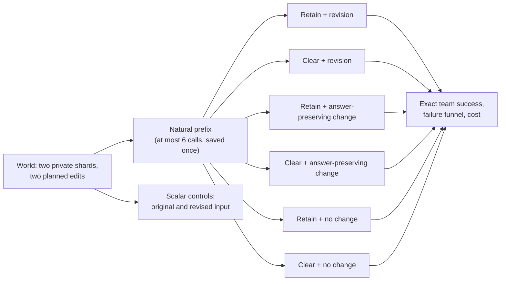
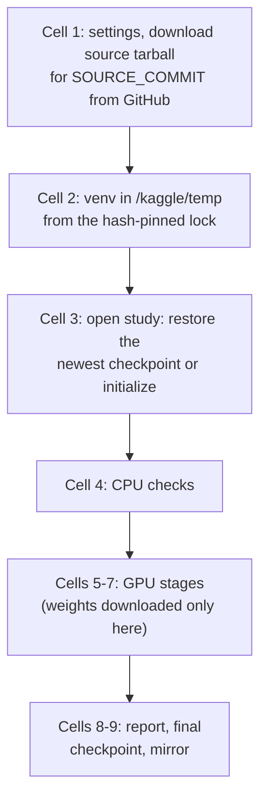

# Thesis project specification: does the change break the team, and does clearing history help?

**Adopted 22 October 2026 as the annex of [PROJECT_SPECIFICATION.md §13](../../PROJECT_SPECIFICATION.md#13-thesis-regime-thesis-recovery-v1)**

The user approved full implementation on 22 October 2026. Sections 3–5 are the
binding annex of §13; the rest explains, documents and guides operation.

**Amended 25 October 2026, before any GPU execution,** by the user's approval of
recommendations R1–R3 of the [pre-execution design review](thesis-pre-execution-design-review-2026-10-25.md):
every world gains a real answer-preserving change as two more sibling cells
(RP, CP); five prespecified secondary analyses are added (§3.9 S12–S16); the
change notice is made symmetric with the no-change notice; one sentence states
the existing waiting rule; and the decoding description is made exact (§3.8).
The primary estimands, the 192/128 worlds (reassessed in §3.10), the gates,
the call budget and the models are unchanged.
Implementation and CPU verification are complete (see the
[implementation evidence](../validation/thesis-implementation.md) and the
[operator runbook](../THESIS_KAGGLE.md)). GPU development, main execution and
publication remain separately authorized. Where implementation refined a detail
of the original proposal, the text below states the implemented behavior.

**Reading guide.** Section 1 is the one-page version. Section 2 explains why
this design beats the earlier proposals. Sections 3–5 are the exact scientific
and execution contract a developer implements. Sections 6–7 are the code and
the Kaggle notebook. Section 8 lists failure and edge cases with their checks.
Sections 9–11 cover amendments, the roadmap and evidence. Section 12 is the
summary and the approval I need.

**Status vocabulary** (from [AGENTS.md](../../AGENTS.md)): *implemented* means
code exists; *verified* means a named check passed; *pilot-tested* means bounded
GPU evidence exists; *empirically executed* means recorded experiment outcomes.
Everything new in this document is **proposed**. The reused I-01 runtime is
implemented, CPU-verified and was empirically executed in two course campaigns.

---

## 1. The project on one page

### 1.1 Plain-language summary

Two LLM agents each hold twenty private numbers. Both must submit the largest
number across both lists. They talk with short messages, have at most three
turns each, and a submission is final. This is the task the course already ran
twice.

Each world runs **once naturally** (the *prefix*). The team then resumes in a
new phase under six conditions, all starting from that same saved moment:

| | **Retain** the earlier conversation | **Clear** it |
|---|---|---|
| **Revision**: one private value changes, and the answer changes | RV | CV |
| **Answer-preserving change**: another private value changes, the answer does not | RP | CP |
| **No change**: the team is simply asked to decide again | RN | CN |

Two primary questions follow directly:

1. **Does the change itself break the team?** Compare revision with no change.
   The course saw success fall from 50% in the first phase to 10–15% after a
   change, but it never ran a no-change control. It could not tell whether the
   *change* hurt, or merely *being reopened* did.
2. **After a change, should a team keep or clear its history?** Compare clear
   with retain under revision.

The answer-preserving change splits the first question exactly: does a change
hurt because it is *announced*, or because the *answer* changes? It also tests
whether a team keeps a conclusion that remains valid after a real change.

Each model runs this design on the same 192 worlds: Qwen3.5-9B and IBM
Granite 4.2-8B. Every world also gets two single-call checks in which the model
sees all forty numbers, to separate "cannot find a maximum" from "cannot finish
as a team". The study measures exact team success and records where each
failure happened: was the needed value delivered, adopted and submitted?

Every outcome is informative. A large revision cost would show that changed
facts, not reopening, break these teams. No revision cost would show that
reopening alone causes the collapse. A null history effect with a tight
interval bounds the practical value of clearing. No result requires a winner.

### 1.2 Design at a glance

| Element | Choice |
|---|---|
| Task | Two-agent distributed maximum (SILO-BENCH I-01 Global Maximum, adapted). 20 integers per agent in −1000…1000, ≤3 calls per agent per phase, private final submissions |
| Change | The unique winning record gets a new value. Half the worlds **demote** it below the runner-up (new answer = runner-up); half **keep it winning** with a different value (new answer = the replacement). Every world also has an **answer-preserving change**: one non-winning record of the same owner gets a new value below the winner, so the answer and both local maxima stay the same |
| Conditions per world and model | One natural prefix, then six isolated continuations RV, CV, RP, CP, RN, CN, plus two full-information scalar controls |
| Models | Qwen3.5-9B `c202236…` and Granite 4.2-8B `a704214…`, direct (non-thinking) mode, NF4 on Kaggle T4×2 |
| Sample | 192 main worlds (fallback 128, chosen by measured cost before main), 8 balanced strata; 16 separate development worlds |
| Primary estimands, per model | **Δ_E** revision cost = success(no change) − success(revision), averaged over retain and clear. **Δ_H** history effect = success(clear) − success(retain) after revision. Secondary: the exact split Δ_E = Δ_announce + Δ_answer, the reopening effect, completion and wrong-commitment channels, prefix and holder subgroups |
| Analysis | Stratified paired world bootstrap, 10,000 draws, 97.5% intervals for the two primaries per model, all six cell means and paired categories always shown |
| Gates | Development checks technical health and capability before the change only: scalar controls, legal prefix actions, original-phase success. Nothing after the change can admit or exclude a model |
| Budget | ≤18,644 physical attempts and ≤100 aggregate allocated GPU-hours for the whole campaign. At worst-case call counts, measured course throughput predicts about 59 aggregate GPU-hours; the expected main load is about 30 |
| Execution | Python package + one Kaggle notebook of 9 code cells (plus an optional inspector). Online download of pinned code, packages and weights. Durable SQLite store, checkpoint every 20 minutes and after every cell, optional private Hugging Face mirror, automatic restore from the newest checkpoint |



### 1.3 Deliberately excluded

The original four-peer, five-family matrix; supplied (scripted) histories; a
repeated-continuation panel; a separate small answer-preserving-edit panel
(replaced on 25 October by preserving cells on every world); supplied-view
diagnostic probes; thinking mode; prompt variants; any solver, verifier,
forced exchange or host repair. Section 2 explains each exclusion.

---

## 2. Why this design

### 2.1 What the course evidence establishes

The numbers below were recomputed in this session from the canonical stores of
the [assisted campaign](../../notebooks/run/assisted-v1/latest/run.json)
(stored under `assisted-v1`) and [Course-7](../../notebooks/run/course-7-working/latest/run.json),
using read-only immutable SQLite connections. They match the
[final course report](../reports/final-course-report-submission.md) and the
[22 October reasoning](thesis-final-reasoning-2026-10-22.md#2-what-the-course-data-actually-say).

| Assisted campaign, 20 main worlds, Qwen3.5-9B | Original phase | Retain recovery | Clear recovery |
|---|---:|---:|---:|
| Exact team success | 10 | 2 | 3 |
| Needed value appeared in the needer's visible messages | 20 | 18 | 18 |
| Agent holding the answer submitted it | 20 | 11 | 12 |
| …holder submitted nothing | 0 | 8 | 6 |
| Agent needing the partner's value submitted it | 10 | 3 | 6 |
| Recovery submissions equal to the withdrawn maximum | — | 0 | 0 |

Revised full-information controls were correct in 18/20 worlds. All 348
scientific replies were valid JSON; 32 of 35 failed recoveries used only legal
actions. Course-7 (unassisted) instead repeated the withdrawn maximum in 7
needer submissions.

Three conclusions shape the design:

1. **The collapse happens at the phase boundary, not in delivery.** The needed
   value reached the needer in 18 of 20 recoveries, yet holders who had
   submitted correctly 20/20 times before the change stopped submitting at all
   in 6–8 worlds. Whether the *change* or the *reopening* causes this is the
   most valuable open question, and only a matched no-change continuation
   answers it. The course report names this gap itself
   ([§5.5, §5.9](../reports/final-course-report-submission.md#55-why-improved-collaboration-did-not-produce-reliable-recovery)).
2. **Old-answer anchoring is not the dominant observed failure** in the assisted
   interface. A design whose main contrast is "old conclusion shown versus
   hidden" targets a mechanism the data do not single out.
3. **The policy difference sits near the floor.** With 20 worlds, five
   discordant pairs and an interval of −15 to +25 points, only a much larger
   sample can bound the history effect usefully.

### 2.2 Candidates considered

| Candidate | What it would identify | Why not chosen |
|---|---|---|
| Original thesis: 4 peers, 5 task families, synchronous rounds, 60/40 worlds (§§1–8) | Rich reuse, receipt and teammate-reset effects | Never executed with a model. The last four-peer Kaggle attempt was rejected at the long-context envelope with 16.8 MiB free against a 1.5 GiB gate ([final-online-6](../validation/course-kaggle-final-online-6-analysis.md)). Two-peer collaboration already struggles; four peers multiply capability risk |
| Controlled supplied histories H0/HS/HSC × revision/no change ([18 Oct proposal](thesis-extension-2026-10-18.md), [22 Oct reasoning](thesis-final-reasoning-2026-10-22.md)) | Effect of showing an old conclusion with the evidence held fixed | Artificial starting state that centralizes recovery in the owner; targets anchoring, which §2.1 does not support as the main failure; needs new packet rendering; less intuitive |
| HS/HSC four-cell variant ([literature package](../implementation-research/thesis-literature-2026-10-18/prioritized-design-tests.md)) | Same, narrower | Same objection; also drops the empty-history baseline |
| Natural retain/clear × revision/no change plus repeat, preserving and diagnostic panels ([22 Oct recommendation](thesis-study-recommendation.md)) | Practical policy effect with matched no-change control | **Closest to this design.** Its panels add cost and analysis surface for descriptive estimates with roughly ±17–25 pp precision; it pins a Granite revision with a broken index; its 200 GPU-hour request predates the measured 8.7 s/call |
| **This design** | Revision cost Δ_E and history effect Δ_H, per model, plus the failure funnel; since 25 October also the exact announcement/answer split of Δ_E | Selected: smallest design that answers the open question, reuses the executed runtime, and gives each primary roughly ±9 pp |
| Same design, Qwen only | Same, one system | Halves cost and removes Granite risk, but gives no cross-family replication. Not chosen: you approved both models ([§12](#12-summary-status-and-next-approval)) |

### 2.3 How the conflicting inputs were resolved

| Topic | Inputs | Decision and reason |
|---|---|---|
| Main comparison | Recommendation: natural retain/clear. Reasoning: supplied H0/HS/HSC | **Natural.** The thesis is about recovering real teams. Natural prefixes cost 6 calls per world, only about 19% of a world's budget |
| Primary estimands | Recommendation: clear − retain only. Reasoning: HS − HSC | **Δ_E and Δ_H.** Δ_E answers the question the course could not; Δ_H answers the practical one. The interaction is secondary because a no-change effect alone can drive it |
| Edit population | Course: demote only. All 22 Oct inputs: add winner-keeps-winning stratum | **Both strata, balanced.** It covers decreases and increases, and in half the worlds the answer is a new value that only its owner can see, so it must be communicated |
| Granite revision | Recommendation: `f8de16cd`. Reasoning: `a7042144` | **`a7042144`.** Verified here: all four weight shards, config, tokenizer and template are byte-identical; only the index file (and signature) differ. The 22 October reasoning found that the old index maps 241/363 tensors to the wrong shard |
| Repeat panel | Both: 24 worlds × 2 extra trials | **Dropped.** The world bootstrap already includes continuation sampling noise. Repeats would only describe a variance component, for about 19% more main calls |
| Answer-preserving edit | Both: 32-world panel | **Dropped as a panel** (with 32 worlds its roughly ±17–25 pp precision cannot rank anything). **Amended 25 October:** run on every world as cells RP and CP, which makes it precise and decomposes Δ_E exactly ([review](thesis-pre-execution-design-review-2026-10-25.md) R1) |
| Supplied diagnostics | Recommendation: 8 per model | **Dropped.** The course diagnostics met 1/4 targets, gated nothing and cannot qualify natural interaction. The natural failure funnel is more informative |
| Development | Recommendation: 8 qualification + 16 development worlds. Reasoning: 12 | **16 development worlds**, with scalar controls inside them; no separate qualification set |
| Development gates | Recommendation: includes no-change success ≥16/32. Reasoning: no-change ≥9/12 per policy | **No gate after the boundary.** If reopening alone collapses a team, that is a finding for Δ_E, not a reason to exclude the model |
| Budget | Recommendation: 17,192 attempts, 200 GPU-h. Reasoning: 20,672 attempts | **13,652 attempts, 100 aggregate GPU-h**, from measured 8.7 allocated GPU-seconds per call and fewer panels. **Amended 25 October:** 18,644 attempts for six cells, same 100 GPU-h |
| Record labels | `agent-0:record-13` vs `A0.r13` | **`agent 0 record 13`**: plain words, one convention for shards, notices and examples |
| Durability | Open question for both | **Three layers plus optional private mirror**, because Kaggle discards session files and may not save outputs of crashed runs (§7.5) |

---

## 3. Scientific contract

### 3.1 Question, hypotheses and contribution

> When one private fact changes after a two-agent LLM team has collaborated,
> (a) how much does the change itself reduce the team's chance of finishing
> with two correct commitments, compared with simply reopening the decision,
> and (b) does retaining or clearing the earlier conversation change the
> outcome after a change?

The study treats each model as a fixed, configured system. Both estimands are
**total effects of a package**: retain bundles useful evidence, stale
conclusions, length and repetition; revision bundles a new value, its notice and
a changed answer. No pure memory or attention mechanism is identified.

Secondary question, added 25 October: does a change hurt because it is
*announced* or because the *answer* changes? The answer-preserving change makes
this an exact decomposition, Δ_E = Δ_announce + Δ_answer (§3.9), and also tests
whether a team keeps a conclusion that stays valid after a real change.

Expectations recorded before any thesis data (priors, not gates): Δ_E is
positive and large for Qwen; Δ_H is small; Granite is unknown. Added 25
October, before any thesis data: Δ_answer is larger than Δ_announce, and
Δ_announce is not zero.

**Contribution.** A matched, exact, uncertainty-aware measurement of revision
cost and history policy in natural two-agent collaboration, replicated in two
model families, with a trace-linked account of where recovery fails. It is not
a new memory architecture, a general benchmark score or a claim about all LLMs.

### 3.2 Task and truth

Agents 0 and 1 each own a shard of 20 integers. Truth is `max` over all 40
current values ([`oracle`](../../recovery/i01/core.py)). A team succeeds in an
episode when it ends with **both** private submissions equal to the current
maximum. Duplicated maxima are scored by value.

### 3.3 Worlds, edits and populations

**Identifiers and strata.** World IDs are `dev-00`…`dev-15` and
`main-000`…`main-191`. For index *i*, stratum `s = i mod 8` gives:

| s | Edit type | Changed owner | First speaker |
|---:|---|---:|---:|
| 0–3 | demote | `(s // 2) mod 2` | `s mod 2` |
| 4–7 | keep | `(s // 2) mod 2` | `s mod 2` |

So indices 0…127 contain exactly 16 worlds per stratum: the fallback is the
first 128 main worlds, nested and balanced. Development has 2 per stratum.

**Generation** (per world, deterministic; reuse `seed_for` and the rejection
pattern of [`make_world`](../../recovery/i01/core.py)):

1. `rng = Random(seed_for(MASTER, world_id, "world"))`, `MASTER = 2026102301`.
2. Up to 1,000 proposals. Each proposal draws two shards of 20 independent
   uniform integers in −1000…1000. Reject, counting each reason separately:
   non-unique maximum `M1`; runner-up `M2 = max(other 39 values) ≤ −1000`;
   `M2 = 999` (no legal keep-winner value exists); `M1` not in the scheduled
   owner's shard. The same eligibility applies to both edit types, so the two
   strata share one population of original inputs.
3. Let `r` be the position of `M1` in the owner's shard. Draw the replacement:
   - **demote:** uniform integer in `[−1000, M2−1]`; revised answer `M2`.
   - **keep:** uniform choice from `{M2+1,…,1000} ∖ {M1}`; revised answer is the
     replacement, which may be above or below `M1`.
4. Save shards, revised shards, owner, `r`, old and new value, both answers,
   edit type, first speaker, proposal count and rejection counts.
5. Save the evaluator-only descriptor `holder`: the set of agents whose current
   shard contains the current answer (for demote this can be the owner, the
   partner or both).
6. **Answer-preserving change** (added 25 October), from a separate stream
   `Random(seed_for(MASTER, world_id, "preserving"))`, so steps 1–5 are
   unaffected: choose a record `r′` uniformly from the owner's 19 positions other
   than `r`, then a replacement uniformly from `{−1000,…,M1−1}` minus that
   record's current value. `M1` is untouched, so the answer and both agents'
   local maxima are unchanged. Save the preserving shards, `r′`, and the old and
   new value.
7. Cell order: `Random(seed_for(MASTER, world_id, "order"))` shuffles
   `[RV, CV, RP, CP, RN, CN]` once; both models use the same order.

If 1,000 proposals fail, generation stops with an error. No world is ever
rejected, replaced or reordered because of a model outcome.

**Manifest.** All 208 worlds are generated once on CPU and committed as
`configs/thesis-worlds.json` (generator `thesis-worlds-v2` since the 25 October
amendment; every field of the earlier `v1` worlds is unchanged except the cell
order). Every session regenerates them and refuses to run unless the bytes
match. Before release, exact complete-input overlap is checked for all 624 new
inputs (original, revised and preserving) against every committed historical
I-01 manifest (`notebooks/run/*/run.json`) and within the new set, reusing
[`check_disjoint_inputs`](../../recovery/i01/core.py) and extending it to the
preserving inputs.
An overlap is a generator defect: change `MASTER` before any model call and
record why.

**Populations.** Development: 16 worlds, used only for gates, throughput and
pipeline shakedown, never pooled with main. Main: 192 worlds (or the first 128
under the fallback). Every main world contributes to every main estimate.

### 3.4 What each agent sees

Every team call receives the system text below, then one user message with: identity,
phase label, invocation count, partner-finished flag, earlier-phase history,
this-phase history, the environment notice and the current private shard. The
renderer extends the assisted renderer in [`messages`](../../recovery/i01/core.py)
with three changes: owner-qualified record names, a no-change notice and the
new phase rule.

**System text** (`THESIS_SYSTEM`; changes from `ASSISTED_SYSTEM` are the
paragraph beginning "Every record", the sentence beginning "A new phase", and,
since 25 October, the sentence beginning "A finished partner", which states the
existing waiting rule):

```text
You are one of two agents finding the global maximum across your current
private integer shards. Both agents must separately submit that same GLOBAL
maximum. Submitting only your own local maximum is insufficient when the
other shard contains a larger value.

Your CURRENT AUTHORITATIVE PRIVATE SHARD is your source for current local
values. The other agent's shard is private. You can exchange ordinary text
messages. A message is a claim, not a certified source or a private submission.
The partner-finished flag reveals only whether that agent has finished.

A useful strategy is to establish the relevant maximum of each shard, compare
them, and send your partner any information needed before you finish. Choose
your messages and timing. Reuse earlier reports when justified; obtain new
information when needed. You do not have to repeat an exchange merely because
a new phase starts. Check what a source change invalidates and what remains
useful. An earlier final answer is not automatically a current answer.

Every record is named by its owner and position, for example "agent 0 record 13".
An ENVIRONMENT NOTICE is not a partner message, a partner maximum or a partner
submission. A record name identifies a location, not an answer. A notice either
reports that no record changed, or names the single record that changed; the
replacement value is supplied only to that record's owner. Earlier-phase
history records what was visible then; current values come from your current
shard.

Return exactly one JSON object with exactly these keys:
message: a string containing non-whitespace text or null
submit: an integer or null
wait: true or false

Legal choices are message only, submit only, message and submit together, or
wait alone. Waiting requires BOTH message and submit to be null. With wait
false, at least one of message or submit must be non-null.
Message-only example: {"message":"example message","submit":null,"wait":false}
Wait-only example: {"message":null,"submit":null,"wait":true}
These are action-form examples, not messages to copy for the task.

Your submission is private unless you explicitly message it. Submission is
FINAL for this phase: you cannot adjust it after another message arrives.
Sending and submitting together delivers your message and then finishes you.
A new phase reopens both agents: submissions from an earlier phase do not
count, and both agents must submit again in the new phase.

Each agent has at most three calls per phase. Unused calls cannot be transferred.
Waiting wakes only on a delivered message. If both agents wait, neither can
send a waking message. A finished partner cannot send messages, so waiting
after your partner has finished ends the phase without your submission.
Invalid replies use a call and deliver nothing.
There is no correctness feedback. Put no text outside the JSON object.
```

**User message template** (history entries keep the assisted
`BEGIN VISIBLE ENTRY … END VISIBLE ENTRY` format, `Your action:` /
`From agent N:` / `Environment feedback:` labels, and literal text):

```text
You are agent {a}. Your partner is agent {b}.
This phase: {initial | new phase after an earlier phase}.
Your invocation: {k}/3.
Partner finished: {true|false}. This is status only; no value is disclosed.

VISIBLE HISTORY: EARLIER PHASE
{entries, or "(no visible entries)"}

VISIBLE HISTORY: THIS PHASE
{entries, or "(no visible entries)"}

ENVIRONMENT NOTICE
{notice}

CURRENT AUTHORITATIVE PRIVATE SHARD
agent {a} record 0: {value}
...
agent {a} record 19: {value}

Choose one legal action for the current phase. Return only the JSON object.
```

| Situation | Notice text |
|---|---|
| Prefix (initial phase) | `No environment notice in the initial phase.` |
| No change | `Environment event: no source record changed. A new phase began.` |
| Change (revision or answer-preserving), non-owner | `Environment event: one source record changed. A new phase began.` newline `Changed record: agent {o} record {r}` |
| Change, owner | As above, plus newline `Replacement value for your record agent {o} record {r}: {x}` |

The two change kinds use one notice form; only the named record (`r` for the
revision, `r′` for the preserving change) and the owner's value differ. The
change and no-change notices differ only in "one" versus "no" and the
changed-record lines (made symmetric on 25 October; the change notice
previously read "…changed before this phase began.").

**Never in any prompt:** the partner's shard, any answer, the edit type, whether
the answer changed, whether a change preserved the answer, the runner-up, the
condition label, the stratum, the holder descriptor, future events, other
cells' or other models' transcripts, or the partner's private submission (only
the finished flag).

#### Worked example: one world, all six starts

*Illustrative world, not from the generator.* Agent 0 starts first. The demote
edit changes agent 0 record 13 from 962 to 407.

```text
agent 0: -412 77 305 -871 640 12 -95 288 803 -330 519 -768 154 [962] -20 711 446 -603 390 865
agent 1: 208 -544 617 90 [931] -277 455 702 -16 383 849 -932 570 11 -480 296 788 64 -705 527
Original answer 962 (holder: agent 0). Revised answer 931 (holder: agent 1).
Keep-winner alternative: 962 -> 948, revised answer 948 (holder: agent 0).
Answer-preserving change: agent 0 record 7 from 288 to -150; answer stays 962.
```

The natural prefix happens to be:

| Call | Agent | Reply |
|---|---|---|
| 1 | 0 | `{"message":"My local maximum is 962 (agent 0 record 13).","submit":null,"wait":false}` |
| 2 | 1 | `{"message":"Mine is 931. 962 is the global maximum; submitting it.","submit":962,"wait":false}` |
| 3 | 0 | `{"message":null,"submit":962,"wait":false}` → both submitted 962, prefix correct |

Agent 1's first continuation call in each cell then contains:

| Field | RV | CV | RP | CP | RN | CN |
|---|---|---|---|---|---|---|
| Phase line | new phase after an earlier phase | same | same | same | same | same |
| Earlier-phase history | `From agent 0: My local maximum is 962 (agent 0 record 13).` and `Your action: message=Mine is 931… submit=962; wait=false` | `(no visible entries)` | identical to RV | `(no visible entries)` | identical to RV | `(no visible entries)` |
| Notice | changed record agent 0 record 13 (no value) | same as RV | changed record agent 0 record 7 (no value) | same as RP | no source record changed | same as RN |
| Current shard | agent 1's original shard (unchanged) | same | same | same | same | same |
| Correct final answer | 931 | 931 | 962 | 962 | 962 | 962 |

Agent 0 (the owner) sees the same history pattern with its own entries, and in
RV/CV its shard shows `agent 0 record 13: 407` plus the replacement line in the
notice. In RV, agent 0 can combine its new local maximum 865 with agent 1's
retained report of 931, but agent 1 still needs to learn that 865 < 931 before
it can be sure. In CV both reports must be re-established. In RN, resubmitting
962 is correct. In the keep variant (962 → 948), agent 1 cannot know 948
without a new message from agent 0. In RP, agent 1 sees that a record of agent
0 changed but cannot tell from the notice whether it was the reported maximum;
the retained report names record 13, so the notice for record 7 is in fact
irrelevant, and resubmitting 962 is correct. In CP that link is not visible.

### 3.5 Interaction protocol (unchanged I-01 semantics)

These rules are exactly the implemented [`validate_action`, `next_agent`,
`apply_outcome` and `finish`](../../recovery/i01/core.py) functions and are
reused without modification:

- One strict JSON object with exactly `message`, `submit`, `wait`. Message: a
  string with non-whitespace text, or null. Submit: a JSON integer (not a
  boolean), or null. Wait: boolean. Wait excludes both other fields; an empty
  non-waiting action is illegal. No duplicate keys, extra keys, code fences,
  surrounding text or repairs.
- An invalid, truncated (512 tokens without end of sequence) or failed call
  consumes the turn, delivers nothing and adds one public feedback entry
  (`REJECTION_FEEDBACK`, ≤32 native tokens) to that agent's history.
- Agents alternate when eligible (not finished, fewer than three calls, not
  waiting); the scheduled next agent goes first if eligible, otherwise the other.
- A message is delivered to the partner's history immediately and wakes a
  waiting partner. Send-and-submit delivers, then finishes the sender. A
  submission is final within the phase.
- The phase ends when both have submitted (`both_submitted`), or when no agent
  can act: `waiting_deadlock` if an unfinished agent is waiting with calls left,
  otherwise `horizon_exhausted`. Correctness never stops an episode.

### 3.6 Phases, retention and isolation

1. **Prefix.** `initial_episode(world, "prefix")` with original shards; first
   speaker from the stratum. It always runs to a terminal state; every
   prefix, correct or not, is kept.
2. **Continuations.** Each of RV, CV, RP, CP, RN, CN starts from a deep copy of
   the terminal prefix state:
   - `history`: **retain** = the exact terminal prefix histories of both agents
     (own valid actions, received messages and feedback entries, in order);
     **clear** = empty lists. The earlier-phase boundary is the retained length.
   - `turns = [0,0]`, `submissions = [null,null]`, `waiting = [false,false]`,
     `next = first speaker`, `events = []`, `terminal = null`.
   - Current shards: revised for RV/CV, preserving for RP/CP, original for
     RN/CN. Notice as in §3.4.
3. **Isolation.** Each continuation owns its state. No reply, delivery or
   submission crosses cells, models or worlds. Every call starts with an empty
   model cache. Retention is only the visible literal history; no hidden state,
   private reasoning or cache crosses a call.
4. **Seeds.** `seed_for(MASTER, model, world, phase_key, agent, invocation)`
   where `phase_key` is `"prefix"` or `"continuation"`. All six continuation
   cells therefore share per-agent per-invocation seeds (a sampling coupling,
   not replay). Controls use `seed_for(MASTER, model, world, "control",
   "original"|"revised")`. Seeds are 63-bit integers stored as JSON integers and
   never passed through floating point. Equal seeds across models do not mean
   equal randomness.

### 3.7 Controls

For every development and main world, each model gets two single calls with
the course [`CONTROL_SYSTEM`](../../recovery/i01/core.py) prompt and
`Complete input: [...]` (agent 0's 20 values then agent 1's 20, original order):
one on the original input, one on the revised input. A control is valid only as
`{"message":null,"submit":INTEGER,"wait":false}`. The preserving input has the
original answer and differs from the original input in one non-winning record,
so the original control covers it; no third control is run. Controls never
feed into a team and never change its scoring. They separate single-call extraction ability
from team behavior; a control-team gap is descriptive, not a causal
communication-failure rate.

### 3.8 Models and decoding

| Setting | Qwen3.5-9B | Granite 4.2-8B |
|---|---|---|
| Repository and pinned revision | `Qwen/Qwen3.5-9B` `c202236235762e1c871ad0ccb60c8ee5ba337b9a` | `ibm-granite/granite-4.2-8b` `a7042144125ce5ae64f89610e8289647fc000b9a` |
| Architecture (config) | `Qwen3_5ForConditionalGeneration`, loaded text-only through the reviewed loader | `GraniteForCausalLM`, dense, 40 layers, 8 KV heads, head dim 128 |
| Mode | Native template, `enable_thinking=False` | Native template, `enable_thinking=False` (prompt ends `<think></think>`) |
| Sampling | temperature 0.7, top-p 0.8, top-k 20 | temperature 1.0, top-p 0.95, **top-k 0 (disabled, explicit)** |
| Common | sampling on, min-p 0, repetition penalty 1.0, presence penalty 0 (deliberate, see below), 1 beam, no constrained decoding | same |
| End of sequence | `248044`, `248046` (existing) | `100257` (the `im_end` token) |
| Limits | ≤8,192 input tokens, ≤512 generated tokens | same numbers, own tokenizer |
| Numerics | bitsandbytes NF4, double quantization, FP16 compute; reviewed T4 attention `recovery_t4_sdpa`, prefill chunk 256 | NF4, double quantization, FP16 compute; PyTorch SDPA attention |
| Placement | one replica per T4, batch 1, no offload, no cross-device split, both GPUs used, replicas loaded one after the other | same |
| Weight files | 4 shards, 19,306,310,880 bytes | 4 shards, 17,583,228,032 bytes |

**Decoding, stated exactly** (corrected 25 October). Each model uses its card's
temperature, top-p and top-k. Qwen's card additionally lists
`presence_penalty=1.5` for non-thinking general tasks; this protocol uses a
presence penalty of 0 for both models, as the course did. The deviation is
deliberate: a presence penalty acts on tokens already generated in the same
reply, so it would penalize copying a number from `message` into `submit`, and
it does not act on the prompt history from which the observed loops were
copied. Granite's card gives no presence penalty. "Model-native" elsewhere in
this document means exactly this.

**Fairness boundary.** Fixed across models: worlds, edits, inputs, prompts,
protocol, cells, limits, scoring and development opportunities. Allowed to
differ: tokenizer, template framing, vendor-recommended sampling (Granite's
card requires temperature 1.0 and top-p 0.95 for all modes) and numerical
behavior under NF4/FP16. Granite's card suggests 2,048 new tokens for
non-thinking use; this protocol's actions are short (the course maximum was 124
tokens), and 512 is the common cap. The cross-model comparison is a replication
across two configured systems, not an architecture effect. There is no thinking mode,
smaller-model fallback, alternative prompt or third model.

**Input limit.** 8,192 tokens is primary. The CPU capacity proof (§5) builds
the worst reachable request for each tokenizer, as in the existing
[`check_tokenizer`](../../recovery/i01/checks.py) (assisted Qwen bound 7,634).
If either bound exceeds 8,192, both models use **12,288** instead, decided on
CPU before any GPU call. History is never truncated. **Measured on 22 October
2026 with the pinned tokenizers:** Qwen 7,784 and Granite 7,745 tokens; after
the 25 October prompt amendment Qwen 7,808 and Granite 7,769. The input limit is
8,192 (recomputed and bound in every study by the CPU checks).

### 3.9 Outcomes and estimands

For model *m*, world *w* and cell *c*, `Y[m,w,c] = 1` if the episode is terminal
with both submissions equal to the current answer (revised answer for RV/CV,
original answer for RP/CP/RN/CN), `0` for any other terminal state, and *unknown* if
the episode is not terminal. Let `a_s = 1/8` be the stratum weight and
`mean_s` the mean over main worlds in stratum *s*.

**Primary estimands (two per model, four in total):**

```text
Δ_E[m] = Σ_s a_s · mean_s( ½[(Y_RN − Y_RV) + (Y_CN − Y_CV)] )     revision cost; >0: change hurts
Δ_H[m] = Σ_s a_s · mean_s( Y_CV − Y_RV )                         history effect; >0: clearing helps
```

Δ_E compares a truthful announced change with a truthful no-change reopening
of the same saved state. It holds reopening, phase reset, history policy and
call budget fixed. It includes the new value, its notice, and any staleness of
retained history. Δ_H is the practical decision after a change; it includes
everything retain and clear do differently.

**Prespecified secondary estimates** (descriptive 95% intervals):

| # | Estimate | Purpose |
|---|---|---|
| S1 | The six cell rates and the prefix success rate | Context for every contrast |
| S2 | Interaction θ = (Y_CV − Y_RV) − (Y_CN − Y_RN) | Is clearing relatively better after a change? Never read without S1 |
| S3 | Δ_E under retain and under clear separately; Δ_H under no change (Y_CN − Y_RN) | Decompose the 2×2 |
| S4 | Δ_E and Δ_H within each edit type | Does demote differ from keep? |
| S5 | Δ_E[Qwen] − Δ_E[Granite] and the same for Δ_H, worlds paired | Model difference, descriptive |
| S6 | Paired categories for Δ_H (both / clear only / retain only / neither) and for each Δ_E component | Gains and losses, not just means |
| S7 | Completion (both submitted), wrong agreement, wrong disagreement, absent submissions, terminal reasons, legal-action rates | Distinguish commitment from correctness |
| S8 | Failure funnel per episode (below) | Where recovery fails |
| S9 | Scalar control accuracy, original and revised | Single-call capability |
| S10 | Calls, input/output tokens and ready-model seconds per cell; prefix-inclusive logical cost per policy | Cost beside quality |
| S11 | Correct-prefix and incorrect-prefix strata, counts per cell | Descriptive conditioning (intervals in S15) |
| S12 | **Decomposition** (added 25 Oct): Δ_announce = Σ_s a_s · mean_s(½[(Y_RN − Y_RP) + (Y_CN − Y_CP)]) and Δ_answer = Σ_s a_s · mean_s(½[(Y_RP − Y_RV) + (Y_CP − Y_CV)]); Δ_E = Δ_announce + Δ_answer exactly, world by world. Also each per-policy component and the history effect after a preserving change, Y_CP − Y_RP | Does a change hurt because it is announced, or because the answer changes? Does a valid conclusion survive a real change? |
| S13 | **Reopening effect** R = Y_prefix − Y_CN, with Y_prefix − Y_RN descriptive | The original phase and CN share inputs and first speaker and differ only by the phase line, the notice and the seeds |
| S14 | **Channels**: Δ_E, Δ_H, Δ_announce and Δ_answer computed on two unconditional episode indicators, C = both agents submitted and K = at least one submitted value is wrong | Whether an effect works through commitment or through correctness; reported side by side, not as an additive decomposition |
| S15 | **Subgroups**: Δ_E and Δ_H within correct-prefix and incorrect-prefix worlds, and within worlds whose revised answer stays with the changed owner or moves to the partner | Prefix correctness and holder location are fixed before any continuation, so these are pre-treatment subgroups |
| S16 | **Self-repetition**: per cell, agents whose message in the phase exactly repeats one of their own earlier messages, and how many repeat an earlier-phase message | Descriptive marker of the copy loops seen in the course |

**Failure funnel** (deterministic, evaluator side, per terminal episode with
current answer T): *holders* are agents whose current shard contains T;
*needers* are the others (none if both hold T). Record: whether T appears as a
standalone integer in any message the needer received in its visible history,
retained history included (a number match, not proof of understanding); whether
each holder and needer submitted T; and each other submission's class: absent,
own local maximum, another value in its own shard, the old answer `M1`
(revision cells only), or a value from neither shard. In RP and CP the old
answer is still current, so any wrong submission there is an unnecessary
revision. The funnel also records whether any submitted value is wrong (S14)
and the self-repetition flags (S16).

**Qualitative casebook.** For each model, the lowest-index main world in each
stratum, with its prefix and six cells: 8 worlds × 7 episodes × 2 models = 112
episode traces, exported with exact call references. Human coding with a frozen
rubric is optional and retrospective, with no LLM judge.

### 3.10 Statistical analysis

**Unit and resampling.** The world, with its single realized prefix per model,
is the unit. Each bootstrap draw samples, within each of the 8 strata, `n_s`
worlds with replacement, carrying every cell and both models together. The
estimate is the equal-stratum mean. 10,000 draws, Python `Random(2026102302)`,
strata in index order, worlds in index order within strata.

**Intervals.** Sort the B = 10,000 draws ascending as `d[0…9999]`. For
confidence `1 − α`, use `d[⌊Bα/2⌋]` and `d[⌈B(1−α/2)⌉ − 1]`: indices 125 and
9874 for the 97.5% primary intervals, 250 and 9749 for 95% secondaries.

**Secondary intervals.** All secondary estimates use the same stratified
draws at 95%. A subgroup estimate (S15) is the simple mean over the subgroup's
worlds; each draw keeps the resampled worlds that belong to the subgroup. If
any draw contains no member, the estimate is reported without an interval.

**Multiplicity.** Within each model the two primaries share a Bonferroni split
(97.5% each). Each model is a separately prespecified experiment. A claim that
an effect holds "in both models" requires both models' 97.5% intervals to
exclude zero in the same direction; this intersection rule needs no further
adjustment. No p-value catalogue.

**Degenerate intervals.** If a primary's bootstrap interval has zero width, or
every stratum's world contrasts are constant, also report the weighted
Hoeffding bound already in the specification:
`h = (U−L)·sqrt(½·ln(2/α)·Σ_w b_w²)` with `b_w = 1/(8·n_s)`, α = 0.025 and range
[−1, 1]. At N = 192, h = 21.4 pp; at N = 128, 26.2 pp. A nonzero claim then
requires both intervals to exclude zero.

**Missing outcomes.** A known terminal failure scores 0. An episode that never
reached a terminal state is unknown, never 0. If main is incomplete when the
campaign is declared stopped, compute each estimand twice, with every unknown
`Y` set to 0 or 1, whichever minimizes and then maximizes it (the coefficient
sign of each cell is known). Report both bounds and both bootstrap intervals.
Claim an effect only if both bounded intervals exclude zero in the same
direction. Never present complete cases as the intended population.

**No interim analysis.** During main, progress and reports show coverage,
validity and terminal reasons only. Estimates are computed when every intended
main episode for that model is terminal, or after an explicit, permanent
`declare-stopped` record. Development outcomes are shown in full; they are not
main data.

**Hand-scored example** (one world per stratum, so equal weights reduce to
simple means):

| World | Stratum | RV | CV | RN | CN | CV−RV | ½[(RN−RV)+(CN−CV)] | θ |
|---|---|---:|---:|---:|---:|---:|---:|---:|
| w0 | demote/0/0 | 0 | 1 | 1 | 1 | +1 | 0.5 | +1 |
| w1 | demote/0/1 | 0 | 0 | 1 | 0 | 0 | 0.5 | +1 |
| w2 | demote/1/0 | 1 | 0 | 1 | 1 | −1 | 0.5 | −1 |
| w3 | demote/1/1 | 0 | 0 | 0 | 0 | 0 | 0 | 0 |
| w4 | keep/0/0 | 0 | 1 | 1 | 1 | +1 | 0.5 | +1 |
| w5 | keep/0/1 | 0 | 0 | 1 | 1 | 0 | 1 | 0 |
| w6 | keep/1/0 | 0 | 0 | 1 | 0 | 0 | 0.5 | +1 |
| w7 | keep/1/1 | 1 | 1 | 1 | 1 | 0 | 0 | 0 |
| **Mean** | | .250 | .375 | .875 | .625 | **Δ_H = .125** | **Δ_E = .4375** | **θ = .375** |

Checks: Δ_E = ½[(.875 − .250) + (.625 − .375)] = .4375. θ = .125 − (.625 − .875)
= .375, so θ is three times Δ_H here because retain helps more under no change;
this is why θ is never read alone. Δ_H paired categories: both 1 (w7), clear
only 2 (w0, w4), retain only 1 (w2), neither 4.

The same worlds with their original-phase and answer-preserving cells (added
25 October):

| World | prefix | RP | CP | ½[(RN−RP)+(CN−CP)] | ½[(RP−RV)+(CP−CV)] | prefix − CN |
|---|---:|---:|---:|---:|---:|---:|
| w0 | 1 | 1 | 1 | 0 | 0.5 | 0 |
| w1 | 1 | 1 | 0 | 0 | 0.5 | 1 |
| w2 | 1 | 0 | 1 | 0.5 | 0 | 0 |
| w3 | 0 | 0 | 0 | 0 | 0 | 0 |
| w4 | 1 | 1 | 1 | 0 | 0.5 | 0 |
| w5 | 1 | 0 | 1 | 0.5 | 0.5 | 0 |
| w6 | 0 | 1 | 0 | 0 | 0.5 | 0 |
| w7 | 1 | 1 | 1 | 0 | 0 | 0 |
| **Mean** | .750 | .625 | .625 | **Δ_announce = .125** | **Δ_answer = .3125** | **R = .125** |

Δ_announce + Δ_answer = .4375 = Δ_E, and the identity holds in every row.

*Missing example:* if w3's CV were unknown, Δ_H ∈ [.125, .250] (CV = 0 or 1) and
Δ_E ∈ [.375, .4375] (CV = 1 or 0).

**Precision** (normal approximation near zero effect, 97.5% two-sided, z =
2.241; 80% detection reference uses 2.241 + 0.842 = 3.083; these are planning
sensitivities, not measured power):

| Estimand and assumption | N = 192 half-width | N = 192 detects | N = 128 half-width | N = 128 detects |
|---|---:|---:|---:|---:|
| Δ_H, discordance q = 0.2 | 7.2 pp | 10.0 pp | 8.9 pp | 12.2 pp |
| Δ_H, q = 0.3 (course: 0.25) | 8.9 pp | 12.2 pp | 10.9 pp | 14.9 pp |
| Δ_H, q = 0.5 | 11.4 pp | 15.7 pp | 14.0 pp | 19.3 pp |
| Δ_E, world-contrast SD 0.4 | 6.5 pp | 8.9 pp | 7.9 pp | 10.9 pp |
| Δ_E, SD 0.5 | 8.1 pp | 11.1 pp | 9.9 pp | 13.6 pp |
| Δ_E, SD 0.6 | 9.7 pp | 13.3 pp | 11.9 pp | 16.4 pp |

Formulas: half-width `2.241·sqrt(q/N)` or `2.241·SD/sqrt(N)`. The study can
resolve effects of about 10–15 points and bound larger ones. It cannot detect
5-point effects: at q = 0.3 that would need about 1,140 worlds. Ten points is a
reporting reference, not an equivalence margin. The interaction θ is noisier
(SD up to 2): at SD 0.8 its 95% half-width is 11.3 pp at N = 192. The
secondary Δ_announce has the structure of Δ_E: at SD 0.35–0.45 its 95%
half-width is 5.0–6.4 pp at N = 192 and 6.1–7.8 pp at N = 128. The reopening
effect at discordance 0.35–0.45 has a 95% half-width of 8.4–9.5 pp at N = 192.

**World count reassessed on 25 October** (before implementation of the
amendment, with six cells costing 32.2 expected calls per world and model at
the course's measured 72% use of call slots):

| N | Δ_H 97.5% half-width, q = .25/.30 | Power, Δ_H = 12 pp, one model | Both models | 80% detectable Δ_H (q = .3) | Expected main calls, both models | Expected aggregate GPU-h at 8.7 s/call |
|---:|---|---:|---:|---:|---:|---:|
| 96 | 11.4 / 12.5 pp | .46 | .21 | 17.2 pp | 6,190 | 15.0 |
| 128 | 9.9 / 10.9 pp | .59 | .35 | 14.9 pp | 8,253 | 19.9 |
| 160 | 8.9 / 9.7 pp | .70 | .49 | 13.3 pp | 10,317 | 24.9 |
| **192** | **8.1 / 8.9 pp** | **.79** | **.62** | **12.2 pp** | **12,380** | **29.9** |

Moving from 192 to 128 worlds would save about 4,100 expected calls (about 10
aggregate GPU-hours, or 2.5 wall-hours per model) but widen every interval by
22%, cut the chance of a replicated 12-point history effect from .62 to .35,
and leave the subgroup analyses (S15) with about 64 worlds each. Compute is not
the binding constraint, and the forecast rule of §4.3 already falls back to 128
worlds without looking at outcomes if measured throughput requires it. The
target therefore stays at 192, with the nested 128 fallback.

### 3.11 What each result licenses

| Pattern (per model) | Defensible conclusion |
|---|---|
| Δ_E > 0 (interval excludes 0) | Changed facts, not reopening alone, reduce completion here. Funnel shows where |
| Δ_E ≈ 0, both events low | Reopening a finished decision is itself the problem in this interface; the change adds little |
| Δ_E ≈ 0, both events high | No recovery problem in this regime; the course drop does not replicate |
| Δ_H > 0 or < 0 | Clearing helps or hurts after a change, as a whole package, with gains/losses and costs shown |
| Δ_H interval spans 0 with half-width ≈ 9 pp | No policy effect larger than about ±9 pp; clearing is not a fix for this failure |
| θ > 0 but Δ_H ≈ 0 | Retention helps mainly when nothing changed; clearing is not a recovery improvement |
| Δ_announce > 0 (95% interval excludes 0) | Announcing a change disrupts the team even when nothing it needs has changed |
| Δ_announce ≈ 0, Δ_answer > 0 | Irrelevant changes are absorbed; the cost lies in obtaining and adopting new information |
| Y_RP below Y_RN | A still-valid retained conclusion is abandoned after a real but irrelevant change (over-revision) |
| R > 0 (reopening) with Δ_E ≈ 0 | Reopening a finished decision is itself the problem in this interface; S14 shows whether through completion or correctness |
| An effect appears only in the C channel | The change or history policy alters commitment, not what the team concludes |
| Effects agree in both models | Same direction in two model families under one interface; still not all LLMs |
| Models disagree | A system-dependent result; report S5 with its uncertainty, no pooled winner |
| A model fails a development gate | Feasibility finding for that configured system; the other model's study stands alone |

**Limitations to state in the thesis.** One numerical task with little
expensive computation to preserve; two agents; three calls per agent; one
announced change per continuation; supplied coordination strategy; strict JSON; quantized direct
mode; one prefix per world (no prefix-to-prefix variability); history policies
are bundles; numeric matching in the funnel is not proof of belief; results are
SILO-derived, not native benchmark scores.

---

## 4. Execution contract

### 4.1 Stages and authorization scopes

| Scope (notebook setting) | What may run | Authorized by |
|---|---|---|
| `cpu` | Code and package installation, manifest and self-checks, tokenizer capacity proof (tokenizer files only), checkpoint/restore, reports | Adoption plus CPU implementation approval |
| `rehearsal` | `cpu` plus a two-world end-to-end run with a **scripted model** on CPU, in a separate study `<STUDY_ID>-rehearsal`, including checkpoint, mirror and cross-session restore | Same as `cpu`; no GPU |
| `development` | `cpu` plus weight downloads, loading, readiness and the 16 development worlds for each model, and the gate report | Your explicit GPU development authorization |
| `main` | `development` (if incomplete) plus freeze and main execution | Your explicit main authorization, recorded by pasting the gate-report ID into `MAIN_AUTHORIZATION` |

Run All never crosses a scope boundary. Within `main`, once authorized,
repeated sessions continue until the frozen scope is complete, with no further
per-session approvals. Passing a gate never authorizes the next scope by itself.

### 4.2 Development and gates

Per model, in one session if time allows:

1. Download and verify the pinned files (§7.2); load replica 0, then replica 1.
2. **Readiness (8 calls):** on each GPU the existing A/B/A state probe (`[-7,3]`,
   `[100,-9]`, `[-7,3]` scalar controls, A seeds equal) and one full envelope
   (control prompt padded to the input limit, 512 forced output tokens). Pass:
   no failure, finite scores, empty fresh cache each call, and observed free
   memory ≥ 1.5 GiB on both GPUs during the envelope. A1/A2 token inequality is
   recorded for review, as in the course; it does not by itself fail.
3. **Development worlds:** 16 worlds × (prefix + RV, CV, RP, CP, RN, CN + 2
   controls), the same code path as main.

Gates per model (all must pass). They use technical health and evidence from before the change only; no post-change correctness, completion or legality can admit or exclude a model:

| Gate | Requirement | If true accuracy is… | …pass probability |
|---|---|---|---|
| G1 technical | Readiness passed; load audit shows no missing or unexpected language weights; at most one recorded provider failure in development; no unconfirmed process termination | — | — |
| G2 scalar capability | ≥ 26 of 32 development controls exact | 90% / 80% / 70% | 0.96 / 0.54 / 0.11 |
| G3 protocol | ≥ 90% of development prefix calls legal | Course assisted: 81/82 main prefix calls | — |
| G4 base task | ≥ 5 of 16 development prefixes jointly correct | 50% / 30% / 15% | 0.96 / 0.55 / 0.08 |

Development continuation outcomes are reported but **never gate**. A model that
fails is excluded from main and its failure reported. **Pre-approved rule:** if
exactly one model passes, main proceeds with that model alone; if neither
passes, the campaign stops with a feasibility report and no main inference.
Failing models get no prompt change, retry, threshold change or substitute.
A software defect discovered in development is fixed, released as a new source
commit and rerun under a new study ID; the old study and its spending are kept.

**Gate report.** A JSON plus printed table with G1–G4 per model, measured
throughput `g_m` (below), the resource forecast, the admitted models, the main
size the rule would choose, and all development outcomes. Its ID is the first
12 hex digits of the SHA-256 of its canonical JSON, prefixed `dev-`.

### 4.3 Freeze and main size

**Throughput.** `g_m` = 2 × (wall seconds from model m's first to last
development scientific call) ÷ (number of those calls): allocated GPU-seconds
per call, both GPUs, idle time included. The course measured 8.7 for Qwen in
its main stage (278 calls in 20.15 minutes).

**Forecast rule.** With `H_spent` = aggregate GPU-hours already observed (2 ×
session wall time from the setup cell to the last cell, for every GPU session;
a session whose end was not observed counts up to its recorded deadline, a
conservative upper bound):

```text
F(N) = H_spent + 4 + 1.25 × (44·N·Σ_m g_m + 300·max_m g_m) / 3600
```

The 4 hours cover main-session setup, downloads, loads, readiness and exports;
44 is the worst-case calls per world per model (32 before the 25 October
amendment; the code reads it from the configured ceiling); 300 is the
contingency; 1.25 is the margin. **Choose N = 192 if F(192) ≤ 100; otherwise
N = 128 if F(128) ≤ 100; otherwise stop and ask.** Both admitted models use the
same N. Example with g = 9.0 (Qwen), 14.0 (Granite), H_spent = 6: F(192) = 6 +
4 + 1.25 × (194,304 + 4,200)/3600 = 78.9 → 192. With Qwen at the measured 8.7 s
and H_spent = 6, the target holds while Granite's g ≤ 21.2 s (32 s before the
amendment); above that both models run 128 worlds.

**Freeze record** (immutable, written once when `SCOPE="main"` and
`MAIN_AUTHORIZATION` equals the gate-report ID): admitted models, N, world IDs,
source commit, hashes of config, world manifest, runtime lock, model files,
tokenizer and template; input limit; authorization ID and time. Every later
session verifies it before any main call.

**Main order.** Admitted models in the order Qwen, then Granite; worlds in index
order. Each GPU takes the lowest-index world not yet started; a world's
episodes run on one GPU in the order prefix, its six cells in saved order,
then the two controls. The device is recorded, not designed.

### 4.4 Attempt ceilings

Counts are **maximum first attempts**, assuming every episode uses all six
calls (the course used 72% of team call slots, 258/360). Unused capacity never
adds worlds.

| Component | Per model | Both models, N = 192 | Both models, N = 128 |
|---|---:|---:|---:|
| First-load readiness | 8 | 16 | 16 |
| Development: 16 × 44 | 704 | 1,408 | 1,408 |
| Main: N × 44 (6 prefix + 36 continuation + 2 controls) | 8,448 / 5,632 | 16,896 | 11,264 |
| Reload readiness: 2 per further load, ≤ 12 loads | — | 24 | 24 |
| Contingency: identical retries of interrupted attempts | — | 300 | 300 |
| **Campaign ceiling** | | **18,644** | **13,012** |

With one admitted model: 10,196 (N = 192) or 7,380 (N = 128). Each stage stops
dispatch at its ceiling. Historical course attempts are separate; they are not
charged here and do not enlarge these ceilings. Before the 25 October amendment
the ceilings were 13,652 and 9,556.

**Aggregate GPU-hour sensitivity** for the full target ceiling (`3 +
1.25 × 18,644 × g / 3600`, where 3 h is a six-session overhead allowance):

| g (allocated s/call) | 8.7 (Qwen measured) | 12 | 15 | 20 | 25 |
|---|---:|---:|---:|---:|---:|
| Aggregate GPU-hours, N = 192 | 59.3 | 80.7 | 100.1 | 132.5 | 164.8 |

This worst case assumes both models at the same g and every call slot used. The
100-hour ceiling holds the target up to g ≈ 15.0 s and the fallback up to
g ≈ 21.5 s; the binding decision is the measured forecast of §4.3. The expected
main load at 72% usage and g = 8.7 is about 12,400 calls, 30 aggregate
GPU-hours or 15 wall-hours on T4×2.

### 4.5 Failure rules

| Event | Rule |
|---|---|
| Wrong, malformed, illegal or truncated reply | Recorded outcome; turn consumed; never retried |
| Call exceeds 180 s | Recorded `timeout` failure, turn consumed, never retried; replica terminated (5 s), confirmed, reloaded with 2 reload-readiness calls |
| Non-finite scores, CUDA error or other exception inside generation | Recorded `provider_failure`, turn consumed; replica restarted. Stop that model's stage if this happens in readiness, more than once in development, or more than 10 times in main |
| Worker process dies or the kernel restarts with no durable reply | Attempt marked `interrupted`; after confirmed termination, **one identical retry** (same request and seed) from contingency |
| Session lost; newer work never saved | Restore the newest checkpoint. Attempts admitted without an outcome become `lost` and are retried once with the identical request and seed, from contingency. Work done after the checkpoint left no record; it is recomputed as ordinary calls with identical requests and seeds, and the session record notes the unrecorded interval. GPU-hour accounting uses wall time, so this spending is still counted |
| Unconfirmed process termination | Stop dispatch until confirmed or the session ends |
| Stage ceiling, contingency or GPU-hour ceiling reached | Stop dispatch, checkpoint, ask |
| More than two lost sessions in the campaign | Stop and ask; check the execution environment |

**Why re-execution after session loss is allowed.** The course blocked worlds
whose tail of calls was lost. This specification instead re-executes them,
because the rerun is mandatory, uses the identical saved request and seed, and
the lost reply was never recorded, so no one can select among outcomes. The
restored checkpoint is always the newest one available (§7.5); choosing an
older one is refused. GPU nondeterminism may make the rerun differ from the
lost draw; the attempt and lost-session facts are recorded and reported.

**Stops never depend on outcomes.** Wrong, invalid or unfinished recoveries in
main never stop, replace or reorder worlds.

### 4.6 Measured versus unmeasured

| Fact | Status |
|---|---|
| Qwen loads and runs this interface on Kaggle T4×2 with ≥1.5 GiB headroom at 8,192+512 | Empirically executed (assisted course: minimum about 6.78 GiB free) |
| Qwen throughput | Measured: 8.7 allocated GPU-s/call (main), mean ready 5.9 s, envelope 67.8 s |
| Setup + 19.3 GB weight download + two loads | Measured once: 7.6 minutes from host observation to first call (16 Oct) |
| Granite NF4/FP16 numerics, memory, speed, JSON compliance on T4 | **Unmeasured GPU gate** (G1–G3) |
| New prompt text, owner labels and no-change notice behavior | **Unmeasured**; development shows it |
| Behavior under the answer-preserving change, the symmetric notice and the waiting sentence (25 October) | **Unmeasured**; development shows it, descriptively |
| Kaggle image still Python 3.13 and compatible with the pinned lock | **Unmeasured until the first session**; setup refuses otherwise |
| How Kaggle charges T4×2 against the weekly quota | **Unmeasured**; the operator records quota before and after the first GPU session |

---

## 5. CPU acceptance before any GPU use

| Check | Pass condition |
|---|---|
| Manifest | Regenerated worlds equal `configs/thesis-worlds.json` byte for byte; strata counts 2/16/24 per stratum for dev, fallback and target; all 624 inputs (original, revised, preserving) disjoint from all committed historical inputs and from each other |
| Generator properties | Unique `M1`; demote replacement < `M2`; keep replacement > `M2` and ≠ `M1`; preserving change of exactly one non-winning record of the owner, below `M1` and different from its old value, with the answer and both local maxima unchanged; answers recomputed by an independent max; rejection counts saved |
| Information witness | A keep world and a demote world exist where the non-owner's first continuation view is identical but the answers differ (the non-owner must receive new information); the non-owner's first RV and RP views differ only in the named record although only RV changes the answer |
| Views and privacy | No partner value, answer, edit type, stratum, holder, cell label or hint that a change preserved the answer appears in any rendered request (checked structurally on scripted runs); owner-only replacement line; one notice form for both change kinds |
| Literal retention | RV, RP and RN earlier-phase blocks byte-identical to the prefix's visible history; CV, CP and CN empty; current shards and notices differ only as specified |
| Protocol | Scripted cases for every row of §3.5 and §8 Table A |
| Capacity | Worst reachable request ≤ input limit for both tokenizers (§3.8), including all adversarial literal families of the existing check |
| Durability | Scripted kill tests: before reply, after raw reply, after effects, during export; restore and identical retry; lost-session re-execution |
| Analysis | Synthetic fixtures with known Δ_E, Δ_H, θ signs; the hand-scored example of §3.10 reproduces exactly, including Δ_announce, Δ_answer, the reopening effect and the world-by-world identity Δ_E = Δ_announce + Δ_answer; subgroup resampling; missingness bounds; degenerate companion |
| Notebook | Every code cell calls exactly one facade function; a CPU-only Kaggle session completes `rehearsal` across two sessions with a restore |

---

## 6. Implementation

### 6.1 Module map

A new package `recovery/thesis/` holds only what is new. It imports stable
pure functions and classes from `recovery/i01/` instead of adding another regime
branch to the course workflow, whose 1,150-line controller encodes course
policies (500-attempt ceilings, pilot reviews, continuation imports) that the
thesis does not use.

| Module | Status | Responsibility | Key interface |
|---|---|---|---|
| `recovery/i01/core.py` | **Reuse unchanged** | `validate_action`, `next_agent`, `apply_outcome`, `finish`, `seed_for`, `canonical`, `oracle`, `check_disjoint_inputs`, `REJECTION_FEEDBACK`, `CONTROL_SYSTEM`, entry rendering | — |
| `recovery/i01/store.py` | **Reuse `Store` unchanged** | SQLite WAL/FULL; tables meta, episodes, calls, attempts, sessions, annotations; immutable binding; raw-before-effects | `Store(path, binding, create=…)` with one file `study.sqlite` |
| `recovery/i01/process.py` | **Reuse unchanged** | Spawned resident model child per GPU, call deadline, confirmed termination | `Resident(factory).load()`, `.obtain(request, timeout)`, `.close()` |
| `recovery/i01/runtime.py` | **Reuse unchanged** | Isolated `-I -S` venv entry that puts the source root on `sys.path` | `runtime.command(python, source, '-m', 'recovery.thesis', …)` |
| `recovery/inference.py` | **Reuse for Qwen** | Reviewed Qwen NF4 loader, T4 attention, fresh-cache `_generate` | `ModelFactory(course_candidate("9B"), …)` as the I-01 adapter does |
| `recovery/i01/setup.py` | **Reuse functions** | `create_environment`, `invoke`, `PIP_BOOTSTRAP`, hash-pinned install of `configs/i01-runtime.lock` | Called by the thesis installer; no source wheel |
| `recovery/i01/archive.py` | **Reuse helpers** | `digest`, `atomic_json`, `inventory`, safe ZIP rules | — |
| `recovery/thesis/worlds.py` | New, ≈150 lines | Generation (§3.3), manifest build and verification, disjointness | `build_manifest(config) -> dict`; `verify_manifest(path)` |
| `recovery/thesis/protocol.py` | New, ≈250 lines | `THESIS_SYSTEM`, user-message rendering, notices, initial states for prefix and the six cells, permitted views, scoring, funnel classification and self-repetition flags | `start(world, cell, prefix_state)`, `view(world, state, agent, cell)`, `messages(view)`, `score(world, cell, state)`, `funnel(world, cell, state)` |
| `recovery/thesis/models.py` | New, ≈250 lines | Exactly two explicit model entries (no registry); settings; request preparation and exact-request check; Qwen via the reviewed loader; Granite factory (one visible T4, NF4/double/FP16, SDPA, local files only, load audit, fresh `DynamicCache`, finite-score processor, exact-prefix check, peak memory) | `prepare(view, seed, model, tokenizer, control=False, envelope=False)`, `Factory(model, device, snapshot)` |
| `recovery/thesis/assets.py` | New, ≈100 lines | Pinned metadata and weight download into the scratch cache; size and SHA-256 verification per file (generalizes `setup.download`) | `download(model, scratch, weights: bool) -> receipt` |
| `recovery/thesis/run.py` | New, ≈450 lines | Study open/init/restore; admission and ceilings; one GPU thread per replica; readiness, development, gates, freeze, main; deadline cutoff; checkpoint cadence; progress lines; lock file | functions behind the CLI below |
| `recovery/thesis/checkpoint.py` | New, ≈200 lines | Export, verify, select newest, restore, optional Hugging Face mirror | `export(run) -> receipt`, `find(study, sources)`, `restore(zip, run)`, `mirror(zip, repo)` |
| `recovery/thesis/analysis.py` | New, ≈400 lines | Estimands, bootstrap, bounds, funnel and cost tables, casebook, figures, Markdown/HTML/CSV report | `analyse(run) -> dict`, `write_report(run, out)` |
| `recovery/thesis/notebook.py` | New, ≈250 lines, **standard library only** | Thin facade used by notebook cells: source download, install, subprocess launch with streamed output, receipts, links | one function per cell (§7.3) |
| `recovery/thesis/__main__.py` | New | CLI dispatch | `python -m recovery.thesis <command>` |
| `configs/thesis.json`, `configs/thesis-worlds.json` | New | Scientific and runtime settings; generated manifest | §6.3 |
| `scripts/build_thesis_source.py` | New, ≈60 lines | Fallback source ZIP with a file-hash manifest, for when GitHub is unreachable | `--commit SHA --output ZIP` |
| `recovery/thesis/checks.py` | New | CPU acceptance checks of §5, run by the notebook every session | `run_checks(source, config, ...)` |
| `scripts/build_thesis_notebook.py`, `notebooks/thesis_kaggle.ipynb` | New | Notebook builder; 9 code cells (settings and source bootstrap, then one facade call each) and an optional inspector | §7.3 |
| `tests/test_thesis_*.py` | New, `unittest` | §5 and §8 checks, with a scripted provider through the same process boundary | — |

No other existing file changes, except documentation updated at adoption.

### 6.2 Canonical storage and identities

One canonical database per study: `study.sqlite` with the existing `Store`
schema. Binding: regime, study ID, source commit, SHA-256 of `configs/thesis.json`,
`configs/thesis-worlds.json` and `configs/i01-runtime.lock`.

| Object | Identity |
|---|---|
| Episode | `{model}/{world}/{cell}` with cell ∈ prefix, RV, CV, RP, CP, RN, CN; controls `{model}/{world}/control-original` and `…/control-revised` |
| Call | `{episode}/agent-{a}/invocation-{k}` (k from 0); readiness `{model}/readiness/load-{n}/gpu-{g}/{probe}` with probe ∈ A1, B, A2, envelope |
| Attempt | Row in `attempts` keyed by call and attempt number; `stage` ∈ readiness, development, main, reload; `contingency` flag; status admitted / completed / failed / interrupted / lost |
| Session | Row per notebook session: start, end, scope, host, GPUs, driver, Python, restored checkpoint, deadline |
| Meta keys | `gates`, `freeze`, `checkpoint_seq`, `declared_stopped`, `lost_sessions` |

Persistence order per call (existing): register request → admit attempt →
generate → persist raw outcome → validate → apply and commit effects
atomically. A completed call is never regenerated.

### 6.3 Configuration (proposed `configs/thesis.json`)

```json
{
  "regime": "thesis-recovery-v1",
  "master_seed": 2026102301,
  "bootstrap_seed": 2026102302,
  "shard_size": 20, "value_range": [-1000, 1000], "turns_per_agent": 3,
  "max_proposals": 1000,
  "development_worlds": 16, "main_worlds": 192, "fallback_main_worlds": 128,
  "cells": ["RV", "CV", "RP", "CP", "RN", "CN"],
  "input_tokens": 8192, "alternative_input_tokens": 12288,
  "output_tokens": 512, "feedback_tokens": 32,
  "load_timeout_seconds": 600, "call_timeout_seconds": 180, "termination_seconds": 5,
  "headroom_bytes": 1610612736,
  "checkpoint_minutes": 20, "dispatch_cutoff_minutes": 25,
  "ceilings": {"readiness": 16, "development": 1408, "reload": 24,
               "main_per_model_per_world": 44, "contingency": 300,
               "aggregate_gpu_hours": 100},
  "gates": {"controls_min": 26, "legal_fraction_min": 0.90, "original_min": 5,
            "development_provider_failures_max": 1, "main_provider_failures_max": 10},
  "bootstrap_draws": 10000, "primary_confidence": 0.975, "secondary_confidence": 0.95,
  "models": {
    "qwen":    {"repo": "Qwen/Qwen3.5-9B", "revision": "c202236235762e1c871ad0ccb60c8ee5ba337b9a",
                "temperature": 0.7, "top_p": 0.8, "top_k": 20, "attention": "recovery_t4_sdpa"},
    "granite": {"repo": "ibm-granite/granite-4.2-8b", "revision": "a7042144125ce5ae64f89610e8289647fc000b9a",
                "temperature": 1.0, "top_p": 0.95, "top_k": 0, "attention": "sdpa"}
  }
}
```

### 6.4 Command line (implemented)

`python -m recovery.thesis <command> --run DIR --study ID --scope S --session ID
--deadline ISO ...` runs inside the pinned venv through `runtime.py`. Every
scientific command (open, check, develop, freeze, main, finish, declare-stopped)
opens the study, does its bounded work, writes a verified checkpoint and a cell
receipt, and exits. Exit codes: 0 done or skipped, 3 expected stop, 1 error.
The `rehearsal` scope runs the same commands with the scripted double in the
study `<STUDY_ID>-rehearsal` (2 development and 2 main worlds per model).

| Command | Effect |
|---|---|
| `open [--start-new] [--input-root DIR]` | Reopen the local study, restore the newest checkpoint from inputs or the mirror, or (first run only) create it |
| `status` | Coverage, gates, freeze, checkpoint sequence, GPU-hours, lost sessions |
| `check` | §5 checks; downloads tokenizer files only; binds the input limit |
| `develop` | Readiness, development and gate report for models still incomplete |
| `freeze --authorization ID` | Write the freeze record (§4.3); in rehearsal the gate ID is used automatically |
| `main` | Continue frozen main work until done or the cutoff |
| `report [--out DIR]` | Build the report from the canonical store only |
| `finish` | Close this session's record and write the final checkpoint |
| `show --model M --world W --cell C` | Print exact requests and replies of one episode |
| `declare-stopped --reason TEXT` | Permanent; enables bounded estimates for an incomplete main |
| `build-worlds` | Release step: regenerate the manifest and the separation receipt |
| `env-check` | Inside the venv: packages equal the lock; isolated startup |

---

## 7. Kaggle workflow

### 7.1 Verified environment facts (22 October 2026)

| Fact | Source and evidence strength |
|---|---|
| GPU sessions run at most 12 hours; 20 GB of `/kaggle/working` is saved with a notebook version; other scratch disk is not saved; T4×2 has 2 T4s, 4 CPU cores and 29 GB RAM; Save & Run All runs top to bottom in a fresh session and must finish within 12 hours | [Kaggle Notebooks documentation](https://www.kaggle.com/docs/notebooks), technical specifications section (official) |
| Weekly GPU quota is 30 hours, sometimes higher | [Kaggle efficient GPU usage](https://www.kaggle.com/docs/efficient-gpu-usage) (official); how T4×2 counts is not stated |
| Interactive sessions end after 20 minutes without code activity (the GPU-tips page says up to 60 minutes after closing the window) | Kaggle documentation (official; the two pages differ) |
| Output files are not captured when a notebook crashes; versions stop at an errored cell | Kaggle staff and product-update posts found by search ([forum](https://www.kaggle.com/discussions/product-feedback/322615), [update](https://www.kaggle.com/product-feedback/249514)); not in the official docs, treated as a risk |
| Host on 16 Oct: Python 3.13.15, driver 580.178.04, two T4 with 15,360 MiB; `/kaggle/temp` on a shared filesystem with about 1.15 TB free; `/kaggle/working` 20.96 GB | Assisted run [setup receipts](../../notebooks/run/assisted-v1/latest/receipts/setup/7785ff79-9fb0-47c3-bedf-b47406d709af/host.json) (measured, may change) |
| Pinned lock (Python 3.13, torch 2.11.0+cu128, transformers 5.12.0, bitsandbytes 0.49.2, huggingface-hub 1.19.0) installed in 175 s; transformers v5.12.0 contains both `granite` and `qwen3_5` model code and disables top-k when `top_k=0` | Course receipts; transformers source at tag v5.12.0 (verified) |
| Both model repositories are public and ungated; Qwen head is still `c202236…`; Granite head `a7042144…` (20 Oct) | Hugging Face API (verified) |
| The project repository is public on GitHub; a pinned commit can be downloaded without credentials from `codeload.github.com/…/tar.gz/<sha>` | GitHub API and a header request (verified); the latest local commits are not yet pushed |

### 7.2 Online bootstrap and storage



| Item | Where | Saved after the session? |
|---|---|---|
| Source (`recovery/`, `configs/`, `pyproject.toml` from the tarball) | `/kaggle/temp/thesis/src-<sha12>` | No; re-downloaded each session (a few seconds) |
| Virtual environment, pip cache | `/kaggle/temp/thesis/venv-<sha12>` | No; reinstalled each session (~3 min) |
| Model files | `/kaggle/temp/thesis/hf-cache` | No; downloaded only for the model a GPU stage needs, SHA-256 verified |
| Study store, receipts, progress log | `/kaggle/working/thesis/<STUDY_ID>/` | Only via a completed version, a download or the mirror |
| Checkpoints | `/kaggle/working/thesis/<STUDY_ID>/checkpoints/thesis-checkpoint-<STUDY_ID>-<seq>.zip` (newest two kept) and `latest.json` | Same |
| Reports | `/kaggle/working/thesis/<STUDY_ID>/reports/` | Same |

**Operator inputs.** Kaggle phone verification, Internet on, accelerator
GPU T4×2, notebook environment pinned to its original image after the first
run, and the settings in cell 1. For the optional mirror: a Hugging Face write
token stored as the Kaggle secret `HF_TOKEN` and a private dataset repository
name. No token is needed for downloads. The implementation commit must be
pushed to the public GitHub repository before the notebook can fetch it;
pushing is your action. **Fallback** if GitHub is unavailable: attach a source
ZIP produced by `scripts/build_thesis_source.py` as a private Kaggle dataset;
cell 1 uses an attached `thesis-source-<sha12>.zip` instead of GitHub. A GitHub
download is accepted only if the archive's commit header equals `SOURCE_COMMIT`.

### 7.3 Notebook cells

Every code cell is one call into `recovery.thesis.notebook` and ends with a
**preparation receipt** (before a study exists) or a **checkpoint** (once it
does). Expected stops (gate failure, time cutoff, ceiling, integrity) never
raise: the cell prints a banner, writes its receipt and later GPU cells skip.
This keeps Save & Run All versions completing so Kaggle saves their output.

Cell 1 necessarily contains a short bootstrap (download and extract the pinned
source, then import the facade) before its facade call.

| # | Cell | Calls | Scope and maximum work | Shows while running → at the end | Leaves behind | Rerun |
|---|---|---|---|---|---|---|
| 1 | Settings and source | assigns settings; downloads the GitHub tarball for `SOURCE_COMMIT` (or uses an attached source packet); `nb.start(...)` | Source only | → study, scope, session, deadline, source commit, mirror on/off | Receipt (settings, source file count) | Keeps the first deadline of this kernel; reuses the extracted source |
| 2 | Install | `nb.install()` | Create venv, install the lock; T4×2 required only for `development` and `main` | pip phases, elapsed → Python, GPUs, free disk | Receipt (host, venv, env check) | Verifies and reuses |
| 3 | Open study | `nb.open_study()` | Restore newest checkpoint or, only if `START_NEW_STUDY=True` and none exists anywhere, initialize | sources searched → coverage summary | **Checkpoint** | Reopens; refuses a live second writer |
| 4 | CPU checks | `nb.cpu_checks()` | §5 checks, tokenizer files only | check names → passed checks, capacity bounds | Checkpoint (check record) | Repeats checks, no model calls |
| 5 | Development | `nb.develop()` | Skips unless scope is `development`, `main` or `rehearsal`. ≤ 704 calls per model | heartbeat (§7.4), per-world lines with development outcomes → gate report and its ID | Checkpoints every 20 min and at end | "Complete" with zero new calls once done |
| 6 | Freeze | `nb.freeze()` | Skips unless scope is `main` (or `rehearsal`) and the ID matches | → frozen N, models | Checkpoint | Verifies and prints the same record |
| 7 | Main | `nb.main()` | Frozen scope only, until done or cutoff | heartbeat, per-world terminal reasons, outcomes hidden → coverage per model | Checkpoints every 20 min and at end | Continues where saved |
| 8 | Report | `nb.report()` | CPU; estimates only when main is complete or stopped | → status, report path | Receipt plus `reports/` | Rebuilds identically |
| 9 | Save and finish | `nb.finish()` | Final checkpoint, mirror, links | → newest checkpoint, whether an off-session copy exists | **Checkpoint** | Idempotent |
| — | Inspect (optional, commented out) | `nb.show(model=…, world=…, cell=…)` | Read-only | → full trace | None | Read-only |

**Run All behavior by scope.** `cpu`: cells 5–7 print "skipped: scope".
`development`: cell 5 runs; cells 6–7 print "skipped". `main` and `rehearsal`:
cells 5–7 run what remains. In every scope cells 8–9 run. After a stop in an
earlier cell, later GPU cells skip and cells 8–9 still run.

Use an interactive Run All for CPU and development sessions you want to watch.
Use **Save Version → Save & Run All** for main sessions: it runs unattended in
a fresh session, its log shows the progress lines live, and Kaggle saves
`/kaggle/working` when it completes.

### 7.4 Progress display

GPU stage processes print one heartbeat at least every 60 seconds and one line
per finished world. *Illustrative output:*

```text
[22:41:07] MAIN qwen · session 3h12m used, deadline in 7h33m (no new episode after 10h35m)
  worlds    57/192 done · running main-058 on GPU0, main-059 on GPU1
  episodes  404/1,344 terminal (prefix 59, RV 58, CV 57, RP 58, CP 57, RN 58, CN 57) · outcomes hidden until main completes
  calls     1,402 with outcome (1,118 this session) · invalid 9 · timeouts 0 · provider failures 0
  attempts  1,404 · contingency 2/300 · lost 0 · aggregate GPU-h so far 21.6/100
  checkpoint seq 31 at 22:30 (11 min ago) · mirror uploaded 22:31 (sha256 verified)
[22:41:55] main-057 done on GPU1: prefix B · RV H · CV B · RP B · CP B · RN B · CN W · 39 calls · 170 s
```

Terminal codes are B (both submitted), H (horizon exhausted), W (waiting
deadlock). Downloads and installs show bytes and elapsed time; loads show phases.
No percentage or ETA is shown without a measured basis. Full traces go to files,
not to the notebook output.

### 7.5 Checkpoints, durability and restore

| Layer | What survives | Mechanism |
|---|---|---|
| During each call | Process or kernel death | Raw reply committed before effects (existing `Store`); resume reuses it |
| During long cells | Session loss after the last checkpoint | Portable checkpoint every 20 minutes, at each model and stage end, and on every stop |
| After every cell | Same | Receipt; scientific cells export a checkpoint |
| Across sessions | Everything up to the newest saved checkpoint | (a) **Private Hugging Face dataset mirror** (recommended): upload after each checkpoint, confirm the remote SHA-256; (b) Kaggle version output from a cleanly completed Save & Run All; (c) a downloaded checkpoint ZIP attached later as a private dataset |

**Checkpoint content:** `study.sqlite` (SQLite backup taken under the writer
lock), `checkpoint.json` (study, sequence, parent sequence, session, source
commit, binding hashes, counts, file SHA-256s), and `receipts/`. No weights,
venv or caches. Expected size: about 32 KB of database per call, so about
600 MB uncompressed at the full ceiling and about 46 MB zipped (the course
archive compressed 13:1). Each export is written to a temporary name,
verified by reopening and an integrity check, then renamed to its final name;
an interrupted export never replaces a good checkpoint. The newest two local
checkpoints are kept and `latest.json` records the newest one.

**Restore rule (cell 3).** Search the local run directory, every
`thesis-checkpoint-<STUDY_ID>-*.zip` under `/kaggle/input`, and the mirror.
Verify each candidate. Select the **highest sequence** for `STUDY_ID`. Refuse
if two different checkpoints share a sequence (two sessions ran concurrently),
if the source commit or binding differs (read-only reporting stays possible),
or if none exists and `START_NEW_STUDY` is not `True`. After restore, attempts
that were admitted without an outcome become `lost` and are retried once from
contingency; the session record notes the unrecorded work between the
checkpoint time and the lost session's end.

**Ownership.** A lock file holds the stage process ID. A cell refuses to start a
second writer while that process lives and shows `nb.stop_running()`, which
asks the process to stop admitting, finish or terminate its current call,
checkpoint and exit. Process exit is reported; GPU deallocation by Kaggle and
completion of a browser download are never claimed.

### 7.6 Walkthroughs

**First run (development).**

1. You approve development. Create a Kaggle notebook from
   `notebooks/thesis_kaggle.ipynb`, select T4×2, Internet on, attach `HF_TOKEN`.
2. In cell 1 set `SOURCE_COMMIT`, `STUDY_ID="thesis-recovery-v1"`,
   `SCOPE="development"`, `START_NEW_STUDY=True`, `SESSION_HOURS=11`,
   `CHECKPOINT_REPO`. Note the weekly quota shown by Kaggle.
3. Run All. Cells 1–4 take about 5 minutes. Cell 5 downloads Qwen, runs readiness
   and 16 worlds (about 520 calls expected, at most 704), then Granite.
   Expected 2–3.5 hours.
4. Cell 5 prints the gate report and its ID, for example `dev-3f9a1c2b7e10`.
   Cell 9 writes and uploads the final checkpoint. Note the quota again to
   learn how T4×2 is charged.
5. Set `START_NEW_STUDY=False` from now on.

**An interrupted main run and its restoration.**

1. With main authorized, a Save & Run All session runs Qwen main. At 4h10m the
   host crashes after checkpoint seq 23 (at 4h02m) was mirrored.
2. In a new session, Run All with the same settings. Cell 3 finds seq 23 on the
   mirror (the crashed version saved no output), restores it, marks 2 admitted
   attempts `lost`, and records the unknown 8-minute tail.
3. Cell 7 retries the 2 lost attempts once from contingency, recomputes the
   unrecorded 8-minute tail as ordinary calls with identical requests and seeds,
   then continues at `main-112`.

**Completing and analysing.**

1. Sessions continue until cell 7 reports "main qwen: complete" and "main granite: complete".
2. Cell 8 builds the full report. You can also download the newest checkpoint and run
   `python -m recovery.thesis report` locally on CPU; it uses only the canonical
   store and gives identical tables.
3. Download the newest checkpoint, `reports/` and the executed notebook. Delete nothing.

### 7.7 Session plan

| Session | Work | Expected wall time on T4×2 |
|---|---|---|
| Kaggle CPU sessions (no GPU) | `rehearsal` twice, including a restore | under 30 min each |
| GPU 1 | Development for both models, gate report | 2–3.5 h |
| GPU 2 | Qwen main (192 worlds) | 7.5 h expected, 10.2 h worst case at the measured rate; may continue in a second session |
| GPU 3–4 | Granite main | Unknown until development measures `g`; 1–2 sessions |
| Local or CPU session | Final report | minutes |

That is roughly 17–25 GPU session hours if Granite runs at Qwen's measured
speed, which fits one week of the documented quota if T4×2 is charged per
session hour and two weeks if it is charged per GPU. The plan uses no paid compute.

---

## 8. Scenarios and how they are checked

These are prospective test specifications. None has been run.

**Table A: protocol and science**

| Scenario | Expected observable behavior | Smallest check |
|---|---|---|
| Both agents submit the current maximum | `both_submitted`, Y = 1 | CPU unit |
| One correct, partner never submits | `horizon_exhausted` or `waiting_deadlock`, Y = 0, partner "absent" | CPU unit |
| Both submit the same wrong value | Y = 0, counted as wrong agreement | CPU unit |
| Message says "954 is the global max. I will submit." with `submit:null` | No submission recorded; Y unaffected by prose; funnel shows the value was stated but not submitted | CPU unit |
| Message and submission in one action | Message delivered, sender finished; a later partner message cannot reopen it | CPU unit |
| An agent waits after its partner has finished | Deadlock terminal state, Y = 0 | CPU unit |
| Code fence, extra key, duplicate key, `true` as integer, trailing text | Invalid, turn consumed, feedback ≤32 tokens, nothing delivered, never retried | CPU unit |
| 512 tokens without end of sequence | Truncated, invalid as above | CPU scripted; GPU envelope |
| Keep-winner world: non-owner learns the new value only in its second call | Possible success; funnel "delivered = yes" for the needer | CPU scripted |
| Agent attributes a partner record to its own shard | No host correction; scored only on submissions | CPU rendering check |
| No-change cell after a correct prefix | Old submissions appear only as history; both must submit again; Y uses the original answer | CPU unit |
| Demote vs keep edits | Demote replacement < M2, answer M2; keep replacement > M2 and ≠ M1, answer = replacement | CPU property |
| Answer-preserving change | One non-winning owner record changes below M1; answer and both local maxima unchanged; resubmitting M1 scores 1, any other value is an unnecessary revision | CPU property and unit |
| Change notices | Revision and preserving notices share one form; change and no-change notices differ only in content | CPU unit |
| Waiting after the partner finished | Phase ends at once as `waiting_deadlock` with no submission, exactly as the system text now states | CPU unit |
| Self-repetition | Exact repeats of an agent's own earlier messages are flagged, separately for earlier-phase repeats | CPU unit |
| Retain vs clear starts | Byte-identical retained history in RV, RP and RN; empty in CV, CP and CN | CPU unit |
| Different first speakers and owners | Strata balanced; first speaker identical across all phases of a world | CPU unit |
| Privacy | No forbidden field reaches a request | CPU structural check |
| Sibling isolation | No cell sees another's actions; each call starts with an empty cache | CPU unit; GPU readiness |
| Synthetic positive, negative and zero effects | Correct signs for Δ_E, Δ_H, θ | CPU fixtures |
| No-change-driven interaction (θ > 0, Δ_H = 0) | Report shows all cell means and labels θ secondary | CPU fixture |
| All contrasts constant | Hoeffding companion shown; no claim | CPU fixture |
| Hand-scored example (§3.10) | Exactly .125, .4375, .375, Δ_announce .125, Δ_answer .3125, R .125, the decomposition identity per world and the stated bounds | CPU fixture |

**Table B: execution, durability and gates**

| Scenario | Expected observable behavior | Smallest check |
|---|---|---|
| Kill during generation | Attempt `interrupted`; after confirmed exit, one identical retry from contingency | CPU kill test |
| Kill after raw reply, before effects | Restart applies effects from the saved reply; no new generation | CPU kill test |
| Kill after effects | Nothing repeated | CPU kill test |
| Kernel restart between cells | Cell 3 reopens the local study; lock prevents a second writer | CPU test |
| Session lost after checkpoint k | New session restores k; interrupted attempts retried once from contingency; unrecorded post-k work recomputed with identical requests and seeds; lost-session note | CPU simulation; Kaggle rehearsal |
| Interrupted export | The previous checkpoint stays unchanged and valid | CPU kill test |
| Completed cell rerun | Zero new calls, same summary | CPU test |
| Two checkpoints with one sequence | Restore refused with both listed | CPU test |
| Source, config, manifest or lock mismatch | Writes refused; reporting allowed | CPU test |
| Mirror upload fails | Run continues; warning; next checkpoint retries; local copy intact | CPU test with a failing uploader |
| Session time nearly used | No new episode after the cutoff; final checkpoint; "run again" message | CPU test with a fake clock |
| Kaggle image not Python 3.13 | Cell 2 stops before installing; message explains | CPU test of host inventory |
| Granite produces non-finite scores in readiness | G1 fails; Granite excluded; Qwen continues under the pre-approved rule | CPU scripted; GPU readiness |
| Both models fail gates | Feasibility report; no main | CPU synthetic |
| Forecast above 100 h at N = 192 | Freeze chooses 128 (44 calls per world in the forecast); above at 128 too: stop and ask | CPU test |
| Ceiling or contingency exhausted | Dispatch stops, checkpoint written, request for a decision | CPU test |
| `MAIN_AUTHORIZATION` does not match | Freeze and main refused | CPU test |
| Campaign ends with main incomplete | No estimates until `declare-stopped`; then bounds and both intervals | CPU fixture |

---

## 9. Amendments and proposed authority text

### 9.1 Amendment table

| Current authority | Proposed change for the thesis campaign only |
|---|---|
| §§1–2: four peers, five task families, 60/40 worlds, synchronous rounds | Two-agent maximum (I-01), 192/128 main and 16 development worlds; sequential private-final protocol of §12 |
| §§3–4: retention policies L/B/C/K/F, masks, receipts, prose delay | Six cells: retain/clear × answer-changing revision, answer-preserving change or no change, from one natural prefix (four cells until the 25 October amendment) |
| §12.1: demote-only edit | Balanced demote and keep-winner strata with common eligibility |
| §12.1: "Only an environment source change … reopens both agents" | Every new phase reopens both agents; truthful no-change notice |
| §12.1 interface | Owner-qualified record names and the notice texts of §3.4; otherwise unchanged assisted text |
| §5: θ and φ primaries; §12.1: clear − retain | Δ_E and Δ_H per model at 97.5%; θ and the rest secondary |
| §6 analysis conventions | Eight-stratum paired bootstrap, interval indices of §3.10, missing-outcome bounds, no interim analysis |
| §8 and §12: one Qwen model (4B fallback) | Two pinned systems, Qwen3.5-9B `c202236…` and Granite 4.2-8B `a704214…`, direct mode, model-native sampling, no fallback model |
| §3.2 262,144 context; §12 8,192 + 512 | 8,192 + 512 for both, with a CPU-decided uniform 12,288 alternative |
| §8.4 100-hour plan; §12 500-attempt campaigns | New campaign ceilings: 13,652 attempts (18,644 after the 25 October amendment) and 100 aggregate GPU-hours; course allowances not reused |
| §12 lost-spending handling (block affected worlds) | Mandatory identical re-execution after session loss, from contingency, always from the newest checkpoint |
| §9 LangGraph checkpoints | Not used; the I-01 SQLite store |
| This annex as adopted on 22 October (amended 25 October, before any GPU execution) | Answer-preserving cells RP and CP on every world; secondary S12–S16; symmetric change notice; waiting-rule sentence; exact decoding description; ceilings 44 per world and 18,644 per campaign; world count reassessed and kept at 192/128 |
| §12 Run All and pilot policies | Scopes of §4.1; development gates of §4.2; freeze and authorization of §4.3 |

### 9.2 Proposed text for `PROJECT_SPECIFICATION.md` §13

> **13. Thesis regime `thesis-recovery-v1` (adopted on [date] by explicit
> approval).** This section governs only studies initialized with
> `configs/thesis.json`. Sections 1–12.1, their configurations, inputs, stores,
> results and allowances keep their own meaning and are not reused or pooled.
> The exact contract is sections 3–5 of the thesis project specification
> (`docs/proposals/thesis-project-specification.md`, linked from the root),
> incorporated as this section's annex, with its scopes, ceilings and failure
> rules in section 4. Adoption authorizes CPU implementation and verification,
> including Kaggle CPU rehearsal sessions. GPU development requires a separate
> explicit authorization. Main execution requires a further explicit
> authorization recorded by the development gate-report ID. Publication is
> separately authorized.

On adoption, the annex's status line changes to *Adopted*, and the
[implementation plan](../IMPLEMENTATION_PLAN.md) gains one living section that
links to §13 rather than copying its rules. Earlier proposals stay as history.

---

## 10. Roadmap

| Step | Work | Acceptance evidence | Effort and risk |
|---|---|---|---|
| R1 Adoption | Your approval; §13 added; plan section added | Committed authority text | 1 hour |
| R2 CPU implementation | Modules of §6.1, manifest generation, notebook, tests | §5 checks pass locally; manifest committed | 6–9 working days; main risk is the Granite factory written without a GPU |
| R3 Delivery rehearsal | Push the commit; two Kaggle CPU sessions in `rehearsal`, with a deliberate restore | Rehearsal checkpoints restored across sessions; mirror verified | 1 day; free (no GPU quota) |
| R4 Development (GPU, authorized) | One T4×2 session | Gate report with ID; quota charge observed | 2–3.5 h of GPU; risk: Granite numerics or JSON compliance |
| R5 Main (GPU, authorized by ID) | Freeze, then 2–4 sessions | Main complete for admitted models | About 15–21 session hours over 1–2 weeks |
| R6 Analysis and writing | Report, casebook, thesis chapters | Report rebuilt locally from the newest checkpoint matches Kaggle output | 2–3 weeks; begin writing from the course report now |

Software and CPU checks never authorize GPU work. Only R4 and R5 use a GPU.

---

## 11. Evidence

| Claim | Evidence | Date and strength |
|---|---|---|
| Course outcomes and funnel (§2.1) | Recomputed from canonical SQLite in this session; matches the report | 22 Oct, direct |
| Qwen throughput and setup time | Attempts table timestamps and setup receipts of the assisted run | 22 Oct reading of 16 Oct records, direct |
| Granite pin, file identity, architecture, template, sampling guidance | Hugging Face API tree at both revisions; config; `chat_template.jinja`; model card ("Use temperature=1.0 and top_p=0.95 across all tasks"; non-thinking via `enable_thinking=False`) | 22 Oct, primary |
| Library support | transformers v5.12.0 source tree; PyPI release records | 22 Oct, primary |
| Kaggle limits | Kaggle documentation pages (rendered text) | 22 Oct, primary; crash-output behavior from staff forum posts only |
| Literature | [18 Oct literature package](../implementation-research/thesis-literature-2026-10-18/README.md) and [sources ledger](../implementation-research/thesis-literature-2026-10-18/sources-and-reading-ledger.md); additionally checked on 22 Oct: [Laban et al., 2505.06120v1](https://arxiv.org/abs/2505.06120) (multi-turn degradation), [Sinha et al., 2509.09677v3](https://arxiv.org/abs/2509.09677) (self-conditioning on own errors), [Schmied et al., 2504.16078v1](https://arxiv.org/abs/2504.16078) (knowing-doing gap), [Li, Naito and Shirado, 2505.11556v4](https://arxiv.org/abs/2505.11556) (distributed information), [Miller, 2411.00640v1](https://arxiv.org/abs/2411.00640) (error bars, clustering) | Titles and versions verified; findings as summarized in those reviews |
| Task origin | [SILO-BENCH, ACL 2026](https://aclanthology.org/2026.acl-long.1354/) via the specification | As cited in the specification |

---

## 12. Summary, status and next approval

**Recommended project.** One natural two-agent maximum-finding collaboration per
world, then six matched continuations (retain or clear × answer-changing
revision, answer-preserving change or no change), in Qwen3.5-9B and Granite
4.2-8B, on 192 balanced worlds. The two primary questions are whether the change
itself reduces completion (Δ_E) and whether clearing history helps after a
change (Δ_H); the preserving change splits Δ_E into announcement and answer
costs.

**Why it is practical.** It reuses the only runtime that has actually run on
Kaggle, adds about 3,500 lines in `recovery/thesis/` (protocol, controller,
checkpoints, analysis, notebook facade), and needs roughly 17–25 GPU
session hours at measured speed, within a new 100-hour ceiling. One notebook of 9 code cells
downloads everything online, shows progress without flooding output,
checkpoints every 20 minutes and after each cell, and restores the newest
checkpoint automatically.

**What remains uncertain.** Granite's FP16 numerics, speed and JSON compliance on
T4 (development gates decide, with a pre-approved Qwen-only continuation);
whether the Kaggle image still matches the pinned Python 3.13 lock; how T4×2 is
charged against the weekly quota; whether recovery sits so low that Δ_H is only
bounded, not detected; how the new labels, phase wording, waiting sentence
and preserving change affect behavior.

**Real blockers.** None found. Prerequisites: push the implementation commit to
the public GitHub repository, and, for the recommended mirror, create a private
Hugging Face dataset and a write token.

**Status (22 October 2026).** You approved full implementation. The
specification is adopted as §13 with both models and the optional private mirror
(off unless `CHECKPOINT_REPO` and the `HF_TOKEN` secret are set). The package,
notebook, manifest and tests are implemented and CPU-verified; see the
[implementation evidence](../validation/thesis-implementation.md).

**Status (25 October 2026).** You approved R1–R3 of the
[pre-execution design review](thesis-pre-execution-design-review-2026-10-25.md),
including the optional items. They are implemented and CPU-verified in this
annex, the code, the configuration, the regenerated manifest and the tests. No
GPU, model inference or publication has occurred.

**Next approvals, in order:** (1) a Kaggle CPU `rehearsal` session and its
restore drill (no GPU; already authorized by adoption); (2) GPU development on
T4×2, at most 1,408 first attempts plus readiness and contingency; (3) main,
recorded by the gate-report ID. Publication remains separately authorized.
