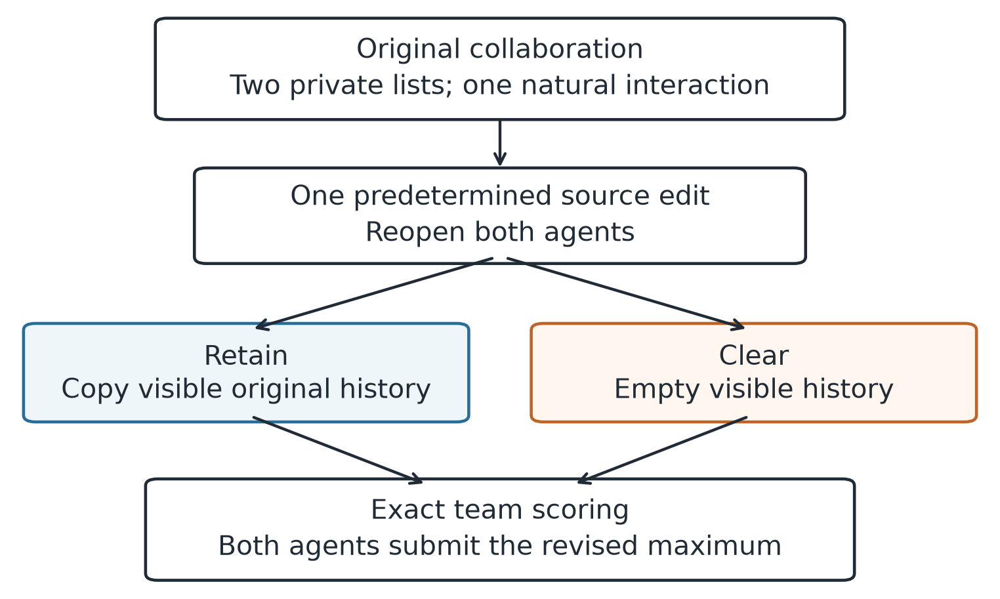
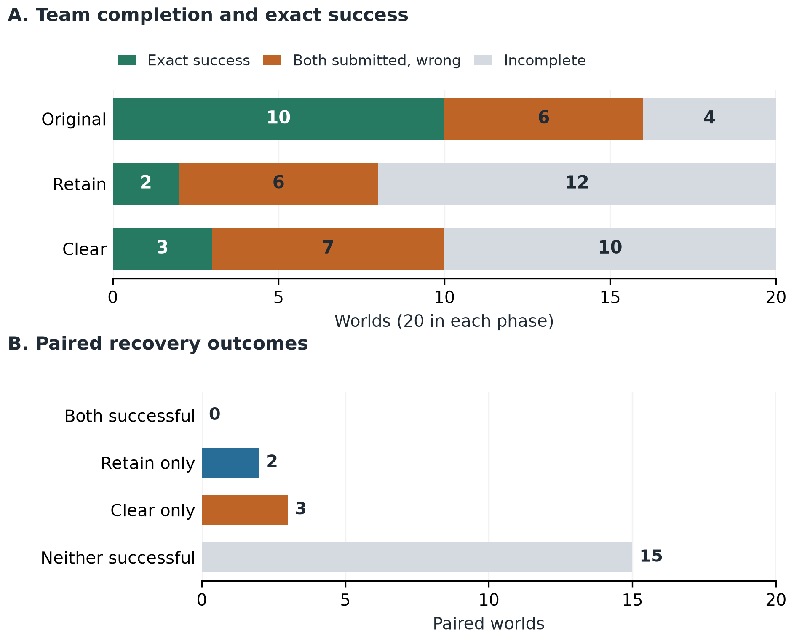
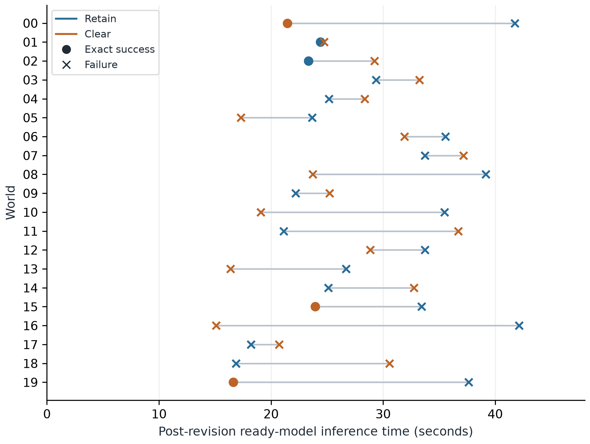

# Recovering Distributed LLM Teams After Information Changes

17 October 2026

## 1. Abstract

A team of language model agents may need to revise its work when information changes. Keeping the previous conversation preserves potentially useful evidence, but also conclusions that may no longer be correct. Clearing the conversation removes both. This study examines that trade-off using two agents with private lists of integers. Both agents must submit the largest number across the two lists. After their initial collaboration, the uniquely largest record is replaced with a lower value. Two independent continuations then either retain or clear the previous visible history, while receiving the same current private data and change notices.

A preliminary experiment exposed weak initial collaboration and frequent violations of the communication rules. A subsequent literature review informed a final experiment with clearer instructions, a short coordination strategy, and improved presentation of current and historical information. Using Qwen3.5-9B, the final experiment completed twenty paired main trials. Retaining history produced exact team success in 2/20 trials (10%); clearing it produced success in 3/20 (15%). The paired difference was +5 percentage points for clearing, with a prespecified exploratory 95% bootstrap interval of −15 to +25 points. Neither policy was reliably successful, and the evidence establishes neither superiority nor equivalence.

Initial collaboration was more successful in the final experiment than in the preliminary experiment, and illegal actions were much less frequent. These are descriptive differences between experiments with different inputs and several methodological changes; they do not identify a causal effect of assistance. Nevertheless, 32 of the final experiment's 35 failed recoveries used only legal actions. Recorded interactions show correct reports repeated without final submissions, errors in reading current values, confusion about source ownership, and disagreement between stated conclusions and committed answers. The main finding is that improved initial collaboration and more compliant communication did not result in reliable recovery after information changed.

**Keywords:** large language models; multi-agent systems; information revision; recovery; conversation history; distributed coordination.

## 2. Introduction

### 2.1 Motivation

Collaborative work depends on information that can change. A team may discover that a measurement was wrong, a document was corrected, or an option is no longer available. The problem is then larger than replacing one fact: earlier conclusions may depend on it, while other parts of the work remain useful. Restarting everything wastes valid work. Continuing without reconsideration risks carrying an obsolete conclusion into the final decision.

This problem is especially difficult for teams of large language model (LLM) agents. Their communication is ordinary text. A single message may combine an observation, a calculation, an interpretation, and a proposed action. Another agent can use that message without retaining a precise account of which source supports which conclusion. Updating the original source therefore does not guarantee that the team's later behavior will change appropriately.

Consider two agents searching for the largest value in separate lists. One reports 943 and the other reports 922, so both answer 943. If the record containing 943 is subsequently replaced, the second agent's report may still be useful. The first agent's old maximum is no longer sufficient: it must inspect its current list to find the best remaining value. Keeping the exchange offers a possible shortcut, but also leaves the previous answer visible. Clearing it removes the old answer and the useful report together. This simple example captures the central tension examined here.

The task is adapted from the Global Maximum family in SILO-BENCH, a benchmark of distributed LLM coordination under private information [1]. The present study adds an actual source revision and paired recovery continuations. It uses its own communication rules and exact team endpoint, so the results are not native SILO-BENCH scores.

### 2.2 Research question and contribution

The research question is:

> After the previously winning source record changes, how does retaining rather than clearing the agents' previous visible history affect exact team recovery under one fixed, assisted two-agent environment?

The experiment compares two practical history policies. Retention preserves everything the agents were previously allowed to see, including inaccurate claims. Clearing removes that history. Both policies keep current private sources available and receive the same assistance and change information. The comparison concerns the complete consequences of these policies, including differences in available evidence, wording, and context length. It does not isolate a pure memory mechanism.

The contribution is an exact, traceable account of a small recovery experiment. It combines paired success outcomes with computational effort and concrete interaction examples. In particular, it distinguishes a legal message from a correct claim, a correct claim from a submitted answer, and one correct answer from a successful team. These distinctions matter because a fluent conversation can appear productive while the required joint decision remains wrong or unfinished.

### 2.3 From the preliminary experiment to the final study

The preliminary experiment tested whether a bounded retain-versus-clear comparison could be carried out with naturally generated collaboration. It used the same nominal model checkpoint, two-agent maximum task, and winning-record withdrawal as the final study. Twenty main world pairs were completed. Each policy succeeded on 2/20 worlds, but the original collaboration was correct on only 3/20. Across its pilots and main trials, 60 of 206 team actions violated the communication rules despite having valid JSON syntax. For example, an agent could put useful information in a message while simultaneously choosing an incompatible waiting action; the system then rejected the whole action and delivered nothing.

The preliminary traces also showed numerical mistakes, confusion between a record's location and its value, and submissions that did not match the accompanying explanation. Retention repeated the withdrawn maximum in ten main worlds. An independent audit found no scoring, message-delivery, or branch-isolation defect that explained these outcomes. The initial result was therefore scientifically usable, but difficult to interpret as recovery from effective collaboration: most original teams had not solved the original task, and many messages had never been legally delivered.

The next step was to improve the experimental environment while keeping the research question manageable. A targeted review of coordination, memory, structured actions, and failure diagnosis was followed by a practical review of agent interfaces and evaluation. That work informed a fixed assistance package: clearer action rules, explicit instructions that both agents must submit the global answer, clearer separation of current sources from history, and a short strategy for exchanging and comparing local maxima. The final design also added focused behavioral diagnostics, four complete pilots, fresh inputs, and a schedule that separated device assignment from the order of the two recovery policies. Section 3 explains the relevant literature and its role in these decisions.

A new experiment was necessary because these changes created a different behavioral condition. Applying the revised instructions to old replies, or repairing them after the fact, would have changed the evidence. The final study therefore used a new fixed cohort, retained all ordinary failures, and kept the preliminary records separate. This sequence supports a research development narrative, but it is not a controlled test of assistance: inputs, seeds, presentation, development checks, and scheduling changed together.

### 2.4 Scope

The broader project considered more agents, several algorithmic tasks, and more selective recovery policies. This report concerns the executed course study: two agents, one task, one announced source change, and two history policies. The numerical task makes correctness unambiguous and keeps the interactions inspectable. It does not establish performance on realistic research workflows, larger teams, or other models, nor does it introduce a new memory-repair architecture.

## 3. Related Work

### 3.1 Revising conclusions while preserving useful work

The distinction between a conclusion and its justification predates LLMs. Doyle's truth maintenance system records reasons for beliefs so that a program can reconsider them when assumptions change [2]. The AGM account of theory change formalizes contraction and revision: withdrawing a proposition can require changes to other conclusions if the resulting theory is to remain coherent [3]. These works provide the conceptual background for asking what should survive a correction. They do not imply that an LLM's explanation contains complete or trustworthy dependencies.

Incremental computation approaches the preservation problem through explicit computation. DBSP derives updates for computations expressed in a stream algebra [4]. *Build Systems à la Carte* separates the order of computation from the decision about which results need rebuilding [5]. In both cases, reuse depends on a well-defined relationship between inputs and outputs. A free-form peer message does not automatically supply such a relationship.

This distinction matters even for maximum finding. An accurate maximum reported by the unchanged agent can remain useful after the other agent's record changes. The changed agent's old maximum, however, may have discarded the next-best value needed for recovery. Preserving an answer is therefore different from preserving enough evidence to derive a new answer. The experiment keeps current private records separate from historical messages and leaves their interpretation to the agents.

There is also a systems requirement: a copied team state must account for communication as well as each participant's state. Chandy and Lamport's distributed snapshot work establishes why communication state belongs in a consistent global snapshot [6]. The present environment uses a central scheduler and settled phase boundaries, making the implementation simpler. Independent continuations are copies of an explicit completed interaction; no new asynchronous snapshot algorithm is claimed.

### 3.2 Agent memory and recovery systems

Recent recovery systems show what can be achieved when dependencies and validators are available. *From Faulty Memories to Corrected Actions* uses diagnosed faulty memories, runtime provenance, independent-support checks, and selective replay [7]. MEMOREPAIR withdraws affected memory artifacts before publishing validated successors [8]. REVISE uses recorded data and control dependencies to preserve valid progress during workflow revisions, expanding recovery conservatively when provenance is incomplete [9]. These works were considered in the project's earlier research and helped limit claims of novelty for selective rollback or source-preserving recovery.

Their assumptions differ from the present experiment. Here, messages are uncertified claims, and the runtime neither constructs a semantic dependency graph nor checks numerical answers before accepting legal actions. Giving agents a correct dependency graph or repairing their conclusions would move part of the recovery problem into the host system. Our question concerns what the agents do with the information actually available to them.

StateAuditor examines a further distinction: updating stored information does not necessarily update behavior. It assembles previous-to-current transitions and uses them to repair responses; deterministic checks establish quotation provenance and chronology, while semantic supersession requires additional judgment [10]. This earlier contextual work helps motivate treating a change notice as information to be interpreted, rather than proof that adaptation has occurred.

Reclaim Evaluation studies memory that preserves a conclusion while losing the source needed to recompute it. Its source-first conditions demonstrate the importance of retained content, with limits when that source is too large or hard to identify [11]. Our original answer can be correct before the world changes, and the agents can exchange fresh information afterwards. Clearing history consequently removes a possible resource, but does not leave the team permanently without the means to solve the task. This difference prevents direct transfer of Reclaim's results to our policy comparison.

### 3.3 Distributed communication and paired evaluation

SILO-BENCH provides the closest task foundation [1]. Its agents receive fragments of a global problem, and its results distinguish active communication from effective distributed computation. That distinction is directly relevant to a team that repeatedly exchanges maxima without completing its answer. Our experiment uses a much smaller team and different waiting, submission, and stopping rules, so its contribution is an additional recovery setting rather than a reproduction of the benchmark.

The Causal Intervention Router study compares recovery and continued execution from the same state and reports both rescues and harms [12]. It shows why an average improvement can hide trajectories moving in opposite directions. We use the same general evaluation principle by reporting all four paired outcome categories. The comparison itself differs: that study perturbs observations while the underlying environment remains unchanged; ours changes the source and compares retaining with clearing history.

Independent–Communicate–Revise (ICR) fixes initial reasoning, varies communication, and measures both correction and preservation with a no-message revision control [13]. Richer messages can increase helpful and harmful influence together. This reinforces the need to examine how outcomes change, rather than counting messages alone. ICR agents initially receive a complete problem, whereas our agents have private sources and continue interacting. Its numerical findings are therefore not expected recovery rates for this study.

These papers were part of the review following the preliminary experiment. They sharpened the interpretation of pairing and the limits of aggregate success. They did not originate the project's earlier use of independent continuations, which was already present in its design history.

### 3.4 Updating information, reasoning, and reliability

Laban and colleagues show that strong performance with fully specified single-turn instructions can coexist with poor performance when information is disclosed over several turns. They distinguish aptitude from reliability and describe early assumptions and reliance on previous answers [14]. Their setting differs from withdrawing a private numerical record, but it explains why a successful one-call control is an incomplete readiness test for a team interaction.

LongMemEval separately evaluates information extraction, reasoning across sessions, temporal reasoning, knowledge updates, and abstention [15]. Its separation of retrieval and reading is useful here: a number can be present in a short current prompt and still be read incorrectly. Such an error should not automatically be described as long-term forgetting. Belief-R similarly distinguishes revising an answer when new evidence requires it from maintaining an answer when it does not [16]. Since our source edit always changes the maximum, the experiment tests recovery from a changed answer but cannot establish appropriate preservation after harmless changes.

Research on self-correction and debate also requires attention to the comparator. Huang and colleagues find that intrinsic self-correction of reasoning is unreliable without external feedback, and discuss the importance of oracle feedback and evaluation choices [17]. ReConcile provides positive evidence for collaboration among diverse models, using explanations, demonstrations, confidence, and aggregation [18]. The findings address different systems. Neither demonstrates that extra calls or voting would solve a private-information task with two irreversible submissions. Such changes would require their own experimental conditions and cost accounting.

### 3.5 Interfaces, legal actions, and behavioral diagnosis

JSONSchemaBench evaluates structured generation through constraint coverage, compliance, efficiency, and output quality [19]. Tam and colleagues investigate how format restrictions affect model performance [20]. These works make clear that output format and task quality need separate evaluation. Our system validates ordinary generated output after generation; it does not use constrained decoding. Valid JSON can still express an illegal action, and a legal action can contain a false numerical claim.

The interface literature informed the refinement more directly. SWE-agent demonstrates that the interface around a fixed model can affect its behavior [21]. The workflow-assistance experiments in τ²-Bench show that assistance can have different effects across conditions [22]. FlowBench distinguishes choosing an action from a supplied history from completing a live interaction in which earlier mistakes accumulate [23]. The final design explicitly used these lessons to select one transparent assistance package and test complete natural pilots. They justified investigating assistance, not predicting that it would solve recovery.

CheckList's capability-focused behavioral testing informed the use of small diagnostics for source reading, instruction following, and commitment [24]. MAST provides a vocabulary for repetition, termination failures, ignored peer information, and mismatches between reasoning and action [25]. Who&When emphasizes the difficulty of identifying which agent and step is responsible for failure [26]. These works guide the descriptions in Section 5, but our case analysis is not a replication of their human annotation procedures. An observable error is not automatically the decisive cause of the later failure.

### 3.6 How the literature informed the study

The research influenced the project in stages. Earlier work on belief revision, provenance, and incremental computation established the distinction between current evidence and retained conclusions. The preliminary experiment then supplied concrete usability and coordination problems. The subsequent reviews connected those problems to interface design, structured actions, supplied-history diagnostics, and live interaction. The final study adopted a practical assisted comparison while leaving selective repair and more detailed mechanism experiments for future work.

Two evaluation principles also shaped the design. *AI Agents That Matter* argues for reporting cost alongside accuracy and documenting development choices [27]. Accordingly, the effort analysis includes failed recoveries and separates physical experiment spending from the cost of each hypothetical policy. τ-bench distinguishes success in one run from consistency across repeated trials [28]. Accordingly, twenty paired worlds with one realized call-seed schedule are treated as limited evidence, not a demonstration of repeated-run reliability.

The resulting method tests a deliberately narrow question. The literature helps explain why the comparison and its limitations matter; it does not supply missing experimental controls or establish the internal causes of the observed mistakes.

## 4. System, Methods, and Experiment

### 4.1 Overall design

Each main trial, called a *world*, contains a fixed pair of private integer lists and one predetermined edit. The agents first collaborate naturally on the original lists. At the end of that phase, the system saves their actual visible histories and submissions. It then creates two independent recovery branches from that same state. One retains history and the other clears it. Both apply the same source change and reopen both agents.

*Figure 1. One paired main trial. The original interaction is executed once. Retain and clear are independent continuations after the same edit; the second branch never receives the first branch's messages or answers. A separate full-information control tests maximum finding without distributed interaction.*

The pairing controls for the original inputs, edit, and realized initial interaction within a world. It does not make the two recovery requests identical: their histories differ by design. The unit of analysis is the world, rather than an agent, message, or call. The study contains twenty main worlds, plus separate qualification and pilot data.

### 4.2 Task, input generation, and source change

Each agent receives a private *shard*: a list of twenty integers. Before conditioning, each integer is sampled uniformly from −1000 through 1000. Both agents must separately submit the maximum across all forty values. They can send text to one another, but cannot directly inspect the other list.

An eligible original input has a uniquely largest record, with value *M*. Let *M₂* denote the largest value among the remaining thirty-nine records. The input is eligible only if *M₂* is greater than −1000. The winning record is replaced by a uniformly sampled integer *x′* satisfying

$$
x' \sim \operatorname{Uniform}\{-1000,\ldots,M_2-1\}, \qquad M'=M_2<M. \tag{1}
$$

The answer therefore always changes and decreases. No agent can solve the revised task merely by repeating a correct old global answer. The edit also illustrates why an old maximum may be an insufficient summary: it need not reveal the best alternative after withdrawal.

Sampling is conditioned on the scheduled owner of the original winning record. Inputs are rejected only for mathematical ineligibility or failure to match that owner, before model outcomes exist. All twenty-eight accepted worlds required forty-eight proposals: twenty were rejected for owner assignment, and none for mathematical ineligibility. Actual inputs, edits, proposal counts, assignments, and call seeds were saved before inference.

The final study has four qualification worlds, four pilot worlds, and twenty main worlds. Their fifty-six ordered original/revised complete inputs are distinct. Release checks also established exact complete-input separation from locally available historical and development inputs. This is a limited overlap check; individual integers recur, and model pretraining contamination is not ruled out.

The main cohort contains five worlds in each combination of changed owner (agent 0 or 1) and first speaker (agent 0 or 1). First speaker is fixed within a world across the original and recovery phases. The master seed and exact generation rules are recorded in Appendix B. No world was selected, replaced, or excluded on the basis of model performance. The data are synthetic and contain no personal information.

### 4.3 What the agents see

Every call contains common instructions, the agent's identity, its own call count, whether its partner has finished, visible conversation history, any source-change notice, and its current private shard. Historical entries precede current source values. The records remain in their original order; the system neither sorts them nor highlights a maximum.

The assistance states the global objective and explains legal actions, source ownership, private submission, waiting, and finality. It suggests establishing the relevant maximum of each shard, comparing them, and communicating useful information before finishing. It also says that only the named record changes at a revision boundary. This is an openly supplied coordination strategy, so the study does not measure autonomous discovery of the distributed maximum algorithm.

The strategy is guidance rather than an enforced workflow. Agents choose what to say, when to reuse an earlier report, whether to request another message, and when to submit. The host does not require a fresh peer report before every answer, calculate maxima for the agents, certify messages, or repair false claims. An accurate earlier report from the unchanged peer can therefore remain useful in retain.

After revision, both agents learn the changed owner's identity and the record index. Only the owner receives the replacement value, which also appears in its current shard. A record index identifies a location within that owner's list, not a value or global answer. The former value is not supplied again as current evidence. The rule that the withdrawn record was the unique winner is hidden from agents, as are evaluator answers, the other private shard, future edits, and the policy label.

### 4.4 Actions, communication, and stopping

An agent returns one JSON object with three fields: `message`, `submit`, and `wait`. A message is text or null, a submission is an integer or null, and waiting is a boolean. The action rules give these fields operational meaning.

| Choice | Effect |
|---|---|
| Send a message | Deliver its text to the partner |
| Submit an integer | Record a private final answer and finish the sender |
| Send and submit together | Deliver the text, then finish the sender |
| Wait alone | Block the sender until a message arrives |
| Invalid reply or illegal combination | Consume the call, deliver nothing, and record rule feedback |

*Table 1. Action choices and their effects. Numerical correctness is assessed separately from legality.*

Waiting must be the only action. Combining it with a message or submission is illegal, as is doing nothing while not waiting. A legal message can contain an incorrect maximum because feedback checks public action rules, not truth. Rejected text is preserved for audit but is not delivered to the partner.

Each agent has at most three calls in each phase, with no transfer of unused opportunities. Eligible agents act in alternating order. If one has finished or is blocked, the other can act if eligible. Legal messages arrive before the next eligible call. This is a sequential interaction protocol.

Submission is irreversible within the phase. The partner-finished flag reveals that a submission occurred, but not its value. An agent can disclose its answer explicitly in a message, including when sending and submitting together. A phase ends when both agents have submitted, or when waiting or exhausted call opportunities prevent further progress. Correctness never determines stopping. Thus an incomplete terminal team is a known failure, not an unobserved outcome, and one correct submission does not count as team success.

### 4.5 History policies and independent recovery

At revision, both agents are reopened with fresh call counters, waiting flags, and submissions. Their current sources and permitted change notices are identical across the two policies.

**Retain** copies each agent's actual visible original history, including its legal own actions, explicit old submissions, received messages, and public rejection feedback. Incorrect claims remain unchanged. Earlier-phase and current-phase entries have explicit boundaries. Raw rejected replies remain audit records rather than becoming delivered history.

**Clear** starts with empty visible histories. It keeps the same common instructions, current private source, source-change notice, and fresh phase state as retain. It is still a recovery condition: the agent sees that information changed and that the phase was reopened.

Only the original interaction is shared physically. Each recovery branch has its own messages, submissions, and effects. Per-agent call seeds are matched across policies by call index, but the requests differ because the histories differ. Equal seeds do not guarantee equal outputs, and continuation replies are never reused across policies. Hidden model state is recreated for each call; retention refers to visible history, not a persistent private chain of thought or model cache.

The intervention changes the whole history package. Useful evidence, obsolete conclusions, length, and phrasing vary together. It cannot identify the effect of one old sentence or distinguish a specific internal bias from other historical influences.

### 4.6 Preparation, pilots, and main execution

The configuration, instructions, inputs, schedule, scoring, and admission rules were fixed before the first model call. Preparation included six short state-isolation calls, eight qualification controls, two full-envelope hardware probes, and four single-call behavioral diagnostics. A *full-information control* receives all forty integers and returns one maximum without communication. It is a separate stochastic task condition, not an oracle that constrains team outcomes.

The behavioral diagnostics tested selected instructions, current-source reading, and use of supplied historical information. Their role was to expose specific limitations. All four had to produce settled evidence, but no aggregate diagnostic accuracy threshold governed admission. Appendix C gives the tasks and results.

Four natural pilots then executed the original interaction, both recovery policies, and original/revised full-information controls. Main admission required complete evidence, reconciled resource accounting, healthy execution, sufficient measured resources, at least three correct original teams out of four, and at least seven correct controls out of eight. These were feasibility and course-usefulness thresholds. A successful recovery or a favorable policy difference was deliberately not required.

Once admitted, all twenty main worlds received one original interaction, both recovery branches, and one revised full-information control. Incorrect original teams remained in the primary population. There was no outcome-based resampling, replacement, or early stopping of the fixed world list.

The order of recovery execution was balanced: ten retain-first worlds and ten clear-first worlds. Device assignment was also balanced ten-to-ten, with five worlds in each joint device/order combination. Every owner/first-speaker stratum included both orders on both devices, allowing unavoidable two-versus-three imbalances within cells. Both recoveries of a world ran on the same device. This corrected the preliminary schedule's perfect coupling between device and policy order, without changing its historical records.

### 4.7 Model, implementation, and resources

The experiment used the pinned Qwen3.5-9B checkpoint [29] on two NVIDIA Tesla T4 devices. The model was loaded in text-only, four-bit NF4 double quantization with FP16 computation. Generation was direct, without a thinking-mode fallback or constrained decoder. Temperature was 0.7, top-p 0.8, top-k 20, repetition penalty 1, and presence penalty 0, with one beam. Input and output limits were 8,192 and 512 tokens respectively. Appendix B records the exact checkpoint, source identity, and software environment.

A Python controller managed the episodes, with one resident model worker per device and two canonical SQLite databases. Both logical agent roles for a world used its assigned worker. Every request, raw reply, and resulting state was recorded. Raw replies were persisted before their effects were committed, so a saved outcome could be resumed without sampling it again. Current-source privacy and branch-specific delivery were checked during reconstruction.

The independent campaign had a hard ceiling of 500 physical generation attempts: 480 ordinary first attempts and twenty contingency attempts. Every generation counted, including diagnostics and failures. A wrong or illegal reply was not retried. One identical infrastructure retry was allowed only without a durable outcome and after confirmed termination; unresolved spending blocked further admission. No such retry occurred in this execution. Loading and downloads consumed elapsed time but were not generation attempts.

The current-load hardware checks required at least 1.5 GiB free memory headroom; the recorded minimum was approximately 6.78 GiB. These measurements and completed execution support feasibility in the recorded environment. They do not establish equivalence to another numerical backend or reliability on another host.

### 4.8 Outcomes, effort, and uncertainty

For world *w*, let *R_w* and *C_w* equal one when both agents' final revised submissions equal the exact revised maximum under retain and clear, respectively, and zero for a known terminal failure. An unresolved or unexecuted episode would remain unknown. The primary estimate is

$$
\widehat{\delta}=\frac{1}{20}\sum_{w=1}^{20}(C_w-R_w). \tag{2}
$$

A positive value favors clear on exact team success. Both policy rates and all four paired outcome categories are reported, so opposite changes across worlds remain visible.

The prespecified exploratory uncertainty display uses 10,000 paired bootstrap draws, stratified by changed owner and first speaker. Each draw samples five complete world pairs with replacement within each of the four strata, then averages the twenty paired differences. The adopted seed, ordering, and percentile-index convention are specified in Appendix B. The resulting nominal 95% interval is descriptive; its small-sample coverage has not been established. It is neither an equivalence test nor a measure of reliability across repeated generation schedules.

The principal secondary outcome is the mean paired difference in post-revision ready-model inference time, including failed episodes. This is time spent generating with an already loaded model. It excludes loading and is distinct from elapsed notebook time or provider billing. Calls, input/output tokens, delivered messages, completion, wrong agreement, and absent submissions provide additional descriptive outcomes. Each hypothetical end-to-end policy includes the original interaction logically, although that interaction ran only once physically.

### 4.9 Evidence verification

The report was checked against the original manifest, immutable read-only database connections, recorded requests and replies, source package, notebook, analysis documents, and preliminary evidence. The preserved standalone verifier was rerun without importing experiment code or loading a model or tokenizer. It passed 10,953 record comparisons with no deviations. Coverage included all 308 natural team actions, their 72 final checkpoints, 36 full-information controls, four diagnostics, inputs, assignments, reports, and the preliminary interaction reconstruction.

A separate calculation for this revision independently recomputed maxima and edits, all twenty main submission pairs, completion and legality counts, message repetition, effort totals, and both adopted intervals. Selected examples were checked against their actual permitted requests and committed actions. Appendix B identifies a seed-transcription problem in the supporting prose ledger. The canonical seed integers and outcome calculations remain intact.

These checks establish consistency of the recorded evidence and scoring. They do not reproduce GPU arithmetic, certify every hidden backend state, or constitute independent human behavioral annotation.

## 5. Results and Discussion

### 5.1 Coverage and the feasibility findings

All intended main worlds were completed, including every original phase, both recovery branches, and every revised full-information control. There are no unknown main outcomes or effort values. The final campaign used 356 physical first attempts, with no retries or contingency charges. All thirty-seven notebook code cells completed without recorded error outputs.

| Stage | Calls | Outcome |
|---|---:|---|
| State checks and hardware envelopes | 8 | Expected short answers and completed envelope probes |
| Qualification controls | 8 | 8/8 correct |
| Supplied-view diagnostics | 4 | All legal; 1/4 exact targets met |
| Four pilots, including controls | 58 | 4/4 original teams and 8/8 controls correct; 0/8 recoveries successful |
| Twenty main worlds, including controls | 278 | Complete intended coverage |
| **Total** | **356** | **No unresolved attempt** |

*Table 2. Execution coverage. Qualification, diagnostics, pilots, and main trials are separate populations.*

The diagnostics gave early warnings. One agent did not follow a request to send only the word “ready,” although its alternative action was legal. Another correctly reported a revised local maximum of 829 but did not submit the required global 907 from the supplied unchanged peer history. A direct local-source probe returned 107 instead of 986. These few cases cannot estimate general competence, but they show why syntax, source reading, and commitment needed separate attention.

All eight pilot recoveries failed. Nevertheless, the pilots met the fixed main-admission rule because the original teams, controls, evidence, health, and resource checks passed. This was not evidence of reliable adaptation. It established that the selected environment could produce successful initial collaboration and a complete, interpretable policy comparison. The candidate was not tuned after the pilot failures, and those failures were preserved.

### 5.2 Exact main recovery

Retain succeeded on **2/20 worlds (10%)** and clear on **3/20 (15%)**. Their successes occurred on different worlds.

| Paired outcome | Worlds |
|---|---:|
| Both policies successful | 0 |
| Retain successful, clear unsuccessful | 2 |
| Clear successful, retain unsuccessful | 3 |
| Neither successful | 15 |
| Unknown pair | 0 |

*Table 3. Paired exact team outcomes across all twenty intended main worlds.*

The three clear-only and two retain-only successes give a clear-minus-retain difference of (3 − 2)/20 = **+5 percentage points**. Its adopted exploratory 95% bootstrap interval is **−15 to +25 percentage points**. Only five worlds distinguish the policies on success; one changed world outcome moves a policy's rate by five points. The interval allows effects favoring either policy, and the data establish neither superiority nor equivalence.

*Figure 2. Exact main outcomes. Panel A separates successful, completed but wrong, and incomplete teams; each bar contains twenty worlds. Panel B preserves the pairing of retain and clear. Incomplete terminal episodes are known failures, not missing observations.*

All outcomes are observed, so bounds arising only from missing outcomes collapse to the measured contrast, [+5,+5] points. This expresses complete observation of the finite cohort. It does not eliminate uncertainty about new worlds or different model samples.

The original collaboration was correct on 10/20 worlds. Among those ten, retain recovered on two and clear on one. Clear's other two successes followed incorrect original teams. These are descriptive subset counts, without a separate interval or conditional-effect claim. The primary estimate includes all twenty worlds because selecting only successful original teams would answer a different question.

The revised full-information controls were correct on 18/20 worlds. Their two errors were 881 instead of 815 and 585 instead of 601. Clear nevertheless solved the first of those worlds. A control is a separate stochastic call with different instructions, information access, and seed, so it is not a deterministic ceiling on team performance. Conversely, the many correct controls show that the recovery result cannot simply be described as universal inability to find a maximum. Single-call numerical ability and successful distributed recovery are different requirements.

### 5.3 Compliance, completion, and correctness

All 348 scientific responses had valid JSON syntax and the required field types. Six combined a message with an incompatible waiting action and were rejected. All six occurred in main natural episodes; every pilot team action was legal. Across pilots and main collaboration, 302 of 308 team actions were legal.

| Main-phase measure | Original | Retain | Clear |
|---|---:|---:|---:|
| Calls | 82 | 91 | 85 |
| Illegal actions | 1 | 1 | 4 |
| Delivered messages | 70 | 85 | 77 |
| Both agents submitted, out of 20 teams | 16 | 8 | 10 |
| Exact success, out of 20 teams | 10 | 2 | 3 |
| Correct final answers, out of 40 agent slots | 30 | 14 | 18 |
| Wrong final answers, out of 40 agent slots | 6 | 8 | 11 |
| Known absent answers, out of 40 agent slots | 4 | 18 | 11 |

*Table 4. Main protocol and submission coverage. Calls depend on behavior; team and final-answer denominators remain fixed. There are no unknown slots.*

Retain's eighteen failed recoveries consist of twelve incomplete teams and six completed but wrong teams. Clear's seventeen failures consist of ten incomplete teams and seven completed but wrong teams. Crucially, **17/18 retain failures and 15/17 clear failures contain no illegal action**. Thus 32 of 35 failed recoveries obey the action rules throughout. This does not identify a causal fraction of failures, but rejected actions do not describe the dominant observed pattern.

Retain delivered more messages yet completed fewer teams. Counting exact repeated strings beyond each sender's distinct messages within an episode gives thirty-one duplicates under retain and eighteen under clear. Thirteen retained agent trajectories repeated the same message on all three calls, compared with four clear trajectories. These are literal string counts, not a complete detector of conversational loops. Repetition can sometimes be useful, while changed wording can conceal the same stalled decision.

No final recovery submission in either policy repeated the withdrawn global maximum. This differs from the preliminary experiment, but does not show that history had no influence. History can affect behavior without reproducing the old number. Moreover, clearing removes that number from both the current data and previous visible conversation, making old-value availability unequal by construction.

### 5.4 What happened in the interactions?

The following examples connect the aggregate results to actual requests, messages, and submissions. World numbers identify rows in Appendix A, rather than different experimental conditions. The fixed case-selection rule chose the first examples of illegal action, locally refutable submission, and each one-policy success. Additional cases were selected after reading the complete traces because they make recurring distinctions understandable. They are illustrations, not an independently coded causal taxonomy. Exact record locators are confined to Appendix D.

#### Correct information without a final decision

World 08 had a correct original answer of 874. After the winning record changed, the actual local maxima were 758 and 857, making 857 the revised global answer. Under retain, both agents correctly reported their current maxima, then repeated the same messages on their remaining calls.

| Agent | Delivered message, repeated on all three calls | Final answer |
|---|---|---|
| 0 | “My local maximum is 758 at record 19. I will wait for your maximum before submitting.” | Absent |
| 1 | “My local maximum is 857 at record 12. I will wait for your maximum before submitting.” | Absent |

*Table 5. A legal report loop in world 08. Each message arrived before the partner's next eligible call.*

Both values needed for the comparison were therefore present in the conversation, but neither agent submitted. The phrases about waiting were only message text: the actual waiting fields were false. The team exhausted six calls while continuing to communicate. This was neither lost delivery nor a protocol deadlock.

Clear failed differently on the same world. Agent 1 reported 786 despite the visible 857 in its private list, and both agents finally submitted 786. That branch completed and agreed, but was wrong. Together, the two branches distinguish accurate communication without completion from completed agreement based on inaccurate information.

#### A correct explanation with no committed answer

In world 04 under clear, agent 0 sent its correct maximum, 954, and later submitted it. Agent 1's last message correctly compared its own 839 with the partner's 954 and stated: “954 is the global max. I will submit.” Its actual submission field remained null. The partner had finished, and no further opportunity remained for agent 1, so the team failed.

The observable problem is precise: the right value appeared in a delivered report and in the agent's own explanation, but not in its final action. Scoring the prose as an answer would repair the experiment retrospectively. The opposite discrepancy also occurred: in world 15's original phase, an agent acknowledged that the partner's 917 exceeded its own 815 but submitted 815. Explanations and committed decisions must therefore be evaluated separately, as the failure-analysis literature recommends [25].

#### Confusing a record's owner with its location

In world 09 under clear, agent 1 received a current message saying that agent 0's maximum was 949 at record 16. The source notice identified agent 0's changed record as 13. Agent 1 then claimed that the partner's maximum was 695 at record 13 and submitted its own 836. The number 695 was present at index 13 of **agent 1's own list**. The correct 949 report was visible in that same request.

World 13 provides an earlier example. Before receiving a current peer message, agent 1 asserted that the partner's record 9 had changed to 397. Its request did not disclose the partner's replacement value. Its own record 9 contained 397, while the actual remote replacement was −509.

These correspondences support a description of source-ownership confusion: a location in another agent's shard was associated with a locally visible value. They do not establish how attention or internal reasoning produced the claim. Both examples occur with cleared history, so retained obsolete text is not necessary for this behavior. The current-source reading distinction in LongMemEval is helpful here [15].

#### Success under either policy, with limits on the explanation

World 00 was clear-only successful. The original answer was 943 and the revised answer 922. Clear exchanged the correct current maxima, 900 and 922, and both agents submitted 922. Retain instead reported 837 for the changed shard despite its visible 900, repeated messages, and ended with no submissions. The difference combines source-reading and completion behavior; it does not isolate a harmful historical sentence.

World 01 was retain-only successful. An unchanged-peer maximum of 926 was present in the old history and was also reported afresh. The changed owner established its current maximum of 931, compared the two, and submitted 931; the partner followed. Clear exchanged the same correct maxima, but only one agent submitted, while the other continued requesting information and finally waited. Retain's success is consistent with useful reuse of unchanged evidence, but the fresh report prevents attributing the outcome uniquely to historical memory.

Correct outcomes can also contain incorrect premises. Clear solved world 19 in two calls with both submissions equal to 896. Its first speaker nevertheless invented a remote maximum of 639, a value in its own shard; the true remote maximum was 860. Since 896 exceeded both, the false premise did not change the answer. A retained success in world 02 similarly contained a false later remote claim. Exact scoring properly credits these outcomes, while leaving faithful source tracking and robustness unproven.

#### Finishing too early and failing to finish

In world 17 under retain, an agent irreversibly submitted 663 despite having 819 in its current private list. Later information could not reopen that commitment. In world 11 under retain, one agent correctly submitted 950 and the other subsequently chose a legal wait. The finished partner could no longer send a message to wake it, so the phase deadlocked even though only one agent was waiting.

These cases expose opposing demands. Agents need enough evidence before committing, but must also commit once useful evidence is available. More caution alone does not address failure to finish. Conversely, forcing faster submission can worsen unsupported decisions. The current traces do not establish that extra turns or removal of finality would rescue either case.

### 5.5 Why improved collaboration did not produce reliable recovery

Recovery requires several behaviors to succeed together: reading current values, preserving source ownership, deciding which old reports remain useful, interpreting the change notice, integrating new messages, and submitting the correct value. Both agents must finish this process within their call limits. The final experiment often achieved parts of that chain without completing it.

The report loop had correct current information but no decisions. The ownership examples had useful delivered evidence but substituted an unrelated local value. The explanation/action example named the correct global answer without submitting it. These observations are more specific than attributing every failure to ignoring the correction or repeating an obsolete answer. They also show why eliminating one visible error pattern need not produce dependable performance.

Retained conversation may make an ineffective action pattern easier to repeat, but that is a hypothesis. The experiment cannot separate imitation, source-reading difficulty, interpretation of partner status, and sampling variation into internal causes. The source/conclusion distinction from Reclaim remains useful [11]; the present evidence adds that preserving or reacquiring the right content can still be insufficient when it does not lead to a final action.

The original and recovery phases also differ in more than the numerical input. Recovery includes reopening, a notice, and potentially earlier history. Clear removes history but keeps that changed-phase presentation. The drop from 50% original success to 10–15% recovery success therefore cannot be assigned solely to stale retained conclusions. Without a matched no-change reopening, it also cannot be identified as the causal effect of factual revision itself.

Likewise, subtracting team accuracy from control accuracy would not measure a causal communication-failure rate. Full-information controls remove private-information exchange, partner status, history, and commitment coordination, while also changing the prompt and seed. They demonstrate a useful capability contrast, not a decomposition of causes.

### 5.6 Recovery effort

| Measure, across twenty main recoveries | Retain | Clear |
|---|---:|---:|
| Calls, total | 91 | 85 |
| Calls, mean per world | 4.55 | 4.25 |
| Ready-model inference time, total | 588.778 s | 513.115 s |
| Ready-model inference time, mean | 29.439 s | 25.656 s |
| Input tokens, total / mean | 102,922 / 5,146.10 | 80,352 / 4,017.60 |
| Generated tokens, total / mean | 3,411 / 170.55 | 3,194 / 159.70 |
| Delivered messages, total / mean | 85 / 4.25 | 77 / 3.85 |

*Table 6. Post-revision effort, including unsuccessful episodes. Means are per world; time contrasts use unrounded recorded values.*

Clear used an average of **3.783 fewer ready-model seconds per world**. The paired clear-minus-retain effort interval was **−8.241 to +0.589 seconds**, including zero. Mean paired differences were −0.30 calls, −1,128.50 input tokens, −10.85 generated tokens, and −0.40 delivered messages per world. No general efficiency advantage is established.

*Figure 3. Ready-model inference time for each main world's paired recoveries. Lines connect the same world; circles mark exact success and crosses mark known failure. Both agents' calls are included. A shorter recovery may reflect an early wrong commitment or deadlock.*

Fast failure is an important qualification. In world 16, both branches ended with the same wrong disagreement, [601,500]. Clear took about 15.11 seconds and retain 42.14 seconds. In world 11, retain was cheaper because it deadlocked early, while clear continued. Time savings should therefore be read alongside success and termination.

The shared original interactions cost eighty-two physical calls and 493.775 ready-model seconds. Charging them to each hypothetical complete policy gives 173 logical calls and 1,082.553 seconds for retain, versus 167 calls and 1,006.890 seconds for clear. Adding those two totals would double-count the shared original interaction. Controls and hardware checks are research overhead, rather than spending attributable to either distributed policy.

Across the complete campaign, 356 attempts used 337,397 input tokens, 13,692 generated tokens, and 2,174.333 summed ready-model seconds. The observed notebook span was approximately 38.26 minutes; main batch cells spanned approximately 20.41 minutes. Overlapping work, loading, setup, and orchestration make summed generation time different from elapsed time. The records do not establish monetary cost, energy consumption, GPU utilization, or billable provider allocation duration.

There was no recorded scientific timeout or truncation. Every scientific reply ended normally at an end-of-sequence token. Scientific inputs ranged from 245 to 1,318 tokens, and the longest scientific reply used 124 of the allowed 512 output tokens. The forced-length hardware probes were separate. The records therefore do not support explaining the scientific failures by exhausted token limits or inadequate measured memory headroom.

### 5.7 What changed relative to the preliminary experiment?

| Observed measure | Preliminary experiment | Final assisted experiment |
|---|---:|---:|
| Original team success | 3/20 | 10/20 |
| Retain recovery success | 2/20 | 2/20 |
| Clear recovery success | 2/20 | 3/20 |
| Clear-minus-retain difference | 0 points | +5 points |
| Exploratory success interval | [−10,+10] points | [−15,+25] points |
| Revised full-information controls correct | 15/20 | 18/20 |
| Illegal actions, all pilot/main team calls | 60/206 | 6/308 |
| Retain teams with both submissions | 20/20 | 8/20 |
| Clear teams with both submissions | 19/20 | 10/20 |
| Retain worlds submitting the obsolete answer | 10/20 | 0/20 |

*Table 7. Descriptive comparison of separate experiments. Inputs are different, and identically numbered worlds are not matched units. The preliminary interval retains its original analysis convention.*

The final experiment exhibits a thirty-five-point higher initial success rate, many fewer illegal actions, and no obsolete recovery submissions. Within the main original interactions, illegal actions numbered 42/82 in the preliminary experiment and 1/82 in the final experiment. These differences are meaningful observations. They do not establish that assistance caused the improvements. Common instructions, action examples, source placement, history boundaries, feedback, input cohort, seeds, qualification/pilot stages, and execution assignments changed together. There is no same-world comparison with assistance turned off.

The preliminary experiment also coupled device and policy order perfectly. The final schedule separated them and kept paired recoveries on the same device. That improves the balance of the final study; it does not retrospectively make the preliminary cohort a randomized control.

The behavioral change is nevertheless informative. Preliminary retain often finished quickly with an obsolete answer. Final retain more often communicated without finishing. Its recovery call count increased from forty-four to ninety-one, while successful teams remained two. Mean retain recovery time increased from 15.733 to 29.439 seconds; clear changed from 24.890 to 25.656 seconds. Total campaign spending increased from 252 to 356 attempts, partly reflecting different preparation and pilot scope. These are descriptions of the two executions, not estimates of the isolated cost of assistance.

The evidence therefore supports the central finding in a bounded form: better observed original collaboration and communication compliance coexisted with poor recovery. It does not show a general trade-off between assistance and completion, prove that an internal bias was removed, or justify pooling the two experiments as one population.

### 5.8 Limitations

**Sample and replication.** Twenty main worlds and one realized generation schedule provide low precision, particularly with only five discordant success pairs. The bootstrap expresses empirical variation within the specified strata; its nominal coverage is not established for this small sample. More bootstrap draws would not create additional informative worlds or measure stability over repeated executions.

**The intervention is a package.** Retain and clear differ in useful evidence, obsolete content, text length, and wording. The primary population also includes imperfect original teams: half were incorrect. The result is a practical policy comparison following natural collaboration, rather than a controlled test of one historical conclusion or recovery only from correct prior reasoning.

**Missing controls.** There is no matched no-change reopening and no real edit that preserves the correct answer. Consequently, the study cannot isolate revision-specific disruption, distinguish it fully from reopening effects, or test whether agents avoid unnecessary answer changes. The update/maintain distinction in Belief-R makes the last limitation particularly relevant [16].

**Generalization.** The task always withdraws a unique winner and lowers the answer. It uses one model, quantized runtime, team size, protocol, and short call budget. These small numerical problems contain little expensive computation to preserve. The findings concern behavior after changed information more directly than savings from large-scale computation reuse, and should not be extended to larger teams or realistic professional workflows without further evidence.

**Behavioral interpretation.** The qualitative analysis was AI-assisted and unblinded. There was no independent human coding panel, inter-rater agreement study, new LLM judge, or counterfactual repair experiment. Deterministic counts and exact trace examples establish what was visible and what happened; they do not reveal private cognition. Following the distinction relevant to Who&When [26], locating an error does not demonstrate that correcting it alone would rescue the trajectory. Historical human-review flags remain pending and are not replaced by this editorial review.

**Runtime and reproducibility.** The final snapshot supports exact offline reconstruction, but the campaign contains no observed crash, retry, or cross-session restoration. Short isolation checks cannot exclude every hidden backend effect. GPU numerical equivalence and provider billing were not independently reproduced. The prose ledger's large-integer seed labels also require care when reconstructing requests; Appendix B explains which records are authoritative.

### 5.9 Implications and future work

A first priority is to test the complete decision process, including current-value extraction, source ownership, uptake of a delivered report, and final commitment after partner completion. Small fixtures can probe these behaviors separately, as CheckList suggests [24], but full live pilots remain necessary because an agent may use a supplied correct history more successfully than it creates one.

A second priority is a matched no-change reopening. Comparing changed and unchanged continuations from the same original state would help separate revision difficulty from generic reopening and interface effects. A real answer-preserving edit would additionally test whether agents maintain a still-correct conclusion. These are future conditions; their results cannot be recovered from the present observations.

To study historical influence more narrowly, a further experiment could hold useful historical evidence fixed while varying exposure to the old conclusion, drawing on source/conclusion and controlled communication work [11], [13]. It would need to state whose evidence survives and whether it is sufficient after the edit. Supplying a controlled history would answer a different question from natural collaboration.

Fresh held-out worlds and repeated continuations would then address stability. Larger models, extra calls, constrained decoding, forced exchanges, public submissions, or numerical checks might improve practical performance, but each changes the system being evaluated. In particular, a checker that rejects an answer below a visible local maximum supplies correctness feedback absent here. These options should be declared and compared prospectively, with their costs, rather than used to repair historical outcomes.

## 6. Conclusion

This study compared retaining and clearing a two-agent LLM team's visible history after an actual source change. In the final assisted experiment, all twenty intended main world pairs were observed. Retain achieved exact team recovery in 10% of worlds and clear in 15%. The paired difference of +5 percentage points had an exploratory interval from −15 to +25 points, providing no basis for a general preference between the policies.

The stronger finding concerns the difference between communication and completed action. Initial collaboration was more successful and illegal actions were much less frequent than in the preliminary experiment, although the comparison cannot identify assistance as the cause. Recovery remained poor under both policies. Correct reports sometimes circulated without submissions, current values were misread or attributed to the wrong source, and stated conclusions did not always match final actions. Even some successful decisions contained false intermediate claims.

The contribution is a bounded negative result supported by complete paired outcomes, exact scoring, computational effort, and inspectable interactions. Preserving evidence differs from preserving conclusions, and making information available differs from using it successfully. In this setting, improved initial collaboration and compliant communication did not ensure that both agents reconsidered current evidence and finished correctly after information changed.

## References

[1] Y. Zhang, F. Liu, Y. Shan, X. Huang, X. Yang, Y. Zhu, X. Cheng, C. Liu, K. Zeng, T. J. Zhang, and W. Jiang, “SILO-BENCH: A Scalable Environment for Evaluating Distributed Coordination in Multi-Agent LLM Systems,” in *Proceedings of the 64th Annual Meeting of the Association for Computational Linguistics, Volume 1: Long Papers*, 2026, pp. 29379–29398. DOI: [10.18653/v1/2026.acl-long.1354](https://aclanthology.org/2026.acl-long.1354/).

[2] J. Doyle, *A Truth Maintenance System*. MIT Artificial Intelligence Laboratory, Memo AIM-521, June 1979. [Institutional publication record](https://dspace.mit.edu/handle/1721.1/5733).

[3] C. E. Alchourrón, P. Gärdenfors, and D. Makinson, “On the Logic of Theory Change: Partial Meet Contraction and Revision Functions,” *The Journal of Symbolic Logic*, vol. 50, no. 2, pp. 510–530, 1985. DOI: [10.2307/2274239](https://doi.org/10.2307/2274239).

[4] M. Budiu, T. Chajed, F. McSherry, L. Ryzhyk, and V. Tannen, “DBSP: Automatic Incremental View Maintenance for Rich Query Languages,” *Proceedings of the VLDB Endowment*, vol. 16, no. 7, pp. 1601–1614, 2023. DOI: [10.14778/3587136.3587137](https://www.vldb.org/pvldb/vol16/p1601-budiu.pdf).

[5] A. Mokhov, N. Mitchell, and S. Peyton Jones, “Build Systems à la Carte,” *Proceedings of the ACM on Programming Languages*, vol. 2, ICFP, article 79, pp. 1–29, 2018. DOI: [10.1145/3236774](https://doi.org/10.1145/3236774).

[6] K. M. Chandy and L. Lamport, “Distributed Snapshots: Determining Global States of Distributed Systems,” *ACM Transactions on Computer Systems*, vol. 3, no. 1, pp. 63–75, 1985. DOI: [10.1145/214451.214456](https://doi.org/10.1145/214451.214456).

[7] C. Yu, Y. Wang, J. Zhang, Y. Duan, M. Zheng, Z. Wu, K. Shi, and T. Cai, “From Faulty Memories to Corrected Actions: Dependency-Guided Rollback Repair for Memory-Augmented Agents,” arXiv:2608.10502v1, 2026, preprint. [Versioned publication](https://arxiv.org/abs/2608.10502v1).

[8] Y. Zhao, C. Dai, M. Kou, and Y. Xiu, “MEMOREPAIR: Barrier-First Cascade Repair in Agentic Memory,” arXiv:2605.07242v1, 2026, preprint. [Versioned publication](https://arxiv.org/abs/2605.07242v1).

[9] R. Qi, X. Wu, P. Liu, J. Chen, and Y. Liu, “REVISE: Validity-Guided Recovery for Online Revisions in Agent Workflows,” arXiv:2609.00643v1, 2026, preprint. [Versioned publication](https://arxiv.org/abs/2609.00643v1).

[10] H. Sun and L. He, “When Memory Updates but Behavior Does Not: Repairing Implicit Stale Dependencies in Personalized Agent Responses,” arXiv:2608.01619v1, 2026, preprint. [Versioned publication](https://arxiv.org/abs/2608.01619v1).

[11] A. Kwon, “Reclaim Evaluation: A Lossy Memory Is Worse Than an Empty One,” arXiv:2606.25449v5, 2026, preprint. [Versioned publication](https://arxiv.org/abs/2606.25449v5).

[12] S. Xiao, S. Wang, X. Chen, K. Chao, M. Cui, F. Qian, C. Mei, F. Meng, Z. Yu, and J. Yin, “When Harnesses Lose the Signal: Causal Evaluation of Recovery in LLM Agents,” arXiv:2610.00372v1, 2026, preprint. [Versioned publication](https://arxiv.org/abs/2610.00372v1).

[13] S. Li, W. Yang, P. Zhang, A. Cheng, H. Ping, and P. Bogdan, “Beyond Final Accuracy: Auditing Communication in LLM Multi-Agent Systems,” arXiv:2610.01042v1, 2026, preprint. [Versioned publication](https://arxiv.org/abs/2610.01042v1).

[14] P. Laban, H. Hayashi, Y. Zhou, and J. Neville, “LLMs Get Lost In Multi-Turn Conversation,” in *International Conference on Learning Representations*, 2026. Reading version: [arXiv:2505.06120v1](https://arxiv.org/abs/2505.06120v1), 2025; identity with the final conference text is not assumed. [Institutional publication record](https://www.microsoft.com/en-us/research/publication/llms-get-lost-in-multi-turn-conversation/).

[15] D. Wu, H. Wang, W. Yu, Y. Zhang, K.-W. Chang, and D. Yu, “LongMemEval: Benchmarking Chat Assistants on Long-Term Interactive Memory,” in *International Conference on Learning Representations*, 2025. Reading version: [arXiv:2410.10813v2](https://arxiv.org/abs/2410.10813v2).

[16] B. Wilie, S. Cahyawijaya, E. Ishii, J. He, and P. Fung, “Belief Revision: The Adaptability of Large Language Models Reasoning,” in *Proceedings of the 2024 Conference on Empirical Methods in Natural Language Processing*, 2024, pp. 10480–10496. DOI: [10.18653/v1/2024.emnlp-main.586](https://aclanthology.org/2024.emnlp-main.586/).

[17] J. Huang, X. Chen, S. Mishra, H. S. Zheng, A. W. Yu, X. Song, and D. Zhou, “Large Language Models Cannot Self-Correct Reasoning Yet,” in *International Conference on Learning Representations*, 2024. Reading version: [arXiv:2310.01798v2](https://arxiv.org/abs/2310.01798v2).

[18] J. Chen, S. Saha, and M. Bansal, “ReConcile: Round-Table Conference Improves Reasoning via Consensus among Diverse LLMs,” in *Proceedings of the 62nd Annual Meeting of the Association for Computational Linguistics, Volume 1: Long Papers*, 2024, pp. 7066–7085. DOI: [10.18653/v1/2024.acl-long.381](https://aclanthology.org/2024.acl-long.381/).

[19] S. Geng, H. Cooper, M. Moskal, S. Jenkins, J. Berman, N. Ranchin, R. West, E. Horvitz, and H. Nori, “JSONSchemaBench: A Rigorous Benchmark of Structured Outputs for Language Models,” arXiv:2501.10868v3, 2025, preprint. [Versioned publication](https://arxiv.org/abs/2501.10868v3).

[20] Z. R. Tam, C.-K. Wu, Y.-L. Tsai, C.-Y. Lin, H.-y. Lee, and Y.-N. Chen, “Let Me Speak Freely? A Study On The Impact Of Format Restrictions On Large Language Model Performance,” in *Proceedings of the 2024 Conference on Empirical Methods in Natural Language Processing: Industry Track*, 2024, pp. 1218–1236. DOI: [10.18653/v1/2024.emnlp-industry.91](https://aclanthology.org/2024.emnlp-industry.91/).

[21] J. Yang, C. E. Jimenez, A. Wettig, K. Lieret, S. Yao, K. Narasimhan, and O. Press, “SWE-agent: Agent-Computer Interfaces Enable Automated Software Engineering,” in *Advances in Neural Information Processing Systems*, vol. 37, 2024. DOI: [10.52202/079017-1601](https://proceedings.neurips.cc/paper_files/paper/2024/hash/5a7c947568c1b1328ccc5230172e1e7c-Abstract-Conference.html).

[22] V. Barres, H. Dong, S. Ray, X. Si, and K. R. Narasimhan, “τ²-Bench: Evaluating Conversational Agents in a Dual-Control Environment,” in *Proceedings of the 43rd International Conference on Machine Learning*, PMLR, vol. 306, 2026, pp. 6736–6782. [Proceedings record](https://proceedings.mlr.press/v306/barres26a.html). Accessible method text checked in [arXiv:2506.07982v1](https://arxiv.org/html/2506.07982v1), 2025.

[23] R. Xiao, W. Ma, K. Wang, Y. Wu, J. Zhao, H. Wang, F. Huang, and Y. Li, “FlowBench: Revisiting and Benchmarking Workflow-Guided Planning for LLM-based Agents,” in *Findings of the Association for Computational Linguistics: EMNLP 2024*, 2024, pp. 10883–10900. DOI: [10.18653/v1/2024.findings-emnlp.638](https://aclanthology.org/2024.findings-emnlp.638/).

[24] M. T. Ribeiro, T. Wu, C. Guestrin, and S. Singh, “Beyond Accuracy: Behavioral Testing of NLP Models with CheckList,” in *Proceedings of the 58th Annual Meeting of the Association for Computational Linguistics*, 2020, pp. 4902–4912. DOI: [10.18653/v1/2020.acl-main.442](https://aclanthology.org/2020.acl-main.442/).

[25] M. Cemri, M. Z. Pan, S. Yang, L. A. Agrawal, B. Chopra, R. Tiwari, K. Keutzer, A. Parameswaran, D. Klein, K. Ramchandran, M. A. Zaharia, J. E. Gonzalez, and I. Stoica, “Why Do Multi-Agent LLM Systems Fail?” in *Advances in Neural Information Processing Systems*, vol. 38, Datasets and Benchmarks Track, 2025. DOI: [10.52202/085713-4082](https://proceedings.neurips.cc/paper_files/paper/2025/hash/b1041e52d3be19f0a9bc491657488e4a-Abstract-Datasets_and_Benchmarks_Track.html).

[26] S. Zhang, M. Yin, J. Zhang, J. Liu, Z. Han, J. Zhang, B. Li, C. Wang, H. Wang, Y. Chen, and Q. Wu, “Which Agent Causes Task Failures and When? On Automated Failure Attribution of LLM Multi-Agent Systems,” in *Proceedings of the 42nd International Conference on Machine Learning*, PMLR, vol. 267, 2025, pp. 76583–76599. [Proceedings record](https://proceedings.mlr.press/v267/zhang25cq.html).

[27] S. Kapoor, B. Stroebl, Z. S. Siegel, N. Nadgir, and A. Narayanan, “AI Agents That Matter,” arXiv:2407.01502v1, 2024, preprint version consulted. [Versioned publication](https://arxiv.org/abs/2407.01502v1).

[28] S. Yao, N. Shinn, P. Razavi, and K. Narasimhan, “τ-bench: A Benchmark for Tool-Agent-User Interaction in Real-World Domains,” in *International Conference on Learning Representations*, 2025. [Conference paper](https://proceedings.iclr.cc/paper_files/paper/2025/file/1b126cc38b8638e07bef37e7b2bb72bf-Paper-Conference.pdf).

[29] Qwen Team, *Qwen3.5-9B: Model Repository and Model Card*, 2026, revision c202236235762e1c871ad0ccb60c8ee5ba337b9a. [Pinned model repository](https://huggingface.co/Qwen/Qwen3.5-9B/tree/c202236235762e1c871ad0ccb60c8ee5ba337b9a).

## Appendix A. Complete main outcomes

Submissions are ordered [agent 0, agent 1]. A dash denotes a known absent answer in a terminal episode. **B** means both agents submitted; **H** means the call horizon was exhausted; **W** means waiting deadlock. These end reasons do not imply correctness. The world numbers refer only to the final assisted experiment.

| World | Old → revised maximum | Original answers | Retain answers / end | Clear answers / end |
|---|---|---|---|---|
| 00 | 943 → 922 | [943,943] | [—,—] H | [922,922] B |
| 01 | 956 → 931 | [956,956] | [931,931] B | [—,931] H |
| 02 | 976 → 964 | [976,976] | [964,964] B | [964,—] H |
| 03 | 946 → 893 | [—,946] | [810,893] B | [876,—] H |
| 04 | 972 → 954 | [972,972] | [—,839] H | [954,—] H |
| 05 | 952 → 884 | [952,868] | [884,—] H | [884,868] B |
| 06 | 941 → 917 | [941,941] | [917,—] H | [766,—] H |
| 07 | 991 → 980 | [991,991] | [—,—] H | [—,980] H |
| 08 | 874 → 857 | [874,874] | [—,—] H | [786,786] B |
| 09 | 979 → 949 | [979,836] | [949,836] B | [949,836] B |
| 10 | 991 → 987 | [878,991] | [—,987] H | [878,987] B |
| 11 | 984 → 950 | [—,984] | [—,950] W | [950,—] H |
| 12 | 963 → 905 | [963,—] | [—,—] H | [—,—] H |
| 13 | 992 → 873 | [992,992] | [873,864] B | [873,864] B |
| 14 | 980 → 975 | [980,980] | [975,—] H | [975,—] H |
| 15 | 917 → 815 | [815,917] | [—,—] H | [815,815] B |
| 16 | 702 → 601 | [702,—] | [601,500] B | [601,500] B |
| 17 | 974 → 955 | [974,955] | [663,955] B | [—,955] H |
| 18 | 961 → 912 | [961,961] | [805,805] B | [764,805] B |
| 19 | 931 → 896 | [860,931] | [—,—] H | [896,896] B |

*Table A1. Every intended main world. No absent answer or unfavorable outcome is excluded. Revised full-information controls matched the revised maximum in every row except world 15 (881 instead of 815) and world 16 (585 instead of 601).*

## Appendix B. Code, data, and reproducibility

### B.1 Evidence access and identities

Code and experiment records are retained in the supplementary project materials. These include the frozen instructions and configuration, complete generated inputs and edits, two canonical databases, exact prompts and outputs, token records, attempt accounting, conversation exports, notebook, and offline analysis. No public archival deposit has been verified; reproducing the reported calculations requires access to these materials. Model weights are obtained separately from the pinned source in reference [29].

Table B1 identifies the recorded studies and execution artifacts.

| Item | Exact identifier |
|---|---|
| Final assisted study | `cbbe6590-00e7-477a-88fc-f6449ea6797c` |
| Recorded scientific condition | `i01-course-assisted-v2` |
| Execution policy | `i01-assisted-feasibility-2026-10-16` |
| Supplied final artifact folder label | `assisted-v1` |
| Executed source commit | `d95bb01223590bb889d4612199662266ce78968d` |
| Preliminary study | `b709c9bd-8d95-40c6-a19e-62a5f5e3c587` |
| Supplied preliminary artifact label | `course-7-working` (called Course-7 in earlier documents) |

*Table B1. Reproducibility identifiers. Labels identify records; they do not define additional experimental conditions.*

The final portable archive contains 179 members matching the extracted checkpoint. Its manifest, named `run.json`, records the fixed worlds and configuration. The two authoritative outcome stores are `worker-0.sqlite` and `worker-1.sqlite`; the conversation and result tables are derived exports. Both databases pass integrity checks.

Archive SHA-256: `5dd5ba2af2a2b85df32f4d0fdd2e6e58105e4649dfc5ba2737f129624dd278c3`.

The scientific authority for the final condition is Section 12.1 of the supplied project specification, including its incorporated protocol and acceptance annex. Earlier prospective headers and software-release statements describe their dated checkpoints. The later execution records establish what ran. Historical specifications, analyses, annotations, and original data were preserved during this revision.

### B.2 Frozen computational configuration

The model revision is `c202236235762e1c871ad0ccb60c8ee5ba337b9a`. The recorded Kaggle environment used Python 3.13.15, PyTorch 2.11.0+cu128, Transformers 5.12.0, bitsandbytes 0.49.2, tokenizers 0.22.2, and accelerate 1.14.0. The frozen T4 attention implementation and prefill chunk size of 256 are part of the runtime. Generation uses the settings in Section 4.7, fresh per-call cache state, a 600-second loading deadline, and a 180-second ordinary-call deadline. There was no fine-tuning or model/backend fallback.

The world master seed is `2026101601`. The primary and principal effort intervals each initialize a separate Python `Random(2026101602)` stream. Strata are ordered by changed owner and first speaker, then worlds by index. Each of 10,000 draws samples five complete pairs with replacement from each stratum. After sorting the resulting twenty-world means, zero-based positions 250 and 9750 give the bounds, without interpolation. None of the four success-contrast strata is constant. The preliminary success interval uses its own preserved seed, `2026101402`, and historical ordering.

### B.3 Offline reconstruction

To reproduce the main results, read the fixed world list from the manifest and open the two backup databases in immutable read-only mode. For each main world, independently calculate the revised maximum from its actual lists and compare it with both final submissions in each policy's terminal episode. A null final submission is a known absence. Count all twenty worlds, then compute clear-minus-retain success differences and apply the resampling convention above.

For effort, sum the recorded `ready_seconds` values of the calls referenced by each recovery episode's events. Include wrong, illegal, and unsuccessful calls. Repeat the paired resampling with the freshly initialized effort stream. The expected values, before report rounding, are:

| Endpoint | Mean clear minus retain | Lower bound | Upper bound |
|---|---:|---:|---:|
| Exact team success | 0.05 | −0.15 | 0.25 |
| Ready-model seconds per world | −3.783145303 | −8.240556760 | 0.588860200 |

*Table B2. Offline reproduction targets. Tiny floating-point summation differences in time do not change the rounded results.*

The supplementary forensic analysis contains the standalone standard-library verifier used in Section 4.9. It also reconstructs permitted views, strict actions, literal histories, delivery, assignments, original seed integers, source/archive identities, and report projections. Its 10,953 comparisons count checked records, not independent experimental replications. Offline reconstruction requires no inference, GPU, model weights, or tokenizer loading. Re-running stochastic model generation is a separate activity and is not promised to reproduce every token.

### B.4 Large-integer seed transcription caveat

The supporting all-response prose ledger preserves the raw replies, but **354 of its 356 printed per-call seed labels differ from the exact request integers**. For example, the first hardware A1 request stores `5709976857183414383`, whereas its ledger label is `5709976857183414000`. This is a transcription discrepancy in large integer labels. The present evidence does not establish the tool operation that introduced it.

The discrepancy does not change the stored requests, generated outcomes, master seed, bootstrap seed, or reported statistics. Exact request reconstruction must use the canonical manifest and database integers, parsed without floating-point conversion, rather than copied prose labels. The original ledger remains unchanged so that the distinction is auditable.

The older preliminary-study audit script also checks an expected historical source identity and refuses direct execution against the later assisted checkout. That guard was preserved. The preliminary results were instead checked through the independent reconstruction of its stored interactions under its own historical semantics; no revised scoring was substituted.

### B.5 Assistance and review disclosure

The experiment's coordination strategy is supplied assistance to the agents, as described in Section 4.3. Separately, drafting, editorial revision, and qualitative trace examination for this report used AI assistance. Deterministic rechecks support numerical and record-level claims; they do not turn the qualitative review into independent human annotation. No human approval, inter-rater reliability, or completed historical annotation process is inferred from the revised report.

## Appendix C. Behavioral diagnostics

| Diagnostic | Supplied task | Observed action | Exact target met? |
|---|---|---|---|
| D00 | Send only “ready”; do not submit or wait | Legal explanatory message reporting local maximum 964 | No |
| D01 | Use a supplied original exchange with partner finished; submit global 943 | Message and submission of 943 | Yes |
| D02 | Reopened owner: combine unchanged historical peer maximum 907 with current local maximum 829; submit 907 | Message reporting 829; no submission | No |
| D03 | Clear-history nonowner: send only current local maximum 986 | Message “107”; no submission | No |

*Table C1. Four single-call supplied-view diagnostics. All actions were legal and durably recorded. D00 and D03 included special appended directives; their failures are not schema violations. No aggregate accuracy threshold for these diagnostics governed main admission.*

The fixtures are diagnostic scaffolding, not extra main worlds or naturally acquired evidence. Their exact calls are `qualification-00/diagnostic-D00`, `qualification-01/diagnostic-D01`, `qualification-03/diagnostic-D02`, and `qualification-02/diagnostic-D03`, respectively.

## Appendix D. Trace locators and case selection

Each exact call identifier locates the request, raw response, and action in the canonical stores and conversation export. Invocation suffixes are zero-based; the agent-facing call counter is one-based. A range below refers to the actual three calls, not to extra observations.

| Example in Section 5.4 | Exact record locator |
|---|---|
| Correct repeated reports, neither agent submits | `main-08/retain/agent-0/invocation-0` through `invocation-2`, and the corresponding three agent-1 calls |
| Wrong agreement on 786 | `main-08/clear/agent-1/invocation-0` and the terminal clear episode |
| Correct prose but no answer | `main-04/clear/agent-1/invocation-2` |
| Wrong submission after correct comparison | `main-15/prefix/agent-0/invocation-1` |
| Local value used as a remote record claim | `main-09/clear/agent-1/invocation-1` |
| Undisclosed remote replacement asserted | `main-13/clear/agent-1/invocation-0` |
| Clear-only and retain-only successes | Terminal episodes `main-00/clear` and `main-01/retain`, with their paired traces |
| Successful answer with false remote premise | `main-19/clear/agent-1/invocation-0`; also `main-02/retain/agent-0/invocation-1` |
| Premature locally refutable commitment | `main-17/retain/agent-0/invocation-0` |
| Legal wait after partner finished | `main-11/retain/agent-0/invocation-1` |

*Table D1. Reproduction locators for the interaction examples. The stored request establishes what was available; the terminal state establishes the scored outcome.*

The prespecified casebook selected the lowest-index qualifying examples: world 03 for illegal action and locally refutable recovery submission, world 00 for clear-only success, and world 01 for retain-only success. Its retained-obsolete-answer and both-policies-success categories were absent. Additional explanatory cases were selected retrospectively and are identified as such in the main text.
