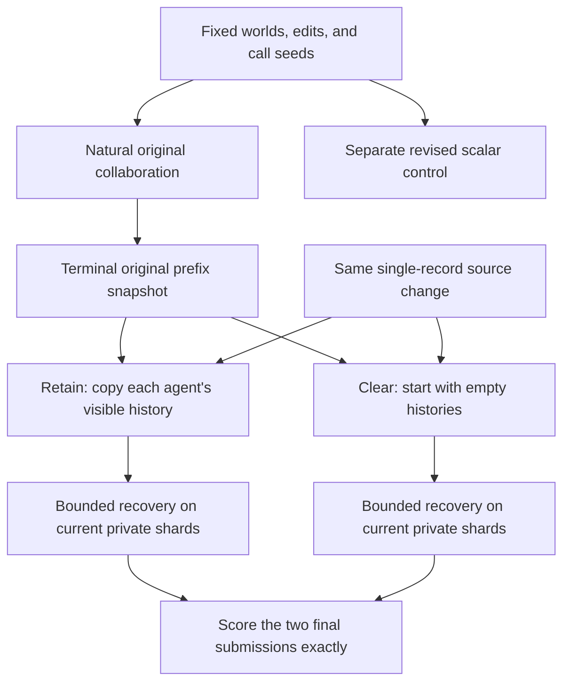
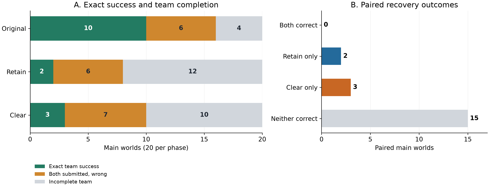
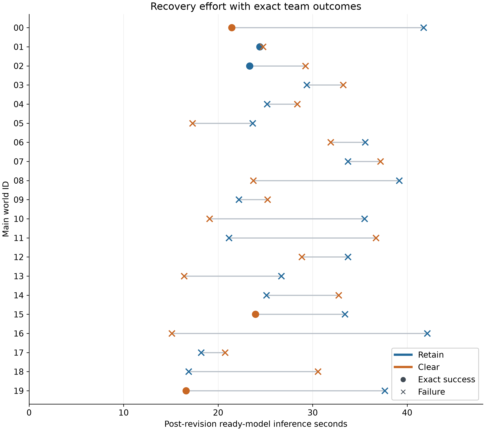

# Recovering Distributed LLM Teams After Information Changes

**Final university course report · 16 October 2026**

Executed condition: `i01-course-assisted-v2`  
Evidence directory: `notebooks/run/assisted-v1/`

**Contents:** [Abstract](#1-abstract) · [Introduction](#2-introduction) · [Related Work](#3-related-work) · [System, Methods, and Experiment](#4-system-methods-and-experiment) · [Results and Discussion](#5-results-and-discussion) · [Conclusion](#6-conclusion) · [References](#references) · [Appendices](#appendix-a-complete-main-outcomes)

## 1. Abstract

When information changes, a team of language model agents must reconsider work that may have been correct earlier. Keeping the conversation can preserve useful evidence, but it can also preserve obsolete conclusions. Clearing it removes both. This project studies that trade-off in a small, controlled experiment. Two agents receive private lists of twenty integers and must each submit the global maximum. After an initial collaboration, the unique winning record is replaced with a lower value. Two independent continuations then either retain or clear the agents' visible histories. Under both policies, each agent receives its current private data, the permitted change notice, and the same assisted instructions.

The completed experiment used Qwen3.5-9B on two NVIDIA T4 devices, with four qualification worlds, four natural pilots, and twenty fixed main worlds. All intended main outcomes were recorded. Retain achieved exact team success on 2/20 worlds (10%), and clear on 3/20 (15%). The paired difference was +5 percentage points for clear, with a prespecified exploratory 95% bootstrap interval from −15 to +25 points. No world succeeded under both policies. These results do not establish that either policy is generally better.

Original collaboration succeeded on 10/20 main worlds, compared with 3/20 in the earlier Course-7 campaign. Illegal actions were also much less common. However, 32 of the 35 failed main recoveries used entirely legal actions. Traces show repeated communication without final submissions, incorrect reading of current values, confusion between local and remote records, and disagreement between explanations and committed answers. Independent reconstruction confirmed the outcome and effort calculations. In this setting, clear instructions and valid communication were insufficient for reliable recovery: agents also needed to track evidence correctly, use it in their decisions, and complete both commitments.

**Keywords:** multi-agent systems; large language models; information changes; recovery; conversation history; distributed coordination.

## 2. Introduction

### 2.1 Problem and motivation

A distributed team rarely works with a permanently correct view of the world. A document may be corrected, a measurement may be replaced, or a previously available option may disappear. The team then needs to decide what can still be trusted. Starting again can waste useful work. Continuing with the existing conversation can carry an old mistake into the new answer.

For language model teams, this problem includes more than changing a stored fact. Agents communicate through text. A message can contain a source observation, an interpretation, a proposed answer, and an instruction at the same time. Once another agent uses that message, its influence may continue even after the original source changes. Conversely, deleting the whole conversation can remove accurate information about an unchanged part of the problem.

The research behind this project examined these questions through truth maintenance, incremental computation, memory repair, and multi-agent evaluation. Those fields already contain methods for preserving valid work and withdrawing unsupported conclusions. The difficult question here is empirical: can language model agents make those distinctions in an actual interaction, under a strict and observable protocol?

We use a deliberately simple numerical task. Each of two agents sees only its own list of integers. Both must eventually submit the largest number across both lists. The arithmetic is easy to check exactly, while the private information still makes communication necessary for a justified global answer. The task comes from the Global Maximum family in SILO-BENCH, which studies collaboration under information silos [1](https://aclanthology.org/2026.acl-long.1354/). Our experiment adds an actual source change and paired recovery continuations. It is a modified recovery study, not a reproduction of the native benchmark's scores.

### 2.2 Objectives and research question

The main research question is:

> Under one fixed assisted two-agent environment, how does retaining rather than clearing the previous visible conversation affect exact team success after the previously winning source record is withdrawn?

The objectives are to measure the paired success difference, compare recovery effort, and explain important behaviors through recorded requests and actions. A further objective is to make the evidence reproducible: the report should distinguish a wrong answer, an unfinished team, an illegal action, and an unknown execution state.

This is a practical comparison between two complete history policies. Retaining history preserves both useful and misleading material. Clearing history removes both. The experiment therefore does not isolate a pure memory operation or a single psychological bias. It also does not test whether assistance itself improves performance, because assistance is common to both policies.

### 2.3 Project scope and contribution

The repository contains a broader research programme involving four peers, several task families, source receipts, and additional recovery policies. The executed course study is smaller: two agents, one maximum task, one announced edit, and two history policies. The governing scientific contract is [specification §12.1](../../PROJECT_SPECIFICATION.md#121-assisted-i-01-course-regime-16-october-2026), together with its incorporated [protocol annex](../../notebooks/run/assisted-v1/latest/source/docs/plans/i01-course-final-design-protocol-and-acceptance.md). Earlier designs provide rationale, not additional executed conditions.

The contribution is a bounded, auditable experimental account. It shows that substantially better observed initial collaboration and protocol compliance can coexist with poor recovery. Its value lies in the paired outcomes, exact behavioral examples, and careful separation of system integrity from agent competence. It does not introduce a new memory architecture or claim a universally superior reset policy.

Throughout this report, **assisted-v1** refers to the supplied folder name. The scientific regime recorded in the executed manifest is **`i01-course-assisted-v2`**. Course-7 is a separate historical campaign.

## 3. Related Work

### 3.1 Revising beliefs and reusing computation

The underlying problem predates language models. Doyle's truth maintenance system records reasons for beliefs so that a program can reconsider them when assumptions change [2](https://dspace.mit.edu/handle/1721.1/5733). Alchourrón, Gärdenfors, and Makinson study contraction and revision of logical theories: removing one proposition can require changing other conclusions to preserve a coherent theory [3](https://fitelson.org/piksi/piksi_22/agm.pdf). These works explain why a correction cannot always be handled by deleting one record. They do not imply that ordinary language model messages contain complete, reliable justifications.

Incremental computation asks a related question: how can an output be updated without recomputing everything? DBSP gives precise change rules for computations expressed in its stream algebra [4](https://www.vldb.org/pvldb/vol16/p1601-budiu.pdf). *Build Systems à la Carte* separates scheduling from decisions about which results need rebuilding, using explicit computation and dependency models [5](https://simon.peytonjones.org/assets/pdfs/build-systems-original.pdf). These are important boundaries for our project. A numerical source record has an exact meaning; a free-form peer explanation does not automatically provide an equally exact dependency graph.

For example, an unchanged agent's accurate local maximum remains useful after the other agent's record changes. The changed agent's old maximum, however, may omit the next-best value needed after withdrawal. An old answer and a sufficient basis for recomputation are different objects. The experiment preserves that distinction by keeping current private sources separate from historical claims. It does not add an automatic dependency repair algorithm.

Reliable branching also requires a consistent state. Chandy and Lamport show that distributed state includes communication state as well as process state [6](https://lamport.azurewebsites.net/pubs/chandy.pdf). Here a central scheduler and settled phase boundaries make the problem simpler. We copy an explicit terminal prefix into independent siblings; we do not implement or claim a new asynchronous snapshot algorithm.

### 3.2 Recovery systems and memory content

Recent agent recovery work makes the preservation problem concrete. *From Faulty Memories to Corrected Actions* uses diagnosed faulty memories, typed runtime provenance, independent-support checks, and selective replay [7](https://arxiv.org/html/2608.10502v1). MEMOREPAIR withdraws affected artifacts before publishing validated successors [8](https://arxiv.org/html/2605.07242v1). REVISE uses recorded data and control dependencies to preserve valid progress during online workflow changes, expanding recovery conservatively when provenance is incomplete [9](https://arxiv.org/html/2609.00643v1).

These systems informed the repository's rejection of broad novelty claims about selective rollback or source-preserving recovery. Their guarantees depend on explicit observations, validators, or structured workflows. Our agents instead receive ordinary, uncertified text. Supplying a correct semantic graph or rejecting numerically wrong answers at runtime would change what the experiment measures.

StateAuditor examines a related separation between updated memory and updated behavior. It constructs previous/current transitions from evidence and uses them in response repair; its deterministic checks establish provenance and chronology, rather than semantic supersession by themselves [10](https://arxiv.org/html/2608.01619v1). This supports treating a change notice as an input whose interpretation must be tested, rather than assuming that its presence ensures adaptation.

Reclaim Evaluation distinguishes memory that keeps a conclusion from memory that keeps the source needed to derive an answer again. Its source-first conditions and length controls show why memory content matters, with limits when the source does not fit or is difficult to identify [11](https://arxiv.org/html/2606.25449v5). Our study differs in two ways. The original conclusion can be correct before the world actually changes, and agents can exchange fresh information afterwards. Clearing history therefore removes a possible resource, but does not create the same source-absence condition as a compressed note containing only a conclusion.

### 3.3 Paired recovery and communication evaluation

The Causal Intervention Router study branches from the same execution state to compare recovery with continued execution. It distinguishes rescues from harms, since the same average gain can hide changes in both directions [12](https://arxiv.org/html/2610.00372v1). That principle motivates reporting all paired categories here. Its underlying environment remains unchanged while observations are perturbed; our numerical source itself changes. We compare retain with clear, rather than either policy with no recovery.

Independent–Communicate–Revise (ICR) fixes initial solutions, compares message conditions, and measures correction and preservation with a no-message revision control. It finds that richer messages can increase helpful and harmful influence together [13](https://arxiv.org/html/2610.01042v1). The connection is methodological: an aggregate success rate should be read alongside the transitions that produce it. ICR agents initially share a complete problem and revised outputs do not propagate through a continuing team. Our agents have private shards, sequential feedback, and final commitments. Its results are therefore not expected recovery rates for this experiment.

SILO-BENCH provides the closest task foundation. Its distinction between active communication and effective distributed computation is especially relevant to our repeated-report traces. However, its team scales, communication substrates, native waiting behavior, and evaluation differ from the adopted I-01 protocol [1](https://aclanthology.org/2026.acl-long.1354/). Our exact team endpoint must be interpreted under our own contract.

### 3.4 Multi-turn adjustment and reliable decisions

Laban and colleagues compare fully specified instructions with information disclosed over several turns. Their study separates aptitude from reliability and reports premature assumptions and reliance on earlier answers [14](https://arxiv.org/html/2505.06120v1). This helps explain why a correct one-call maximum is a limited capability check. Their setting concerns staged user instructions, not withdrawal of a private record, so our loops cannot simply be assigned the same internal explanation.

LongMemEval separates information extraction, multi-session reasoning, temporal reasoning, knowledge updates, and abstention [15](https://arxiv.org/abs/2410.10813v2). This encourages a more precise vocabulary than calling every mistake a memory failure. In our short contexts, a model can fail to read a currently visible number or fail to act on a delivered message without any demonstrated retrieval failure.

Belief-R explicitly tests both changing an answer when warranted and maintaining it when the new premise does not require a change [16](https://aclanthology.org/2024.emnlp-main.586/). Its pragmatic language tasks use different gold judgments from our exact arithmetic. The transferable lesson is the need to measure preservation as well as updating. Our course cohort always changes the global maximum, so it cannot establish whether agents also preserve answers appropriately under harmless updates.

Self-correction and debate are possible alternatives, but their comparators matter. Huang and colleagues show that apparent self-correction gains can depend on oracle feedback, prompt design, and unmatched response budgets [17](https://arxiv.org/abs/2310.01798v2). ReConcile supplies positive evidence for collaboration among diverse models, using explanations, demonstrations, confidence, and host aggregation [18](https://aclanthology.org/2024.acl-long.381/). These findings do not contradict each other. They study different systems. Neither establishes that additional calls or voting would solve a private-information task with two irreversible submissions.

### 3.5 Interfaces, action validity, and diagnosis

JSONSchemaBench evaluates structured generation through constraint coverage, compliance, efficiency, and output quality [19](https://arxiv.org/html/2501.10868v3). Tam and colleagues show that format restrictions can affect reasoning performance, with results depending on task, model, and interface [20](https://aclanthology.org/2024.emnlp-industry.91/). Together they caution against treating valid JSON as complete action competence, or assuming a universal benefit or penalty from structured output. Our study uses strict validation after ordinary generation, without constrained decoding.

SWE-agent demonstrates that the interface around a fixed model can materially affect performance [21](https://proceedings.neurips.cc/paper_files/paper/2024/hash/5a7c947568c1b1328ccc5230172e1e7c-Abstract-Conference.html). The final course design also draws explicitly on τ²-Bench, where workflow assistance has condition-dependent effects, and FlowBench, which distinguishes turn-level evaluation using supplied histories from live session-level interaction [22](https://proceedings.mlr.press/v306/barres26a.html), [23](https://aclanthology.org/2024.findings-emnlp.638/). These works supported a fixed assistance package and complete natural pilots. They did not guarantee that clarification would improve recovery.

CheckList's capability-focused behavioral testing provides a useful model for small diagnostic fixtures [24](https://aclanthology.org/2020.acl-main.442/). MAST supplies a broader vocabulary for repetition, termination problems, ignored peer information, and reasoning–action mismatch [25](https://proceedings.neurips.cc/paper_files/paper/2025/hash/b1041e52d3be19f0a9bc491657488e4a-Abstract-Datasets_and_Benchmarks_Track.html). Who&When further distinguishes locating an observable mistake from identifying a decisive error through a counterfactual correction [26](https://proceedings.mlr.press/v267/zhang25cq.html). We use exact state checks and trace-linked descriptions, without importing a judge or claiming human-coded causal attribution.

Finally, *AI Agents That Matter* motivates evaluating accuracy with cost and documenting development choices [27](https://arxiv.org/abs/2407.01502v1). τ-bench distinguishes one-run success from consistency over repeated trials [28](https://proceedings.iclr.cc/paper_files/paper/2025/file/1b126cc38b8638e07bef37e7b2bb72bf-Paper-Conference.pdf). These lessons shape the effort accounting and limitations of this report. Twenty world pairs with one realized generation schedule do not measure repeated-run reliability.

### 3.6 How the research shaped this study

The repository's literature investigation was broader than the final experiment. Its main effect was to clarify what a small study could responsibly claim.

| Research lesson | Consequence in the executed study |
|---|---|
| A conclusion and its supporting evidence are different | Current shards remain authoritative; old conversation is retained literally or cleared |
| Recovery can help some states and harm others | Report both arm rates and all four paired outcome categories |
| Provenance guarantees require explicit assumptions | Do not infer a semantic dependency graph from peer prose |
| The interface is part of agent behavior | Declare assistance as a new condition and apply it in every phase |
| Static ability does not certify interaction | Separate scalar controls, supplied-view diagnostics, and natural pilots |
| Legal output is not task success | Evaluate syntax, legality, completion, and exact submissions separately |
| Extra computation has a cost | Include unsuccessful recovery effort and distinguish physical from logical spending |

*Table 1. Connections between the research foundation and the adopted methods.*

This history is documented in the [original related-work audit](../../research/01_original_blueprint/03_related_work.md), [updated landscape](../../research/04_design_extensions/UPDATED_RESEARCH_LANDSCAPE.md), [targeted fifteen-paper review](../implementation-research/i01-course-7-targeted-scientific-literature-review.md), and [practical literature investigation](../implementation-research/i01-course-practical-literature-investigation.md). A paper discussed in those reviews is not automatically an implemented method. In particular, the selective-repair architectures and proposed no-change studies remain distinct from the experiment reported below.

## 4. System, Methods, and Experiment

### 4.1 System architecture

The system has a Python controller, two resident model workers, and two canonical SQLite stores. A logical agent is a role within an episode, not a dedicated GPU process. One assigned worker runs both agent roles for a world. Its retain and clear siblings use that same worker and device. The second replica allows independent worlds to progress on the other T4.

The controller selects the next eligible agent, builds its permitted view, records the call, and requests generation. The worker rebuilds and checks the request, initializes fresh call-owned model state, and returns the raw output and runtime evidence. The controller persists that output before applying any action. The resulting episode state and effect flag are then committed together. During execution, the stores use write-ahead logging and full synchronous durability.

The notebook is a thin orchestration and inspection layer. Its 37 finite code cells cover setup, checks, qualification, diagnostics, pilots, ten main batches, reports, export, and shutdown. The scientific state resides in the stores, rather than notebook variables alone.



*Figure 1. One paired main world. The original prefix is executed once. Recovery branches are independent copies, not consecutive stages of one conversation. Each branch has its own actions and effects. A control is a separate diagnostic call and supplies no answer to the team.*

These boundaries implement the snapshot and authority concerns discussed in Section 3. They also prevent the evaluator from becoming an assistant. Hidden truth, the other private shard, future edits, treatment labels, and source-selection eligibility are excluded from peer requests. No host calculator computes an answer for the agents.

Source inspection confirms the intended persist-before-effects and exact-resume paths. The completed campaign contains no crash, retry, reload, or unresolved call, so it does not empirically exercise every restart path. Equal short A–B–A probes provide bounded evidence about call isolation; they do not prove absence of every possible hidden backend effect.

### 4.2 Task and synthetic dataset

Each world contains two private shards, each with twenty integers drawn uniformly from −1000 through 1000 before conditioning. Let the original global maximum be \(M\). An eligible world has one unique occurrence of \(M\), and the largest remaining value \(M_2\) is greater than −1000. The winning record is replaced by a uniform draw from

\[
[-1000,\;M_2-1].
\]

The revised global maximum is therefore \(M_2\), which is strictly lower than \(M\). This guarantees an actual answer change. It also creates a concrete recovery problem: remembering only \(M\) does not reveal the next-best value.

Proposals are additionally conditioned on the scheduled owner of the old maximum. All inputs, edits, proposal counts, assignments, and invocation seeds are saved before inference. Rejections depend on mathematical eligibility and owner assignment, never model performance. The 28 accepted worlds required 48 proposals, including twenty owner-block rejections and no mathematical-ineligibility rejections.

There are four qualification worlds, four pilot worlds, and twenty main worlds. The 56 ordered original/revised whole inputs are distinct, and the release checks exact whole-input separation from locally exposed historical and development inputs. This does not imply that individual integers are unique across worlds or that model pretraining contamination has been ruled out.

The master seed is `2026101601`. Main worlds are evenly divided between four strata: changed owner 0 or 1, crossed with first speaker 0 or 1. Each stratum contains five worlds. These are synthetic algorithmic data; no human participants or personal data are involved.

### 4.3 Agent interface and assistance

Every ordinary call presents the same common system instructions and a user message containing the agent identity, phase, own-call counter, partner-finished status, earlier-phase history, current-phase history, source notice, and current private shard. Current values appear after the historical text. Records remain in their original order; the host does not sort them or highlight a maximum.

The assistance explains the global objective, private finality, legal actions, waiting, source ownership, and the sole-record-change rule. It also suggests establishing the relevant maximum of each shard, comparing them, and sending useful information before finishing. This is a supplied coordination strategy. The experiment does not measure discovery of that strategy without guidance. However, the host does not enforce an exchange sequence, require a fresh peer report before every submission, or repair a numerical claim.

An agent must return exactly one JSON object with three fields:

```json
{"message":"My current local maximum is 922.","submit":null,"wait":false}
```

This is an illustration for the report. The experimental system instructions supplied action-form examples without a worked numerical demonstration. A message is ordinary text, not a certified source. The `submit` field is either a strict integer or null, and `wait` is a boolean.

| Action | Effect |
|---|---|
| Message only | Deliver the text to the other agent |
| Submit only | Record a private final answer and finish the sender |
| Message and submit | Deliver the text, then finish the sender |
| Wait alone | Block the sender until a message is delivered |
| Illegal or malformed action | Consume the call; deliver nothing; record public rule feedback |

*Table 2. Legal choices and their state effects under the adopted I-01 protocol.*

Waiting cannot accompany a message or submission. An empty non-wait action is also illegal. A grammatically valid JSON object can therefore still be an illegal action, a distinction motivated by the structured-output literature [19](https://arxiv.org/html/2501.10868v3).

There are at most three calls per agent in each phase, with no transfer of unused opportunities. Calls alternate between eligible agents; if the scheduled agent has finished or is blocked, the other eligible agent can act. Delivery occurs before the next eligible call. This is a sequential protocol, not the synchronous four-peer rounds in the broader thesis design.

A submission is irreversible within its phase. The partner-finished flag reveals completion, not the submitted value. A phase ends when both submit or no unfinished agent can progress because of waiting or exhausted opportunities. Correctness never determines stopping. In particular, one correct submission is insufficient.

### 4.4 Source change and history policies

After the original phase, both agents are reopened with fresh call counters, waiting flags, and current submissions. Both see which owner's record changed. Only that owner receives its replacement value; its current shard already contains the replacement. The before-value is not reissued as current evidence. The hidden rule that the withdrawn value was uniquely largest is not shown to the agents.

**Retain** copies each agent's actual visible prefix history: its legal own actions, explicit old submissions, received messages, and public rejection feedback. Wrong claims remain wrong. Rejected raw replies remain auditor evidence and are not inserted as delivered messages. Earlier-phase and current-phase entries have explicit boundaries.

**Clear** starts with empty visible histories. It retains the same common instructions, current own shard, change notice, and fresh phase state as retain. It does not mean an ordinary initial episode: the agent still sees that a source change occurred.

Both siblings start independently from the same terminal prefix. Neither sees the other continuation. Only the prefix is shared physically. Recovery invocation seeds are matched by agent and call index across policies, but requests differ because their histories differ. Matching seeds do not imply identical sampled outputs, and no continuation output is replayed across treatments.

This is a total history-policy intervention. Information, wording, context length, and opportunities to repeat earlier behavior change together. We do not interpret it as selective deletion of an obsolete answer, execution-state unlearning, or a test of one internal bias.

### 4.5 Experimental stages and admission

The candidate configuration, presentation, inputs, schedule, evaluation, and gates were fixed before the first model call. Preparation included six short state checks, eight complete-input qualification controls, two full-envelope hardware probes, and four supplied-view diagnostics.

The scalar control receives all forty integers and a short instruction to return one maximum without communication. It tests a different information and interaction condition from the team. It is not a runtime oracle and does not constrain the team's score.

Four natural pilots then execute their original, retain, and clear episodes, together with original and revised scalar controls. Main admission requires settled evidence, reconciled spending and exports, current hardware health, adequate measured resources, at least 3/4 correct pilot original teams, and at least 7/8 correct pilot controls. These are course-usefulness thresholds, not reliability guarantees. No minimum recovery success or favorable retention effect is required.

If admitted, every main world receives one natural original prefix, both recovery siblings, and a revised scalar control. All twenty intended worlds remain in the analysis even when their originals are wrong. There is no outcome-based replacement, extra sampling, or early stopping of the world list.

Physical policy order is balanced 10 retain-first and 10 clear-first. Device assignment is balanced 10/10, with five worlds in each joint device/order combination. Owner/first-speaker strata contain both orders on both devices, allowing the unavoidable 2/3 cell imbalances. Siblings stay on the same device. Ten consecutive two-world batches cover main-00 through main-19; same-device worlds are serialized.

### 4.6 Model, runtime, and resources

| Component | Executed configuration |
|---|---|
| Model | `Qwen/Qwen3.5-9B` [29](https://huggingface.co/Qwen/Qwen3.5-9B/tree/c202236235762e1c871ad0ccb60c8ee5ba337b9a) |
| Checkpoint revision | `c202236235762e1c871ad0ccb60c8ee5ba337b9a` |
| Source release | `d95bb01223590bb889d4612199662266ce78968d` |
| Precision | Text-only NF4 double quantization with FP16 computation |
| Hardware | Two distinct Tesla T4 devices; one resident replica per worker |
| Generation | Direct/nonthinking; temperature 0.7, top-p 0.8, top-k 20 |
| Other settings | Repetition penalty 1; presence penalty 0; one beam; fresh cache per call |
| Token bounds | 8,192 input tokens; at most 512 generated output tokens |
| Deadlines | 600 s loading; 180 s ordinary call; bounded termination and export margins |
| Minimum measured free headroom | Required 1.5 GiB; recorded minimum approximately 6.78 GiB |
| Physical attempt ceiling | 480 ordinary first attempts plus 20 contingency; 500 total |

*Table 3. Frozen model and execution configuration. Model availability is documented by its pinned repository; runtime and resource values come from the execution records.*

The recorded Kaggle environment used Python 3.13.15, PyTorch 2.11.0+cu128, Transformers 5.12.0, bitsandbytes 0.49.2, tokenizers 0.22.2, and accelerate 1.14.0. The executed T4 attention path and prefill chunk size of 256 are part of the frozen runtime. No fine-tuning, alternate model, thinking fallback, or constrained decoder was used.

Every physical generation counts, including diagnostics, failures, and eligible retries. Downloads and loading consume time but are not generation attempts. A recorded wrong or invalid reply is never retried. At most one identical infrastructure retry is permitted only without a durable outcome and after confirmed termination. Unknown spending blocks further admission. In this campaign every call was a completed first attempt; no retry or contingency charge occurred.

### 4.7 Evaluation and uncertainty

For main world \(w\), let \(R_w\) and \(C_w\) be 1 when both agents' final revised submissions equal the exact revised maximum under retain and clear, respectively, and 0 for a known terminal failure. An unexecuted or unresolved episode would be unknown rather than zero. The primary contrast is

\[
\widehat{\delta}=\frac{1}{20}\sum_{w=1}^{20}(C_w-R_w).
\]

A positive value favors clear on this endpoint. The analysis unit is the world. Two agents, multiple messages, and the two siblings are not independent replications. We show both arm rates and the four possible paired outcome categories, following the methodological reasoning in paired recovery work [12](https://arxiv.org/html/2610.00372v1).

The prespecified uncertainty display uses 10,000 stratified paired bootstrap draws with seed `2026101602`. Strata are ordered by owner and first speaker, with worlds ordered by index. Each draw samples five complete world pairs with replacement within each of the four strata, then averages the twenty differences. The bounds are sorted zero-based draw indices 250 and 9750, without percentile interpolation. This is a nominal 95% exploratory interval; its small-sample coverage has not been established. It is not an equivalence test or an estimate of repeated-seed reliability.

The principal secondary outcome is mean paired **post-revision ready-model inference time**, including unsuccessful calls. We also report calls, input and generated tokens, messages, completion, wrong agreement, and absent submissions. Ready-model time measures call execution with an already loaded model; it excludes loading and is not provider billing or wall-clock allocation time. Each hypothetical end-to-end policy is charged the original prefix logically, while the experiment executes that prefix only once physically.

Correct-prefix recovery is descriptive only. No conditional bootstrap, post hoc best-policy selector, or accuracy/cost composite is used. Process labels can overlap; their counts do not form a causal decomposition of failure.

### 4.8 Verification for this report

The four documents in [the assisted analysis directory](../analysis/assisted-v1/README.md) were studied alongside the canonical stores, manifest, full natural traces, controls, executed notebook, source package, specifications, and Course-7 evidence. The preserved standalone verifier was executed read-only with no experiment imports, model loading, or tokenizer loading. It returned **10,953 passed record comparisons and no deviations**. These checks reconstruct all 308 natural actions, 72 natural checkpoints, 36 scalar controls, four diagnostics, and the historical Course-7 state trajectories, as well as world generation, source identities, exports, and report projections.

A separate calculation written for this report independently recomputed maxima and edits, all twenty submission pairs, completion and action counts, effort totals, both adopted intervals, and the main Course-7 outcomes directly from immutable SQLite connections. The figures use those reconstructed values. Verification found a presentation issue in the earlier ledger's large invocation-seed transcriptions; Appendix B explains it. The canonical seeds and scientific results agree.

These are checks of recorded evidence and implementation semantics. They do not reproduce GPU arithmetic, validate every hidden backend state, or create independent human annotations. The distinction between an auditable system and a reliable team remains essential when interpreting the results.

## 5. Results and Discussion

### 5.1 Execution coverage and preparation results

The supplied notebook completed all 37 code cells without a Jupyter error output. Every intended main prefix, recovery sibling, and revised scalar control has a terminal durable record. There are no unknown main outcomes or unknown main effort values. The campaign used **356 physical first attempts**, with zero retries and zero contingency charges.

| Stage | Recorded calls | Main observation |
|---|---:|---|
| Hardware/state checks and envelopes | 8 | Six expected short answers; two full envelopes completed |
| Qualification scalar controls | 8 | 8/8 exact, legal answers |
| Supplied-view diagnostics | 4 | Four legal actions; one met its exact behavioral target |
| Four pilots, including controls | 58 | 4/4 correct original teams; 8/8 correct controls; 0/8 successful recoveries |
| Twenty main worlds, including revised controls | 278 | Complete intended coverage; recovery results below |
| **Total** | **356** | **No recorded unresolved or repeated attempt** |

*Table 4. Physical execution by stage. A diagnostic nonpass differs from an illegal action. Qualification, pilot, and main observations are separate populations.*

The diagnostics already exposed limits that matter later. One agent ignored a request to send exactly `ready`, although its alternative message was legal. Another correctly extracted its revised local maximum, 829, but did not make the requested global submission using a still-valid historical peer report of 907. A clear-history local-source probe returned 107 instead of 986. These four supplied views are informative examples, not a reliable estimate of general competence. Appendix C gives their exact targets and call IDs.

The pilots satisfied the adopted main gate despite every recovery failing. That was consistent with the contract: all four original teams and all eight scalar controls were correct, and evidence, health, spending, and resource checks passed. Recovery success was deliberately not an admission criterion. The pilots therefore established course usefulness and execution feasibility, not reliable adaptation. Their failures were retained, and the candidate was not tuned afterwards.

### 5.2 Main success and the paired contrast

Retain succeeded on **2/20 worlds (10%)**, and clear on **3/20 (15%)**. The successful worlds were different.

| Paired revised-team outcome | Worlds | Main IDs |
|---|---:|---|
| Both policies correct | 0 | None |
| Retain only correct | 2 | 01, 02 |
| Clear only correct | 3 | 00, 15, 19 |
| Neither correct | 15 | All remaining main worlds |
| Unknown pair | 0 | None |

*Table 5. Exact paired outcomes for all twenty intended main worlds. IDs refer to the assisted campaign only.*

There are three world differences of +1, two of −1, and fifteen of zero. Thus

\[
\widehat{\delta}=\frac{3-2}{20}=0.05,
\]

or **+5 percentage points for clear**. The adopted exploratory 95% bootstrap interval is **−15 to +25 percentage points**. All four strata contain a nonzero contrast, so the empirical primary interval is not degenerate. However, only five worlds distinguish the policies on success. The interval includes effects favoring either arm, and one changed world outcome would move an arm's rate by five points. The data establish neither superiority nor equivalence.

All outcomes are known, so the missing-outcome completion bounds collapse to the observed contrast, [+5,+5] points. That means the finite cohort has been fully observed; it does not remove uncertainty about new worlds or model samples.



*Figure 2. Main outcomes reconstructed from final submissions. Panel A separates exact team success, completed but wrong teams, and incomplete teams. Every bar contains twenty worlds. Panel B preserves the retain/clear pairing. Incomplete episodes are known failures, not missing observations. [Vector version](assets/final-course-report/main-outcomes.svg).*

The original teams were exactly correct on 10/20 worlds. Among those ten correct-prefix worlds, retain recovered on 2/10 and clear on 1/10. The other two clear successes followed incorrect original teams. These are descriptive counts, as specified in the design, without a separate subgroup interval or inferential claim. A correct original answer also does not certify that every earlier report was accurate.

Revised full-information controls were correct on 18/20 main worlds. The two errors were 881 instead of 815 in main-15, and 585 instead of 601 in main-16. Clear nevertheless solved main-15. A control is a separate stochastic call with different instructions, information access, and seed; it is neither an oracle nor a deterministic capability ceiling for that world. Conversely, the many correct controls show why poor recovery should not simply be described as an inability to find any maximum. This separation between single-call ability and interaction performance is consistent with the evaluation concerns raised by Laban et al. [14](https://arxiv.org/html/2505.06120v1).

### 5.3 Legal communication often ended without a complete team

All 348 scientific responses were valid JSON with the required field types. Six violated the action rule by combining a message with `wait:true`. Their text was recorded but never delivered. All six occurred in main natural episodes; the fifty pilot team actions were legal. Across pilot and main collaboration, **302/308 actions were legal**.

| Main-phase measure | Original | Retain | Clear |
|---|---:|---:|---:|
| Actual calls | 82 | 91 | 85 |
| Illegal actions | 1 | 1 | 4 |
| Delivered messages | 70 | 85 | 77 |
| Both agents submitted, out of 20 worlds | 16 | 8 | 10 |
| Exact team success, out of 20 worlds | 10 | 2 | 3 |
| Correct individual final answers, out of 40 slots | 30 | 14 | 18 |
| Wrong individual final answers, out of 40 slots | 6 | 8 | 11 |
| Known absent final answers, out of 40 slots | 4 | 18 | 11 |

*Table 6. Protocol, completion, and answer coverage. Call counts depend on behavior; the intended team and agent-slot denominators remain fixed. There are no unknown slots.*

Retain's eighteen failures comprise twelve incomplete teams and six completed but wrong teams. Clear's seventeen failures comprise ten incomplete teams and seven completed but wrong teams. Of those failures, **17/18 retain episodes and 15/17 clear episodes contain no illegal action**. In total, 32/35 failed recoveries are entirely legal. This does not assign a causal fraction to protocol compliance, but it rules out rejected actions as a general description of the current failure pattern.

Retain delivered more messages than clear yet completed fewer teams. Literal repetition was also more common: counting delivered messages beyond the distinct strings sent by each agent within an episode gives 31 duplicates for retain and 18 for clear. Thirteen retained agent trajectories repeated the same message on all three own calls, compared with four clear trajectories. These are exact string counts, not a complete semantic loop detector. A repeated message can sometimes be useful, and changed wording can conceal the same stalled behavior.

No main recovery submission in either policy equals the withdrawn old global maximum. That is a meaningful difference from Course-7, but it does not mean history ceased to matter. Earlier text can still affect message choices or completion behavior. Clear also removes the old answer from both current data and earlier visible history by construction, so old-answer avoidance in clear alone would not demonstrate resistance to anchoring.

### 5.4 What the traces show

The fixed casebook selects the lowest-index main examples for illegal action, local refutation, clear-only success, and retain-only success: main-03, main-03, main-00, and main-01. Its obsolete-retain and both-policy-success categories are absent. The further cases below were selected for explanation after inspecting the complete record. They are illustrative observations, not an independently coded or mutually exclusive failure taxonomy.

#### A useful history can help, but an empty history can also succeed

Main-00 is the first clear-only success. The old answer was 943 and the revised answer 922. Clear exchanged current maxima 900 and 922 and finished with [922,922]. Retain instead reported 837 for the changed shard, although 900 was visible, and ended without either submission. This comparison combines extraction and completion differences; it does not isolate a single harmful old sentence. [Original paired trace](../../notebooks/run/assisted-v1/latest/reports/conversations.html#main-00/clear/agent-0/invocation-0).

Main-01 gives the opposite result. The unchanged peer's maximum, 926, appeared in the retained original history. The changed owner reported its new maximum, 931, compared it with 926, and submitted 931. Its partner followed, giving retain a three-call success. Clear exchanged the same correct maxima and one agent submitted 931, but the other kept requesting information and eventually used its final opportunity to wait. The retained response is consistent with useful reuse of unchanged peer evidence, although a fresh current report was also available. It does not prove an internal memory mechanism. [Owner's retained request and action](../../notebooks/run/assisted-v1/latest/reports/conversations.html#main-01/retain/agent-0/invocation-0).

#### Correct reports can circulate without becoming decisions

Main-08 is particularly clear. The original team correctly submitted 874. After withdrawal, the current local maxima were 758 and 857. In retain, each agent sent its correct maximum on every own call:

| Agent | Repeated message content | Number of own calls | Final submission |
|---|---|---:|---|
| 0 | “My local maximum is 758 at record 19. I will wait for your maximum before submitting.” | 3 | Absent |
| 1 | “My local maximum is 857 at record 12. I will wait for your maximum before submitting.” | 3 | Absent |

*Table 7. A fully legal retained report loop in main-08. The messages arrived before subsequent calls, and both final `submit` fields remained null.*

Both agents had received the other's current maximum, yet the episode exhausted all six calls. The messages said they would wait, but their actual `wait` fields were false: they remained ordinary messages, not blocked protocol waits. The failure was therefore not lost delivery or literal mutual waiting. [Last agent-0 request and reply](../../notebooks/run/assisted-v1/latest/reports/conversations.html#main-08/retain/agent-0/invocation-2).

Clear failed differently on this same world. Agent 1 reported 786 instead of its visible 857, and both finally submitted 786. This wrong agreement shows why completion and consensus need separate checks from correctness. Retain had correct exchanged values without completion; clear completed with the wrong value.

#### Record locations were sometimes treated as evidence about the wrong owner

In main-09 clear, agent 1 received a current message reporting agent 0's maximum as 949 at record 16. Its notice identified agent 0's changed record as 13. On its next call, agent 1 claimed the partner's maximum was 695 at record 13 and submitted its own 836. The number 695 was in **agent 1's own shard at index 13**. The correct 949 report was visible in that request. [Exact request and action](../../notebooks/run/assisted-v1/latest/reports/conversations.html#main-09/clear/agent-1/invocation-1).

Main-13 clear provides an even earlier example. Before receiving any current peer message, agent 1 said the partner's record 9 had changed to 397. The request disclosed no remote replacement. Its own record 9 was 397; the actual remote replacement was −509. [Exact first call](../../notebooks/run/assisted-v1/latest/reports/conversations.html#main-13/clear/agent-1/invocation-0).

These numerical correspondences support an interpretation of confusion about source ownership and record locations. They do not identify an attention mechanism or prove why the model selected those numbers. Their occurrence in clear also shows that old retained prose is not necessary for this pattern. In LongMemEval's terms, access to information and successful reading of it are distinct concerns [15](https://arxiv.org/abs/2410.10813v2).

#### Explanations and actions did not always agree

In main-04 clear, agent 1's last message correctly stated that 954 was the global maximum and said it would submit. Its actual action was:

```json
{"message":"My max is 839. Your shard max is 954. 954 is the global max. I will submit.","submit":null,"wait":false}
```

Only whitespace has been normalized in this display. The larger value had already arrived in a legal message, and the partner had finished. The final answer nevertheless remained absent. [Stored action and permitted view](../../notebooks/run/assisted-v1/latest/reports/conversations.html#main-04/clear/agent-1/invocation-2).

The opposite mismatch also occurs: in main-15's original phase, agent 0 recognized that the partner's 917 exceeded its own 815, yet submitted 815. In main-10 retain, agent 0 twice identified the revised global 987 in text without committing it. These are observable reasoning–action mismatches of the kind organized by MAST [25](https://proceedings.neurips.cc/paper_files/paper/2025/hash/b1041e52d3be19f0a9bc491657488e4a-Abstract-Datasets_and_Benchmarks_Track.html). Scoring the prose instead of the action would rewrite the endpoint.

#### Finality exposes both premature commitment and failure to finish

In main-17 retain, agent 0 submitted 663 even though its current shard contained 819. Later information could not reopen that answer. In main-11 retain, one agent submitted the correct 950, while the other subsequently chose a legal wait. Because the finished partner could no longer send a waking message, the episode deadlocked. A waiting deadlock therefore need not mean both agents are waiting.

These two cases reveal opposing requirements: an agent should avoid an unsupported early commitment, but should also commit when enough useful information has arrived. Merely advising more caution can leave the second requirement unmet. The traces do not show that removing finality or adding turns would necessarily rescue either trajectory.

#### Correct outcomes can contain incorrect premises

Main-19 clear succeeded in two calls with [896,896]. Its first speaker nevertheless invented a partner maximum of 639; that was a value in its own shard, while the true remote maximum was 860. Since 896 exceeded both, the wrong premise did not alter the answer. Main-02 retain similarly succeeded despite a later false remote maximum claim. [Main-19 first action](../../notebooks/run/assisted-v1/latest/reports/conversations.html#main-19/clear/agent-1/invocation-0).

The exact endpoint correctly credits these successes. They should not be presented as proof of faithful source tracking or robust reasoning. The reverse also matters: sending a correct answer once does not guarantee team success, as the incomplete cases demonstrate.

### 5.5 Why better original collaboration did not become reliable recovery

Recovery combines several requirements. An agent must read its current data, distinguish its own records from its partner's, decide which earlier reports remain useful, interpret a change notice, integrate new messages, and put the right integer into an irreversible action. Both agents must complete that chain within their call limits.

The assisted campaign often achieved some of these behaviors without achieving all of them. Main-08 retained the right current reports but failed to finalize. Main-09 had a correct delivered report but replaced it with an unrelated local value. Main-04 explicitly named the right answer but left the action empty. These are more specific explanations than saying the agents simply ignored the correction or kept the old answer.

The original and recovery phases also present different decision contexts. Recovery includes reopening, a source notice, and possible old text. Clear removes history but keeps the changed-phase presentation. Thus the drop from 50% original success to 10–15% recovery success cannot be attributed solely to retained obsolete conclusions. Nor can it be identified as the causal effect of revision itself, because there is no matched no-change reopening.

Retain may preserve useful evidence while also making an ineffective action pattern easier to repeat. That is a plausible explanation for some report loops, but the study cannot separate imitation, source-reading difficulty, status interpretation, and sampling variation into internal causes. The source/conclusion distinction from Reclaim [11](https://arxiv.org/html/2606.25449v5) remains useful; our results add that preserving or reacquiring useful content is still insufficient when the receiver does not convert it into a final action.

Likewise, the scalar controls remove most coordination decisions. They do not test who owns a location, when a peer report is sufficient, or how two agents should finish. The gap between controls and teams is informative, but subtracting their accuracies would not estimate a causal communication-failure rate. The conditions differ in several ways at once.

### 5.6 Recovery effort and campaign resources

| Main recovery measure | Retain | Clear | Mean clear minus retain |
|---|---:|---:|---:|
| Calls, total / mean per world | 91 / 4.55 | 85 / 4.25 | −0.30 calls |
| Ready-model time, total / mean | 588.778 / 29.439 s | 513.115 / 25.656 s | **−3.783 s** |
| Input tokens, total / mean | 102,922 / 5,146.10 | 80,352 / 4,017.60 | −1,128.50 tokens |
| Generated tokens, total / mean | 3,411 / 170.55 | 3,194 / 159.70 | −10.85 tokens |
| Delivered messages, total / mean | 85 / 4.25 | 77 / 3.85 | −0.40 messages |

*Table 8. Complete post-revision effort across the twenty paired main worlds, including failed episodes. Time totals are rounded to three decimals; contrasts use unrounded records.*

The principal effort interval is **−8.241 to +0.589 ready-model seconds per world** for clear minus retain. Clear was cheaper on average in this cohort, but the interval includes zero. More importantly, fast failure is not useful efficiency. Main-16 clear finished with the wrong disagreement [601,500] in about 15.11 seconds; retain reached the same disagreement in about 42.14 seconds. Main-11 shows the other direction: retain was cheaper because it deadlocked before using the horizon, while clear continued.



*Figure 3. Ready-model inference time for each main world's two recoveries. Lines connect the same world; circles indicate exact team success and crosses known failure. Blue is retain and orange is clear. Both agents' calls are included. A shorter duration can result from a wrong final commitment or early deadlock. [Vector version](assets/final-course-report/paired-recovery-effort.svg).*

The original prefixes cost 82 physical calls and 493.775 ready-model seconds. Charging that same prefix to each hypothetical complete policy gives 173 logical calls and 1,082.553 seconds for retain, versus 167 calls and 1,006.890 seconds for clear. Summing those policy totals would double-count the shared physical prefix. Controls and hardware diagnostics are research cost rather than the cost of either distributed policy.

Across the whole campaign, the 356 attempts used 337,397 input tokens, 13,692 generated tokens, and 2,174.333 summed ready-model seconds. The observed notebook span was about **38.26 minutes**; the ten main batch cells spanned about **20.41 minutes**. Summed generation time and elapsed time differ because of overlap, setup, loading, exports, and orchestration. Provider allocation duration, GPU utilization, monetary cost, and energy consumption are not established by these records. Confirmed worker exits also do not prove provider allocation release.

There is no recorded scientific timeout or truncation. All scientific replies ended at EOS; the longest scientific reply used 124 of the allowed 512 generated tokens, and scientific inputs ranged from 245 to 1,318 tokens. The two forced-length hardware envelopes are separate probes. Recorded cap exhaustion or missing headroom therefore does not explain the observed scientific failures. Numerical equivalence to an independent inference implementation was not measured.

### 5.7 Comparison with Course-7

Course-7 used the same nominal checkpoint, direct decoding, and two-agent maximum task, but an earlier interface and a different world and seed cohort. Its original evidence was reconstructed under its own protocol and feedback presentation. It was not rescored with assisted rules.

| Observed measure | Course-7 | Assisted condition |
|---|---:|---:|
| Main original exact team success | 3/20 (15%) | 10/20 (50%) |
| Main retain exact team success | 2/20 (10%) | 2/20 (10%) |
| Main clear exact team success | 2/20 (10%) | 3/20 (15%) |
| Clear minus retain | 0 pp | +5 pp |
| Historical/adopted exploratory interval | [−10,+10] pp | [−15,+25] pp |
| Main revised scalar controls correct | 15/20 | 18/20 |
| Illegal actions across all natural team calls | 60/206 | 6/308 |
| Main original illegal actions | 42/82 | 1/82 |
| Main retain teams with both submissions | 20/20 | 8/20 |
| Main clear teams with both submissions | 19/20 | 10/20 |
| Main retain worlds repeating the obsolete answer | 10/20 | 0/20 |
| Mean retain recovery ready time | 15.733 s | 29.439 s |
| Mean clear recovery ready time | 24.890 s | 25.656 s |
| Physical campaign attempts | 252 | 356 |

*Table 9. Descriptive comparison of separate campaigns. Team-call totals include their respective pilots and main worlds. A main ID denotes a different actual input in each campaign. The Course-7 interval retains its original bootstrap seed, `2026101402`.*

The newer campaign exhibits a 35-point higher original success rate, far fewer illegal actions, and no obsolete final submissions. Those are observed differences. Assistance cannot be assigned causal credit from this comparison. Common instructions, examples, source placement, history boundaries, rejection feedback, development stages, input cohort, seeds, and execution assignments changed together. There is no same-world assistance control.

Course-7 also coupled device and physical treatment order perfectly. The assisted assignment decoupled them and kept siblings on the same device. This improves the new comparison's balance, but cannot turn the historical campaign into a randomized control arm. The nominally common model does not remove these differences.

The behavioral contrast is still useful. Course-7 retain often finished quickly with obsolete answers; the assisted retain arm more often spent calls communicating without completing. Its main recovery call count rose from 44 to 91, while its success count remained two. Eliminating a visible failure pattern can expose another limitation and increase time spent failing. The wider assisted outcome interval also shows that a slightly larger point estimate is not a more precise estimate.

The historical analysis and raw evidence are preserved in [the Course-7 audit](../validation/i01-course-7-independent-scientific-audit.md) and [canonical checkpoint](../../notebooks/run/course-7-working/latest/run.json). No data are pooled across campaigns.

### 5.8 Limitations

| Limitation | Consequence for interpretation |
|---|---|
| Twenty main worlds and one realized call-seed schedule | Low precision; no estimate of repeated-run reliability |
| Only five discordant success pairs | A small change in outcomes substantially changes the contrast |
| Natural original histories; half are incorrect | The main effect includes recovery from imperfect original collaboration |
| Whole-history retain/clear intervention | Useful evidence, obsolete conclusions, length, and wording are bundled |
| No no-change or answer-preserving continuation | Cannot isolate revision-specific disruption or warranted answer preservation |
| Different scalar and team prompts and information access | Control–team differences do not identify one communication cost |
| Different Course-7 cohort and interface package | Cross-campaign differences do not identify prompt efficacy |
| One model, quantization/runtime, task, and team size | No general claim about larger teams, other tasks, or frontier models |
| Unblinded AI-assisted qualitative trace review | Descriptions are not independent human-coded mechanism evidence |
| Final snapshot and recorded measurements | No independent billing, kernel equivalence, or complete crash-history proof |

*Table 10. Main limits on identification, measurement, and generalization.*

The small tasks make exact evaluation possible but leave little expensive computation to preserve. This experiment therefore studies behavior under changed information more directly than large-scale computational reuse. It does not establish savings for realistic research teams or production workflows.

The world distribution is also specific: a unique old winner is always withdrawn and the answer always decreases. A strategy that changed its answer after every notice would not be tested for appropriate preservation here. The importance of that missing counterpart follows from Belief-R's update/maintain distinction [16](https://aclanthology.org/2024.emnlp-main.586/), without assuming its numerical results transfer.

Finally, a trace gives evidence about what was available and what action occurred. It does not reveal private cognition. No human annotation panel, inter-rater agreement, new LLM judge, or counterfactual repair of a particular error was performed. Following the distinction emphasized by Who&When [26](https://proceedings.mlr.press/v267/zhang25cq.html), an observable mistake should not be called the unique decisive cause without an appropriate intervention.

### 5.9 Lessons and future work

The first lesson is to evaluate the whole decision chain. A future feasibility screen should separately examine current-source extraction, ownership of record references, uptake of an already delivered report, and final commitment after partner completion. Small behavioral fixtures can reveal these requirements, as CheckList suggests [24](https://aclanthology.org/2020.acl-main.442/), but complete live pilots remain necessary. The present four diagnostics are too few to certify them.

A second priority is a no-change reopening control. Branching the same original state into change and no-change continuations would help distinguish factual revision difficulty from generic reopening and interface effects. An answer-preserving real edit would answer a further question about maintaining a still-correct conclusion. These are prospective conditions, not interpretations recoverable from the current data.

To study historical influence more narrowly, another condition could hold useful historical source evidence fixed while varying exposure to the old conclusion. This follows established source/conclusion and controlled communication work [11](https://arxiv.org/html/2606.25449v5), [13](https://arxiv.org/html/2610.01042v1). Such a study would need to specify exactly whose evidence survives and whether it is sufficient after the edit. Simply retaining an old maximum is insufficient when the withdrawn record belonged to that shard. Controlled histories would also change the question from natural collaboration to behavior given a supplied history.

Repeated continuations and fresh held-out worlds would then address stability. More bootstrap draws cannot create additional informative world pairs. Any larger model, constrained decoder, extra-turn budget, forced exchange, public answer, or submission checker would need its own declared condition and cost. Some may improve practical performance, but none is a neutral retrospective repair of these outcomes. In particular, a checker that rejects a value below a visible local maximum supplies task-specific correctness feedback that the current agents did not receive.

The practical conclusion for this system is modest: neither retaining nor clearing the whole history produced dependable recovery. The next useful step is a discriminating comparison of evidence use and completion behavior, rather than treating more messages, greater fluency, or elimination of one error label as sufficient progress.

## 6. Conclusion

This project tested whether a two-agent language model team recovers more successfully when its visible conversation is retained or cleared after an actual source change. The experiment completed all twenty intended main world pairs under the fixed `i01-course-assisted-v2` regime. Exact revised-team success was 10% with retain and 15% with clear. The +5-point paired difference was uncertain, with an exploratory interval from −15 to +25 points. The evidence does not support a general preference for either policy.

The more informative finding concerns the gap between communication and completed action. Initial collaboration was more successful than in Course-7, and illegal actions were much less common. Nevertheless, most main recoveries failed while obeying the action rules. Agents repeated correct reports without submitting, confused local values with remote records, overlooked current maxima, and sometimes expressed a correct comparison without committing the corresponding answer. Even some successful episodes contained false intermediate claims.

The literature explains why these distinctions matter. Preserving evidence differs from preserving conclusions; an available correction differs from effective behavioral adjustment; and a paired average can hide successes and failures in opposite directions. The present study makes those issues inspectable through exact inputs, raw actions, independent reconstruction, and complete denominators.

Reliable recovery therefore remains unresolved in this bounded system. The report's contribution is a clear negative result and a concrete account of its limits: valid communication and improved initial performance did not ensure that both agents used current evidence and finished correctly. Future work should test those missing behaviors directly while preserving strict scoring, matched comparisons, and honest uncertainty.

## References

Numbered citations link to primary publications or their inspected versions. Preprints are identified explicitly; their reported results are not reproductions by this project. Bibliographic records and relevant original texts were checked for this report on 16 October 2026. The model card is technical documentation, not a peer-reviewed evaluation.

[1] Y. Zhang et al., “SILO-BENCH: A Scalable Environment for Evaluating Distributed Coordination in Multi-Agent LLM Systems,” in *Proceedings of ACL 2026, Volume 1: Long Papers*, 2026, pp. 29379–29398. DOI: [10.18653/v1/2026.acl-long.1354](https://aclanthology.org/2026.acl-long.1354/).

[2] J. Doyle, *A Truth Maintenance System*. Massachusetts Institute of Technology, Artificial Intelligence Laboratory, Memo AIM-521, June 1979. [Institutional record and author memo](https://dspace.mit.edu/handle/1721.1/5733).

[3] C. E. Alchourrón, P. Gärdenfors, and D. Makinson, “On the Logic of Theory Change: Partial Meet Contraction and Revision Functions,” *The Journal of Symbolic Logic*, vol. 50, no. 2, pp. 510–530, 1985. DOI: 10.2307/2274239. [Full text](https://fitelson.org/piksi/piksi_22/agm.pdf).

[4] M. Budiu, T. Chajed, F. McSherry, L. Ryzhyk, and V. Tannen, “DBSP: Automatic Incremental View Maintenance for Rich Query Languages,” *Proceedings of the VLDB Endowment*, vol. 16, no. 7, pp. 1601–1614, 2023. DOI: 10.14778/3587136.3587137. [Published paper](https://www.vldb.org/pvldb/vol16/p1601-budiu.pdf).

[5] A. Mokhov, N. Mitchell, and S. Peyton Jones, “Build Systems à la Carte,” *Proceedings of the ACM on Programming Languages*, vol. 2, ICFP, article 79, 2018. DOI: 10.1145/3236774. [Author copy](https://simon.peytonjones.org/assets/pdfs/build-systems-original.pdf).

[6] K. M. Chandy and L. Lamport, “Distributed Snapshots: Determining Global States of Distributed Systems,” *ACM Transactions on Computer Systems*, vol. 3, no. 1, pp. 63–75, 1985. DOI: 10.1145/214451.214456. [Author copy](https://lamport.azurewebsites.net/pubs/chandy.pdf).

[7] C. Yu et al., “From Faulty Memories to Corrected Actions: Dependency-Guided Rollback Repair for Memory-Augmented Agents,” arXiv:2608.10502v1, 2026, preprint. [Inspected version](https://arxiv.org/html/2608.10502v1).

[8] Y. Zhao, C. Dai, M. Kou, and Y. Xiu, “MEMOREPAIR: Barrier-First Cascade Repair in Agentic Memory,” arXiv:2605.07242v1, 2026, preprint. [Inspected version](https://arxiv.org/html/2605.07242v1).

[9] R. Qi, X. Wu, P. Liu, J. Chen, and Y. Liu, “REVISE: Validity-Guided Recovery for Online Revisions in Agent Workflows,” arXiv:2609.00643v1, 2026, preprint. [Inspected version](https://arxiv.org/html/2609.00643v1).

[10] H. Sun and L. He, “When Memory Updates but Behavior Does Not: Repairing Implicit Stale Dependencies in Personalized Agent Responses,” arXiv:2608.01619v1, 2026, preprint. [Inspected version](https://arxiv.org/html/2608.01619v1).

[11] A. Kwon, “Reclaim Evaluation: A Lossy Memory Is Worse Than an Empty One,” arXiv:2606.25449v5, 2026, preprint. [Inspected version](https://arxiv.org/html/2606.25449v5).

[12] S. Xiao et al., “When Harnesses Lose the Signal: Causal Evaluation of Recovery in LLM Agents,” arXiv:2610.00372v1, 2026, preprint. [Inspected version](https://arxiv.org/html/2610.00372v1).

[13] S. Li, W. Yang, P. Zhang, A. Cheng, H. Ping, and P. Bogdan, “Beyond Final Accuracy: Auditing Communication in LLM Multi-Agent Systems,” arXiv:2610.01042v1, 2026, preprint. [Inspected version](https://arxiv.org/html/2610.01042v1).

[14] P. Laban, H. Hayashi, Y. Zhou, and J. Neville, “LLMs Get Lost In Multi-Turn Conversation,” *ICLR*, 2026. Reading version: arXiv:2505.06120v1, 2025; identity with the final conference text is not assumed. [Inspected text](https://arxiv.org/html/2505.06120v1); [institutional publication record](https://www.microsoft.com/en-us/research/publication/llms-get-lost-in-multi-turn-conversation/).

[15] D. Wu, H. Wang, W. Yu, Y. Zhang, K.-W. Chang, and D. Yu, “LongMemEval: Benchmarking Chat Assistants on Long-Term Interactive Memory,” in *ICLR*, 2025. Reading version: [arXiv:2410.10813v2](https://arxiv.org/abs/2410.10813v2).

[16] B. Wilie, S. Cahyawijaya, E. Ishii, J. He, and P. Fung, “Belief Revision: The Adaptability of Large Language Models Reasoning,” in *Proceedings of EMNLP*, 2024, pp. 10480–10496. DOI: [10.18653/v1/2024.emnlp-main.586](https://aclanthology.org/2024.emnlp-main.586/).

[17] J. Huang et al., “Large Language Models Cannot Self-Correct Reasoning Yet,” in *ICLR*, 2024. Reading version: [arXiv:2310.01798v2](https://arxiv.org/abs/2310.01798v2).

[18] J. Chen, S. Saha, and M. Bansal, “ReConcile: Round-Table Conference Improves Reasoning via Consensus among Diverse LLMs,” in *Proceedings of ACL, Volume 1: Long Papers*, 2024, pp. 7066–7085. DOI: [10.18653/v1/2024.acl-long.381](https://aclanthology.org/2024.acl-long.381/).

[19] S. Geng et al., “JSONSchemaBench: A Rigorous Benchmark of Structured Outputs for Language Models,” arXiv:2501.10868v3, 2025, preprint. [Inspected version](https://arxiv.org/html/2501.10868v3).

[20] Z. R. Tam, C.-K. Wu, Y.-L. Tsai, C.-Y. Lin, H.-y. Lee, and Y.-N. Chen, “Let Me Speak Freely? A Study On The Impact Of Format Restrictions On Large Language Model Performance,” in *Proceedings of EMNLP: Industry Track*, 2024, pp. 1218–1236. DOI: [10.18653/v1/2024.emnlp-industry.91](https://aclanthology.org/2024.emnlp-industry.91/).

[21] J. Yang et al., “SWE-agent: Agent-Computer Interfaces Enable Automated Software Engineering,” in *Advances in Neural Information Processing Systems 37*, 2024. [Proceedings record](https://proceedings.neurips.cc/paper_files/paper/2024/hash/5a7c947568c1b1328ccc5230172e1e7c-Abstract-Conference.html).

[22] V. Barres, H. Dong, S. Ray, X. Si, and K. R. Narasimhan, “τ²-Bench: Evaluating Conversational Agents in a Dual-Control Environment,” in *Proceedings of ICML*, PMLR, vol. 306, 2026, pp. 6736–6782. [Proceedings record](https://proceedings.mlr.press/v306/barres26a.html).

[23] R. Xiao et al., “FlowBench: Revisiting and Benchmarking Workflow-Guided Planning for LLM-based Agents,” in *Findings of EMNLP*, 2024, pp. 10883–10900. DOI: [10.18653/v1/2024.findings-emnlp.638](https://aclanthology.org/2024.findings-emnlp.638/).

[24] M. T. Ribeiro, T. Wu, C. Guestrin, and S. Singh, “Beyond Accuracy: Behavioral Testing of NLP Models with CheckList,” in *Proceedings of ACL*, 2020, pp. 4902–4912. DOI: [10.18653/v1/2020.acl-main.442](https://aclanthology.org/2020.acl-main.442/).

[25] M. Cemri et al., “Why Do Multi-Agent LLM Systems Fail?” in *Advances in Neural Information Processing Systems 38*, Datasets and Benchmarks Track, 2025. [Proceedings record](https://proceedings.neurips.cc/paper_files/paper/2025/hash/b1041e52d3be19f0a9bc491657488e4a-Abstract-Datasets_and_Benchmarks_Track.html).

[26] S. Zhang et al., “Which Agent Causes Task Failures and When? On Automated Failure Attribution of LLM Multi-Agent Systems,” in *Proceedings of ICML*, PMLR, vol. 267, 2025, pp. 76583–76599. [Proceedings record](https://proceedings.mlr.press/v267/zhang25cq.html).

[27] S. Kapoor, B. Stroebl, Z. S. Siegel, N. Nadgir, and A. Narayanan, “AI Agents That Matter,” arXiv:2407.01502v1, 2024, preprint version inspected. [Inspected version](https://arxiv.org/abs/2407.01502v1). This report does not rely on uninspected changes in the later journal version.

[28] S. Yao, N. Shinn, P. Razavi, and K. Narasimhan, “τ-bench: A Benchmark for Tool-Agent-User Interaction in Real-World Domains,” in *ICLR*, 2025. [Conference paper](https://proceedings.iclr.cc/paper_files/paper/2025/file/1b126cc38b8638e07bef37e7b2bb72bf-Paper-Conference.pdf).

[29] Qwen Team, *Qwen3.5-9B: Model Repository and Model Card*, pinned revision `c202236235762e1c871ad0ccb60c8ee5ba337b9a`, 2026. [Technical source](https://huggingface.co/Qwen/Qwen3.5-9B/tree/c202236235762e1c871ad0ccb60c8ee5ba337b9a).

## Appendix A. Complete main outcomes

Submissions are ordered [agent 0, agent 1]. A dash means a known absent final submission in a terminal episode. **B** = both submitted; **H** = horizon exhausted; **W** = waiting deadlock. These are terminal reasons, not correctness labels. Scalar errors are marked explicitly. The table is derived from the manifest and final episode states, not inferred from message text.

| Main world | Old → revised maximum | Original submissions | Retain submissions / end | Clear submissions / end | Revised scalar control |
|---|---|---|---|---|---:|
| 00 | 943 → 922 | [943,943] | [—,—] H | [922,922] B | 922 |
| 01 | 956 → 931 | [956,956] | [931,931] B | [—,931] H | 931 |
| 02 | 976 → 964 | [976,976] | [964,964] B | [964,—] H | 964 |
| 03 | 946 → 893 | [—,946] | [810,893] B | [876,—] H | 893 |
| 04 | 972 → 954 | [972,972] | [—,839] H | [954,—] H | 954 |
| 05 | 952 → 884 | [952,868] | [884,—] H | [884,868] B | 884 |
| 06 | 941 → 917 | [941,941] | [917,—] H | [766,—] H | 917 |
| 07 | 991 → 980 | [991,991] | [—,—] H | [—,980] H | 980 |
| 08 | 874 → 857 | [874,874] | [—,—] H | [786,786] B | 857 |
| 09 | 979 → 949 | [979,836] | [949,836] B | [949,836] B | 949 |
| 10 | 991 → 987 | [878,991] | [—,987] H | [878,987] B | 987 |
| 11 | 984 → 950 | [—,984] | [—,950] W | [950,—] H | 950 |
| 12 | 963 → 905 | [963,—] | [—,—] H | [—,—] H | 905 |
| 13 | 992 → 873 | [992,992] | [873,864] B | [873,864] B | 873 |
| 14 | 980 → 975 | [980,980] | [975,—] H | [975,—] H | 975 |
| 15 | 917 → 815 | [815,917] | [—,—] H | [815,815] B | **881, wrong** |
| 16 | 702 → 601 | [702,—] | [601,500] B | [601,500] B | **585, wrong** |
| 17 | 974 → 955 | [974,955] | [663,955] B | [—,955] H | 955 |
| 18 | 961 → 912 | [961,961] | [805,805] B | [764,805] B | 912 |
| 19 | 931 → 896 | [860,931] | [—,—] H | [896,896] B | 896 |

*Table 11. All twenty intended main worlds. No row or absent answer is excluded. Complete inputs, actual edits, and individual responses are available in the evidence linked below.*

## Appendix B. Evidence and reproducibility

### B.1 Evidence identities and reading path

The assisted study ID is `cbbe6590-00e7-477a-88fc-f6449ea6797c`, and its execution policy is `i01-assisted-feasibility-2026-10-16`. The final archive SHA-256 is:

```text
5dd5ba2af2a2b85df32f4d0fdd2e6e58105e4649dfc5ba2737f129624dd278c3
```

| Evidence | Location and purpose |
|---|---|
| Scientific authority | [Specification §12.1](../../PROJECT_SPECIFICATION.md#121-assisted-i-01-course-regime-16-october-2026), incorporating the [exact annex](../../notebooks/run/assisted-v1/latest/source/docs/plans/i01-course-final-design-protocol-and-acceptance.md) |
| Adopted design rationale | [Final experimental design](../../notebooks/run/assisted-v1/latest/source/docs/plans/i01-course-final-experimental-design.md); read its prospective header in light of the later adoption |
| Executed inputs and configuration | [Canonical run manifest](../../notebooks/run/assisted-v1/latest/run.json) |
| Outcomes, requests, tokens, attempts, states | [Worker 0](../../notebooks/run/assisted-v1/latest/worker-0.sqlite) and [worker 1](../../notebooks/run/assisted-v1/latest/worker-1.sqlite) |
| Portable evidence | [Final ZIP](../../notebooks/run/assisted-v1/latest.zip) and [executed notebook](../../notebooks/run/assisted-v1/multi-agents-assisted-v1nb.ipynb) |
| Human-readable traces | [Conversation HTML](../../notebooks/run/assisted-v1/latest/reports/conversations.html) and [exact JSONL export](../../notebooks/run/assisted-v1/latest/reports/conversations.jsonl) |
| Existing independent analyses | [Reading index](../analysis/assisted-v1/README.md), [scientific analysis](../analysis/assisted-v1/scientific-analysis.md), [all-response ledger](../analysis/assisted-v1/exhaustive-trace-ledger.md), and [forensic verifier](../analysis/assisted-v1/forensic-reproducibility.md) |
| Historical comparison | [Course-7 manifest](../../notebooks/run/course-7-working/latest/run.json), [worker 0](../../notebooks/run/course-7-working/latest/worker-0.sqlite), [worker 1](../../notebooks/run/course-7-working/latest/worker-1.sqlite), and [independent audit](../validation/i01-course-7-independent-scientific-audit.md) |
| Research development | [Archive navigation](../../research/README.md), [research index](../../research/INDEX.md), and [implementation-research synthesis](../implementation-research/SYNTHESIS.md) |

*Table 12. Evidence map. The stores are the outcome authority; generated reports and trace presentations are derived views.*

The supplied run folder contains 181 files. Its final ZIP has 179 members, all matching the extracted checkpoint. Both stores pass SQLite integrity checks. The full verifier also reconciles the release, installed-source receipt, source/wheel contents, all 21 CSV projections, and both adopted bootstrap calculations. Its assertion count measures record checks, not independent experimental replications.

For this report, the 2,514-file baseline of existing tracked and relevant run/analysis files was checked for preservation. Existing evidence and documents were left unchanged. The only repository additions are this report and its four new PNG/SVG figure files. No implementation, inference, scientific configuration, original result, or historical annotation was changed.

### B.2 Minimal independent outcome and effort reproduction

The following standard-library Python code can be run from the repository root. It opens only the supplied backup databases in immutable read-only mode. It does not import the experiment implementation or load a model.

```python
from pathlib import Path
import json
import random
import sqlite3

base = Path("notebooks/run/assisted-v1/latest")
run = json.loads((base / "run.json").read_text(encoding="utf-8"))
episodes, calls = {}, {}
for slot in range(2):
    uri = (base / f"worker-{slot}.sqlite").resolve().as_uri()
    with sqlite3.connect(uri + "?mode=ro&immutable=1", uri=True) as db:
        assert db.execute("PRAGMA integrity_check").fetchone()[0] == "ok"
        episodes.update((i, json.loads(s)) for i, s in
                        db.execute("SELECT id, state FROM episodes"))
        calls.update((i, json.loads(o)) for i, o in
                     db.execute("SELECT id, outcome FROM calls"))

strata = {}
for world in sorted(run["worlds"],
                    key=lambda w: (w["owner"], w["first"], w["id"])):
    if world["group"] != "main":
        continue
    truth = max(v for shard in world["revised"] for v in shard)
    values = []
    for policy in ("retain", "clear"):
        state = episodes[world["id"] + "/" + policy]
        assert state["terminal"]
        success = int(state["submissions"] == [truth, truth])
        ready = sum(calls[e["call"]]["ready_seconds"]
                    for e in state["events"])
        values.append((success, ready))
    difference = tuple(c - r for r, c in zip(*values))
    strata.setdefault((world["owner"], world["first"]), []).append(difference)

assert len(strata) == 4 and all(len(v) == 5 for v in strata.values())
for metric, label in enumerate(("success", "ready_seconds")):
    rng = random.Random(2026101602)  # Fresh stream for each endpoint.
    draws = sorted(sum(rng.choice(v)[metric] for v in strata.values()
                       for _ in range(5)) / 20 for _ in range(10000))
    mean = sum(x[metric] for v in strata.values() for x in v) / 20
    print(label, mean, draws[250], draws[9750])
```

Expected values, allowing only floating-point summation differences for time:

```text
success        0.05          -0.15          0.25
ready_seconds -3.783145303   -8.240556760   0.588860200
```

The longer [preserved verifier](../analysis/assisted-v1/forensic-reproducibility.md#2-reproduction) additionally reconstructs every permitted view, delivered effect, literal history, and historical Course-7 state. Figure 2 is derived from exact submissions and terminal reasons; Figure 3 sums the `ready_seconds` of each recovery state's event calls. [Original cost projections](../../notebooks/run/assisted-v1/latest/reports/costs.csv) provide an inspectable secondary representation.

### B.3 Presentation and reproduction caveats found during review

The existing all-response ledger accurately preserves raw reply strings, but **354 of its 356 printed per-call seed labels differ from the canonical request integers**. For example, the first hardware A1 request stores `5709976857183414383`, whereas its ledger label is `5709976857183414000`. These are large-integer transcription differences. They do not alter stored requests, model outcomes, master/bootstrap seeds, or the reported results. Exact replay must use `run.json` and SQLite request integers, rather than copying those prose labels. The original ledger is preserved unchanged.

The older `scripts/audit_i01_course7.py` also refuses a direct run against the current assisted checkout at its `Scientific source drift` guard: it expects the historical live source identity. This report did not weaken that guard. Course-7 outcomes and trajectories were instead checked from its preserved artifact using the independent historical reconstruction. Its historical interval remains [−10,+10] percentage points with its own seed and ordering.

Some source and design documents still describe GPU gates as unrun at their earlier software-release checkpoint. The later supplied execution records establish what actually ran; neither the old status text nor a proposed experiment is substituted for empirical evidence. Similarly, historical human-review flags remain pending and the annotation table remains empty. This report's AI-assisted drafting and trace review do not constitute independent human approval or an inter-rater study.

## Appendix C. Diagnostic fixtures and interpretation

| Fixture and exact call | Supplied task | Observed action | Target met? |
|---|---|---|---:|
| [D00: qualification-00](../../notebooks/run/assisted-v1/latest/reports/conversations.html#qualification-00/diagnostic-D00) | Send only the message `ready`; do not submit or wait | Legal explanatory message reporting local maximum 964 | No |
| [D01: qualification-01](../../notebooks/run/assisted-v1/latest/reports/conversations.html#qualification-01/diagnostic-D01) | Use a supplied original exchange with partner finished; submit global 943 | Message plus submission 943 | Yes |
| [D02: qualification-03](../../notebooks/run/assisted-v1/latest/reports/conversations.html#qualification-03/diagnostic-D02) | Reopened owner; use correct old peer report 907 and revised own maximum 829; submit 907 | Message reporting 829; no submission | No |
| [D03: qualification-02](../../notebooks/run/assisted-v1/latest/reports/conversations.html#qualification-02/diagnostic-D03) | Clear nonowner; send only current local maximum 986 | Decimal message `107`; no submission | No |

*Table 13. Four single-call supplied-view diagnostics. All four actions are legal and durably recorded. D00 and D03 include special appended directives. Their nonpasses are not ordinary schema violations, and no aggregate numerical diagnostic threshold governed admission.*

These fixtures illustrate why original collaboration, protocol compliance, current-source extraction, and final commitment were examined separately. They do not supply additional main observations, prove general competence, or determine what would have happened with extra turns.

