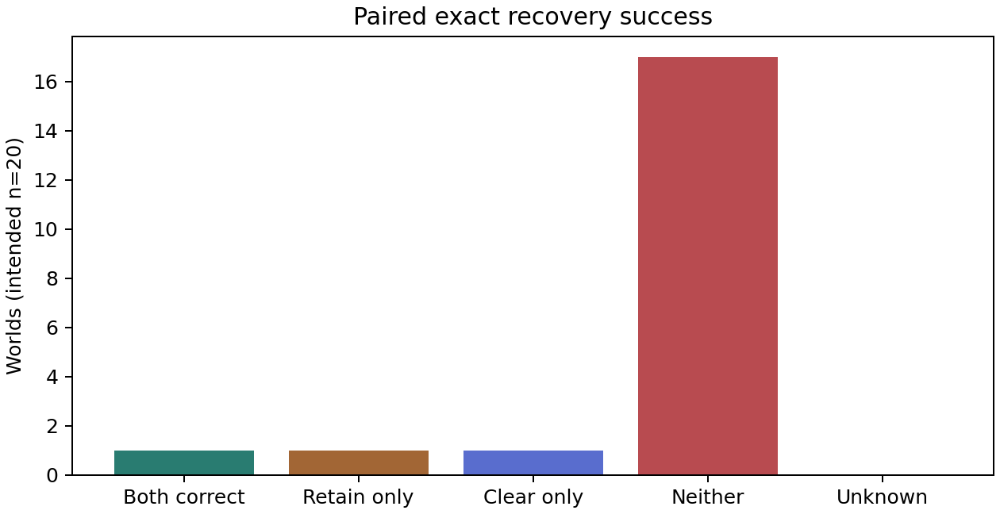
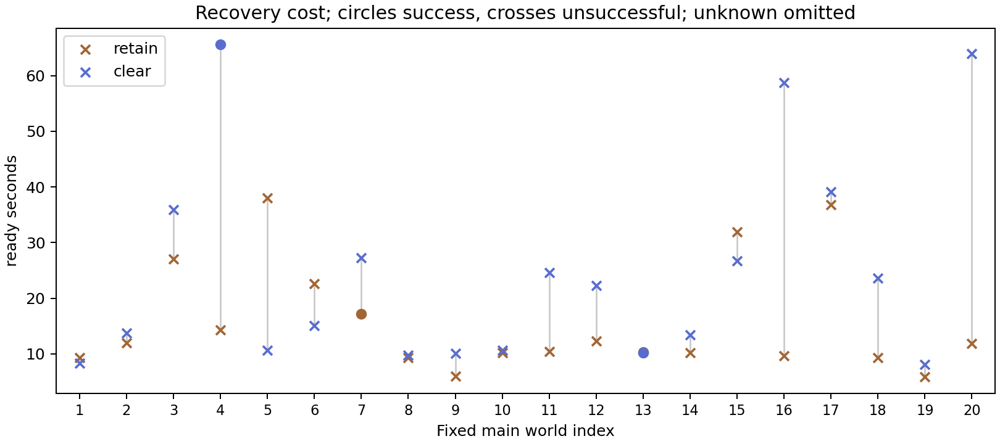

# Retaining or clearing collaborative history after a source revision

## Course-7: audited results and material for the final course report

**Analysis date:** 15 October 2026. **Verdict:** the fresh Run All completed the
entire intended experiment, including all **20 paired main worlds**. Retain and
clear each achieved **2/20 exact team successes (10%)**. Execution succeeded;
collaborative task performance was weak. The observed success difference is zero,
which does not establish equivalence or the absence of a history effect.

This document follows the six recommended report sections. Sections 1–6 contain
report material and interpretation; the appendices provide the complete world
table, provenance, audit procedure and guidance on responsible claims. It is an
analysis of the supplied run, not a new experiment or a scientific amendment.

Evidence: the original [executed notebook](../../notebooks/run/course-7-working/multi-agents-course-v5nb.ipynb)
and [final checkpoint](../../notebooks/run/course-7-working/latest.zip).
The [machine-readable audit](../../notebooks/validation/i01-course7-analysis/audit.json),
[world table](../../notebooks/validation/i01-course7-analysis/main-worlds.csv),
[call audit](../../notebooks/validation/i01-course7-analysis/team-call-audit.csv)
and [cost table](../../notebooks/validation/i01-course7-analysis/main-costs.csv)
are derived from the two canonical SQLite stores. Original evidence is unchanged.
The scientific authority remains [specification §12](../../PROJECT_SPECIFICATION.md#12-adopted-i-01-course-regime).

## 1. Abstract

Distributed language-model agents must coordinate using partial information and
revise earlier conclusions when their sources change. This project evaluates
whether retaining or clearing visible collaborative history changes recovery
after a factual revision. We implement a controlled extension of SILO-BENCH
I-01 Global Max: two agents each receive twenty private integers, collaborate,
and then encounter a revision that invalidates the original maximum. Twenty
fixed main worlds produce paired continuations with identical revised sources,
matched sampling seeds and bounded communication opportunities. Qwen3.5-9B runs
in direct mode with NF4 quantization on two Kaggle Tesla T4 GPUs. The complete
workflow finishes in approximately 34.5 minutes and consumes 252 physical model
attempts, below its 500-attempt ceiling. Both policies achieve exact team success
on 2/20 worlds; the clear-minus-retain difference is zero percentage points,
with an exploratory stratified paired bootstrap interval of −10 to +10 points.
Retain repeats the obsolete maximum in ten worlds, whereas clear never submits
it, but clearing introduces other reasoning and coordination failures. Retain
uses less recovery effort: 15.73 versus 24.89 ready-model seconds per world.
All scientific replies are valid JSON, yet sixty actions violate protocol
semantics. These findings demonstrate a reproducible recovery experiment and
show why output validity, coordination, source updating, correctness and cost
must be evaluated separately. The small sample and low baseline success limit
claims about general policy superiority.

## 2. Introduction

### 2.1 Problem, objective and motivation

An agent can have an accurate current source while its conversation still
contains conclusions derived from an older source. This creates a practical
recovery problem: preserving history can retain useful work and remote
information, but it can also preserve claims that have become false. Restarting
with an empty history removes those claims and also removes potentially useful
coordination. Which behavior is preferable is an empirical question.

The project studies this tension in a deliberately small distributed computation.
The maximum of forty integers is exactly checkable, so evaluation does not need
an LLM judge or subjective answer scoring. Partitioning the numbers between two
agents creates an information boundary: a locally correct maximum is not enough
when every agent must submit the global maximum. Lowering the unique winning
record then makes the old global answer unambiguously incorrect.

The principal question is: **under the frozen model, protocol, resources and
world distribution, how does clearing rather than retaining the pre-revision
visible history change exact team success?** A second question concerns the
effort required to obtain those outcomes. Trace analysis examines observable
stale submissions, illegal actions, local computation and communication failures.

The contribution is a bounded, inspectable recovery comparison with paired
worlds, explicit private views, durable raw replies, exact evaluation and honest
failure accounting. It is not a demonstration that a global maximum requires an
LLM: ordinary code solves this task trivially. The simple mathematics makes the
behavior of the distributed language-model system easier to investigate.

### 2.2 Positioning and scope

The experiment is a **controlled recovery extension of SILO-BENCH I-01**, not an
unmodified SILO-BENCH evaluation. Its original integer task and private shards
are retained, while source revision, bounded JSON actions and paired history
policies are added. This scope separates a recovery question from a broad
benchmark leaderboard claim. The authoritative design and implementation
settings were fixed before this run's main outcomes were collected.

The intervention is a **total visible-history policy**. Clearing removes both
obsolete and useful messages; retaining preserves both. Consequently, the
comparison cannot isolate psychological anchoring, pure misinformation effects,
or the effect of transcript length alone. Nor does it compare multi-agent
systems against a matched-cost centralized algorithm or establish benefits from
adding more agents.

## 3. Related work

The following primary papers were checked directly for this analysis. Their
results motivate comparisons of methods and failure mechanisms; their numerical
scores are not interchangeable with this experiment's team success rate.

| Work | Relevant contribution | Relationship to this project |
|---|---|---|
| Zhang et al. (2026), *Silo-Bench: A Scalable Environment for Evaluating Distributed Coordination in Multi-Agent LLM Systems* | Algorithmic tasks with private information and autonomous communication | Direct task origin; this project adds an explicit source revision and paired recovery policies. |
| Laban et al. (2025), *LLMs Get Lost In Multi-Turn Conversation* | Studies reliability as information arrives across conversation turns | Motivates examining dependence on earlier conclusions; its conversational task setup differs from private-source revision. |
| Cemri et al. (2025), *Why Do Multi-Agent LLM Systems Fail?* | A taxonomy of failures in multi-agent traces | Helps distinguish specification following, inter-agent coordination and verification; our labels are narrower observable indicators. |
| Du et al. (2023), *Improving Factuality and Reasoning in Language Models through Multiagent Debate* | Multiple model instances exchange and revise proposed answers | Provides a useful contrast to phase-final submissions and shows why agreement should be evaluated separately from truth. |

**SILO-BENCH.** Zhang et al. investigate distributed computation across private
shards and identify failures in integrating communicated information. Their
benchmark includes Global Maximum. Our private-shard setting follows that
motivation, but our twenty paired worlds, small direct-mode model, revision,
turn limit and exact-team metric differ from their broader evaluation. The
paper's agent-oriented success summaries must not be equated with our
requirement that both agents answer correctly. The comparison is methodological,
not a replication of their reported scores.
[Paper, version 2](https://arxiv.org/html/2603.01045v2)
and [pinned I-01 generator](https://github.com/jwyjohn/acl26-silo-bench/blob/e74127782ed1c42fff474249961f022c063d76f2/benchmark_generator/paradigm_i.py#L53).

**Multi-turn reliability.** Laban et al. find that models can prematurely commit
to assumptions and rely on earlier answer attempts as conversation unfolds.
This motivates checking whether an obsolete answer survives a factual update.
Our `main-03` trace provides a concrete stale-answer example, but the project
does not reproduce their task distribution or estimate the same degradation
quantity. Here the authoritative data change; the agent must recover while
working with only a private shard.
[Paper](https://arxiv.org/html/2505.06120v1).

**Multi-agent failure analysis.** Cemri et al. organize observed failures into
system design, inter-agent misalignment and task verification categories. Their
taxonomy includes premature termination and incomplete verification, which are
useful lenses for our traces. Our automatic labels are not validated MAST
annotations: an illegal action, wrong submission or stale integer is directly
observable, whereas a root cognitive explanation requires stronger evidence.
No inter-rater agreement statistic or human-validated taxonomy result is claimed
for this run.
[Paper, version 3](https://arxiv.org/html/2503.13657v3).

**Multi-agent debate.** Du et al. study repeated exchange and revision of
candidate answers, finding benefits in their tasks but also cases of convergence
on incorrect answers. Our agents instead make irreversible submissions within
each phase. This distinction matters: a message containing a correct maximum
cannot repair an already finalized wrong answer. In our data, incorrect
consensus occurs under both policies. That is consistent with the need to
separate agreement from correctness, without being a direct test of their
debate method.
[Paper](https://arxiv.org/html/2305.14325v1).

The project's distinct question is therefore **recovery after a known source
change under controlled history retention**, connecting multi-turn reliability
and distributed coordination in a small, exactly scored environment.

## 4. System, methods and experiment

### 4.1 Dataset construction and factual revision

Each world begins with two shards of twenty integers sampled uniformly from
−1000 through 1000. Eligible worlds have a unique original global maximum, and
the maximum of the remaining 39 records is above the lower boundary. A fixed
owner/first-speaker stratum is also enforced during mathematical proposal
generation. These eligibility rules do not inspect model answers.

The original winning record is replaced by an integer sampled from −1000 to one
below the maximum of the remaining records. Thus exactly one source record
changes, and the revised answer is certainly different from the old answer.
The replacement is **not** generally the new maximum. In the main set, the
revised winner lies in the other agent's shard in 14 worlds and remains in the
edited agent's shard in six. Those outcomes are properties of the fixed worlds,
not post-run selection criteria.

The manifest contains six qualification worlds, three disjoint pilot worlds and
twenty main worlds. Main worlds have five observations in each combination of
edited owner {0,1} and first speaker {0,1}. The master seed is `2026101401`.
World data, revisions, device assignment, treatment order and per-call seeds are
saved before outcomes. All 29 worlds regenerate exactly from that configuration.

### 4.2 What each agent sees

The permitted input contains its agent ID, current private shard, invocation
number, whether its partner has finished, and its own visible history. The
revision notice identifies the edited owner and record. Only the edited owner
receives the new record value in that notice; the partner may learn it later
through a delivered message. Evaluator truth, the other private shard, hidden
submission values, future edits and policy labels are excluded.

In retain, each agent receives its literal saved visible action/message history
from the original phase. In clear, that history is empty. Both continuations
receive the revised private source, factual notice and fresh phase state.
Their sampling seeds match by agent and invocation index. They do not share
KV caches, recurrent state, newly generated sibling messages or submission state.
Retained history is visible text and action records, not persistent hidden
reasoning or a live conversation cache.

The audit replayed every eligible call, reconstructing the permitted view and
rendered system/user messages, checking saved seeds/settings and applying the
recorded action. All final episode states match. This verifies host-provided
information boundaries; it does not certify that model-generated claims are true.

### 4.3 Protocol, termination and qualification

Each reply must contain exactly `message`, `submit` and `wait`. Messages are
nonempty strings or null; submissions are strict integers or null; wait is a
boolean. A waiting action must have null message and submission. An empty
nonwaiting action is illegal. A valid action may message and submit together.

Each agent has at most three invocations per phase. Submissions are private
unless explicitly communicated and are final within that phase. The scheduler
delivers legal messages between calls; a new message wakes a waiting agent.
Invalid actions consume the invocation, deliver no message or submission and
receive only bounded generic feedback. The host neither corrects wrong answers
nor repairs contradictory actions. A phase ends when both submit or the
remaining agents cannot act because of waiting or exhausted turns. A source
revision reopens submissions in a new phase. Unused turns are not transferred.

The adopted admission policy is
`i01-recorded-outcomes-run-all-2026-10-15`. The twelve direct qualification
controls must produce legal scalar-only actions; arithmetic correctness is
diagnostic. Subsequent ordinary pilot and main protocol mistakes and terminal
noncompletion are recorded outcomes. Runtime, isolation, source, accounting,
headroom, terminal evidence and resource checks remain blocking requirements.
Therefore **passing a pilot check means its required evidence is usable, not
that its team solved the task**. All three pilot checks pass despite their
unsuccessful teams. This is the intended repaired behavior of this policy.

### 4.4 Model, software and resources

| Item | Executed setting/evidence |
|---|---|
| Model | `Qwen/Qwen3.5-9B` |
| Model revision | `c202236235762e1c871ad0ccb60c8ee5ba337b9a` |
| Model class / quantization | Text-only `Qwen3_5ForCausalLM`; NF4 double quantization with FP16 computation |
| Mode | Direct/nonthinking throughout; no fallback or thinking comparison in this run |
| Sampling | Temperature 0.7; top-p 0.8; top-k 20; repetition penalty 1; presence penalty 0; sampling enabled |
| Limits | 8,192 input tokens; 512 generated tokens; at most three calls per agent per phase |
| Input handling | Native chat template; explicit permitted views; no truncation of scientific inputs |
| Hardware | Two Tesla T4 GPUs, inventory reports 15,360 MiB each; driver 580.178.04 |
| Runtime | Linux x86-64; Python 3.13.15; PyTorch 2.11.0+cu128; CUDA 12.8 |
| Main libraries | Transformers 5.12.0, Accelerate 1.14.0, bitsandbytes 0.49.2, tokenizers 0.22.2, huggingface-hub 1.19.0 |
| Attention / recurrent path | Repository T4-compatible SDPA path; recorded `recurrent_fast_path=False` |
| Experiment controller | Reusable Python stage/state-machine modules; two canonical SQLite stores; ordinary notebook cells |
| Source checkpoint | `65462e1e5fc687e1107d80a152e7d6c638ed93b7` |
| Sampling / uncertainty seeds | Master `2026101401`; bootstrap `2026101402` |
| Resources | Independent fresh-study ceiling 500 physical attempts, with contingency ceiling 28 |

Two resident model replicas serve **different worlds in parallel**. Both logical
agents of a given world use the same GPU sequentially; the GPUs are not assigned
one per agent. Retain and clear of a world remain on that same GPU. Ten main
batches each contain two worlds, one per device. This preserves paired device
conditions while allowing inter-world parallelism.

Treatment order alternates by world parity, and device assignment also follows
parity. Thus device and treatment order are coupled across worlds. Pairing
reduces direct device confounding of the policy contrast, but the run cannot
separately estimate device effects and order effects. Cache isolation also does
not eliminate hardware warm-up, contention or timing-order effects.

### 4.5 Workflow, durability and analysis populations

The executed notebook has 33 code cells with consecutive execution counts and
no recorded notebook exception. It completes installation, source-bound
initialization, lightweight implementation checks, weight acquisition, resident
loading, state diagnostics, qualification, direct resource-envelope testing,
three pilots, admission/freeze, ten main batches, reporting, checkpoint
verification and session closure.

The plan is recorded before model calls; the main freeze is recorded at
`2026-10-15T17:57:54.267336+00:00`, before the first main batch. Previous course
runs informed implementation and admission repairs. This is therefore an
exploratory study after development on earlier diagnostic/pilot evidence, not an
untouched preregistration made before any project data existed. No earlier
results or checkpoints are imported into this cohort, and previous runs are not
pooled into its denominators.

Raw outcomes, attempt accounting and committed state are saved in the canonical
stores; reports and ZIP exports derive from them. A final `controller-close`
checkpoint contains the complete run and matching source. Both inference
processes have confirmed termination. The local analysis validates that snapshot
and replays saved effects without resampling. It does not test resumption of
this completed run on a new live Kaggle session, provider GPU release or the
operator's earlier checkpoint downloads.

### 4.6 Evaluation metrics and uncertainty

For world $w$ and policy $p$, define

$$
Y_{wp}=\mathbf{1}\{s_{w0p}=s_{w1p}=\max(D'_w)\},\qquad
\widehat\Delta=\frac1{20}\sum_w(Y_{w,clear}-Y_{w,retain}).
$$

The primary unit is a **paired world**, not an individual agent, call, token or
message. A terminal wrong or incomplete team scores zero. A missing/unexecuted
episode would remain unknown; none is missing in the main population. The
primary denominator remains all twenty intended worlds regardless of prefix
success, protocol errors or centralized control correctness.

The prescribed exploratory 95% percentile bootstrap uses 10,000 draws, resampling
paired worlds within the four owner/first-speaker strata with five worlds per
stratum. The same pairing is used for the principal effort contrast: clear
minus retain post-revision ready-model seconds. The main outcome and effort
intervals were independently reconstructed from saved records.

Ready-model time measures a call after the resident model is ready. It excludes
initial loading and many notebook/controller operations. Calls, input/generated
tokens and valid messages provide complementary effort measures. Physical
accounting charges the shared original prefix once; a logical end-to-end policy
includes that prefix as well as its own recovery continuation. Neither measure
is a billable GPU-hour or energy estimate.

Correct-prefix subsets, per-agent correctness, strata, stale submissions and
case explanations below are descriptive diagnostics. They do not replace the
primary estimand or constitute additional confirmatory hypothesis tests.

## 5. Results, interpretation and lessons

### 5.1 Was the run successful?

| Dimension | Finding | Interpretation |
|---|---|---|
| Notebook | All 33 code cells executed; zero saved exceptions | The end-to-end workflow completed. |
| Integrity | All 160 inventoried payload files verified; both SQLite integrity checks pass | The supplied checkpoint is internally consistent. |
| Identity | 49 scientific-source hashes, 98 release members and 46 wheel Python members match | The run is bound to the delivered implementation. |
| Reproducibility | All 29 worlds regenerate; 206 team calls and 38 controls replay; complete saved analysis reconstructs exactly | Recorded outcomes and host effects are auditable without new inference. |
| Main coverage | 20/20 prefixes, 20/20 retain, 20/20 clear and 20/20 revised controls | No main outcome is unexecuted or missing. |
| Runtime | No provider failures, scientific truncation, framing failure, retries or unfinished attempts | The recorded poor answers are not disguised missing calls. |
| Closure | Both model processes confirm termination; final export is `controller-close` | Local worker lifecycle completed; provider allocation release remains unmeasured. |
| Scientific task | 10% exact team success under each recovery policy | Most teams failed to compute the required shared answer. |

The experiment is successful as an executed research procedure. A claim of high
model reliability or a winning recovery policy would be unsupported.

### 5.2 Qualification and pilots

Direct qualification records twelve legal and committed control actions, ten
correct and two incorrect. Both mistakes occur in `qualification-03`: the
original truth is 951 and revised truth 920, but the model returns 788 in both.
The observed accuracy is 10/12 = 83.3%; the qualification pass establishes the
specified scalar protocol requirement, not general reasoning competence.
Thinking has zero admitted calls in this run. Its unexecuted twelve controls
are **not** a measured 0/12 accuracy result.

| Pilot | Original exact team | Retain exact team | Clear exact team | Original/revised full-input controls | Illegal actions | Objective check |
|---|---:|---:|---:|---:|---:|---|
| `pilot-00` | 0 | 0 | 0 | 2/2 correct | 2 | Passed |
| `pilot-01` | 0 | 0 | 0 | 2/2 correct | 2 | Passed |
| `pilot-02` | 0 | 0 | 0 | 2/2 correct | 3 | Passed |

All original pilot teams submit both answers, but none has both correct. Across
the recovery phases, one retain team exhausts its horizon and one clear team
deadlocks; the other pilot continuations finish with wrong answers. Seven
illegal actions remain in the data. Allowing those ordinary scientific failures
to remain outcomes lets the fixed main cohort run instead of selecting only
fortunate pilot behavior.

Canonical annotations remain empty and the checkpoint says
`human_review='retrospective_pending'`. This document supplies a retrospective
trace analysis. It does not retroactively record that an operator reviewed
pilots during execution or that two independent human annotators agreed.

### 5.3 Primary paired recovery result

| Paired outcome | Worlds | Share |
|---|---:|---:|
| Both policies correct | 1 (`main-12`) | 5% |
| Retain only correct | 1 (`main-06`) | 5% |
| Clear only correct | 1 (`main-03`) | 5% |
| Neither correct | 17 | 85% |
| Unknown | 0 | 0% |

Retain succeeds in `main-06` and `main-12`; clear succeeds in `main-03` and
`main-12`. Each is correct on **2/20 = 10%**. The contrast **clear − retain is
0 percentage points**, with the prescribed exploratory 95% paired stratified
bootstrap interval **[−10, +10] percentage points**. Missingness bounds are
[0,0] because every outcome is known, not because policy uncertainty disappears.



*Figure 1. The original checkpoint's paired outcome figure, copied without
alteration. Seventeen failures shared by both policies dominate the sample.*

Only two worlds are discordant, so there is very little information about which
policy improves exact success. The bootstrap describes variation in this small
observed sample under its stated resampling scheme. It is not an equivalence
test, does not include uncertainty over other models/protocols, and may have
limited small-sample coverage. Zero observed difference must not become “history
does not matter.” The policies reach the same aggregate success rate through
different errors and different successful worlds.

### 5.4 Original phases, subgroups and centralized controls

The original main prefix succeeds exactly in three worlds:
`main-00`, `main-03` and `main-09` (**3/20 = 15%**). Eleven prefixes reach two
submissions; seven end in waiting deadlock and two exhaust the horizon. This
weak initial collaboration is a major limitation for a study intended to
investigate recovery from previously established conclusions.

| Descriptive subset | Worlds | Retain successes | Clear successes | Clear − retain |
|---|---:|---:|---:|---:|
| Correct original team | 3 | 0/3 | 1/3 | +33.3 pp |
| Incorrect/incomplete original team | 17 | 2/17 | 1/17 | −5.9 pp |
| All intended main worlds | 20 | 2/20 | 2/20 | 0 pp |

All three correct-prefix worlds repeat the old answer under retain. Clear
recovers in `main-03`, but fails in the other two. The saved conditional
bootstrap interval is [0, +66.7] pp. With only three cases distributed across
two occupied strata, this is a highly discrete, fragile descriptive interval;
it cannot establish a general advantage for reset. Restricting the primary
analysis to these three worlds would discard most of the intended experiment.

The four fixed main strata show the following exact counts:

| Edited owner | First speaker | Worlds | Original correct | Retain correct | Clear correct | Revised control correct |
|---:|---:|---:|---:|---:|---:|---:|
| 0 | 0 | 5 | 2 | 0 | 1 | 4 |
| 0 | 1 | 5 | 1 | 1 | 0 | 3 |
| 1 | 0 | 5 | 0 | 1 | 1 | 4 |
| 1 | 1 | 5 | 0 | 0 | 0 | 4 |

These small cells are not sufficient for reliable claims about owner or
first-speaker effects. Their purpose is to document design balance and prevent
an aggregate result from hiding where the few successes occurred.

Main revised full-input controls are correct on **15/20 = 75%**. Wrong controls
are `main-03`, `main-07`, `main-09`, `main-10` and `main-16`. Thus arithmetic/input
interpretation is imperfect even without distributed information. The control
receives all forty revised integers and a simpler scalar-only prompt; it is a
task-feasibility diagnostic, not a matched-cost causal baseline for the benefits
of multi-agent collaboration. No original main controls were scheduled, so their
absence is intentional and should not be reported as zero accuracy.

Notably, clear succeeds in `main-03` even though its revised control is wrong.
Across the fifteen correct-control worlds, retain succeeds twice and clear
once; across the five wrong-control worlds, clear succeeds once and retain
never. This prevents treating control correctness as a deterministic label of
whether a team can solve a world, or filtering the main set on that basis.

### 5.5 JSON validity, protocol legality and actual completion

Every one of the **244 scientific calls** has valid JSON and correctly typed
fields. Only **184/244 = 75.4%** are legal actions. The remaining sixty have
contradictory or empty action semantics; none requires an invalid-JSON parser
explanation. Eight hardware probes are excluded from these denominators.

| Population / phase | Calls | JSON and schema valid | Legal actions | Illegal actions |
|---|---:|---:|---:|---:|
| Qualification controls | 12 | 12 | 12 | 0 |
| Pilot prefix | 12 | 12 | 8 | 4 |
| Pilot retain | 9 | 9 | 8 | 1 |
| Pilot clear | 8 | 8 | 6 | 2 |
| Pilot controls | 6 | 6 | 6 | 0 |
| Main prefix | 82 | 82 | 40 (48.8%) | 42 |
| Main retain | 44 | 44 | 42 (95.5%) | 2 |
| Main clear | 51 | 51 | 42 (82.4%) | 9 |
| Main revised controls | 20 | 20 | 20 | 0 |
| All scientific calls | 244 | 244 | 184 (75.4%) | 60 |

Fifty-eight invalid actions combine `wait: true` with a message. Two are empty
nonwaiting actions: `main-01/retain/agent-1/invocation-0` and
`main-05/clear/agent-1/invocation-1`. The label `malformed_action` therefore mostly
means **a protocol contradiction inside valid JSON**. The readable text in an
invalid message was saved for inspection but was not delivered to the partner.

For example, an agent writes that it will send its maximum and wait, but encodes
both the message and `wait: true`. A reader might regard that as sensible
natural-language coordination. The frozen protocol explicitly requires a
message action with `wait: false`, followed by waiting separately if needed.
The evaluator correctly rejects the contradictory action. Silently delivering
its message afterward would change the experiment and incorrectly improve its
outcomes. This mismatch is a concrete target for a future interface experiment.

| Main phase | Both submitted | Waiting deadlock | Horizon exhausted | Worlds with any illegal action | Exact team successes |
|---|---:|---:|---:|---:|---:|
| Original prefix | 11 | 7 | 2 | 15 | 3 |
| Retain | 20 | 0 | 0 | 2 | 2 |
| Clear | 19 | 0 | 1 | 6 | 2 |

Retain improves recorded action legality and procedural completion relative to
clear in this sample, but those improvements do not translate into more exact
team successes. Call-level percentages also have endogenous denominators:
errors, waiting and early submissions change how many calls a phase needs.
Calls should not be treated as independent Bernoulli observations for a policy
significance test.

### 5.6 What kinds of errors occurred?

The following descriptive counts are computed from exact final submissions and
call order. They overlap and must not be summed into an exclusive taxonomy.

| Observable main recovery diagnostic | Retain | Clear |
|---|---:|---:|
| Correct individual agents, out of forty intended agent answers | 12/40 (30%) | 16/40 (40%) |
| Worlds with at least one correct agent | 10/20 | 14/20 |
| Worlds with both correct agents | 2/20 | 2/20 |
| Worlds submitting the obsolete original maximum | 10/20 | 0/20 |
| Individual submissions of that obsolete maximum | 14 | 0 |
| Individual submissions below the agent's own current local maximum | 6 | 11 |
| Individual submissions equal to the replacement record value | 2 | 8 |
| Wrong but matching team submissions | 5 worlds | 4 worlds |
| First recovery call already makes a final submission | 18/20 worlds | 14/20 worlds |

**Stale conclusions are a visible retain-specific failure in this cohort.** All
fourteen obsolete submissions exceed the revised global maximum and are
therefore certainly wrong. Ten are made by the agent whose source was edited;
four by its partner. This is stronger evidence of an observable stale-answer
pattern than merely finding an old value quoted in a transcript: quoting old
history is expected under retention, while submitting it is an outcome.

**Removing stale answers is insufficient.** Clear has no obsolete submissions,
yet only two successful teams. Eleven clear submissions are smaller than a
number already in that agent's current private shard, proving a failure that
does not require access to the partner's hidden data to diagnose. Eight clear
submissions equal the replacement record, which the generator guarantees is
below the true revised maximum. The transcripts often confuse a revision notice
with a partner submission or treat the edited value as the answer. These are
observable associations and case interpretations, not proof of a universal
internal mechanism.

**Local correctness is insufficient.** Agents often submit their own local
maximum and finish before both agents have established the global maximum.
Other traces explicitly mention a larger partner value but still submit a
smaller local value. Messages sent together with a final submission cannot
repair that sender's answer. Valid-message counts alone therefore do not measure
effective coordination.

**Agreement is insufficient.** Retain reaches identical wrong submissions in
five worlds and clear in four. Combining those with the two correct-consensus
worlds per policy shows why consensus is not the primary success metric.

**Correct outputs need not imply a sound explanation.** Even successful traces
contain false role descriptions or incorrect claims about what the partner
submitted. Exact output scoring remains appropriate for the frozen objective;
trace analysis supplies the process caveat rather than changing success labels.

### 5.7 Call-linked case studies

These are retrospective analyst interpretations. Exact prompts and raw replies
remain in the checkpoint's `reports/conversations.html`, `.txt` and `.jsonl`;
the derived call CSV preserves all team replies. The IDs below locate the cases.

**`main-03`: resetting removes a visibly stale successful solution.** The source
edit is agent 0, record 7: 993 → −489. Current local maxima become 783 and 822,
so the revised global answer is 822. The original team correctly submits
[993,993]. Under retain, both agents submit 993 again, including a message
reasserting that 993 is the global maximum. Under clear, agent 0 first attempts
an illegal message-plus-wait action, whose message is discarded. Agent 1 then
sends a legal message containing its shard and maximum 822. Agent 0 submits
822, followed by agent 1. Clear succeeds despite the initial protocol mistake.
The explanatory language is imperfect: agent 0 calls 822 its own shard maximum,
although its actual local maximum is 783. This is a good example of successful
answer recovery with an unreliable explanation.

Key calls: `main-03/retain/agent-0/invocation-0`,
`main-03/retain/agent-1/invocation-0`,
`main-03/clear/agent-1/invocation-0`,
`main-03/clear/agent-0/invocation-1`.

**`main-06`: retaining history can also coincide with successful coordination.**
The edit is 977 → 905 in agent 0's shard; the new global maximum is 926 in
agent 1's shard. The original phase deadlocks with two legal waits and no
messages. Retain produces [926,926]: agent 1 sends and submits 926; agent 0
uses that delivered claim, notes its own current 905, and submits 926. Agent 1's
message incorrectly attributes 926 to both shards, but the final outputs are
right. Clear begins with an illegal message-plus-wait action from agent 1.
Agent 0 then submits 905 without receiving the withheld message, and agent 1
later submits 926. Finality prevents repairing [905,926]. Importantly, this
retain-only success is **not** evidence that useful old factual messages were
preserved: the prefix contained only waits. It is a history-conditioned behavior
difference with matched seeds and different permitted text.

Key calls: `main-06/retain/agent-1/invocation-0`,
`main-06/retain/agent-0/invocation-0`,
`main-06/clear/agent-1/invocation-0`,
`main-06/clear/agent-0/invocation-0`.

**`main-12`: both policies can recover after an unsuccessful prefix.** The edit
is agent 1's 997 → 142. Its revised local maximum is 548; agent 0 holds the
global maximum 983. The prefix deadlocks. Both continuations produce [983,983]
with two legal message/submission actions. Agent 1 copies a message claiming
“My shard max is 983,” although 983 is in agent 0's shard. The global answer is
correct and the action is legal; the model's accompanying source attribution
is wrong. Identical outputs across these continuations do not indicate illegal
cross-sibling reuse: requests, seeds, separate call records and literal state
replay match the prescribed execution.

Key calls: `main-12/retain/agent-0/invocation-0`,
`main-12/retain/agent-1/invocation-0`,
`main-12/clear/agent-1/invocation-0`.

**`main-00` and `main-09`: stale answers disappear without successful teams.**
Both prefixes are exactly correct and both retain siblings repeat the obsolete
answer twice. In `main-00`, 894 → 753 leaves truth 872. Clear returns [753,872]:
one agent submits the edited record while its partner has the global answer.
In `main-09`, 999 → 283 leaves truth 933. Clear instead returns [97,97], with
claims about a partner maximum of 5, the revision's record index. The trace
supports confusion between notice metadata and task data; it does not reveal
an internal reasoning state. Clearing removes the stale solution but does not
supply a reliable replacement coordination procedure.

Key calls: `main-00/clear/agent-0/invocation-0`,
`main-09/clear/agent-1/invocation-0`,
`main-09/clear/agent-0/invocation-0`.

**`main-04`: knowing the global answer in prose can still yield a wrong action.**
In retain, agent 0's final message states that its own maximum is 943, the
partner has 959, and “the global maximum is 959.” It nevertheless submits 943
to complete its turn. Agent 1 submits 959, producing [943,959]. This is a clear
reasoning/action mismatch observable in the record; simply allowing more
generated prose would not necessarily solve it. Clear returns [629,629], the
replacement value, showing a different route to failure.

Key call: `main-04/retain/agent-0/invocation-1`.

**`main-05`: a recorded incomplete phase is not missing data.** Clear ends at
the invocation horizon with [915,null] after an empty nonwaiting action and
waiting behavior. The exact team outcome is zero, with all executed replies
and the terminal state present. No imaginary extra call is imputed and no
earlier candidate is inherited for the missing submission.

Key calls: `main-05/clear/agent-1/invocation-1`,
`main-05/clear/agent-1/invocation-2`.

### 5.8 Effort, time and physical accounting

| Main phase, twenty worlds each | Calls | Input tokens | Generated tokens | Valid messages | Total ready-model seconds | Mean seconds/world | Median seconds/world |
|---|---:|---:|---:|---:|---:|---:|---:|
| Shared original prefix | 82 | 29,609 | 5,246 | 21 | 648.15 | 32.41 | 34.26 |
| Retain recovery | 44 | 20,319 | 2,434 | 33 | 314.66 | 15.73 | 11.15 |
| Clear recovery | 51 | 20,350 | 4,077 | 37 | 497.80 | 24.89 | 18.70 |

Clear uses **9.16 additional ready-model seconds per world on average**. The
paired exploratory 95% stratified bootstrap interval is **[1.96,17.12] seconds**.
Retain's observed mean is approximately 36.8% lower than clear's. This is a
sample-specific effort finding under the measured runtime, not an inference
about energy or universal speed. Retain often ends quickly with a wrong stale
answer, so lower cost must be presented alongside its 90% team failure rate.

Retain averages 2.20 recovery calls and 121.70 generated tokens per world;
clear averages 2.55 calls and 203.85 generated tokens. Total recovery input
tokens are almost identical despite the retained histories: clear's additional
calls and longer replies offset retain's longer individual inputs. The simple
prediction that “retaining history must cost more tokens/time” is not supported
by these recorded totals.



*Figure 2. Original per-world effort figure. Positions 1–20 correspond to
`main-00`–`main-19`. Lines join the same world's policies. Circles identify exact
success and crosses unsuccessful recorded outcomes. Larger cost does not
consistently correspond to correctness.*

| Physical accounting category | Attempts |
|---|---:|
| Hardware/state and direct-envelope probes | 8 |
| Direct qualification | 12 |
| Three pilots, including controls | 35 |
| Main prefixes, both continuations and revised controls | 197 |
| **Total** | **252 / 500** |
| Contingency charges / retries / unfinished attempts | **0 / 0 / 0** |
| Unused ceiling | **248** |

Main accounting is 82 prefix + 44 retain + 51 clear + 20 control calls = 197.
The two logical policy trajectories would include 126 and 133 calls,
respectively, because each includes the shared 82-call prefix. Their sum is not
the physical charge: it counts that prefix twice. Historical spending is not
silently added to this explicitly independent fresh study.

Unused budget does not indicate an unfinished experiment. The cap is a ceiling,
not an instruction to generate more worlds or resample failed actions after
the fixed cohort is complete.

Recorded notebook timestamps run from `17:40:46.593762Z` to
`18:15:17.128233Z`: **2,070.53 seconds, or 34 minutes 30.5 seconds**, including
setup and final closure. Study initialization to final checkpoint is 30 minutes
33.5 seconds, a different interval. Installation takes approximately 231.24
seconds, weight acquisition 171.40 seconds, and the model-loading cell 123.22
seconds. Individual model loads sum to 119.03 seconds. The ten main cells span
approximately 16 minutes 50 seconds, including their exports and inspection
output. These measured durations should not be conflated with the conservative
pre-main forecast, which was a resource-admission estimate rather than a
promised completion time.

Across all physical calls, the run records **1,943.11 summed ready-model seconds**
and **15,472 generated tokens**. These sums include eight hardware probes;
scientific main calls alone use 1,505.35 seconds and 12,076 generated tokens.
Some calls execute concurrently, so summed call time can exceed the elapsed
time of the corresponding notebook stages. It is not an allocation duration.

### 5.9 GPU use, memory, warnings and what remains unmeasured

Both physical GPUs performed inference: slot 0 records 128 attempts, 7,909
generated tokens and 992.20 ready-model seconds; slot 1 records 124 attempts,
7,563 tokens and 950.91 seconds. Distinct process IDs and GPU UUIDs confirm the
two devices. Each worker exposes its assigned GPU locally as `cuda:0`, which
does not imply both processes used physical GPU 0.

The minimum sampled free memory / recorded conservative peak-free lower value
across calls is **7,275,872,256 bytes (about 6.78 GiB)**, above the 1.5 GiB gate.
Maximum recorded PyTorch peak reservation is **8,214,544,384 bytes (about
7.65 GiB)**. Allocator reservation, CUDA free memory and the inventory's VRAM
capacity are different measurements. These observations and the passed envelope
check support feasibility for this executed configuration, not arbitrary larger
contexts or thinking budgets. The longest scientific input is only 783 tokens.

The eight hardware probes include two deliberate 512-token length-terminated
envelope calls. They test capacity and are not failed/truncated scientific
answers. All 244 scientific outputs are untruncated and have no provider or
framing error. A/B/A readiness outputs match on both devices; recorded caches
start empty and are disposed after calls, and all recorded score checks are
finite. These are bounded runtime diagnostics, not proof of numerical identity
with every other inference stack or independent reproduction across machines.

The controller log contains Transformers `[ERROR]` messages about undocumented
output-class signature fields, a missing recurrent fast-path warning and a
bitsandbytes deprecation warning. They do not correspond to a stopped stage or
provider failure in this run. In particular, the runtime explicitly reports
`recurrent_fast_path=False` and uses its PyTorch fallback. The logs justify
documenting the execution path; they do not establish that the fallback caused
the observed answer errors or quantify a potential acceleration.

**The operator's recollection of approximately 50% GPU usage is unverified.**
There is no preserved time series sufficient to estimate time-weighted GPU
compute utilization for the experiment. The recollection might refer to
compute activity, memory occupancy or a momentary dashboard view. It must not
be reported as a measured average, used to halve GPU-hours, or turned into an
energy/cost estimate. Sequential autoregressive generation, finite per-world
work, different branch lengths, setup and exports can leave devices idle; these
are plausible contributors, not measured causal explanations. Resident memory
occupancy and genuine compute utilization must remain separate.

The notebook uses a disclosed 700-minute fresh-session planning bound based on
the reported approximately twelve-hour limit. It is labelled
`planning_estimate`; provider quota, actual allocation start, hard expiry and
release are not independently measured. The run comfortably completes within
its observed interval, but no precise provider GPU-hour or monetary charge is
available.

### 5.10 Limits and scientifically defensible interpretation

1. **Small sample and low outcome counts.** Only twenty world pairs and two
   discordant pairs support the primary comparison. General superiority,
   equivalence and robust subgroup interactions are not established.
2. **Weak original-team success.** Only three correct prefixes directly support
   studying preservation/revision of a previously correct shared answer. Most
   worlds instead measure recovery after already unsuccessful coordination.
3. **The intervention changes multiple useful and harmful history elements.**
   Retained facts, own actions, feedback, dialogue cues and text length move
   together. The total policy contrast does not identify a pure anchoring effect.
4. **One specific model/runtime/decoding configuration.** NF4, direct mode,
   bounded calls, custom T4-compatible inference and this prompt define the
   treatment context. No within-run thinking, precision or model comparison
   identifies why the model performed poorly.
5. **Protocol competence is conditional.** Scalar-only qualification passed,
   yet message/wait coordination frequently violated the protocol. Valid JSON
   alone cannot establish collaborative readiness or correctness.
6. **Retrospective development and annotation.** Earlier runs informed repairs.
   No independent human coding/reliability study was completed, and causal
   labels beyond observable record patterns remain interpretations.
7. **Timing and sampling scope.** Matched seeds reduce an avoidable difference
   but do not make different prompts produce the same randomness or outcomes.
   Device/order coupling, one runtime realization and no repeated timing trials
   limit conclusions about performance engineering.
8. **No deployment resilience or broad benchmark claim.** A verified portable
   snapshot and clean process closure do not empirically demonstrate every
   possible crash/restore scenario, provider release, or native benchmark score.

The strongest supported interpretation is: **retaining history preserved stale
answers and reduced observed recovery effort, while clearing removed those
stale submissions but did not improve aggregate exact team success because
other computation, protocol and coordination errors remained.**

### 5.11 Lessons learned and future extensions

The current cohort can be reported now. A new experiment is not needed to make
its negative/limited findings legitimate, and known wrong answers should remain
in its results. The following are proposed extensions, not implemented changes
or retroactive fixes to this dataset.

**First, finish the reporting and trace review using existing evidence.** Keep
the all-world primary table, paired outcome figure, effort comparison and the
contrasting `main-03`/`main-06` cases. Have an independent human reviewer check
call-linked descriptions if a human-coded taxonomy is desired. Preserve the
empty canonical annotation history unless actual dated annotations are added
through the intended workflow; do not describe this automated analysis as
completed human validation.

**Second, investigate the action interface on held-out development worlds.**
The dominant invalid behavior is simultaneous messaging and waiting. A future
version could make these actions less ambiguous through separate message/wait
tools, a single action-kind field, or schema-constrained generation. Each
changes the agent environment and may improve protocol success without
improving mathematical accuracy. It must receive a new declared configuration
and be evaluated on held-out worlds, rather than silently accepting the sixty
invalid historical actions or rerunning them until valid.

**Third, separate source updating from communication planning.** Clarifying
that a revision notice is not a partner message/submission is a motivated
prompt intervention. Explicitly teaching local-max exchange and agreement
before finality would be a stronger algorithmic scaffold. Both would change
the natural-coordination condition and should be labelled as new arms. A
deterministic non-LLM protocol baseline can verify task solvability without
being substituted for model behavior.

**Fourth, improve the evidence base before making stronger history claims.**
A new fixed cohort with more worlds and independent sampling seeds can improve
precision. If the goal is recovery from a correct shared solution, that target
population should be specified prospectively, with its feasibility assessed
without favorable post-run world replacement. A more protocol-capable fixed
model or scaffold may create more informative prefixes, but changing it is a
new scientific condition. Any larger study requires its own declared budget;
the unused 248 attempts are not automatic permission to expand this cohort.

**Fifth, isolate mechanisms in an explicitly redesigned study.** Additional
conditions could preserve correct remote facts while removing stale conclusions,
or use controlled transcripts with matched information content. These would
address mechanisms that the current retain/clear policy comparison cannot
separate. Post-hoc removal of only harmful history from these outcomes would
invalidate their original meaning.

**Finally, measure resources directly in a future run.** Preserve timestamped
GPU compute utilization, memory, CPU activity, inference boundaries and actual
provider allocation/release observations. Evaluate kernel or batching changes
separately from scientific prompting changes. Installing an untested fast-path
dependency into this frozen run is not an evidence-based explanation or repair
for its task failures.

## 6. Conclusion

The course-7 execution delivers a complete and auditable twenty-world paired
study of visible-history retention after a factual source revision. Its
recorded results reproduce from canonical data, fit within the attempt budget,
and distinguish terminal failures from unexecuted outcomes.

Retain and clear each achieve 10% exact team success. Retain repeats the obsolete
maximum in half the worlds and uses less recovery time. Clear eliminates those
obsolete submissions but still fails through other reasoning and coordination
errors. The observed zero aggregate success difference is inconclusive about
general policy superiority, especially with only three correct original teams.

The useful research finding is that reliable recovery requires several distinct
capabilities: legal actions, correct local computation, explicit communication,
respect for finality and revision of outdated conclusions. Valid JSON,
procedural completion, fluent explanations and consensus do not individually
guarantee a correct global answer. The final course report can present this
result as an exploratory, reproducible investigation with concrete failure
evidence and carefully bounded conclusions.

## Appendix A. Complete intended main-world results

Pairs are `[agent 0, agent 1]`; `null` means no final submission in a recorded
terminal episode. Every row has a known team outcome. `D` denotes waiting
deadlock, `H` horizon exhausted; all other listed pairs end with both submitted.
`R`/`C` identify exact retain/clear success, not merely agreement. Original
and revised full forty-integer data are available in the checkpoint manifest.

| World | Owner / first | Old → revised truth | Original submissions | Retain submissions | Clear submissions | Successful policy | Revised control correct |
|---|---|---|---|---|---|---|---|
| main-00 | 0 / 0 | 894 → 872 | [894,894] | [894,894] | [753,872] | Neither | Yes |
| main-01 | 0 / 0 | 936 → 910 | [null,null] D | [-152,-992] | [723,910] | Neither | Yes |
| main-02 | 0 / 0 | 957 → 914 | [null,null] D | [830,830] | [830,830] | Neither | Yes |
| main-03 | 0 / 0 | 993 → 822 | [993,993] | [993,993] | [822,822] | C | No |
| main-04 | 0 / 0 | 994 → 959 | [null,null] D | [943,959] | [629,629] | Neither | Yes |
| main-05 | 0 / 1 | 949 → 915 | [null,null] D | [915,870] | [915,null] H | Neither | Yes |
| main-06 | 0 / 1 | 977 → 926 | [null,null] D | [926,926] | [905,926] | R | Yes |
| main-07 | 0 / 1 | 917 → 880 | [null,null] D | [-721,669] | [-721,669] | Neither | No |
| main-08 | 0 / 1 | 965 → 960 | [965,928] | [965,928] | [948,928] | Neither | Yes |
| main-09 | 0 / 1 | 999 → 933 | [999,999] | [999,999] | [97,97] | Neither | No |
| main-10 | 1 / 0 | 937 → 918 | [758,937] | [937,937] | [867,867] | Neither | No |
| main-11 | 1 / 0 | 972 → 963 | [757,972] | [757,972] | [757,963] | Neither | Yes |
| main-12 | 1 / 0 | 997 → 983 | [null,null] D | [983,983] | [983,983] | R and C | Yes |
| main-13 | 1 / 0 | 982 → 953 | [737,982] | [737,982] | [737,953] | Neither | Yes |
| main-14 | 1 / 0 | 984 → 730 | [null,984] H | [461,730] | [461,730] | Neither | Yes |
| main-15 | 1 / 1 | 967 → 959 | [959,967] | [959,967] | [959,947] | Neither | Yes |
| main-16 | 1 / 1 | 919 → 916 | [916,919] | [916,895] | [916,895] | Neither | No |
| main-17 | 1 / 1 | 885 → 878 | [878,885] | [878,885] | [878,774] | Neither | Yes |
| main-18 | 1 / 1 | 908 → 848 | [848,908] | [848,908] | [848,333] | Neither | Yes |
| main-19 | 1 / 1 | 951 → 944 | [944,null] H | [944,875] | [944,875] | Neither | Yes |

## Appendix B. Provenance and exact audit scope

| Artifact / identity | Recorded value |
|---|---|
| Study ID | `b709c9bd-8d95-40c6-a19e-62a5f5e3c587` |
| Controller session | `a7bb7845-cf04-4efd-9b68-f74b9595cfaa` |
| Source commit | `65462e1e5fc687e1107d80a152e7d6c638ed93b7` |
| Final boundary | `controller-close` |
| Final checkpoint time | `2026-10-15T18:15:12.210624+00:00` |
| Original ZIP bytes | 2,878,097 |
| Original ZIP SHA-256 | `e4e2ce613dc8949ed6d5224e09bff19b96ee97f5d53065a80437e68b42cc4aca` |
| Executed notebook bytes | 4,067,407 |
| Executed notebook SHA-256 | `f88899ca4b21faf970684be2be6ffa3f1fb4d189e87abf993af1107616f260a6` |
| Canonical records | 252 calls and 252 completed first attempts; 107 terminal scientific episodes; two resident-load/session records |
| Scientific effects | 206 team-call effects plus 38 control effects committed; eight hardware probes are not scientific episode effects |
| Human annotation rows | Zero |

The release records untracked historical course-3 through course-6 folders in
its working-tree metadata. Those entries do not show that scientific source
was changed: every bound source hash and packaged Python file matches. The
analysis uses the final ZIP as canonical evidence rather than assuming an
unverified expanded directory is identical.

Reproduction, from the repository root with Python 3.11 or later:

```powershell
python scripts/audit_i01_course7.py
```

The [audit script](../../scripts/audit_i01_course7.py) temporarily extracts and
verifies the supplied ZIP, opens snapshots read-only, checks mathematical
invariants and deterministic manifest regeneration, verifies exact permitted
views/rendered messages/seeds/settings, replays all saved actions and compares
episode states. It checks scientific token-vector lengths, physical worker
binding, recorded cache/finite-state evidence, scalar controls and exact saved
analysis equality. It separately implements the paired outcome and effort
bootstrap reconstruction and checks notebook counts/timestamps. Input ZIP and
notebook hashes are checked before and after.

This is an executed-data audit, not another extensive CPU test campaign or new
model qualification. It does not load weights, rerun inference, retokenize the
native prompt template, establish independent kernel numerical equivalence, or
prove the temporal sequence of past writes from timestamps that were not
recorded. Successful replay confirms the recorded outcomes and their committed
effects are consistent with the frozen implementation. Existing raw traces,
source binding and prerequisite durability checks provide the complementary
evidence; these scopes should remain distinct.

Both processes record confirmed termination at approximately `18:15:02Z`, with
exit code −15. This is consistent with controller-requested termination on
session closure, not a mid-experiment model crash. The checkpoint is subsequently
written after both acknowledgements. Provider resource release and successful
restoration on a separate GPU session remain separate unmeasured claims.

## Appendix C. Using this material in the submitted report

Use the abstract, motivation, method, primary paired table, protocol table,
effort comparison, at least the contrasting `main-03`/`main-06` cases, limitations
and conclusion. The full twenty-world table and audit details can be appendices
or supplementary material. Retain the primary-paper links and distinguish
literature findings from this run's measurements.

Prefer these bounded formulations:

- “Both policies achieved 10% exact team success in twenty paired worlds; the
  sample did not establish a general success advantage.”
- “Retain repeated the obsolete maximum in ten worlds. Clear removed that
  behavior but did not improve aggregate team success.”
- “Retain used less observed post-revision ready-model time, often while
  finalizing an incorrect answer.”
- “The end-to-end implementation completed; model-level task performance
  remained weak.”

Avoid “reset solves stale memory,” “history has no effect,” “retention is more
intelligent,” “100% valid protocol,” “verified 50% GPU utilization,” “thinking
is worse in this experiment,” “human-validated failures,” or “native SILO-BENCH
score.” None is established by the supplied run.
