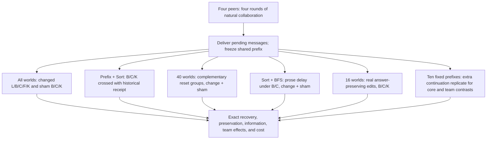

# Final scientific plan: recovery and useful state reuse in distributed LLM teams

**Definitive blueprint for the next specification rewrite · 4 October 2026**

Suggested study title: **Recovering Distributed LLM Teams After Information Changes: State Reuse, Historical Evidence, and Communication Effects**.

This document specifies the final research design to adopt when rewriting [PROJECT_SPECIFICATION.md](../../PROJECT_SPECIFICATION.md). It does not modify that specification or authorize inference execution. The existing specification remains the implementation authority until that rewrite occurs. This plan supersedes the *recommendations* in the two planning directories for that future rewrite, while preserving their evidence and limitations.

The central problem remains:

> A distributed team of LLM agents has already performed substantial collaborative work. Previously valid information then changes. How should the team recover while preserving useful previous work without allowing obsolete work to harm the revised result?

## 1. Final research decision

Build one controlled research program around **what the team retains, what the correction tells it, and how recovering peers influence one another**. These are connected aspects of the same recovery episode. Measure the resulting recovery process, preservation of correct work, and resource costs throughout.

Adopt the following design as the intended complete study:

- **Five live task families:** Top-K, Prefix Sum, Difference Array, Distributed Sort, and BFS Distance. Retain Global Max in the mathematical examples and evaluator checks, but remove it from the live matrix because Top-K already supplies the discarded-alternative phenomenon while supporting richer preservation measurements.
- **60 independent base worlds**, 12 per family, with one natural four-round collaborative prefix per world and four-round recovery continuations. Use a predeclared **40-world fallback**, eight per family, if the measured resource forecast requires it.
- **Five main policies:** local correction with retained history (L), broadcast with retained history (B), broadcast with evidence-only reset (C), fresh corrected restart (F), and broadcast with each peer's own last candidate retained (K).
- **Changed and no-change B/C/K siblings on every world.** L and F remain changed-event comparisons. Run B/C/K after answer-preserving edits on 16 fixed worlds.
- **A historical-receipt × retained-representation experiment** on every Prefix Sum and Sort world: add BΔ, CΔ, and KΔ. The KΔ cell is essential to the combined scientific question.
- **A matched two-group reset experiment** on 40 worlds: run both complementary two-peer reset masks under change and sham, together with the existing B/C endpoints. This makes recovery effects on collaborators a central scientific question.
- **A focused prose-delay experiment** on every Sort and BFS world: delay first-round received prose, while delivering authenticated source references normally, under both B and C and both change and sham.
- **One extra continuation replicate** on ten fixed worlds for B/C/K and the two mixed-team policies under change and sham. This checks both primary estimands rather than repeating only favorable or changed-event branches.
- **An integrated explanatory analysis:** trajectories, failure annotations, synchronization, information availability, task structure, deterministic update references, a reproducible casebook, and measured quality/cost tradeoffs. These share one outcome and trace pipeline.

This is deliberately larger than the previous minimal packages. Compact state and receipts are now a joint test of *which representation can use historical information*. Complementary resets and a controlled prose delay expose *what happens between peers*. Repetition checks the stability of that account. Each component has a specified result and a useful negative outcome; no learned router, semantic dependency extractor, new search lifecycle, or full factorial across all factors is required.

The preferred main schedule requires **15,192 distinct model calls with verified response sharing**, or **16,376 if those savings are not implemented**. These are exact schedule counts, not measured runtime. Provisionally plan around **100 aggregate allocated GPU-hours**, including development, setup, and reserve, subject to the measured forecast in Section 12. The previous 30-hour allocation is superseded as a scientific design constraint. This planning envelope is not a promise that the study fits or an instruction to purchase compute.

### What the finished study should contribute

The contribution is an empirical account of recovery after real distributed work, supported by exact information boundaries and causal interventions on team state. It should establish which policy packages are useful in the tested regime, what their costs and limitations are, and whether reset decisions propagate benefits or harms through collaboration. A universally superior new policy is neither assumed nor required.

## 2. Connected research questions and evidential roles

| Question | Design and evidence | Intended scientific result | Status |
|---|---|---|---|
| **RQ1. When does clearing prior reasoning help specifically after a factual change?** | Matched B/C under change and sham; L/F identify delivery and evidence-retention effects | Separate correction-dependent reset value from generic context-management effects | Primary estimand θ |
| **RQ2. Can compact retained results preserve useful work, and what information makes them reusable?** | K on all worlds; B/C/K × after-only/before-and-after receipt on Prefix Sum and Sort; information atlas | Identify useful intermediate representations and distinguish missing operands, missing alternatives, and computation errors | Important prespecified secondary comparisons |
| **RQ3. Does resetting part of a team change the recovery of peers whose own initial state was untouched?** | B, C, and complementary two-peer masks from each same prefix under change and sham | Quantify effects on collaborators and distinguish them from each peer's own reset | Primary estimand φ |
| **RQ4. When does immediate post-correction discussion help or hinder recovery?** | Source-preserving prose delay under B/C, with shams, on Sort/BFS | Isolate an early received-prose timing effect, then measure its downstream consequences | Focused secondary experiment |
| **RQ5. How do recovery, failure, preservation, synchronization, and cost fit together?** | All branch trajectories, exact coordinate labels, source and message logs, deterministic references, repeatability | Explain mixed policy effects and derive bounded practical guidance | Prespecified descriptive and deterministic analyses |

RQ2 supplies a possible practical compromise between retain-all and clear-all. RQ3 tests whether choosing that kind of intervention independently for each peer would miss team effects. RQ4 examines one controllable communication channel through which those effects can unfold. RQ5 connects all results to the work actually preserved or lost.

There are **two primary estimands**, not one primary test for every row or figure. The first retains the original correction-specific question. The second gives a distinctly multi-agent phenomenon adequate status and coverage. Other comparisons are planned estimates and explanatory evidence; their importance does not require a separate significance test.

All subsets, including repeatability, are assigned before any outcomes. All experimental boxes denote sibling continuations of the original prefix, never a sequence of interventions applied to one another.

## 3. Experimental population and task selection

### 3.1 Five complementary families

Keep the existing small task definitions and output placements. Do not present SILO levels as a causal or numerical complexity scale.

| Family | World and assigned output | Main edit | Why this family earns its place |
|---|---|---|---|
| **Top-K, I-09** | 32 integers in 0–99, eight privately owned per peer; every peer returns the descending top ten, retaining duplicates | Lower a uniquely occurring value strictly above the old cutoff to below it, changing the answer | A compact result preserves many useful entries but can discard the reserve now needed; replicated output permits synchronization and wrong-agreement analysis |
| **Prefix Sum, II-11** | 32 integers in 1–9, contiguous eight-record shards; each peer returns its own global prefix-sum segment | Replace one entry by a different value in range | A potentially large suffix change admits a simple update when the historical operand and old result are available; local ownership creates different information views |
| **Difference Array, II-17** | 32 integers in 0–30; every peer returns all 31 adjacent differences | Replace one entry by a different value in range | A small semantic footprint with replicated responsibility; a useful preservation contrast and a counterexample to universal before-value insufficiency |
| **Distributed Sort, III-21** | 32 integers in 0–99, random equal source partitions; peer i returns ascending global ranks 8i through 8i+7 | Replace one entry by a different value in range | Local retained outputs may require another peer's boundary values; source identity and output responsibility are different |
| **BFS Distance, III-24** | 12 public nodes, source 0, 16 unique undirected edges, four privately owned per peer; each returns the full distance map, unreachable = −1 | Delete an edge whose removal changes at least one distance | Nonlinear effects, alternative paths, disconnection, and missing information not restored by an old distance map |

For BFS, retain the uniform Prüfer-tree plus five uniformly sampled nonedges construction, permutation of non-source labels, and random equal edge partition. For numeric tasks, retain the stated uniform value draws and ownership conventions. Record positions separately from source ownership. Preserve the distinction between replicated answers and segmented outputs.

**Why retain Difference Array while removing Maximum?** Difference Array supplies an unusually useful contrast between small output damage, wide peer responsibility, and an information-preserving old representation. Top-K already captures Maximum's principal live scientific role—discarded alternatives after an incumbent is weakened—and also permits partial preservation. The five-family choice is about explanatory coverage, not completing benchmark levels.

Global Max remains in the six-row information atlas and deterministic counterexamples. No empirical maximum-task result may be inferred from its CPU examples. No substitute family may be chosen after inspecting main recovery outcomes.

### 3.2 Generation and selection

Generate every world, edit, subset assignment, reset partition, and continuation-seed schedule before main inference. Use separate development seeds. Balance the main edited owner over peers within each family: three worlds per owner in the target and two in the fallback. Order the seed list in balanced blocks of four so the first eight worlds per family form the fallback without changing the intended distribution.

Select edits using the mathematical task definition and oracle, never model outputs. Retain the existing uniform sampling over eligible records/replacements and the explicit 1,000-attempt generation limit. Log rejection counts. All main Top-K and BFS worlds must support both an answer-changing edit and a separate answer-preserving edit; this eligibility condition is part of the declared generated population, even when only selected preserving branches are executed.

Every edited v1 record must have been visible to its owner during the prefix. Do not require that it was cited, used correctly, or forwarded. Record those observations afterward. Exposure establishes an opportunity to use information; it does not establish internal causal use.

Run all four prefix rounds and retain all valid generated worlds, including incorrect or malformed final prefix candidates. Do not regenerate prefixes until they succeed. Correct-prefix analyses are pre-intervention strata with explicit denominators.

### 3.3 Events

1. **Answer-changing revision:** a single authoritative record becomes v2. The revised target differs from the original target.
2. **Sham:** no source changes; a neutral phase-boundary notice supplies the same opportunity to continue. This controls generic effects of resetting or changing communication timing.
3. **Answer-preserving revision:** a real source change leaves the exact answer unchanged. On the first eight Top-K and first eight BFS worlds, run B/C/K. For Top-K, change a below-cutoff value without entering the top ten. For BFS, remove a distance-redundant edge. Choose these edits before inference, independently of prefix quality; the preserving edit need not have the main edit's owner.

Every event forks from the original prefix. Events are not chained. Do not invent preserving single-entry revisions for Prefix Sum or Sort. Answer-preserving runs address collateral damage under a real update, not repair of a changed answer. Sixteen worlds make this a useful diagnostic, not a second broad population study.

### 3.4 Fixed allocation

| Component | 60-world target | 40-world fallback | Selection rule |
|---|---:|---:|---|
| Main policy study | 12 per family = 60 | 8 per family = 40 | Balanced nested seed lists |
| Complementary mixed-team experiment | 8 per family = 40 | All 40 | First eight per family |
| Historical receipt experiment | 12 Prefix + 12 Sort = 24 | 8 + 8 = 16 | Every world in those families |
| Prose-delay experiment | 12 Sort + 12 BFS = 24 | 8 + 8 = 16 | Every world in those families |
| Answer-preserving diagnostic | 8 Top-K + 8 BFS = 16 | Same 16 | First eight of each |
| Extra continuation replicate | 2 per family = 10 | Same 10 | First two per family, already in mixed-team set |

Subset overlap is intentional. It supports connected trace interpretation and avoids unnecessary new prefixes. It does not multiply the independent sample size or justify pooling effects across different target populations.

## 4. Common protocol and controls

### 4.1 Shared scientific contract

Use four identical peers with private source shards and separate conversation state. They share model weights, not caches or hidden conversation handles. Retain four synchronous prefix rounds and four recovery rounds. Every peer has one scheduled call per round and remains active after producing a correct or submitted answer.

All calls in a round use immutable start-of-round views. Commit outgoing messages only after all calls finish. At the prefix boundary, deliver all round-four messages, then freeze the snapshot. No old pending delivery crosses the intervention boundary.

Use fully connected point-to-point permissions with model-chosen routes. Retain short task definitions, output contracts, and task-appropriate algorithm hints without imposing chains, a leader, or centralized execution. Centralization is permitted and must be recorded if it occurs. Do not claim communication lower bounds or exclusively decentralized behavior.

Hide policy names, branch identifiers, subset membership, future edits, gold answers, affected-output labels, and hypothesized effects from model-visible prompts. Use stable neutral peer/source identifiers. Log exact rendered requests so visibility claims can be checked rather than inferred from an internal state object alone.

Maintain these distinct state components:

- **Current evidence:** authenticated record ID, owner, version, raw value or explicit tombstone; rendered once outside history.
- **Derived history:** prior own replies, received prose, candidate history, and validation feedback.
- **Historical candidate:** an actual prior candidate with explicit temporal status when retained by K.
- **Authoritative event notice:** current revision metadata, and the optional historical before-value, rendered outside clearable history throughout recovery.

The host forwards only source versions that the sender currently holds and is allowed to forward. It copies their exact contents. It neither infers dependencies nor computes model answers. Prose remains untrusted derived content. An assertion in prose does not become an authenticated source.

### 4.2 Output and failure contract

Start from the existing limits: total context 8,192 tokens including output, maximum generation 384 tokens, at most one message to each other peer, at most eight source references per recipient, and 128 tokenizer tokens of message prose across a reply. Complete JSON has a typed candidate and send list. No separate chain-of-thought, reviewer, semantic judge, or formatting repair call is requested.

Reject malformed JSON, wrong shapes, booleans as integers, duplicate recipients, invalid references, and excess payload using the frozen schema. An invalid reply yields no outgoing messages and no valid candidate for that round; feedback is available only at the next scheduled call. A shape-valid wrong answer is a normal outcome. Never carry the previous candidate forward as a newly valid answer.

These are candidate protocol limits, subject to CPU tokenization and the development checks before the main freeze. The upper bounds on prose and references do not imply every simultaneous maximum payload fits the generation cap. Verify that useful legal communication and every required candidate can fit. Any uniform development adjustment to caps or input sizes requires updating all arms, controls, accounting, and the frozen specification together. No history truncation in B/L or favorable-arm-specific expansion is allowed.

### 4.3 Revision visibility

All changed branches receive a public notice identifying the record, owner, and new version. Revision is announced; detecting an unnoticed change is outside scope. Remove v1 from usable source tables everywhere. In L, only the owner initially receives replacement content; B/C/F/K receive it at every peer.

Freeze opaque record IDs that do not encode hidden numeric values or private edge endpoints. Public array positions remain public. For BFS, the delivered v2 tombstone contains the deleted edge's endpoints and deletion status so its meaning is explicit; the public notice alone does not disclose those endpoints to an unexposed L peer. A tombstone counts as a known current record, while its edge is absent from the current graph. Audit information already present in old prose separately.

Use the same after-only notice layout for all ordinary broadcast branches. Its historical field states **“not included in this receipt”**, not that the old value is unknowable or absent from history. Never disclose that the generator selected an answer-changing edge, selected-value demotion, or particular gold footprint as an extra task hint.

### 4.4 Capability and attainability controls

Retain one full-information single-agent solve before and after the main edit for every base world. It returns the complete mathematical output, including all segments when necessary, under the same output cap. It diagnoses bounded model capability; it is not a matched multi-agent competitor and does not isolate a unique source of team failure.

Add a **CPU-only protocol attainability witness**, an important control implied by the prior audits. A scripted peer sends its own current shard to a different peer in each of the first three rounds, then uses the exact solver only after the required records are locally available. Check actual serialization/token limits with the accepted tokenizer. One dissemination schedule plus the existing task solvers is sufficient; six new distributed algorithms are unnecessary. This demonstrates that the selected horizon and channel capacity admit a correct solution without giving any runtime LLM the solver. Test L, reset states, and the prose-only delay as well as ordinary broadcast.

Failure of this witness means the protocol needs repair before model inference. Its success establishes attainability, not that an LLM will discover or execute that strategy.

## 5. Main recovery policies: what to preserve

| Policy | Initial correction delivery | Initial current evidence | Initial derived state |
|---|---|---|---|
| **L: local delivery** | Replacement content at owner; public announcement to all | Prefix-acquired current records, obsolete v1 removed | Retain history |
| **B: broadcast and retain** | Replacement content at all peers | Prefix-acquired records plus revision | Retain history |
| **C: evidence-only reset** | Same as B | Exactly B's per-peer current tables | Clear all derived history and candidates |
| **F: fresh corrected restart** | Same broadcast record as B | Corrected private shards plus revision; discard previously acquired remote records | Empty history and candidates |
| **K: compact retained result** | Same as B | Exactly B/C's per-peer current tables | Keep only the peer's own prefix-round-four typed candidate; clear all other old derived state |

K retains the **actual round-four candidate**, even if incorrect. If that reply is invalid under the protocol, use an explicit absence marker. Do not select an earlier valid or correct candidate, repair it, summarize it, or reveal another peer's private candidate. The historical candidate has no authority as current truth.

All resets are applied once at the boundary. Afterward, histories grow through the ordinary protocol. K is a compact *initial recovery state*, not continuous sliding-window compression. All policies receive the same generic task/recovery instruction and generation opportunity; they receive no policy-specific coaching.

Run L/B/C/F/K after the main edit on every world; run B/C/K under sham on every world. Run B/C/K on the answer-preserving subset. Keep F's abandoned prefix in hypothetical end-to-end workflow cost.

The main policy ladder separates useful questions without pretending to separate every possible cause:

- **B−L:** guaranteed replacement-content delivery after an announced change.
- **C−F:** retaining previously acquired authenticated current evidence.
- **K−C:** retaining an actual compact computed result.
- **B−K:** retaining the rest of the old conversation, intermediate candidates, and validation history.
- **C−B with sham adjustment:** whether the value of removing old derived state changes specifically after a factual revision.

These are state-package effects. Context length, information content, formatting, and earlier selection of evidence are not independently randomized. Do not describe them as pure tests of psychological anchoring or hidden reasoning erasure.

## 6. Historical information and the usefulness of compact work

### 6.1 Run the representation × receipt crossing

On every Prefix Sum and Sort world, run the following six changed-event siblings:

| Retained representation | After-only notice | Historical old value + current new value |
|---|---|---|
| Full history | B | **BΔ** |
| Own final candidate only | K | **KΔ** |
| Evidence only | C | **CΔ** |

B/K/C already belong to the main study. The three added cells cost 48 calls per focal world. This design combines additions 07 and 11 rather than choosing one merely to minimize conditions.

The runtime uses its genuine archived v1 and current v2 to render the receipt. It supplies record ID, owner, versions, old and new raw values, and already-public input position. It supplies **no arithmetic delta, update formula, changed-output mask, repaired candidate, correctness label, or additional unedited current source**. Old values remain outside current-source lookup and forwarding.

Use one common layout and temporal-role wording, with only the before-value field changed. Count prompt tokens and maintain identical context/output caps. Do not add a padding factorial: the intended estimand is the historical-receipt interface package. Common formatting reduces incidental differences; neither padding nor formatting establishes equal attention or a pure information-processing mechanism.

### 6.2 Why KΔ is scientifically important

BΔ versus B alone cannot show whether full discussion is needed. KΔ versus K alone cannot distinguish historical help that also benefits evidence-only solving. The six cells let the study ask whether **an actual compact answer plus an explicit transition captures useful prior work**, whether richer discussion contributes something additional, and whether either representation preserves earlier mistakes.

Prefix Sum and Sort provide complementary boundaries. A correct local prefix segment plus the edit's old and new values permits an exact local update. A correct local sorted segment can still lack the remote rank-boundary values needed after the edit. The receipt can restore source-to-old-value identity without solving the coordination problem.

These are representation facts, not predictions that one family must show a larger LLM effect. Natural histories may already reveal the old value; current evidence may suffice for fresh solving; old candidates may be wrong. All such worlds remain in the analysis.

### 6.3 Prespecified receipt estimates

Let a[p,1] be exact-peer accuracy in the first recovery round. The focused secondary estimand is:

`η_KC = mean_focal{(a[KΔ,1] − a[CΔ,1]) − (a[K,1] − a[C,1])}`.

Positive η_KC means the receipt makes retaining the compact answer relatively more useful than evidence-only reset at the first response. It can also arise from harm to CΔ; show all six cell means and the three direct receipt effects before interpreting it as a benefit.

Also report the corresponding B-versus-C interaction, the B-versus-K comparison under each receipt, four-round AUC contrasts, final/stable completion, and collateral damage. These are descriptive companions, not additional confirmatory tests. The first-round endpoint is chosen because no newly generated recovery message can yet arrive. It does not promise higher power or establish communication savings.

No receipt-sham factorial is included. Existing shams control B/C/K state retention, not a receipt-by-sham interaction. No claim about receipt effects on answer-preserving revisions is supported by this matrix.

## 7. Recovery inside the team

### 7.1 Complementary reset groups

For each of the 40 designated worlds, partition peer IDs into two groups G and H of size two using a frozen randomized schedule. Balance peer pairing approximately within families. Run both complementary masks on the **same** prefix and reuse the same partition under sham:

| Group G | Group H | Condition |
|---|---|---|
| Retain | Retain | Existing B, denoted 00 |
| Clear | Retain | **P_G**, denoted 10 |
| Retain | Clear | **P_H**, denoted 01 |
| Clear | Clear | Existing C, denoted 11 |

This is a two-group factorial, not an enumeration of all 16 peer-reset masks. Both mixed conditions reset two peers, so their average is a practical randomized half-team policy. Each peer, including the edited owner, is reset in exactly one mixed condition and retained in the other. No mask depends on prefix correctness, gold footprints, exposure scores, or later outcomes.

Use B/C's current tables, correction delivery, instructions, and ordinary communication. Hide the global mask and other peers' reset status from each peer. Do not add new reset explanations or identity cues to prompts.

One mask on each of different worlds would confound identity with team composition. Complementary masks on each same world provide the required counterfactuals while avoiding a massive mask sweep.

### 7.2 Effects on peers whose own state is retained

For event z, define M_G^{ab}(z) as mean exact-candidate correctness over peers in G and **recovery rounds 2–4** in condition ab. Define M_H analogously. Then:

`E_keep(z) = ½[(M_G^01(z) − M_G^00(z)) + (M_H^10(z) − M_H^00(z))]`.

Each term compares the same peers with identical retained initial local state, while the other group is reset. The **second primary estimand** is:

`φ = task-balanced mean_world[E_keep(change) − E_keep(sham)]`.

This measures how the effect on retained collaborators changes after factual revision. Show E_keep(change) and E_keep(sham) alongside φ: a positive interaction can mean reduced harm, not a positive corrected-world spillover.

Under the isolated synchronous protocol, resetting the other group cannot change a peer's first recovery request. A policy effect can begin only after communication. This is an observable design property, not a claim about inferred mental states. Verify exact request equality; with the response sharing below, first-round outcomes are also identical by construction. Show this zero-effect reference in the group trajectory figure. If complete branches are independently generated instead, first-round response differences can reflect sampling or backend nondeterminism; request equality, rather than exact sampled-output equality, remains the invariant.

Differences in later retained-peer outcomes identify effects of the **other peers' reset policy**, transmitted through subsequent interaction. They include changes in source forwarding, prose, routing, and feedback. They do not identify the causal effect of a particular sentence or prove that a repeated old number was copied.

### 7.3 Necessary secondary views

Report analogous effects on already-reset peers:

`E_clear(z) = ½[(M_G^11(z) − M_G^10(z)) + (M_H^11(z) − M_H^01(z))]`.

This asks whether a reset peer benefits from resetting its collaborators too. Show the complementary own-group reset contrasts and all four team trajectories, so a zero φ cannot hide effects confined to reset peers. Report mixed-policy AUC and joint completion beside B and C.

The team AUC interaction `A^11 − A^10 − A^01 + A^00` can describe nonadditivity. Do not equate a nonzero interaction in all-correct team completion with psychological synergy: the all-correct indicator is nonlinear even when individual responses are independent.

No estimator here averages peer observations as independent trials. Partition and continuation seed are sampled components nested within each base world. Conclusions concern this balanced two-group intervention, not an optimal subset selection algorithm or every team size.

### 7.4 Exact response sharing is both a control and a saving

Construct first-round mixed replies from already executed B/C replies for the same peer, world, event, and replicate: a retained peer uses its B reply; a cleared peer uses its C reply. This is valid only if its complete rendered request, model configuration, and seed are identical. The peer cannot see the other group's status or within-round messages.

Assemble the mixed branch at a **pre-delivery barrier**, then apply its combined message set into independent recipient state. Never copy B/C's post-delivery recipient tables into the mixed branch. A mixed branch still has 16 logical calls; it requires only 12 new generations after validated sharing.

Cache raw replies including invalid replies. Do not resample an inconvenient first-round outcome. Different continuation replicates have new seeds and must never retrieve replicate-zero replies. If exact sharing is unavailable, budget complete 16-call branches; do not replace it with an assumption that matched seeds imply identical outputs.

## 8. A focused experiment on early discussion

### 8.1 Choose a prose-only delay

On every Sort and BFS world, add Q_B and Q_C under change and sham. Each inherits B or C exactly, except for this fixed delivery rule:

1. Execute recovery round one normally and reuse its exact parent B/C replies.
2. Deliver its validated **source references and authenticated records normally** before round two.
3. Hold only its received peer **free-text prose** until before round three. Senders still retain their own replies.
4. Before round three, release held round-one prose in generation order, followed by round-two prose; retain generation-round labels and stable message IDs. All later delivery is ordinary.

No message is dropped, no fifth round is granted, and the host broadcast revision is never delayed. The prompt does not announce the scheduling condition or add a reconsideration instruction. Use the normal source-delivery metadata; do not smuggle the held text through receipts, summaries, validation feedback, or candidate sharing.

This strengthens addition 09 by avoiding its main all-message-delay confound. Before round two, each Q_B/B or Q_C/C pair has identical current source tables and its own prior reply. Its incoming prose differs. The contrast therefore isolates **early prose availability as an interface intervention at round two**, with source evidence held fixed at that boundary. Prose itself can contain useful factual summaries; this is not a pure misinformation test.

After round two, evidence acquisition and messages may diverge as consequences of the intervention. Later differences are total scheduling-policy effects, not prose effects with all future evidence artificially fixed.

### 8.2 Comparisons and interpretation

Prespecify round-two exact-peer accuracy as the immediate diagnostic endpoint. Show Q_B−B and Q_C−C for change and sham, then complete four-round curves, AUC, stable/joint completion, old-value persistence, and collateral damage. Do not add a formal test for every difference or a high-variance three-way interaction as another headline hypothesis.

C's delay comparison tests whether any delay effect also occurs after old derived state was cleared. Shams test generic scheduling effects. All four new cells are necessary to interpret a claim about early post-correction discussion versus ordinary collaboration. No reset-mask × delay × receipt crossing is included.

Sort and BFS earn this allocation because remote information and inter-peer consistency can remain important after the correction; they complement the receipt experiment's local-update question. There are 24 target or 16 fallback clusters, enough for a focused large-effect estimate, not precise family-specific laws.

Report the fraction of calls with any prose actually withheld. If peers send none, Q is an inactive intervention; report that boundary without encouraging extra messages or selecting talkative worlds after the fact. A benefit of delay does not identify harmful content in a specific message. A cost of delay shows the value of early derived communication under this schedule, not a universal requirement to communicate immediately.

## 9. Evaluation: recovery, preservation, information, and cost

### 9.1 Main outcome and first primary estimand

Let c[w,p,z,i,r] be one when peer i's entire new candidate is valid and exactly correct, and zero for a recorded model/protocol failure. Define:

`a[w,p,z,r] = ¼ Σ_i c[w,p,z,i,r]`.

`A[w,p,z] = ¼ Σ_{r=1..4} a[w,p,z,r]`.

A is normalized exact-peer recovery AUC, ranging from zero to one. It rewards earlier correctness within the same four-round allowance. Its 16 indicators are repeated observations within one world, not 16 independent trials. The reset boundary is not an extra failed round.

The **first primary estimand** is:

`θ = task-balanced mean_world{(A[C,change] − A[B,change]) − (A[C,sham] − A[B,sham])}`.

This keeps the original scientific contrast but changes its target population explicitly to the five selected families. Always report the two component contrasts. Positive θ alone does not establish that reset helps after change.

Primary φ is defined in Section 7 on the 40-world mixed-team subset and rounds 2–4. Its denominator intentionally excludes the first round, where an effect of other peers' reset is impossible under the protocol.

### 9.2 Exact scoring and preservation

Use independent task-specific graders. Preserve list order and multiplicity; compare BFS outputs on the complete public node set. Do not use native generic SILO partial credit, an LLM judge, semantic similarity, or a runtime gold validator.

Compute evaluator-only `D = {j: old_gold[j] ≠ new_gold[j]}` and its complement U. Measure new correctness on D, explicit old-gold values on D, and preservation of U coordinates that the same peer had correctly produced at the prefix boundary. A changed value on U can repair an earlier error, so report unnecessary changes separately from harmful changes.

Malformed candidates are incorrect for required-coordinate correctness and preservation. Keep malformed/absent values separate from explicit old-value persistence. Empty preservation denominators are not applicable, with counts reported. Replicated peer copies do not become independent problem coordinates.

Aggregate diagnostic coordinate rates within eligible peers, within worlds, and then equally over eligible families; report every exclusion from a diagnostic denominator. Primary outcomes still include every designated world. Show both unique changed-coordinate counts and affected peer-copy counts.

### 9.3 Recovery paths and team synchronization

Publish round-by-round peer accuracy and all-four-correct completion. Record first joint correctness and first correctness that persists through the observed fourth round. Never average only successful recovery times or assign failures an invented fifth-round recovery time. “Stable” means stable to the measured horizon.

Use four mutually exclusive descriptive trajectory categories:

| Category | Rule |
|---|---|
| Immediately and continuously correct | All four rounds jointly correct |
| Correct at the end after delay or regression | Final round jointly correct, first rule not met |
| Temporary joint success, incorrect at the end | Some joint success, final round incorrect |
| No joint success | Never all four correct within the horizon |

Also report whether every peer was correct at least once. A trajectory is **fragmented** if each peer was correct at some point but the team was never correct together. Do not assemble those answers from different rounds and call that an executable policy. For replicated-output families only, report valid identical but wrong full answers. Whole-answer agreement is not meaningful for differently assigned Prefix/Sort segments; use their exact assigned outputs instead.

### 9.4 Small observable failure dictionary

Use nonexclusive labels: protocol/inference failure; authoritative v2 not yet available in L; incorrect changed-coordinate output after v2 receipt; explicit old-value persistence; collateral error on previously correct U; and post-event regression. Record prefix correctness as context. Publish counts and intersections rather than stacked percentages that falsely sum to 100%.

These are observations, not a taxonomy of hidden cognitive causes. A verified generator, evaluator, branch-isolation, or leakage defect is a validity problem requiring correction and matched reruns, not a model-failure label.

### 9.5 Information and prefix investment

For prefix rounds 1–4, show old-world correctness, acquired remote-record coverage, history tokens, and communication. This makes “substantial collaborative work” measurable rather than rhetorical. It does not identify a causal effect of correcting earlier versus later.

At each recovery call, record v2 availability, source inventory, new acquisitions, and correctness. Separate host injection from model-generated fan-out. Count first usable call boundaries, not only send timestamps. A peer may be correct before authoritative receipt through prose or deduction. Receipt followed by no success is not omitted from lag reporting; preserve censoring and remaining-horizon differences.

For C−F, count current remote records held at the boundary excluding the host-injected changed record, then unique newly acquired record/version pairs. Source coverage is not total knowledge coverage: prose can contain summaries, and incomplete raw tables do not prove insufficient information.

Audit historical-value status conservatively: explicitly source-bound in rendered context; reconstructible under a stated correct-candidate assumption; complete current raw inputs available for fresh solving; or unresolved. A matching number in prose is not a source-bound historical value. “Unresolved” does not mean absent. Gold correctness is used only for offline stratification.

Build at most a small delivered-content exposure analysis from existing call and delivery records. It can report how much history is possibly influenced and whether useful selective-reset opportunities appear limited. It omits possible absence, routing, and source-selection channels unless explicitly modeled. It certifies neither semantic dependence nor safety of retaining unexposed-looking text. Do not divide exposed-call counts by changed-coordinate counts and call the ratio unnecessary invalidation.

### 9.6 Task information atlas and deterministic references

Use a compact six-family atlas, including CPU-only Maximum:

| Old representation | What it can preserve | What a receipt does not necessarily restore |
|---|---|---|
| Maximum | Old winning value | Runner-up after demotion |
| Top-K | Selected multiset | Omitted replacement and source identity |
| Local prefix segment | Accumulated calculation for assigned coordinates | After-only notices may omit the historical operand; a complete transition resolves that operand |
| Complete differences plus unchanged anchor | Entire old array is reconstructible if the differences are correct | Correct execution of reconstruction and correction of pre-existing candidate errors |
| Local sorted segment | Part of the ordered multiset | Remote boundary values; even a global multiset lacks record-to-old-value identity without more information |
| BFS distances | Old labels | Alternative graph topology |

State update sufficiency relative to a named view: if two admissible worlds produce the same retained observation and edit payload but require different revised outputs, that view cannot support universally correct immediate updating. The existing constructed witnesses concern specified local views before new communication; they do not establish natural frequencies or four-round team impossibility.

Add the exact linear update reference applied to each **actual shape-valid prefix candidate** offline. For Prefix Sum, add δ to coordinates at or after edited position k. For differences indexed `d_j = x_j − x_(j−1)`, j=1…31, add δ to d_k when k≥1 and subtract δ from d_(k+1) when k≤30. Do not backfill malformed candidates.

The residual identity `(candidate + update) − (old_gold + update) = candidate − old_gold` explains error inheritance: exact updating can preserve old mistakes. A model can improve on this reference by correcting them, or fall below it by introducing new errors. The reference receives the true transition and sometimes privileged historical information; it is an explanatory CPU reference, never an agent policy or proof of equal-information model failure.

Retain coarse sufficient-current-source flags: all inputs through a prefix segment's endpoint, or all current records for the other selected outputs. They are sufficient conditions, not necessary-information tests. Add direction/magnitude, prefix position, affected output owners, sort segment crossings, and BFS disconnection as descriptive task annotations. Do not fit a many-variable task-difficulty law from these few families.

### 9.7 Work preservation and cost

Keep three meanings separate: **retained evidence inventory**, **preserved correct outputs**, and **measured runtime work**. Neither unchanged answers nor retained bytes establish hidden reuse of computation.

Report prompt/generated tokens, source deliveries, failed attempts, continuation allocated GPU-seconds, and hypothetical prefix-plus-continuation workflow cost. A fixed four-round policy does not save scheduled calls by becoming correct early. Cost to an oracle-recognized stable round is retrospective and not a deployable stopping rule.

Count a shared prefix or reused generation once in physical experimental spending. For a hypothetical deployed policy, include all logical calls it would have had to execute, including the measured cost assigned to shared first-round responses. Otherwise P or Q would appear artificially cheap because of experimental caching. F must include the already-spent abandoned prefix.

Use paired quality/cost plots, not an arbitrary composite utility or accuracy-per-message score. Claim observed dominance only with uncertainty and compatible quality/preservation evidence. Similar point estimates do not establish equivalence.

### 9.8 One frozen practical boundary rule

Evaluate one CPU-only rule using complete recorded branches: **choose C when every peer holds the complete current raw record manifest; otherwise choose K**. This strengthens addition 16 by using the compact policy actually included in this study. It uses record/version coverage available to the host, including tombstones, not gold, D/U, correctness, or a learned threshold.

Freeze it before outcomes. Replay the selected whole changed-event branch and its policy-accounted cost; compare descriptively with always B/C/K. Report selection frequencies. If the rule is constant, one sentence is enough. Do not replace it with an outcome-tuned rule, splice trajectories from different policies, or present hindsight best-of-policy performance as achievable recovery.

## 10. Statistical discipline and repeatability

### 10.1 Independent units and target populations

The independent unit is the generated base world with its one realized prefix. All events, policies, peers, rounds, masks, and continuation replicates remain in that cluster. θ targets an equal-weight mixture of the five selected families. φ targets the corresponding balanced mixed-team subset. Receipt and prose-delay estimates target their two named families only.

Use stratified paired world bootstrap resampling with 10,000 draws, keeping complete sibling records together. Estimate each prespecified subset within its eligible families; when comparing displays across modules, preserve world identity and overlap rather than treating modules as independent samples. Family-specific estimates have only eight or twelve worlds and are descriptive.

There is one sampled prefix per world. Primary inference describes variation over this world/prefix generation process and its specified continuation sampling. It does not separately estimate variance over multiple independent prefixes for the same base input.

### 10.2 Claim hierarchy

| Evidence class | Included quantities | Claim rule |
|---|---|---|
| **Two primary estimands** | θ and φ | Two-sided; show ordinary 95% intervals and multiplicity-aware 97.5% intervals for the two-estimand family |
| **Important prespecified secondary estimates** | Corrected C−B, K−C, K−B, B−L, C−F; compact-versus-clear sham comparison; η_KC; mixed-policy performance; immediate Q contrasts | Paired effects and descriptive 95% intervals; no separate collection of confirmatory significance claims |
| **Explanatory/descriptive analyses** | Curves, coordinate damage, synchronization, information availability, task annotations, costs, repeatability | Counts, paired distributions, uncertainty where useful; no round-by-round or subgroup significance fishing |
| **Deterministic analyses** | Oracles, update identities, information witnesses, protocol attainability, frozen boundary replay | State exact assumptions and whether privileged information is used; no empirical model claim from a CPU proof |
| **Case studies** | Reproducibly selected matched traces | Illustration of observed behavior, not prevalence or proof of a hidden mechanism |
| **Exploratory findings** | Additional moderators, discovered trace patterns, unforeseen interactions | Clearly labeled; disclose selection and require independent confirmation for general claims |

The two primary questions need not both show benefits for the study to succeed. A claim about practical recovery also requires the direct corrected-world effect, preservation, and cost—not merely a favorable interaction sign.

Avoid tests of every policy pair, family, round, metric, or receipt cell. If a later publication requires formal secondary tests, define and adjust that family before main execution; it is not part of the default plan.

### 10.3 Precision and sample justification

Use 0.10 in AUC or mean peer correctness as a practical reporting reference, not a promised detectable effect or automatic equivalence margin. For an interaction, the scale is a difference of effects, so its operational meaning must also be unpacked into components.

The following normal approximations illustrate the limits. They are **not measured power**. For two primary two-sided contrasts with Bonferroni adjustment, a rough 80% power reference is `3.08 × SD(world contrast) / sqrt(n)`; the unadjusted descriptive reference is about `2.8 × SD / sqrt(n)`.

| Target | n | Reference if SD = 0.35 | Reference if SD = 0.60 |
|---|---:|---:|---:|
| θ, target, multiplicity-aware | 60 | 0.139 | 0.239 |
| θ, fallback, or φ, either schedule, multiplicity-aware | 40 | 0.170 | 0.292 |
| Receipt/prose diagnostic, target, unadjusted illustration | 24 | 0.200 | 0.343 |
| Receipt/prose diagnostic, fallback, unadjusted illustration | 16 | 0.245 | 0.420 |

The actual variance differs by endpoint and covariance among matched branches. First-round exactness can floor. Interactions can be noisy. This allocation supports meaningful moderate-to-large effects and transparent uncertainty; it does not reliably rule out a 0.10 interaction. Reducing 60 to 40 worlds increases θ's standard error by approximately 22.5% at equal variance, while keeping φ at 40 worlds. That is the explicit cost of the fallback.

Bootstrap intervals are approximate, especially with eight/twelve worlds per family. If all observed contrasts coincide, do not report a zero-width interval as population certainty. Supply a conservative bounded-mean interval using the estimand's known range (θ and φ: −2 to 2; direct accuracy differences: −1 to 1), with family weights respected; use exact binomial bounds for all-success/all-failure completion rates where appropriate. Absence of significance is not equivalence. Do not declare equivalence unless a suitable interval lies inside a prospectively justified margin.

### 10.4 Repeat the quantities that support the story

On the ten fixed repeatability worlds, keep the original prefix and partition and run one new seed replicate of B/C/K/P_G/P_H under change and sham. Use new per-world/event/peer/round seed streams, matched across sibling policies, and the same within-replicate response-sharing rules.

This repeats θ, φ, and the compact-state comparison, unlike a changed-B/C-only check. Replicate zero remains the primary analysis for every world. Display replicate-paired world effects, ties separately from sign reversals, aggregate subset estimates, and changes in trajectory categories. Do not replace an unfavorable first replicate or count twenty independent worlds.

Two continuation samples per selected prefix are too few to estimate reliable per-world variance. This check tests conditional stability of the account, not full repeated-prefix robustness. Receipt and prose-delay repeatability remain unmeasured; say so rather than extrapolating this audit to every arm.

### 10.5 Missingness, exclusions, and defects

Scheduled model timeouts, malformed replies, and truncations are outcomes under the fixed attempt contract. Unexecuted infrastructure slots are unknown, not demonstrated old-value errors. Publish complete-pair coverage and bounded best/worst outcome sensitivity when such slots remain missing. Do not silently analyze only convenient complete branches.

Exclude or replace a world only for a verified independent generator/protocol/evaluator defect. Fix it and rerun all affected matched branches, record the deviation, and charge its cost. Do not exclude poor prefixes, unhelpful receipts, silent peers, or harmful mixed-team outcomes.

## 11. Results narrative and planned exhibits

The main report should read as a sequence of answers about one recovery process. Approximately eight combined figures/tables plus a short casebook are justified by this design; detailed world tables and task panels belong in the appendix.

| Exhibit | Content | What remains informative under null or negative results |
|---|---|---|
| **1. Design and task-information map** | Shared-prefix intervention diagram; five live tasks and six-row mathematical atlas; actual sample coverage and prefix competence | Establishes exactly what information and responsibility differ, even if policy scores coincide |
| **2. Recovery-policy effects** | B/C/K/L/F trajectories; B/C/K sham companions; θ and direct paired effects | Separates generic reset effects, ceiling/floor behavior, delivery, and useful retained computation |
| **3. Repair and preservation** | Changed-coordinate repair, old-value persistence, collateral damage, and answer-preserving B/C/K results | Reveals different costs hidden by equal final accuracy |
| **4. Representation × receipt** | Six first-round cell means; η_KC and direct effects; AUC/final companions; Prefix/Sort panels | Distinguishes redundant information, helpful presentation, missing remote information, and transported old errors |
| **5. Effects on collaborators** | Four mask trajectories, retained/reset subgroup outcomes, φ and its components, first-round zero reference | Shows whether local intervention decisions have external effects; a bounded null limits their importance in this regime |
| **6. Communication and synchronization** | v2/source timelines; Q_B/Q_C round-two and subsequent effects; fragmented and wrong-agreement counts | Shows efficient natural delivery, indispensable prose, inactive delay treatments, or unstable joint completion |
| **7. Practical tradeoffs** | Paired quality/preservation versus policy-accounted GPU time and tokens; retained/reacquired evidence; frozen-rule selection | A simpler or cheaper policy may be useful without an accuracy winner; wide intervals remain explicit |
| **8. Robustness and limitations** | Repeat-zero/repeat-one θ/φ/K contrasts; family effects, prefix strata, capability controls, missing-run sensitivity | Reveals stochastic instability, capability limits, and restrictions on generalization |

Include actual counts and uncertainty beside means. Do not connect old-gold prefix accuracy to new-gold recovery accuracy as though the target had not changed. Do not hide opposite family effects in a pooled curve.

### Reproducible casebook

Select at most six cards from a frozen rule, without first reading persuasive messages. For each of three focal contrasts—corrected K−C AUC, corrected E_keep, and KΔ−K first-round accuracy—select the median strictly positive and median strictly negative complete world if that sign exists. Order by effect and immutable world ID, choosing the lower middle observed world for even counts. Report empty categories. If all are zero, use the smallest-ID regression case, or the smallest complete world if none regresses.

Each card shows the source edit, relevant matched branches, peer-by-round correctness, authoritative availability, preservation, and necessary raw excerpts linked to call/message IDs. Add no more than two appendix cards for a prose-delay divergence or a fragmented team, selected by a stated deterministic rule. These are illustrations; the full annotation table supplies prevalence.

### Decision patterns the report must support

- **C helps equally under change and sham:** useful general cleanup, not correction-specific evidence.
- **K is useful, especially with a receipt:** actual retained outputs plus transition information can be a practical compact recovery state; preserve the wrong-candidate caveat.
- **K fails while B helps:** information outside the last output remains useful; the contrast does not uniquely identify which narrative component matters.
- **Receipt interactions are near zero:** examine direct effects and uncertainty; equal large benefits can cancel in an interaction.
- **Mixed teams help or harm untouched peers:** recovery policy is a team intervention; use the direct group contrasts before making operational recommendations.
- **φ is near zero but E_clear or mixed team completion changes:** effects may be confined to reset peers or joint coordination; do not generalize the primary null to every team phenomenon.
- **A prose pause helps:** immediate derived communication can be counterproductive under the tested schedule; do not label individual sentences causally stale without a separate intervention.
- **A prose pause hurts:** timely summaries or coordination matter despite current source delivery; this is useful positive evidence for communication.
- **All policies recover:** compare delay, temporary damage, synchronization, and cost; if these also coincide within informative bounds, simpler recovery is supported in this regime.
- **All policies and capability controls fail:** report a capability/protocol boundary, not proof that recovery mechanisms are equivalent.
- **Intervals remain broad or repeats disagree:** publish uncertainty and unstable per-world rankings rather than manufacturing a policy-selection law.

## 12. Feasibility, allocation, and execution gates

### 12.1 Main call accounting

One full branch has four peers × four rounds = 16 logical calls. Shared prefixes run once. Mixed and Q branches need 12 *additional* calls only after exact first-round sharing passes its checks. The primary statistical unit is unchanged by this saving.

| Component | Formula | 60-world target | 40-world fallback |
|---|---|---:|---:|
| Prefixes | 16N | 960 | 640 |
| Changed L/B/C/F/K | 5 × 16N | 4,800 | 3,200 |
| Sham B/C/K | 3 × 16N | 2,880 | 1,920 |
| Full-information before/after | 2N | 120 | 80 |
| Preserving B/C/K | 16 worlds × 3 × 16 | 768 | 768 |
| BΔ/CΔ/KΔ, Prefix/Sort | 24 or 16 worlds × 3 × 16 | 1,152 | 768 |
| Two mixed masks × change/sham | 40 worlds × 4 × 12 new calls | 1,920 | 1,920 |
| Q_B/Q_C × change/sham, Sort/BFS | 24 or 16 worlds × 4 × 12 new calls | 1,152 | 768 |
| Extra continuation replicate | 10 worlds × (6 full B/C/K branches × 16 + 4 mixed branches × 12) | 1,440 | 1,440 |
| **Distinct main model calls** | Sum | **15,192** | **11,504** |
| **Without first-round generation reuse** | Full mixed/Q branches, including repeats | **16,376** | **12,560** |

The full logical branch schedule corresponds to the last row even when physical generation is shared. No savings assume early stopping, extra successful-prefix selection, shorter answers, or an unmeasured backend speedup.

### 12.2 Development pilot

Keep Qwen3.5-9B with local four-bit quantization as the initial candidate and Qwen3.5-4B as the hardware fallback. These remain candidates requiring actual model-loading, tokenizer, memory, kernel, and task-capability checks. Do not import the old version list as a validated environment lock. Use one complete model replica per suitable GPU; two T4s are separate devices, not a unified memory pool. Preserve isolated call state and pin the passing environment before main execution.

Use five disjoint development worlds, one per live family. The full planned pilot is:

| Component | Calls with validated sharing |
|---|---:|
| Five prefixes, changed L/B/C/F/K, sham B/C/K, before/after capability controls | 730 |
| Mixed masks, change/sham, on development Prefix and BFS | 96 |
| BΔ/CΔ/KΔ on development Prefix and Sort | 96 |
| Q_B/Q_C, change/sham, on development Sort and BFS | 96 |
| Preserving B/C/K on development Top-K and BFS | 96 |
| **Pilot** | **1,114** |
| Separate bounded initial smoke screen | Up to 24 |
| **One passing configuration including smoke** | **Up to 1,138** |

Without first-round sharing, this becomes 1,178 pilot calls or 1,202 including smoke. Failed configurations, retries, targeted reruns, and backend probes add actual charged work; this is not a free allowance for several full pilots.

Perform CPU/mocked checks first. Use the smoke screen for loading, source forwarding, each output shape, a corrected continuation, and a near-limit prompt. Require finite outputs, no unexplained missing language weights, no hidden CPU offload in the intended one-device configuration, and at least 1.5 GiB memory headroom at the accepted worst prompt.

Before main admission require at least 98% schema-valid scheduled development replies, no unresolved isolation/leakage defect, at least 9/10 correct full-information controls with at least one correct control in every family, at least three of five jointly correct round-four prefixes, and at least 14/20 correct final prefix-peer answers. These are small operational screens, not effect estimates or evidence of general competence. Check every new treatment's semantics on CPU and inspect its pilot traces.

If necessary, permit the existing uniform development size reduction to six records per numeric shard and BFS with eight nodes/twelve edges, keeping task functions, K=10, four peers, and round counts. Repeat affected capability and budget checks. No family may disappear solely because its recovery result is inconvenient. If the selected model cannot satisfy the competence and protocol gates after bounded uniform adjustments, stop before the main study and report the feasibility finding.

Do not require a positive reset effect, a beneficial receipt interaction, talkative peers, or a preferred mask result to pass the pilot. Record inactive or redundant treatments as interpretation risks rather than manufacturing their prevalence.

### 12.3 Resource forecast and explicit decision order

Reserve provisionally **six aggregate GPU-hours for development inference, two for loading/setup, and two for interruptions/necessary reruns**. These ten hours are a planning allowance; actual consumption remains in the ledger. A failed configuration cannot be hidden outside it. Use a phase- and policy-weighted forecast from measured allocated seconds, slower-device behavior, actual prompt lengths, and a 25% main-time margin.

For illustration only, if g is mean allocated seconds per distinct main call, `10 + 1.25 × main_calls × g / 3600` gives:

| Assumed allocated seconds/call | Target | Fallback |
|---|---:|---:|
| 10 | 62.75 GPU-hours | 49.94 GPU-hours |
| 15 | 89.13 GPU-hours | 69.92 GPU-hours |
| 20 | 115.50 GPU-hours | 89.89 GPU-hours |
| 30 | 168.25 GPU-hours | 129.83 GPU-hours |

These examples include the stated margin and reserve, not measured throughput. Within the provisional 100-hour envelope, arithmetic average thresholds are about 17.06 seconds/call for the target and 22.53 for the fallback. Without response sharing, use the larger call counts and recompute. Actual phase costs, allocated idle time, failures, and provider metering govern the real decision. Two busy GPUs reduce elapsed time; they do not halve aggregate device-hours.

Use this order, frozen before main outcomes:

1. Validate the protocol, exact sharing, environment, and five-family capability.
2. Choose the **complete 60-world study** if its conservative forecast fits the available planning envelope.
3. Otherwise choose the **complete 40-world study**, preserving all scientific modules and φ's 40 clusters. Prefer a capable 9B/40 study to switching models solely to obtain 60 worlds.
4. If hardware demands the 4B candidate, validate it independently and use the same target/fallback rules. Do not mix models across arms.
5. If neither complete schedule fits or development fails, revise the resource commitment or study scope explicitly **before** main execution. Do not silently turn the design into many two-world ablations, delete shams, or launch a schedule known to be incomplete.

This is a deliberate breadth/depth choice: five families with substantive matched questions are preferable to six families with a single small optional arm. The 40-world fallback sacrifices some main and focal precision while preserving the multi-agent test. No outcome-adaptive sample growth, favorable-family replacement, or use of unused reserve to shop for a winning mechanism is allowed.

Monitor remaining allocation during execution and finish matched world blocks in balanced task order. If unexpected timing prevents completion, retain the explicit incomplete-study status and missingness analysis. Do not transform a resource shortfall into a scientific exclusion.

### 12.4 Human implementation scope

This remains a small fixed-round research runner with deterministic state transformations, one extra delivery queue, and shared analysis—not a general recovery platform. Beyond the original runner, the substantive engineering is K/receipt rendering, group masks, pre-delivery response sharing, a prose queue, and replicate bookkeeping. The analysis reuses one typed record model.

A reasonable planning allowance is several weeks of implementation/validation plus one to two weeks of analysis and writing, excluding queueing for compute. This is a planning judgment, not measured labor. The expanded study is realistic only if those semantics remain small and testable; building a semantic graph, training a selector, or reproducing several external frameworks would change that assessment.

## 13. Implementation sequence and decisive checks

Retain the existing choice of LangGraph with local SQLite checkpoints, subject to a short branch/replacement semantics test. A small Python loop remains the fallback if necessary. Framework selection must not change source visibility, prompts, event timing, or estimands. No new framework, service, vector store, or supervisor model is needed.

1. **Rewrite the specification from this plan.** Replace obsolete scope/budget tables and settle all definitions together; do not append new arms below incompatible old rules.
2. **Implement independent worlds, edits, and evaluators.** Verify selected native stored cases; validate duplicates, rank placement, array boundaries, alternate paths, disconnections, and preserving edits. Generate the nested main manifests without invoking models.
3. **Implement the common protocol with scripted peers.** Verify the attainability witness, token serialization, synchrony, provisional candidates, source/version authority, and exact per-call visible state.
4. **Implement B/C/F/L/K and receipt transformations.** Check source-table equality at each intended initial comparison; ensure historical values and candidates never regain current authority and no private candidate is revealed.
5. **Implement masks and prose delay.** Audit pre-delivery checkpoints, source/text separation, first-round local-state equality, mixed-message assembly, chronological release, independent delivery cursors, and idempotent message application.
6. **Implement analysis before live data.** Use synthetic outputs to check θ, φ, denominators, synchronization, missingness bounds, and physical-versus-policy cost accounting. In a no-interference mock, all effects of another group's reset must be zero. Identical reset effects under change/sham must give θ=0. Identical collaborator effects must give φ=0.
7. **Run the bounded development pilot and freeze.** Record passing configuration, input size, tokenizer, limits, complete branch manifest, randomization, estimands, sample size, and forecast before main outcomes.
8. **Execute balanced matched blocks.** Persist exact requests/replies before applying effects. Resume completed calls using their saved raw response. Rotate execution order and device assignment without exposing it to peers.
9. **Recompute all results from raw artifacts.** Publish coverage, failures, direct effects, controls, negative findings, and repeatability before drawing practical conclusions.

Retain bounded infrastructure retries: at most one identical-request retry for an interruption with no durable response; no semantic retries. Begin with the existing 120-second per-attempt timeout and confirm its adequacy during development before freezing it. Timeouts consume their slots and budget. Record possible unobserved completed generation around a crash rather than claiming exactly-once inference.

Persist each branch in a new isolated thread/state initialized from a deep-deserialized snapshot. Do not assume checkpoint update APIs clone branches or that append reducers clear history. Fresh KV/recurrent state per call is mandatory. Shared-generation records must have explicit logical-call references and recipient effects that remain branch-local.

Required new fields are modest: retention mode, reset-group membership, receipt mode, delivery mode, event/replicate IDs, physical-generation ID versus logical-call ID, first usable delivery boundary, queue/release records, and policy-cost attribution. Gold, D/U, oracle references, correctness strata, and evaluation results remain offline.

Include v1→v2→v3 CPU/mock checks to ensure no old source is restored by reset or resume. These validate version handling only; the scientific experiment still contains one revision.

## 14. Final disposition of every proposed addition

The earlier recommendations often ranked additions under a minimum-extension or 30-hour objective. Those constraints do not govern this final design. The following decisions are scientific scope commitments, not a checklist of optional future experiments.

| Candidate | Final decision | Reason and scope |
|---|---|---|
| [01 Recovery trajectories](../05_practical_additions/01_RECOVERY_TRAJECTORIES.md) | **Include and integrate** | Core curves, literal trajectory categories, within-window regression; no extra calls |
| [02 Failure taxonomy](../05_practical_additions/02_FAILURE_TAXONOMY.md) | **Include lean version** | Observable nonexclusive labels and reproducible counterexamples; no hidden-cause classifier |
| [03 Communication/information flow](../05_practical_additions/03_COMMUNICATION_AND_INFORMATION_FLOW.md) | **Strengthen** | Required delivery/evidence timelines; actual team interventions supply causal evidence; narrow exposure analysis stays descriptive |
| [04 Quality/reuse/cost](../05_practical_additions/04_QUALITY_REUSE_COST.md) | **Include** | Separate evidence, preserved outputs, logical policy work, and physical spending |
| [05 Task structure](../05_practical_additions/05_TASK_STRUCTURE_AND_RECOVERY.md) | **Include; select five live families** | Preserves distinct explanatory motifs while removing redundant live Maximum coverage |
| [06 Information atlas](../05_practical_additions/06_RECOVERY_INFORMATION_ATLAS.md) | **Include as explanatory foundation** | Six-family mathematical table with local/collective, historical/current, and correctness assumptions |
| [07 Compact state](../05_practical_additions/07_COMPACT_STATE.md) | **Promote to main policy on every world** | A practical compromise deserves more than a twelve-world optional diagnostic; sham and preserving controls retained |
| [08 Partial team resets](../05_practical_additions/08_PARTIAL_TEAM_RESETS.md) | **Promote and redesign** | Complementary masks on each of 40 worlds identify effects on untouched collaborators; no full mask sweep |
| [09 Communication pause](../05_practical_additions/09_FIRST_ROUND_COMMUNICATION_PAUSE.md) | **Include a narrower, better-controlled version** | Delay received prose only, with C and sham controls; hold raw evidence fixed at the first affected call |
| [10 Delayed reset](../05_practical_additions/10_DELAYED_RESET.md) | **Exclude from this study** | Adds another history/evidence timing package; compact state and partial reset already supply substantial practical middle policies, while prose timing provides a cleaner communication question |
| [11 Historical receipts](../05_practical_additions/11_HISTORICAL_CHANGE_RECEIPTS.md) | **Promote and combine with K** | Six-cell B/C/K × receipt crossing directly tests which retained representation benefits from historical information |
| [12 Revision timing](../05_practical_additions/12_REVISION_TIMING.md) | **Include prefix-progress analysis; no live timing sweep** | Quantify existing work without adding older/younger prefix populations and another sham interaction |
| [13 Direction and alternative edits](../05_practical_additions/13_CHANGE_DIRECTION_AND_SECOND_EDITS.md) | **Include CPU examples and observed edit descriptors only** | Explains asymmetry and discarded alternatives; live mirror edits would create another population with eligibility complications |
| [14 Deterministic references](../05_practical_additions/14_DETERMINISTIC_RECOVERY_REFERENCES.md) | **Strengthen modestly** | Actual-candidate linear updates plus a simple protocol attainability witness; never a privileged runtime competitor |
| [15 Team synchronization](../05_practical_additions/15_TEAM_SYNCHRONIZATION.md) | **Include centrally** | Joint versus individual-ever success and fragmented correctness make team behavior visible |
| [16 Boundary replay](../05_practical_additions/16_BOUNDARY_POLICY_REPLAY.md) | **Include one frozen C/K rule** | Cheap practical check, no learned controller or threshold search; report degeneracy honestly |
| [17 Repeatability](../05_practical_additions/17_CONTINUATION_REPEATABILITY.md) | **Include and strengthen** | Repeat shams and complementary masks as well as B/C/K so both primary quantities can be checked |
| [18 Second revision](../05_practical_additions/18_SECOND_REVISION.md) | **CPU version tests only; defer live matrix** | Repeated recovery is valuable but introduces longer histories and policy-dependent second-stage parents; it deserves a separate controlled study |

Other candidates in the v2 research are resolved as follows:

- **Completion/search reopening:** retain the conceptual warning that valid artifacts do not prove adequate search. Do not import obligations, query receipts, or a new completion lifecycle; the present experiment keeps all peers active and studies a different empirical object.
- **Semantic or exposure-cone selective deletion:** retain the applicability audit; omit a live filter because its validity and advantage would require additional retention-volume controls and assumptions absent here.
- **Artifact validation/salvage with exact checkers:** evaluator-side only. For these tasks a strong checker can perform the computation, obscuring whose recovery is being measured.
- **Learned adaptive reset/router:** exclude. A frozen boundary rule is enough to expose the practical question without outcome tuning or a separate training population.
- **Change-resilient prefix engineering:** exclude from this study. Changing how work is produced would break the shared natural-prefix comparison and require prevention-cost controls.
- **Cyclic changes, asynchronous races, topology sweeps, larger teams, additional models, and training:** outside the final live matrix. They are transfer/robustness studies, not automatic follow-ups needed to complete this project.

The important additions implied by the accumulated evidence are the **KΔ crossing**, **same-world complementary-mask externality estimand**, **first-round equality/sharing control**, **source-preserving prose-delay control**, and **protocol attainability witness**. They improve interpretation rather than merely increasing condition count.

## 15. Literature positioning and evidence status

The study should be presented as a controlled empirical investigation and generalization. No part depends on claiming that reset, before-images, answer-only retention, interference, or selective recomputation is new.

- SILO-BENCH supplies private-shard algorithmic coordination tasks and exact targets. The modified sizes, provisional outputs, source forwarding, and revisions make these **SILO-derived revision tasks**, not native benchmark scores. [SILO-BENCH](https://aclanthology.org/2026.acl-long.1354/)
- Matched recovery interventions and rescue/harm analysis have direct agent precedents. Reuse their experimental lessons without claiming a new causal-evaluation framework. [CIR](https://arxiv.org/html/2610.00372v1)
- Answer-only/full-text communication and preservation/correction comparisons already exist. ICR's frozen independent solutions and single-hop revisions help identify what differs here: private inputs, substantial prior interaction, a changed target, and subsequent feedback. [ICR](https://arxiv.org/html/2610.01042v1)
- Historical/current transition information has an agent-repair predecessor; before/after representations and incremental updates also have established computational foundations. The question here is their interaction with actual retained team work, not invention of transition-aware repair. [StateAuditor](https://arxiv.org/html/2608.01619v1), [DBSP](https://arxiv.org/abs/2203.16684)
- Recorded reads, membership/control dependencies, and conservative invalidation already support selective workflow recovery. Do not describe a coarse exposure graph as a new rollback algorithm or claim semantic guarantees it cannot supply. [REVISE](https://arxiv.org/html/2609.00643v1)

These primary sources were spot-checked for the relevant method boundaries during this planning pass. The wider [v2 landscape](../04_design_extensions/UPDATED_RESEARCH_LANDSCAPE.md) and its source/version/access notes remain the related-work base for the eventual rewrite. This was not another broad literature search. Preserve unresolved access caveats, including the previously unverified OpenReview title, and verify precise claims and paper versions before publication. External reported results have not been reproduced here.

### Evidence actually available now

Read the entire current specification and every existing file under `research/04_design_extensions/` and `research/05_practical_additions/`, including scripts, result JSON, reviews, and source ledgers. Older recommendation language, task-count mandates, and budget priorities were treated as candidates, not instructions overriding this design.

The existing [protocol probe](../04_design_extensions/evidence/protocol_probe.py) and [budget probe](../04_design_extensions/evidence/budget_and_precision.py) were rerun with result writes intercepted in memory. Regenerated outputs matched the stored JSON exactly. This reconfirmed 8,748 finite update cases, five numeric ambiguity pairs, one graph pair, two scripted full-history witnesses, and 256 routing patterns, alongside the earlier budget arithmetic. No source evidence file was changed.

These are deterministic constructions and accounting checks. They establish neither natural model frequencies nor recovery efficacy, statistical power, current hardware throughput, or completion of a production runner. The richer design, its new state transformations, new statistical analyses, tokenizer attainability witness, pilot, and main experiments are **planned work**. Do not write a results section as though they have run.

## 16. Rewrite instructions for PROJECT_SPECIFICATION.md

The next step is a coherent rewrite, preserving useful normative details rather than appending this document to the old specification.

| Existing section | Required replacement or strengthening |
|---|---|
| §1 Research decision | Adopt the integrated program, five live families, main K policy, team externality question, target/fallback, and revised resource envelope |
| §2 Prior research | Use accurate predecessors and bounded empirical contribution language; retain unresolved-source caveats |
| §3 SILO foundation | Preserve task attribution and evaluator/runner audit findings; explain why output placement and information loss guide family selection |
| §4 Worlds/interventions | Replace six-family allocation with the exact five-family nested manifest, subset rules, and B/C/K preserving diagnostic |
| §5 Protocol/policies | Define K, typed historical notices, complementary masks, prose-only queue, and pre-delivery sharing; retain L/B/C/F invariants |
| §6 Evaluation/statistics | Replace sole-primary/six-family language with θ and φ, claim hierarchy, task-specific subsets, repetition rules, and combined explanatory analyses |
| §7 Implementation/records | Add only the few state/delivery/replicate/sharing fields needed; retain isolation, persistence, saved replies, and bounded retry semantics |
| §8 Compute/feasibility | Replace all 48/36-world, 5,856/4,488-call, 588-call-pilot, and hard-30-hour rules with the reconciled schedules and measured gates here |
| §9 Implementation/checks/outputs | Add attainability, first-round mask equality, source-preserving delay, primary-estimator mocks, and physical/policy accounting checks |
| §10 Limitations | State fixed four-peer/one-model/single-edit scope, two-group mask scope, source/prose distinction, modest subset precision, and untested repeated revisions/generalization |

After rewriting, no contradictory old sentence should remain claiming six equally weighted live families, one primary estimand, one optional new policy, no continuation repetition, or an immutable 30-hour scientific ceiling. Keep those quantities only when explicitly labeled historical context.

The eventual specification is ready for implementation when a reader can identify, without consulting the old recommendations: every scheduled branch and its population; what each peer sees at every intervention boundary; the two primary estimands; which other claims are descriptive; exact call accounting with and without sharing; development and stop rules; and the figures through which positive, negative, mixed, and inconclusive findings will be reported.

**Completion standard:** a validated, reproducible study that explains the joint tradeoff between preserved evidence, retained computation, historical change information, and interaction among recovering peers. The finished project succeeds by producing useful bounded findings about that tradeoff, not by accumulating mechanisms or ensuring that a preferred policy wins.
